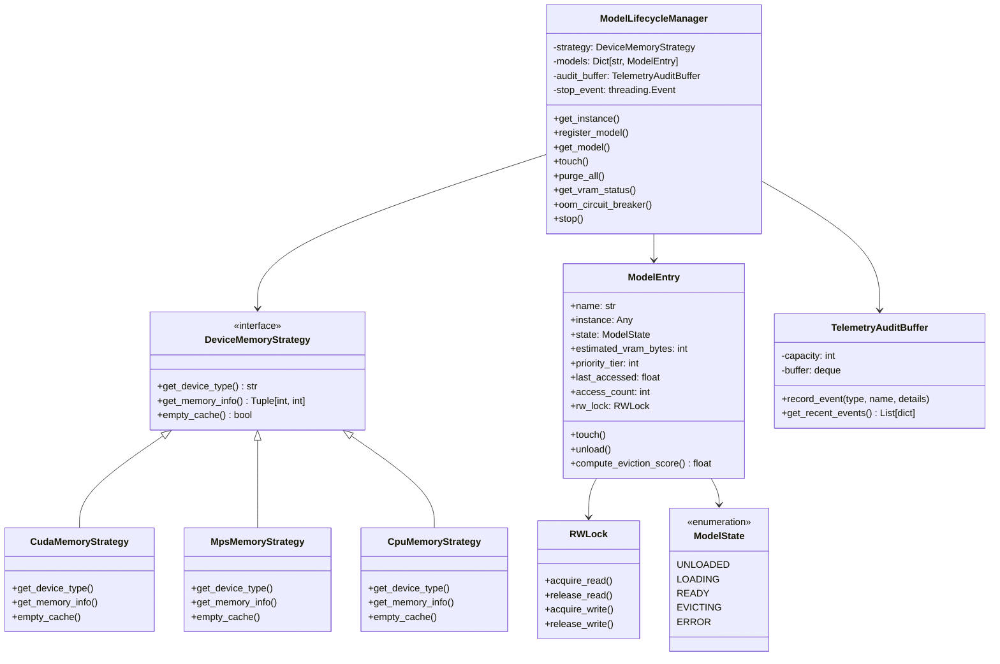

# Refined Implementation Plan - Enterprise Quality & Resilience Upgrade for `ModelLifecycleManager`

## Goal Description
Enhance `apps/ai-supervisor/python-backend` to enterprise-grade quality and fault resilience by refactoring [`model_lifecycle_manager.py`](file:///Users/anle/workspace/acc/apps/ai-supervisor/python-backend/src/services/model_lifecycle_manager.py), adhering to `enterprise-hf-inference` and `enterprise-clean-coder` standards.

This design incorporates all decisions aligned during the `/grill-me` architectural review and tracks the effort under macro-epic [Backlog 040: Enterprise Model Lifecycle, Hardware Memory Strategies & OOM Telemetry Audit Plane](file:///Users/anle/workspace/acc/docs/backlogs/040_model_lifecycle_hardware_strategies_and_oom_telemetry.md).

---

## Architectural Decisions Confirmed in Grill-Me

| Decision Topic | Selected Architectural Choice | Rationale & Mechanism |
| :--- | :--- | :--- |
| **OOM Circuit Breaker Behavior** | **Dual Response Pattern** | Always returns fallback output (deterministic audio cadence / structured extractor) to guarantee zero crash for the caller, while recording an internal audit event and logging an urgent alert. |
| **Proactive Eviction Policy** | **Composite Multi-Criteria Scoring** | Calculates eviction priority as: `Score = w_age * AgeNorm + w_size * SizeNorm - w_tier * TierPriority`. Combines LRU, VRAM footprint, and model retention tiers. |
| **Concurrency Synchronization** | **Per-Model Reader-Writer Lock (`RWLock`)** | Multi-threaded read access during inference (`acquire_read()`) while requiring an exclusive write lock (`acquire_write()`) during model unloads/evictions. |
| **Audit & Telemetry Persistence** | **In-Memory Ring Buffer + Dedicated Backlog 040** | Maintains a thread-safe ring buffer of the last 100 lifecycle events (OOMs, purges, evictions), exposed via `AdminService.GetVRAMStatus`. |

---

## Architecture & Class Design



---

## Proposed Changes

### apps/ai-supervisor/python-backend

#### [NEW] `src/services/device_memory_strategy.py`
- Protocol `DeviceMemoryStrategy` defining `get_device_type()`, `get_memory_info()`, `empty_cache()`.
- Concrete implementations:
  - `CudaMemoryStrategy`: Handles `torch.cuda` memory info, `empty_cache()`, `ipc_collect()`.
  - `MpsMemoryStrategy`: Handles Apple Silicon `torch.mps` memory allocations and cache clearing.
  - `CpuMemoryStrategy`: Platform-independent system memory fallback.
- Dynamic factory `get_device_memory_strategy()`.

#### [NEW] `src/services/concurrency_utils.py`
- `RWLock`: Re-entrant reader-writer lock with read preference and timeout support for Python threading.
- `TelemetryAuditBuffer`: Thread-safe fixed-capacity ring buffer (default 100 entries) capturing lifecycle events.

#### [MODIFY] [`src/services/model_lifecycle_manager.py`](file:///Users/anle/workspace/acc/apps/ai-supervisor/python-backend/src/services/model_lifecycle_manager.py)
- Refactor `ModelEntry` with explicit `ModelState`, `priority_tier` (1=high, 2=medium, 3=low), and per-model `RWLock`.
- Compound eviction heuristic calculating composite scores (LRU age, footprint, priority tier).
- `oom_circuit_breaker(model_name: str)` context manager with cache purging, victim deallocation, and dual response logging.
- Background eviction thread governed by `threading.Event` (clean shutdown without thread leakage).
- Backward-compatible public API: `register_model`, `touch`, `get_model`, `purge_all`, `get_vram_status`, `stop`.

#### [MODIFY] [`src/services/llm_engine.py`](file:///Users/anle/workspace/acc/apps/ai-supervisor/python-backend/src/services/llm_engine.py)
- Register `llm_engine` with `ModelLifecycleManager` under priority tier 2 (medium).
- Wrap generation in `oom_circuit_breaker`: when OOM triggers, log audit event and seamlessly fall back to deterministic structured extractor.

#### [MODIFY] [`src/services/tts_engine.py`](file:///Users/anle/workspace/acc/apps/ai-supervisor/python-backend/src/services/tts_engine.py)
- Wrap synthesis with `oom_circuit_breaker`: when OOM triggers, log audit event and seamlessly fall back to cadence tone synthesizer.

#### [MODIFY] [`src/server.py`](file:///Users/anle/workspace/acc/apps/ai-supervisor/python-backend/src/server.py)
- In `graceful_shutdown()`, call `ModelLifecycleManager.get_instance().stop()` to cleanly terminate eviction worker before process exit.

#### [NEW] `tests/test_model_lifecycle_manager.py`
- Pytest test suite covering:
  - Multi-device strategy initialization (CUDA / MPS / CPU fallback).
  - Reader-Writer Lock concurrency (concurrent reads, exclusive eviction write).
  - Explicit `ModelState` transitions and eviction scoring.
  - Multi-criteria eviction ordering (LRU age + size + tier).
  - OOM Circuit Breaker recovery and audit trail emission.
  - Backward compatibility with `admin_pb2` gRPC structures.

---

## Verification Plan

### Automated Tests
Run pytest in the python virtual environment:
```bash
apps/ai-supervisor/python-backend/.venv/bin/pytest -v apps/ai-supervisor/python-backend/tests/test_model_lifecycle_manager.py
```

### Static & Runtime Sanity
Verify imports and backend startup:
```bash
apps/ai-supervisor/python-backend/.venv/bin/python -c "import server; from services.model_lifecycle_manager import ModelLifecycleManager; print(ModelLifecycleManager.get_instance().get_vram_status())"
```
