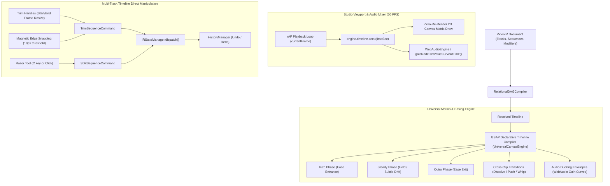

# Implementation Plan 08: Phase 6 - Universal Motion & Easing Engine & Timeline Direct Manipulation

## Goal Description
Build an enterprise-grade **Universal Motion & Easing Engine** combined with **Multi-Track Timeline Direct Manipulation** for the Studio NLE. 

In production quality, motion and easing curves are not an isolated static setting—they are a **universal temporal modulation primitive** that governs:
1. **Spatial Transform & Object Motion (Intra-Clip)**: Hybrid 3-stage lifecycle (`Intro` entrance animation, `Steady` hold/drift, `Outro` exit transition) with GSAP Bézier easing curves (`power2.out`, `back.out`, `elastic.out`, `bounce.out`, `expo.out`, `linear`), backed by underlying keyframe evaluation.
2. **Cross-Clip Sequence Transitions**: Transitions between adjacent video clips (crossfades, slide pushes, whip zooms, dips) shaped by easing curves.
3. **Audio Dynamics & Voiceover Ducking**: Temporal gain modulation curves where background music/SFX ducks smoothly during dialog or impacts with customizable attack/release easing (`power2.out` attack, `power2.inOut` release) avoiding audio pumping or clipping.
4. **Timeline Direct Manipulation**: Direct interactive clip trimming (left/right handles with magnetic playhead/clip snapping), Razor split tool (`C` hotkey), ripple/roll awareness, and live Undo/Redo depth badges.

---

## User Review Required

> [!IMPORTANT]
> **Polymorphic Value & Temporal Curve Model in VideoIR**:
> Any animatable parameter in VideoIR (such as `transform.scale`, `transform.x`, `audio/ducking.factor`, `transition.progress`) can be specified either as a static scalar/vector or as a `TemporalCurve<T>`:
> ```typescript
> export interface TemporalCurve<T = number> {
>   intro?: { durationSec: number; from: T; to?: T; ease: string };
>   steady?: { type: 'hold' | 'drift' | 'pulse'; intensity?: number };
>   outro?: { durationSec: number; to: T; ease: string };
>   keyframes?: Array<{ timeSec: number; value: T; ease?: string }>;
> }
> ```
> This is backward-compatible with static values while unlocking deep automation across canvas, audio, and video renderers.

> [!TIP]
> **Zero-Re-Render Direct Canvas Sampling**:
> During live 60fps playback, `UniversalCanvasEngine` scrubs its paused GSAP timeline at `timeSec = currentFrame / fps` directly inside the `requestAnimationFrame` loop. Canvas elements, matrix transformations, and overlay outlines sample these interpolated values without incurring React re-render overhead.

---

## Architectural Workflow



---

## Proposed Changes

### 1. VideoIR & Schema Layer (`packages/ir/`)

#### [MODIFY] [`packages/ir/src/types/VideoIR.ts`](file:///c:/Users/Admin/workspace/git/acc/packages/ir/src/types/VideoIR.ts)
- Add `TemporalCurve<T>` interface:
  ```typescript
  export interface TemporalCurve<T = number> {
    intro?: { durationSec: number; from: T; to?: T; ease: string };
    steady?: { type: 'hold' | 'drift' | 'pulse'; intensity?: number };
    outro?: { durationSec: number; to: T; ease: string };
    keyframes?: Array<{ timeSec: number; value: T; ease?: string }>;
  }
  ```
- Support `TemporalCurve` on `TransformModifierParams`, `DynamicDuckingModifierParams`, and `TransitionModifierParams`.

#### [MODIFY] [`schema/video-ir.schema.json`](file:///c:/Users/Admin/workspace/git/acc/schema/video-ir.schema.json)
- Add schema definitions for `temporalCurve` object allowing numeric/vector properties to be static or polymorphic curve objects.

---

### 2. Effect Engines & Canvas Compiler (`packages/effect-engines/`)

#### [MODIFY] [`packages/effect-engines/src/canvas/UniversalCanvasEngine.ts`](file:///c:/Users/Admin/workspace/git/acc/packages/effect-engines/src/canvas/UniversalCanvasEngine.ts)
- Upgrade `syncTimeline(sequences, fps)`:
  - Parse 3-stage lifecycle (`intro`, `steady`, `outro`) for spatial transforms (`x`, `y`, `scale`, `rotation`, `opacity`).
  - Generate GSAP tweens with the designated easing curves (`power2.out`, `bounce.out`, `elastic.out`, `back.out`, `expo.out`, `power2.inOut`, `linear`).
  - Provide `getActiveInterpolatedTransform(seqId, timeSec)` returning the instantaneous evaluated `{ x, y, scale, rotation, opacity }` for any active sequence at the current playhead.
  - Implement cross-clip sequence transition tweens (fading out outgoing clip while animating incoming clip with easing).

#### [MODIFY] [`packages/effect-engines/src/audio/UniversalAudioMixer.ts`](file:///c:/Users/Admin/workspace/git/acc/packages/effect-engines/src/audio/UniversalAudioMixer.ts)
- Upgrade ducking calculation to generate smoothed GSAP attack/release gain curves and apply them to `GainNode.gain.setValueCurveAtTime` in `WebAudioEngine`.

---

### 3. Studio Timeline & Direct Manipulation Commands (`apps/studio/`)

#### [MODIFY] [`apps/studio/src/lib/commands/TrimSequenceCommand.ts`](file:///c:/Users/Admin/workspace/git/acc/apps/studio/src/lib/commands/TrimSequenceCommand.ts)
- Support non-destructive trimming of sequences (adjusting `time.start`, `time.duration`, and internal media offsets) with 100% undo/redo recovery.

#### [MODIFY] [`apps/studio/src/lib/commands/SplitSequenceCommand.ts`](file:///c:/Users/Admin/workspace/git/acc/apps/studio/src/lib/commands/SplitSequenceCommand.ts)
- Support Razor cut at frame `f`, splitting sequence into two contiguous sequences on the same track with cloned modifiers and adjusted start/duration.

#### [MODIFY] [`apps/studio/src/components/Timeline.tsx`](file:///c:/Users/Admin/workspace/git/acc/apps/studio/src/components/Timeline.tsx)
- Add interactive left and right trim handles on timeline clip items with hover state (`cursor-col-resize`).
- Implement magnetic snapping to nearby clip boundaries and playhead (within a 12px / 3-frame threshold).
- Add Razor Tool mode toggle (with hotkey `C` and pointer indicator) allowing one-click sequence splitting.

---

### 4. Studio Right Sidebar Motion Inspector & Preview Viewport (`apps/studio/`)

#### [MODIFY] [`apps/studio/src/components/RightSidebar.tsx`](file:///c:/Users/Admin/workspace/git/acc/apps/studio/src/components/RightSidebar.tsx)
- Expand the Motion & Transform panel:
  - **Motion Preset Quick Pickers**: Pop In (`elastic.out`), Smooth Slide (`power2.out`), Overshoot Snap (`back.out`), Bounce Drop (`bounce.out`), Drift Zoom (`power2.inOut`).
  - **3-Stage Lifecycle Tabs**: `Intro` (Duration slider, direction, easing curve), `Steady` (Hold vs subtle drift), `Outro` (Duration slider, exit direction, easing curve).
  - Integrated `EasingCurveSelector` showing the live animated SVG curve for the active stage.

#### [MODIFY] [`apps/studio/src/components/Preview.tsx`](file:///c:/Users/Admin/workspace/git/acc/apps/studio/src/components/Preview.tsx)
- Connect live rAF canvas draw loop to `engine.getActiveInterpolatedTransform()`:
  - Elements and bounding box update in real time according to their GSAP motion curves during playback and scrubbing.
  - Contextual Action Pill positions dynamically above the animated selection.

---

## Verification Plan

### Automated Tests
Run dedicated suite for Phase 6:
```bash
bun test autogenerated-tests/studio_phase6_motion_timeline.test.ts
```
Run all Studio tests to verify 0 regressions:
```bash
bun test studio
```
Verify clean Vite production build:
```bash
bun run studio:build
```

### Manual Verification
1. **Motion & Easing Live Audition**:
   - Select a text title or graphic sequence.
   - Choose `elastic.out` or `bounce.out` with a 0.6s Intro.
   - Press `Space` to play: Observe smooth physical bounce/spring entrance at 60fps on canvas.
2. **Audio Ducking Transition**:
   - Scrub playhead into voiceover/SFX section: Confirm background music gain ducks with smooth curve.
3. **Timeline Direct Manipulation**:
   - Drag clip left/right trim handles: Verify clip trims with magnetic edge snapping to neighboring clips.
   - Press `C` (Razor tool) and click on a clip: Confirm clip splits into two distinct segments. Press `Ctrl+Z` to verify 100% undo fidelity.
