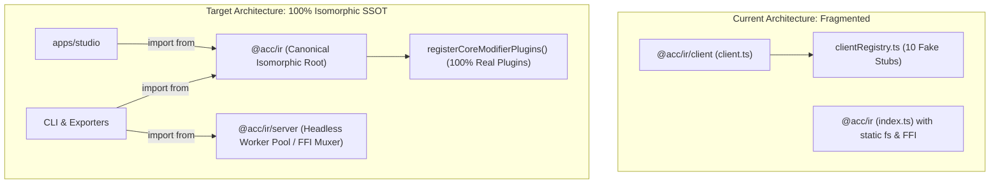

# Implementation Plan 24: Eliminate Client-Specifics & Truly Unify `@acc/ir`

**Document ID:** `apps/studio/doc/implementation_plan_24.md`  
**Paired Walkthrough:** `apps/studio/doc/walkthrough_24.md`  
**Target Goal:** Completely eliminate `@acc/ir/client`, `packages/ir/src/client.ts`, `packages/ir/src/plugins/clientRegistry.ts`, and all fake client stubs, making `@acc/ir` the single, canonical, 100% isomorphic package across browser and server.

---

## 1. Goal Description

Historically, `@acc/ir` was split into two separate entry points:
- `@acc/ir` (`packages/ir/src/index.ts`): Server/headless Node entry point containing native FFI dependencies (`FFIVideoDecoder`, `FFIConcatMuxer`, `IRChunkWorkerPool`) and static Node `fs`/`path` imports.
- `@acc/ir/client` (`packages/ir/src/client.ts`): A cherry-picked client-only subset created to prevent Vite bundling crashes in `apps/studio`.

This split introduced significant architectural debt:
1. **Duplicate Maintenance & Developer Friction:** Any new plugin or type had to be manually wired into both `src/index.ts` and `src/client.ts`.
2. **Sabotaged Preview Quality from Fake Stubs:** `packages/ir/src/plugins/clientRegistry.ts` registered empty dummy stubs (`createClientPluginStub`) for 10 plugins (`vfx/color_grading`, `editorial/split_edit`, `editorial/transition_crossfade`, `transition/crossfade`, `overlay/blend_mode`, `overlay/canvas_particles`, `vfx/depth3d`, `vfx/camera_3d`). Even though real implementations exist and are already canvas-decoupled, the browser runtime executed empty stubs.
3. **Violations of Architecture Rules:** Violates `NO-STUBS-ORPHANED-CODE` and the Single Source of Truth (SSOT) principle.

This plan details the steps to eliminate all client specifics from `packages/ir`, purge leaked `fs` calls, decommission `clientRegistry.ts` and `client.ts`, and migrate all call sites to import directly from `@acc/ir`.

---

## 2. User Review Required

> [!IMPORTANT]
> - **Zero Dummy Stubs:** Every modifier plugin (`ColorGradingPlugin`, `BlendModePlugin`, `CanvasParticleOverlayPlugin`, `Depth3DPlugin`, `Camera3DPlugin`, `TransitionCrossfadePlugin`) will run its **real implementation** in both the browser (Studio Preview) and server (Headless Exporter).
> - **Unified Entry Point (`@acc/ir`):** All `from '@acc/ir/client'` imports across `apps/studio` and `packages/effect-engines` will be migrated to `from '@acc/ir'`. For backward compatibility, `package.json` will temporarily alias `"./client": "./src/index.ts"`.
> - **Server FFI Isolation:** Server-only batch worker orchestrations (`IRChunkWorkerPool`, `FFIChunkConcatMuxer`) will be cleanly isolated under `@acc/ir/server`, ensuring the root `@acc/ir` is 100% browser-safe and causes zero Vite bundle warnings.

---

## 3. Proposed Changes



---

### Step 1: Purge Static `fs` / Node Imports from Plugins & Audio Mixer

#### [MODIFY] `packages/ir/src/plugins/vfx/Depth3DPlugin.ts`
- Remove `import fs from 'fs'`.
- Remove `fs.existsSync(params.imagePath)`. `CanvasAssetLoader` / `UniversalCanvasProvider` already gracefully handles asset resolution for both web URLs/Blobs and server disk paths.

#### [MODIFY] `packages/ir/src/plugins/vfx/Camera3DPlugin.ts`
- Remove `import fs from 'fs'`.
- Remove `fs.existsSync(imgPath)` check in favor of runtime asset loader check.

#### [MODIFY] `packages/ir/src/renderer/audio/UniversalAudioMixer.ts`
- Remove static `import fs from 'fs'` and `import path from 'path'`.
- Isolate `writeWavToDisk()` to use dynamic import `await import('fs')` if running in Node, or export as a standalone helper so browser bundlers never see a static `fs` import.

#### [MODIFY] `packages/ir/src/prober/AssetMetadataProber.ts`
- Remove static `import fs from 'fs'` and `import path from 'path'`.
- Wrap WAV header sniffing in a Node-guarded dynamic loader or isolate it to `NodeAssetMetadataProber.ts`, allowing `AssetMetadataProber` to remain 100% isomorphic.

---

### Step 2: Decommission `clientRegistry.ts` & Unify Plugin Registration

#### [DELETE] `packages/ir/src/plugins/clientRegistry.ts`
- Completely remove the file and all `createClientPluginStub` definitions.

#### [MODIFY] `packages/ir/src/plugins/index.ts`
- Remove exports of `clientRegistry`.
- Verify `registerCoreModifierPlugins()` instantiates all 18 real modifier plugins cleanly.

---

### Step 3: Server FFI Decoupling & Canonical Root Entry

#### [NEW] `packages/ir/src/server.ts`
- Export server-only FFI batch pooling tools:
  - `IRChunkWorkerPool`
  - `FFIChunkConcatMuxer`
  - `FFIVideoEncoderSink`

#### [MODIFY] `packages/ir/src/renderer/IRMasterRenderer.ts`
- Replace direct static import of `FFIVideoDecoder` from `@acc/core` with dynamic loading or interface injection (`IDecoderFactory` / `MediaEngineRegistry`), ensuring `IRMasterRenderer` can be bundled without forcing native C++ `.node` binaries into browser Vite graphs.

#### [MODIFY] `packages/ir/src/index.ts`
- Remove static export of `./workers` (moved to `./server.ts`).
- Export all canonical types, compilers, plugins, audio mixer, preview engine, and canvas compositor.

#### [MODIFY] `packages/ir/package.json`
- Update exports:
  ```json
  "exports": {
    ".": "./src/index.ts",
    "./server": "./src/server.ts",
    "./client": "./src/index.ts"
  }
  ```

---

### Step 4: Migrate All Call Sites in `apps/studio` and `packages/`

#### [MODIFY] `apps/studio/src/main.tsx`
- Replace `registerClientModifierPlugins` with `registerCoreModifierPlugins` from `@acc/ir`.

#### [MODIFY] `apps/studio/src/renderer/preview/IRPreviewEngine.ts`
- Replace default fallback `registerClientModifierPlugins` with `registerCoreModifierPlugins`.

#### [MODIFY] Search & Replace across `apps/studio/` and `packages/effect-engines/`
- Replace all occurrences of `'@acc/ir/client'` with `'@acc/ir'`:
  - `apps/studio/src/App.tsx`
  - `apps/studio/src/components/LeftSidebar.tsx`
  - `apps/studio/src/components/Preview.tsx`
  - `apps/studio/src/components/RightSidebar.tsx`
  - `apps/studio/src/lib/audio/WebAudioEngine.ts`
  - `apps/studio/src/lib/ir/irState.ts`
  - `apps/studio/src/lib/library/sfxBank.ts`
  - `packages/effect-engines/src/audio/ProceduralAudioSynthesizer.ts`
  - `packages/effect-engines/src/audio/UniversalAudioMixer.ts`

---

## 4. Verification Plan

### Automated Tests
1. **Modifier Plugin Registry Real Implementation Test:**
   - Verify every plugin registered by `registerCoreModifierPlugins()` is an instance of its real class and has `renderClipSpace` / `renderMasterComposite` / `processAudio`.
   - Verify zero stubs exist.
2. **Web/Server Parity Test:**
   ```powershell
   bun test autogenerated-tests/ir_renderer_web_server_parity.test.ts
   ```
3. **LeftSidebar & Studio Tests:**
   ```powershell
   bun test autogenerated-tests/studio_phase1_leftsidebar_retained_plugins.test.ts
   bun test autogenerated-tests/studio_enterprise_layout.test.ts
   ```

### Production Build
```powershell
bun run --cwd apps/studio build
```
- Confirm build succeeds in <4s.
- Confirm **ZERO** Vite externalization warnings for `fs` or `path` from `packages/ir`.
