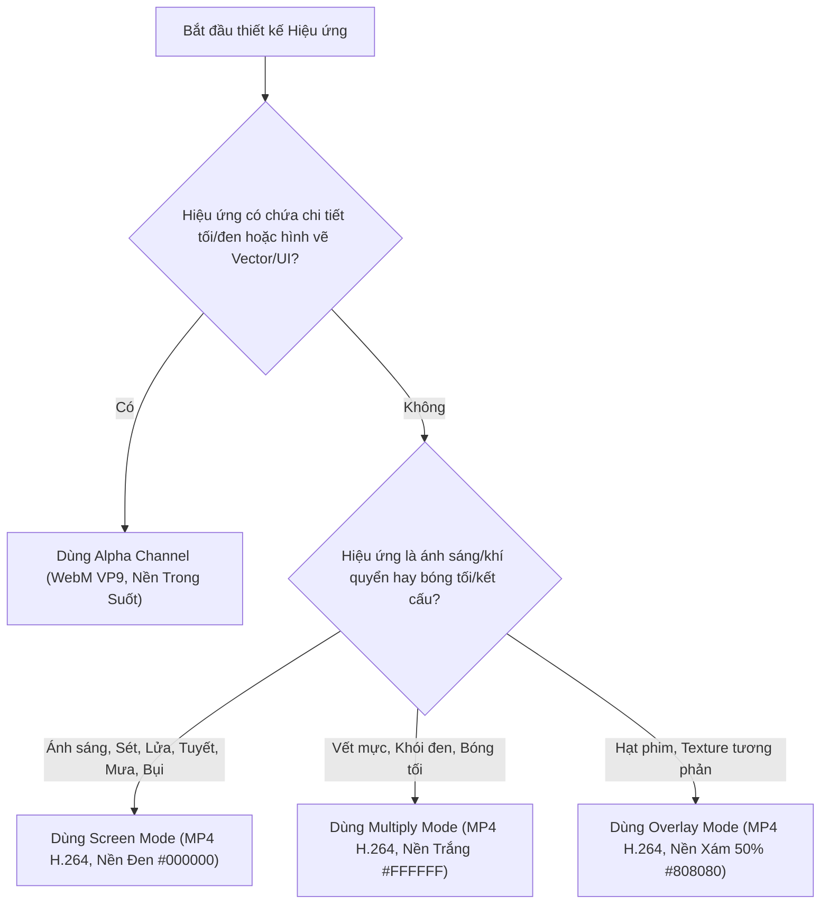

# Hệ thống hóa Toàn diện các Phương pháp Overlay & Hòa trộn (Video Blending Specification)

Tài liệu này định nghĩa chi tiết các phương pháp hòa trộn (Blending Modes), cơ chế toán học, chuẩn màu nền, định dạng xuất khẩu và quy tắc sử dụng trong hệ thống **Storytelling Video Generator** và **Overlay Effects Engine**.

---

## 📊 1. Bảng Ma trận Tổng quan (Blending Methods Matrix)

| Phương pháp (Method) | Kênh màu (Color Space) | Màu nền chuẩn | Container & Codec | FFmpeg Filter Snippet | Ứng dụng tiêu biểu |
| :--- | :--- | :--- | :--- | :--- | :--- |
| **`alpha`** (Alpha Compositing) | RGBA / YUVA | Trong suốt (`Alpha=0`) | `.webm` (`libvpx-vp9`, `yuva420p`) | `overlay=shortest=1` | UI/HUD, Nhân vật, Cánh hoa, Pháo hoa, Composite tổng hợp |
| **`screen`** (Luma Additive) | RGB / YUV | Đen (`#000000`) | `.mp4` (`libx264`, `yuv420p`) | `blend=all_mode=screen:all_opacity=1:shortest=1` | Lửa, Sấm sét, Tia sáng, Bụi, Bokeh, Mưa, Tuyết |
| **`multiply`** (Darkening) | RGB / YUV | Trắng (`#FFFFFF`) | `.mp4` (`libx264`, `yuv420p`) | `blend=all_mode=multiply:all_opacity=1:shortest=1` | Vết mực loang, Khói đen, Vết ố giấy, Bóng râm |
| **`overlay`** (Contrast) | RGB / YUV | Xám 50% (`#808080`) | `.mp4` (`libx264`, `yuv420p`) | `blend=all_mode=overlay:all_opacity=1:shortest=1` | Hạt phim Grain, Xước phim analog, Texture giấy |

---

## 🔬 2. Chi tiết Kỹ thuật & Toán học từng Phương pháp

### 2.1. Alpha Channel Compositing (`alpha`)
Phương pháp chuẩn xác nhất trong đồ họa máy tính (Porter-Duff Compositing).

* **Công thức toán học:**
  $$C_{\text{out}} = C_{\text{fg}} \times \alpha_{\text{fg}} + C_{\text{bg}} \times (1 - \alpha_{\text{fg}})$$
* **Màu nền xuất khẩu:** Hoàn toàn trong suốt (`rgba(0, 0, 0, 0)`).
* **Định dạng container:** `.webm` (`vcodec: libvpx-vp9`, `pix_fmt: yuva420p`).
* **Yêu cầu giải mã FFmpeg:** BẮT BUỘC thêm tùy chọn đầu vào `-c:v libvpx-vp9` trước `-i` để tránh trình giải mã mặc định của FFmpeg tự ý xóa kênh Alpha thành `yuv420p`.
* **Ưu điểm:**
  - Giữ nguyên 100% độ trung thực của màu sắc (kể cả màu đen đặc, chữ đen, viền đen).
  - Không gây hiện tượng cháy sáng khi xếp chồng nhiều lớp.
  - Kéo-thả sử dụng được ngay trên mọi phần mềm dựng phim.
* **Nhược điểm:** Tốn tài nguyên giải mã hơn H.264 một chút.

---

### 2.2. Luma Additive / Screen Blending (`screen`)
Phương pháp tối ưu cho ánh sáng phát quang và các hạt tự nhiên.

* **Công thức toán học:**
  $$C_{\text{out}} = 1 - (1 - C_{\text{bg}}) \times (1 - C_{\text{fg}})$$
* **Màu nền xuất khẩu:** Đen đặc (`#000000` / RGB `0, 0, 0`).
* **Định dạng container:** `.mp4` (`vcodec: libx264`, `pix_fmt: yuv420p`).
* **Ưu điểm:**
  - File siêu nhẹ, render cực nhanh, hỗ trợ GPU NVENC 100%.
  - Ánh sáng hòa quyện mềm mại tự nhiên vào video nền.
* **Nhược điểm & Lưu ý:**
  - **Màu đen sẽ bị xóa hoàn toàn:** Bất kỳ chi tiết màu đen nào trong hiệu ứng sẽ trở nên trong suốt khi hòa trộn.
  - Chồng quá nhiều lớp Screen liên tiếp sẽ làm video bị chói lóa (Over-exposure).

---

### 2.3. Multiply Blending (`multiply`)
Phương pháp in chìm các chi tiết tối màu.

* **Công thức toán học:**
  $$C_{\text{out}} = C_{\text{bg}} \times C_{\text{fg}}$$
* **Màu nền xuất khẩu:** Trắng tinh (`#FFFFFF` / RGB `255, 255, 255`).
* **Định dạng container:** `.mp4` (`vcodec: libx264`, `pix_fmt: yuv420p`).
* **Ưu điểm:** Màu trắng ($1$) nhân vào giữ nguyên màu nền, các chi tiết màu tối in hằn lên video gốc.
* **Ứng dụng:** Vết mực rơi, khói đen dày đặc, bóng đen, giả lập trang sách cổ.

---

### 2.4. Overlay & Soft Light Blending (`overlay`)
Phương pháp tăng cường độ tương phản và kết cấu bề mặt.

* **Công thức toán học:**
  $$C_{\text{out}} = \begin{cases} 2 \times C_{\text{bg}} \times C_{\text{fg}} & \text{nếu } C_{\text{bg}} < 0.5 \\ 1 - 2 \times (1 - C_{\text{bg}}) \times (1 - C_{\text{fg}}) & \text{nếu } C_{\text{bg}} \ge 0.5 \end{cases}$$
* **Màu nền xuất khẩu:** Xám trung tính 50% (`#808080` / RGB `128, 128, 128`).
* **Định dạng container:** `.mp4` (`vcodec: libx264`, `pix_fmt: yuv420p`).
* **Ưu điểm:** Vùng xám trung tính biến mất, vùng sáng làm sáng nhẹ, vùng tối làm tối nhẹ. Giúp hạt phim và texture bám dính vào video cực đẹp.

---

## 📑 3. Quy chuẩn Metadata Đồng hành (Companion JSON Specification)

Mỗi khi xuất một video hiệu ứng (ví dụ: `rain_storm_5s.mp4`), hệ thống **bắt buộc tạo file JSON cùng tên** (`rain_storm_5s.json`) theo cấu trúc:

```json
{
  "effect": "rain",
  "variant": "storm",
  "pipeline": "mp4_luma",
  "overlay_method": "screen",
  "background": {
    "type": "solid",
    "color": "#000000"
  },
  "recommended_blend_mode": "screen",
  "ffmpeg_input_options": [],
  "ffmpeg_filter_snippet": "blend=all_mode=screen:all_opacity=1:shortest=1",
  "resolution": {
    "width": 1920,
    "height": 1080
  },
  "fps": 30,
  "duration": 5,
  "format": "mp4",
  "video_file": "rain_storm_5s.mp4"
}
```

Đối với file Alpha WebM:
```json
{
  "effect": "leaves",
  "variant": "sakura_petals",
  "pipeline": "webm_alpha",
  "overlay_method": "alpha",
  "background": {
    "type": "transparent",
    "color": "rgba(0, 0, 0, 0)"
  },
  "recommended_blend_mode": "normal",
  "ffmpeg_input_options": [
    "-c:v",
    "libvpx-vp9"
  ],
  "ffmpeg_filter_snippet": "overlay=shortest=1",
  "resolution": {
    "width": 1920,
    "height": 1080
  },
  "fps": 30,
  "duration": 3,
  "format": "webm",
  "video_file": "leaves_sakura_petals_3s.webm"
}
```

---

## 🎯 4. Cây Quyết định Chọn Phương pháp (Decision Tree)


