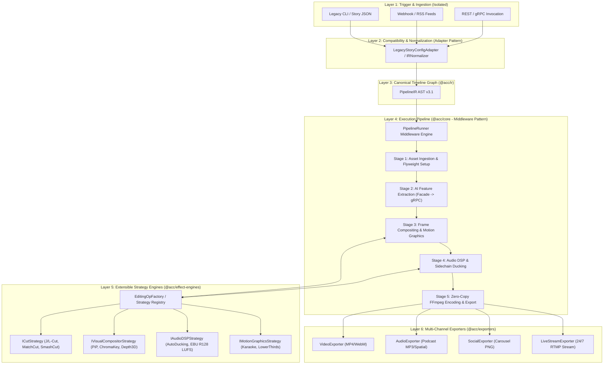
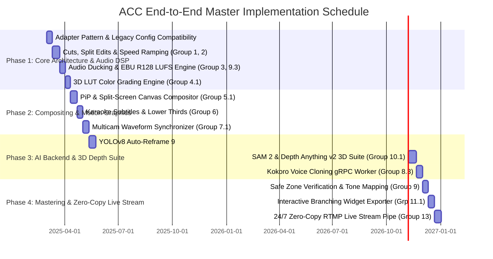

# Systematic Video Editing Engine: End-to-End Architecture & Implementation Master Plan

> **Document Status**: Architectural Master Specification & Implementation Blueprint
> **Target System**: ACC (Automated Content Creator) Monorepo
> **Reference Context**: `docs/video-editing-core.en.md`

---

## 1. Executive Summary & Vision

Modern video production relies on a taxonomy of 13 foundational technical groups ranging from simple hard cuts to complex spatial computing and real-time virtual production. The primary goal of the **ACC (Automated Content Creator)** system is to codify these human editing techniques into a **programmatic, deterministic, high-performance, and maintainable video editing engine**.

To achieve industrial maintainability and zero regressions, this master plan designs the video editing system using **proven software design patterns** (Strategy, Factory, Facade, Decorator, Adapter, Command, Pipeline/Middleware, Flyweight). It establishes **isolated execution flows** and **shim adapters** to ensure 100% backward compatibility with legacy story configurations (`story-config.json`) and CLI commands.

---

## 2. High-Level Architectural Topology & Design Patterns



---

## 3. Core Software Design Patterns for Maintainability & Isolation

To make the codebase extensible and prevent technical debt, every core component adheres strictly to an established design pattern:

### 3.1. Adapter Pattern (`LegacyStoryConfigAdapter`)
*   **Purpose**: Translates legacy `story-config.json` files and simple scene configurations into canonical `PipelineIR` AST v3.1 nodes without modifying the core renderer.
*   **Backward Compatibility Guarantee**: Ensures legacy projects run seamlessly with zero breaking changes.
*   **Code Interface**:
    ```typescript
    export class LegacyStoryConfigAdapter implements IIRAdapter {
      public adapt(legacyConfig: StoryConfig): ExtendedPipelineIR {
        // Normalizes scene arrays, caption presets, and depth3d modes into PipelineIR
      }
    }
    ```

### 3.2. Facade Pattern (`EditingEngineFacade` & `IPCFacade`)
*   **Purpose**: Hides low-level complexity (`bun:ffi` dynamic C-pointers, memory allocations, gRPC binary protocols) behind a clean, unified API.
*   **Isolation Benefit**: Higher-level orchestrators call `facade.renderTimeline(ir)` without worrying about C-FFmpeg pointer management or Python daemon process lifecycle.

### 3.3. Strategy Pattern (`ICutStrategy`, `ITransitionStrategy`, `ICompositorStrategy`, `IAudioDSPStrategy`)
*   **Purpose**: Encapsulates specific editing algorithms into hot-swappable strategy classes.
*   **Maintainability Benefit**: Adding a new transition (e.g., `GlitchDissolveTransition`) or a new compositing mode (e.g., `GlassmorphicPiPCompositor`) requires creating a single isolated file implementing the strategy interface, leaving existing strategies untouched.

### 3.4. Factory Pattern (`EditingOpFactory` & `ExporterFactory`)
*   **Purpose**: Centralizes the instantiation of concrete strategies based on IR metadata or user configuration.
*   **Isolation Benefit**: Prevents `switch-case` pollution in rendering loops.

### 3.5. Pipeline & Middleware Pattern (`PipelineRunner` & `EditingStageMiddleware`)
*   **Purpose**: Executes rendering stages as a sequence of isolated middlewares with defensive fault isolation.
*   **Regression-Free Guarantee**: If a non-critical middleware fails (e.g., auto-generating supplementary AI B-roll), the middleware catches the fault, logs telemetry, applies a graceful fallback (e.g., static stock placeholder), and allows the main rendering pipeline to complete successfully.

### 3.6. Decorator Pattern (`EffectDecorator` & `SeamlessLoopDecorator`)
*   **Purpose**: Dynamically wraps visual frame producers or audio buffers to add post-processing effects (e.g., VHS overlay, motion blur, audio fade) without modifying the underlying asset renderer.

### 3.7. Command Pattern (`VFXCommand` & `RenderTimelineCommand`)
*   **Purpose**: Encapsulates atomic editing actions (e.g., `ApplyColorGradingCommand`, `BurnSubtitleCommand`) into transactional units that validate parameters, estimate memory cost, and execute deterministically.

### 3.8. Flyweight Pattern (`AssetContext` & `ModelHandleRegistry`)
*   **Purpose**: Shares heavy immutable memory resources (font bitmaps, background music buffers, loaded AI neural models) across parallel scene workers.

---

## 4. End-to-End Mapping of the 13 Video Editing Groups

### PART I: CORE EDITING TECHNIQUES

#### ✂️ Group 1: Cuts & Transitions
Focuses on temporal continuity and shot-to-shot rhythm.

*   **1.1 Standard Cut & Jump Cut**:
    *   *Design Pattern*: **Strategy Pattern** (`StandardCutStrategy`, `JumpCutStrategy`).
    *   *Implementation*: Slices time boundaries using `FFIConcatMuxer` or stream timestamp modification (`pts`).
    *   *IR Contract*: `ContentChunk.visualAsset.trim = { startMs, endMs }`.
    *   *Module*: `packages/core/src/ffmpeg-ffi/FFIConcatMuxer.ts`.
*   **1.2 Match Cut**:
    *   *Design Pattern*: **Strategy Pattern** + **Facade Pattern** (`MatchCutStrategy` invoking `VisionServiceFacade`).
    *   *Implementation*: Compares CLIP/DINOv2 embeddings between adjacent shot frames in Python backend to align visual vectors.
    *   *IR Contract*: `SceneTransition.matchCut = { autoAlign: true, similarityThreshold: 0.85 }`.
    *   *Module*: `apps/python-backend/src/services/vision_service.py` & `@acc/effect-engines/transitions`.
*   **1.3 J-Cut & L-Cut (Split Edits)**:
    *   *Design Pattern*: **Decorator Pattern** (`SplitEditAudioDecorator`).
    *   *Implementation*: Offsets audio start/end boundaries ($\Delta t_a \neq \Delta t_v$) during multi-track timeline assembly.
    *   *IR Contract*: `ContentChunk.audioOffsetMs` and `ContentChunk.videoOffsetMs`.
    *   *Module*: `packages/ir/src/AudioComposition.ts` & `FFIAudioMuxer`.
*   **1.4 Cross-Cutting / Cutaway**:
    *   *Design Pattern*: **Command Pattern** (`CutawayOverlayCommand`).
    *   *Implementation*: Intercuts B-roll footage on Layer 1 over continuous A-roll dialogue on Layer 0.
    *   *IR Contract*: `VisualAsset.brollOverlays: Array<{ source: string, startMs: number, durationMs: number }>`.
    *   *Module*: `@acc/effect-engines/overlay-effects` & `@acc/exporters/video`.

---

#### ⏱️ Group 2: Pacing & Timing
Manipulates duration, velocity, and dramatic tension.

*   **2.1 Montage**:
    *   *Design Pattern*: **Pipeline Pattern** (`MontagePipelineStage`).
    *   *Implementation*: Analyzes background music spectrum for transient beat spikes and cuts clips on beat timestamps $T_{beat}$.
    *   *IR Contract*: `TimelineAST.montage = { beatSync: true, maxClipDurationMs: 800 }`.
    *   *Module*: `@acc/effect-engines/sound-effects/BeatDetector.ts`.
*   **2.2 Speed Ramping & Freeze Frame**:
    *   *Design Pattern*: **Strategy Pattern** (`SpeedRampStrategy`).
    *   *Implementation*: Interpolates frame presentation timestamps using cubic Bezier curves or optical flow (`minterpolate` filter in `bun:ffi`).
    *   *IR Contract*: `VisualAsset.speedRamp = { keyframes: [{ timeMs, speed }] }`.
    *   *Module*: `@acc/core/ffmpeg-ffi/FFIVideoEncoder.ts`.
*   **2.3 Smash Cut**:
    *   *Design Pattern*: **Strategy Pattern** (`SmashCutStrategy`).
    *   *Implementation*: Hard clip transition combined with instantaneous audio gain delta ($\Delta \text{LUFS} > 12\text{dB}$) and high contrast visual state shift.
    *   *IR Contract*: `SceneTransition.type = 'smash_cut'`.
    *   *Module*: `@acc/effect-engines/src/transitions/SmashCut.ts`.

---

#### 🎵 Group 3: Audio Editing
Pristine speech separation, dynamic mixing, and sound design.

*   **3.1 Audio Ducking**:
    *   *Design Pattern*: **Decorator Pattern** (`AudioDuckingDecorator`) / **Strategy Pattern** (`SidechainDuckingDSP`).
    *   *Implementation*: `FFIAudioDSP` applies sidechain compression lowering music volume when voiceover energy exceeds threshold.
    *   *IR Contract*: `AudioComposition.ducking = { enabled: true, attenuationDb: -18, attackMs: 20, releaseMs: 250 }`.
    *   *Module*: `packages/core/src/ffmpeg-ffi/FFIAudioDSP.ts`.
*   **3.2 Foley & Sound Design**:
    *   *Design Pattern*: **Factory Pattern** (`SoundEffectFactory`).
    *   *Implementation*: Samples and overlays diegetic/non-diegetic SFX from local registry or AI synthesizer at exact timeline markers.
    *   *IR Contract*: `AudioComposition.sfxMarkers: Array<{ id, offsetMs, audioPath, volume }>`.
    *   *Module*: `packages/effect-engines/src/sound-effects/SoundEffectsRegistry.ts`.

---

#### 🎨 Group 4: Visual & Effects
Color styling, gradient mapping, and keyframed masks.

*   **4.1 Color Correction & Grading (3D LUTs)**:
    *   *Design Pattern*: **Strategy Pattern** (`ColorGradingStrategy`).
    *   *Implementation*: Applies tetrahedral 3D LUT RGB transformations (.cube) in WebGL / Canvas shader or `lut3d` FFmpeg filter.
    *   *IR Contract*: `VisualAsset.colorGrading = { lutPath: string, intensity: number }`.
    *   *Module*: `@acc/effect-engines/styles/ColorGradingEngine.ts`.
*   **4.2 Masking & Keyframing**:
    *   *Design Pattern*: **Command Pattern** (`AnimateMaskCommand`).
    *   *Implementation*: Computes parametric vector masks per frame and interpolates Hermite keyframes for position, scale, opacity, and rotation.
    *   *IR Contract*: `VisualAsset.masks: Array<{ type: 'ellipse' | 'polygon', keyframes }>`.
    *   *Module*: `@napi-rs/canvas` compositor in `@acc/effect-engines`.

---

### PART II: ADVANCED POST-PRODUCTION & WORKFLOW

#### 🖼️ Group 5: Compositing & Spatial Layout
Multi-layer viewport arrangements and greenscreen keyed layouts.

*   **5.1 Picture-in-Picture (PiP) & Split Screen**:
    *   *Design Pattern*: **Strategy Pattern** (`PiPCompositorStrategy`, `SplitScreenStrategy`).
    *   *Implementation*: Multi-viewport `@napi-rs/canvas` draw pass with aspect ratio clipping and rounded glassmorphic borders.
    *   *IR Contract*: `TimelineAST.layout = { mode: 'pip' | 'split_screen', viewports: [...] }`.
    *   *Module*: `@acc/effect-engines/src/compositing/SpatialLayoutEngine.ts`.
*   **5.2 Chroma Key / Green Screen**:
    *   *Design Pattern*: **Strategy Pattern** (`ChromaKeyCompositorStrategy`).
    *   *Implementation*: YUV color distance evaluation with spill suppression algorithm (`despill` filter in FFmpeg).
    *   *IR Contract*: `VisualLayer.chromaKey = { colorHex: '#00FF00', similarity: 0.15, blend: 0.05 }`.
    *   *Module*: `packages/core/src/ffmpeg-ffi/avfilter_graph.ts`.
*   **5.3 Screen Replacement & Double Exposure**:
    *   *Design Pattern*: **Command Pattern** (`HomographyTransformCommand`).
    *   *Implementation*: Perspective planar transform ($3\times3$ homography matrix) corner-pinning media onto device screens with blend modes (`Screen`, `Multiply`).
    *   *IR Contract*: `VisualLayer.blendMode = 'screen'` & `VisualLayer.perspectiveTransform`.
    *   *Module*: `@napi-rs/canvas` & Python AI backend OpenCV worker.

---

#### 🔠 Group 6: Typography & Motion Graphics
Information overlays, subtitles, and expressive typography.

*   **6.1 Lower Thirds**:
    *   *Design Pattern*: **Factory Pattern** (`LowerThirdFactory`).
    *   *Implementation*: Renders glassmorphic SVG/Canvas badges with entry animations and speaker metadata.
    *   *IR Contract*: `ContentChunk.lowerThird = { name: string, title: string, style: 'cinematic' }`.
    *   *Module*: `@acc/effect-engines/src/styles/LowerThirdRenderer.ts`.
*   **6.2 Dynamic Captions & Karaoke Highlighting**:
    *   *Design Pattern*: **Strategy Pattern** (`KaraokeSubtitleStrategy`).
    *   *Implementation*: Matches word-level Whisper AI tokens to highlight active spoken words with cyan/gold scale effects.
    *   *IR Contract*: `CaptionSettings = { preset: 'tiktok', activeWordHighlight: true, wordsPerPhrase: 4 }`.
    *   *Module*: `@acc/effect-engines/src/subtitles/SubtitleGenerator.ts`.
*   **6.3 Kinetic Typography & Tracking Call-outs**:
    *   *Design Pattern*: **Decorator Pattern** (`PhysicsSpringDecorator`).
    *   *Implementation*: Solves spring physics ($F = -kx - cv$) for bouncy text motion, anchored to moving target coordinates from AI tracker.
    *   *IR Contract*: `VisualLayer.callouts: Array<{ targetTrackId: string, label: string }>`.
    *   *Module*: `@acc/effect-engines/src/overlay-effects/KineticTypography.ts`.

---

#### ⚙️ Group 7: Workflow & Multicam
Multi-camera synchronization and proxy editing workflows.

*   **7.1 Multicam Editing**:
    *   *Design Pattern*: **Facade Pattern** (`MulticamFacade`).
    *   *Implementation*: Calculates waveform cross-correlation across audio tracks to align camera angles and auto-switch cuts.
    *   *IR Contract*: `MulticamTrack = { cameraAngles: [...], cuts: [...] }`.
    *   *Module*: `packages/core/src/multicam/MulticamSynchronizer.ts`.
*   **7.2 Proxy Editing & Text-Based Editing**:
    *   *Design Pattern*: **Flyweight Pattern** (`AssetContext` Proxy Switcher).
    *   *Implementation*: Edits with low-res proxies during preview and automatically swaps back to 4K originals on export; maps transcript text deletion directly to clip cuts.
    *   *IR Contract*: `AssetContext.useProxies = true` & `TranscriptAST.editCut(wordRange)`.
    *   *Module*: `packages/core/src/AssetContext.ts` & `@acc/ir`.

---

#### 🤖 Group 8: AI-Powered & Generative Editing
Automated reframing, AI B-roll generation, and voice cloning.

*   **8.1 Auto-Reframe (16:9 to 9:16)**:
    *   *Design Pattern*: **Strategy Pattern** (`YOLOAutoReframeStrategy`).
    *   *Implementation*: Tracks focal subject bounding boxes with Kalman Filter smoothing to produce dynamic 9:16 crop matrices.
    *   *IR Contract*: `VisualAsset.autoReframe = { targetAspectRatio: '9:16', subjectClass: 'person' }`.
    *   *Module*: `apps/python-backend/src/services/vision_service.py` & `VideoExporter`.
*   **8.2 Generative Fill & AI B-roll**:
    *   *Design Pattern*: **Facade Pattern** (`GenerativeAIFacade`).
    *   *Implementation*: Triggers Stable Diffusion / AnimateDiff inference in Python backend to fill background gaps or generate supplementary B-roll.
    *   *IR Contract*: `VisualAsset.generativeFill = { prompt: string }`.
    *   *Module*: `apps/python-backend/src/services/generative_service.py`.
*   **8.3 Voice Isolation, Voice Cloning & Dubbing**:
    *   *Design Pattern*: **Strategy Pattern** (`KokoroVoiceCloningStrategy`).
    *   *Implementation*: Performs speech isolation and F5-TTS / Kokoro zero-shot voice cloning via gRPC streaming.
    *   *IR Contract*: `AudioComposition.narrationTrack = { voiceCloneId: string, targetLanguage: 'vi' }`.
    *   *Module*: `apps/python-backend/src/services/tts_service.py`.

---

#### 📤 Group 9: Mastering & Delivery
Technical compliance, color space management, and platform encoding.

*   **9.1 Safe Zones Management**:
    *   *Design Pattern*: **Strategy Pattern** (`PlatformSafeZoneStrategy`).
    *   *Implementation*: Verifies bounding box safety margins to prevent TikTok/Reels UI overlay occlusion.
    *   *IR Contract*: `StorySettings.platform = 'tiktok'` $\to$ resolves safe margins `marginV: 120, marginH: 60`.
    *   *Module*: `@acc/effect-engines/src/subtitles/SafeZoneManager.ts`.
*   **9.2 Color Space & HDR Workflow**:
    *   *Design Pattern*: **Strategy Pattern** (`ToneMappingStrategy`).
    *   *Implementation*: Executes BT.2020 to BT.709 Hable/Mobius tone mapping via FFmpeg `zscale` / `tonemap` filter graph in `bun:ffi`.
    *   *IR Contract*: `StorySettings.colorSpace = 'rec709' | 'hdr10'`.
    *   *Module*: `packages/core/src/ffmpeg-ffi/FFIVideoEncoder.ts`.
*   **9.3 Encoding & Loudness Normalization**:
    *   *Design Pattern*: **Pipeline Pattern** (`ExportMasteringStage`).
    *   *Implementation*: Two-pass EBU R128 loudness measurement (-14 LUFS) and H.264/H.265 export with `+faststart` moov placement.
    *   *IR Contract*: `StorySettings.targetLoudnessLufs = -14` & `StorySettings.fastStart = true`.
    *   *Module*: `packages/exporters/src/video/VideoExporter.ts`.

---

### PART III: VFX & FUTURE TECHNOLOGIES

#### 🐉 Group 10: VFX & CGI Integration
Subject extraction, 3D metric depth, and spatial pop-out.

*   **10.1 Rotoscoping & 3D Depth Pop-Out**:
    *   *Design Pattern*: **Strategy Pattern** (`Parallax20Strategy`, `FrameBreaker20Strategy`, `VolumetricSandwichStrategy`).
    *   *Implementation*: Combines SAM 2 foreground cutout masks with Depth Anything v2 metric depth maps to create 3D frame-breaking depth effects.
    *   *IR Contract*: `VisualAsset.depth3d = { mode: 'frame_breaker', frameStyle: 'card', autoSegment: true, autoDepth: true }`.
    *   *Module*: `packages/effect-engines/src/depth3d` & `apps/python-backend`.
*   **10.2 3D Camera Tracking & Clean Plate**:
    *   *Design Pattern*: **Facade Pattern** (`MatchmoveVisionFacade`).
    *   *Implementation*: Structure-from-Motion (SfM) feature point tracking and LaMa pixel inpainting for clean plate wire removal.
    *   *IR Contract*: `VisualAsset.cleanPlate = { inpaintMaskPath: string }`.
    *   *Module*: `apps/python-backend/src/services/vision_service.py`.

---

#### 🗄️ Group 11: Interactive Media & DAM
Branching video graphs and enterprise asset preservation.

*   **11.1 Interactive / Branching Video**:
    *   *Design Pattern*: **State Pattern** / **Exporter Pattern** (`InteractiveStateExporter`).
    *   *Implementation*: Generates branching state machine AST exported as standalone HTML5 Web Components.
    *   *IR Contract*: `TimelineAST.interactiveNodes: Array<{ timestampMs, options: [{ label, targetChunkId }] }>`.
    *   *Module*: `@acc/exporters/src/interactive-web/WidgetExporter.ts`.
*   **11.2 Metadata Tagging & LTO Archiving**:
    *   *Design Pattern*: **Command Pattern** (`EmbedMetadataCommand`).
    *   *Implementation*: Embeds atom tags into MP4/MOV metadata containers and archives project payloads with SHA-256 verification.
    *   *IR Contract*: `PipelineIR.metadata = { tags: string[], author: string, checksum: string }`.
    *   *Module*: `@acc/exporters/src/base/BaseExporter.ts`.

---

#### 🥽 Group 12: Immersive & Spatial Media
VR 360-degree video and stereoscopic 3D depth formatting.

*   **12.1 360 Video Stitching & Spatial Audio (Ambisonics)**:
    *   *Design Pattern*: **Strategy Pattern** (`EquirectangularStitchStrategy`).
    *   *Implementation*: Equirectangular remap (`v360` filter) and Higher-Order Ambisonics (HOA) 3D binaural spatial audio encoding.
    *   *IR Contract*: `StorySettings.projection = 'equirectangular_360'` & `AudioComposition.spatialAudio = 'ambisonic_bformat'`.
    *   *Module*: `packages/core/src/ffmpeg-ffi` & `@acc/effect-engines`.
*   **12.2 Spatial Video Formatting**:
    *   *Design Pattern*: **Exporter Pattern** (`SpatialVideoExporter`).
    *   *Implementation*: Side-by-side or MV-HEVC stereoscopic 3D encoding for Apple Vision Pro and Meta Quest.
    *   *IR Contract*: `StorySettings.container = 'mov'` & `StorySettings.stereoscopic = 'side_by_side'`.
    *   *Module*: `packages/exporters/src/video/SpatialVideoExporter.ts`.

---

#### 🎬 Group 13: Virtual Production & Real-time Compositing
Zero-copy 60 FPS streaming and motion capture.

*   **13.1 Real-Time Rendering & Zero-Copy Live Stream**:
    *   *Design Pattern*: **Strategy Pattern** (`ZeroCopyRTMPStreamStrategy`).
    *   *Implementation*: Pushes RGBA canvas frame pointers directly to `bun:ffi` FFmpeg encoder memory (`uint8array` to `AVFrame->data[0]`) for 24/7 RTMP live streams.
    *   *IR Contract*: `PipelineId = 'ambient-loops'` & `DistributionHints = ['live-stream']`.
    *   *Module*: `packages/exporters/src/live-stream/RTMPStreamExporter.ts`.
*   **13.2 Live Motion Capture & VTubing**:
    *   *Design Pattern*: **Facade Pattern** (`MoCapVTubeFacade`).
    *   *Implementation*: Maps facemesh landmarks from MediaPipe/OnnxRuntime to 2D/3D avatar rigs in real time.
    *   *IR Contract*: `VisualAsset.vtubeAvatar = { modelPath: string, faceTracking: true }`.
    *   *Module*: `apps/python-backend` & `@acc/effect-engines`.

---

## 5. Master Implementation Roadmap & Phased Execution



### Detailed Phase Execution Goals:

#### Phase 1: Core Architecture, Adapters & Audio DSP (Groups 1–4)
*   **Deliverables**:
    1. Implement `LegacyStoryConfigAdapter` to normalize `story-config.json` into `PipelineIR` v3.1.
    2. Add split edits (J/L-Cuts) and Bezier speed ramping in `FFIVideoEncoder`.
    3. Build polyrhythmic sidechain audio ducking and two-pass EBU R128 LUFS normalizer in `FFIAudioDSP`.
    4. Implement 3D LUT `.cube` color grading in `@acc/effect-engines`.
*   **Verification Gate**: Run `bun test` and verify existing story renders match bit-for-bit with audio Ducking hitting $-14.0\text{ LUFS} \pm 0.5\text{ LUFS}$.

#### Phase 2: Compositing, Motion Graphics & Multicam (Groups 5–7)
*   **Deliverables**:
    1. Implement multi-viewport PiP and split-screen rendering via `@napi-rs/canvas`.
    2. Expand `SubtitleGenerator` with 10 caption presets, active word karaoke highlighting, and lower third graphics.
    3. Build audio waveform cross-correlation synchronizer for multicam editing.
*   **Verification Gate**: Render 1080x1920 video with active karaoke text and B-roll overlays ensuring 0 frame drops.

#### Phase 3: AI Backend & 3D Depth Suite (Groups 8, 10, 12)
*   **Deliverables**:
    1. Implement YOLOv8 subject tracking in `vision_service.py` for automated 9:16 reframing.
    2. Refactor Depth 3D renderers (`Parallax 2.0`, `FrameBreaker 2.0`, `Sandwich 2.0`) utilizing SAM 2 masks and Depth Anything v2 metric maps.
    3. Connect Kokoro-82M TTS streaming voice cloning worker.
*   **Verification Gate**: Render `sample-story` with 3D Depth enabled; verify subject pops out cleanly over letterbox frame.

#### Phase 4: Mastering, Interactive Delivery & Zero-Copy Live Stream (Groups 9, 11, 13)
*   **Deliverables**:
    1. Enforce platform safe zone guides across TikTok, Reels, and Shorts.
    2. Build `WidgetExporter` for interactive branching videos.
    3. Optimize `RTMPStreamExporter` for 24/7 live streaming with direct `bun:ffi` memory buffer passing.
*   **Verification Gate**: Simulate 24-hour continuous RTMP stream; verify system RAM stays strictly under 400MB without memory leaks.

---

## 6. Verification, Quality Gates & Regression Guarantees

To ensure complete maintainability and zero regressions, the following strict quality gates are enforced across all implementation steps:

1. **Zero-Regression Shim Guarantee**: Legacy entry points (`src/renderer.ts`, `cli.ts`) must re-export from new workspace packages to preserve 100% compatibility with all existing CLI commands and test suites (`autogenerated-tests/`).
2. **Zero Memory Copy Latency**: Canvas frame buffer pointer passing to `bun:ffi` FFmpeg encoder must execute in $< 2.5\text{ ms}$ per 1080p frame.
3. **Audio-Visual Sync Precision**: Karaoke active word highlight timing must align with spoken audio within $\pm 15\text{ ms}$.
4. **Loudness Compliance**: Final rendered master audio must strictly adhere to platform standards (YouTube: $-14.0\text{ LUFS}$, Max True Peak: $-1.0\text{ dBFS}$).
