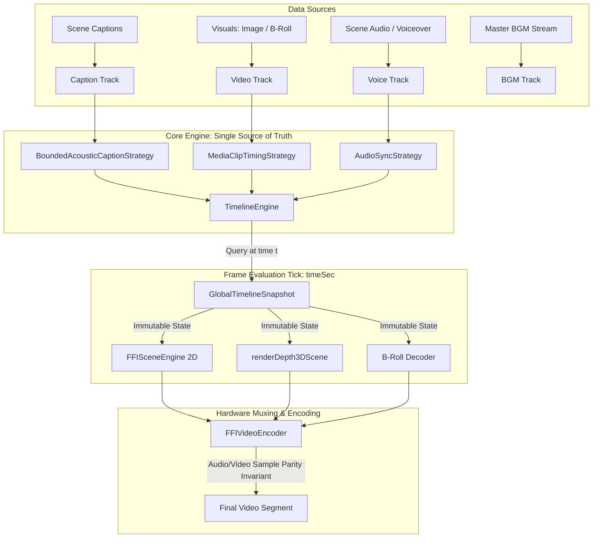

# 🏛️ Technical Specification & Implementation Architecture
## Multi-Track TimelineEngine & Regression-Free Caption/Audio Synchronization

**Document Version**: 2.0.0  
**Target Subsystems**: `@acc/core`, `@acc/effect-engines`, `apps/cli`  
**Status**: Approved Architecture Design  

---

## 1. Executive Summary & Design Rationale

As the Generative Storytelling system grew from basic sequential image rendering into an advanced multi-modal engine (3D Depth Pop-outs, SAM 2 character cutouts, B-roll video decoders, concurrent worker threads, polyrhythmic overlay compositing, and sidechain DSP ducking), subtitle and audio synchronization suffered recurring regressions.

### The Architectural Failure Modes Identified:
1. **Coupled Temporal & Presentation Logic**: Pixel renderers (`FFISceneEngine`, `renderDepth3DScene`, `captions-canvas`) each implemented separate loops to determine which phrase or word was active, leading to drift.
2. **Conflating Macro Drift with Micro Acoustic Offset**: When transition padding or silence padding fell out of sync at the container level, developers compensated by adjusting micro lead-in offsets (`timeOffset`), which broke inter-word pause handling.
3. **Loop Termination Collisions in BGM Mixing**: In `VideoEditPipelineOrchestrator`, `amix` used `[bgDucked, fgOut]` with `duration: 'first'`, binding duration to the infinite background music loop instead of the finite master voiceover.
4. **Linear Phonetic Slicing in Whisper**: Script alignment divided duration evenly across words regardless of syllable count, causing mid-sentence karaoke drift.

---

## 2. Architectural Blueprint: The Multi-Track Timeline Engine



### Core Invariant Guarantees
1. **Purity**: Given any timestamp $t$, `TimelineEngine.getTrackState(trackId, t)` produces an identical, immutable snapshot regardless of renderer or hardware platform.
2. **Pause Immunity**: When acoustic speech stops ($\text{gap} > 60\text{ms}$), all active highlights de-illuminate immediately.
3. **Lead-In Boundedness**: Acoustic anticipation ($\sim 40\text{ms} - 50\text{ms}$) never activates across phrase boundaries or preceding silence.
4. **Stream Parity**: Every scene video frame count and audio sample count must satisfy:
   $$\text{Total Audio Samples} \equiv \left\lceil \frac{\text{Frames}}{\text{FPS}} \times 48000 \right\rceil$$

---

## 3. Class & Interface Specifications

### 3.1 Timeline Engine Interfaces (`@acc/core`)

```typescript
export interface ITimelineTrack<TItem = any, TSnapshot = any> {
  readonly id: string;
  readonly type: 'caption' | 'video' | 'audio' | 'overlay' | 'sfx';
  items: TItem[];
  strategy: ITimelineStrategy<TItem, TSnapshot>;
  duration: number;
  timeOffset?: number; // Slip/nudge in seconds
}

export interface ITimelineStrategy<TItem, TSnapshot> {
  readonly strategyId: string;
  evaluate(items: TItem[], localTimeSec: number, trackConfig?: any): TSnapshot;
}

export interface CaptionWordState {
  wordIndex: number;
  word: {
    text: string;
    start: number;
    end: number;
  };
  isActive: boolean;
  progress: number; // 0.0 to 1.0 progression within the word
}

export interface CaptionTrackSnapshot {
  activePhraseIndex: number;
  phrase: Array<{ text: string; start: number; end: number }> | null;
  activeWord: CaptionWordState | null;
  isInSpeechPause: boolean;
  shouldRender: boolean;
}
export interface SFXTrackSnapshot {
  activeClips: SFXClipConfig[];
  isEmittingAudio: boolean;
}

export interface VideoClipItem {
  sceneIndex: number;
  start: number;
  end: number;
  duration: number;
  image?: string;
  video?: string;
  transition?: any;
}

export interface VideoTrackSnapshot {
  activeClipIndex: number;
  activeClip: VideoClipItem | null;
  clipLocalTimeSec: number;
  isInTransition: boolean;
}
```

### 3.2 SFX & Master Audio Timeline Strategies
```typescript
export class SoundEffectsTimelineStrategy implements ITimelineStrategy<SFXClipConfig, SFXTrackSnapshot> {
  public readonly strategyId = 'sfx-timeline-v1';

  public evaluate(items: SFXClipConfig[], localTimeSec: number): SFXTrackSnapshot {
    const activeClips = items.filter(clip => {
      const start = clip.time || 0;
      const duration = clip.duration !== undefined ? clip.duration : 2.0; // fallback window
      return localTimeSec >= start && localTimeSec < start + duration;
    });

    return {
      activeClips,
      isEmittingAudio: activeClips.length > 0,
    };
  }
}

export class MasterAudioTimingStrategy implements ITimelineStrategy<AudioTrackConfig, { isPlaying: boolean; timeSec: number }> {
  public readonly strategyId = 'master-audio-timing-v1';

  public evaluate(items: AudioTrackConfig[], localTimeSec: number): { isPlaying: boolean; timeSec: number } {
    return {
      isPlaying: localTimeSec >= 0,
      timeSec: localTimeSec,
    };
  }
}
```

---

## 4. Full Concrete Implementation Modules


### 4.1 Bounded Acoustic Caption Strategy

```typescript
// packages/effect-engines/src/subtitles/BoundedAcousticCaptionStrategy.ts
import type { ITimelineStrategy, CaptionTrackSnapshot, CaptionWordState } from '@acc/core';

export interface CaptionItem {
  text: string;
  start: number;
  end: number;
}

export interface CaptionStrategyOptions {
  wordsPerPhrase?: number;
  leadInOffsetSec?: number; // Acoustic lead-in (default: 0.05s / 50ms)
  maxHoldDecaySec?: number; // Maximum tail hold into silence (default: 0.04s)
}

export class BoundedAcousticCaptionStrategy implements ITimelineStrategy<CaptionItem, CaptionTrackSnapshot> {
  public readonly strategyId = 'bounded-acoustic-caption-v1';

  constructor(
    private defaultLeadInSec: number = 0.05,
    private defaultMaxHoldSec: number = 0.04
  ) {}

  public groupPhrases(captions: CaptionItem[], wordsPerPhrase: number): CaptionItem[][] {
    if (wordsPerPhrase <= 1) {
      return captions.map(c => [c]);
    }

    const phrases: CaptionItem[][] = [];
    let current: CaptionItem[] = [];

    for (let i = 0; i < captions.length; i++) {
      const item = captions[i];
      current.push(item);

      const isPunctuation = /[.!?]$/.test(item.text.trim());
      const next = captions[i + 1];
      const isLongPause = next && (next.start - item.end) > 0.4;

      if (current.length >= wordsPerPhrase || isPunctuation || isLongPause) {
        phrases.push(current);
        current = [];
      }
    }

    if (current.length > 0) {
      phrases.push(current);
    }

    return phrases;
  }

  public evaluate(
    items: CaptionItem[],
    localTimeSec: number,
    options?: CaptionStrategyOptions
  ): CaptionTrackSnapshot {
    if (!items || items.length === 0) {
      return {
        activePhraseIndex: -1,
        phrase: null,
        activeWord: null,
        isInSpeechPause: true,
        shouldRender: false,
      };
    }

    const wordsPerPhrase = options?.wordsPerPhrase ?? 1;
    const leadInSec = options?.leadInOffsetSec ?? this.defaultLeadInSec;
    const maxHoldSec = options?.maxHoldDecaySec ?? this.defaultMaxHoldSec;

    const phrases = this.groupPhrases(items, wordsPerPhrase);

    let foundPhraseIndex = -1;
    let activePhrase: CaptionItem[] | null = null;

    // Phrase selection: Visible from (firstWord.start - leadIn) to (lastWord.end + 0.12)
    for (let pIdx = 0; pIdx < phrases.length; pIdx++) {
      const p = phrases[pIdx];
      const pStart = p[0].start;
      const pEnd = p[p.length - 1].end;

      if (localTimeSec >= (pStart - leadInSec) && localTimeSec <= (pEnd + 0.12)) {
        foundPhraseIndex = pIdx;
        activePhrase = p;
        break;
      }
    }

    if (!activePhrase) {
      return {
        activePhraseIndex: -1,
        phrase: null,
        activeWord: null,
        isInSpeechPause: true,
        shouldRender: false,
      };
    }

    // Word highlight evaluation with strict pause boundary check
    let activeWordState: CaptionWordState | null = null;
    let inPause = true;

    for (let wIdx = 0; wIdx < activePhrase.length; wIdx++) {
      const w = activePhrase[wIdx];
      const nextW = activePhrase[wIdx + 1];
      const gap = nextW ? Math.max(0, nextW.start - w.end) : 0;
      
      // Decay window is bounded by half the gap to prevent bleeding into next word
      const holdDecay = Math.min(maxHoldSec, gap * 0.5);

      const effectiveStart = w.start - leadInSec;
      const effectiveEnd = w.end + holdDecay;

      if (localTimeSec >= effectiveStart && localTimeSec <= effectiveEnd) {
        const duration = Math.max(0.01, w.end - w.start);
        const progress = Math.min(1.0, Math.max(0.0, (localTimeSec - w.start) / duration));
        activeWordState = {
          wordIndex: wIdx,
          word: w,
          isActive: true,
          progress,
        };
        inPause = false;
        break;
      }
    }

    return {
      activePhraseIndex: foundPhraseIndex,
      phrase: activePhrase,
      activeWord: activeWordState,
      isInSpeechPause: inPause,
      shouldRender: true,
    };
  }
}
```

---

### 4.2 Multi-Track Timeline Engine Coordinator

```typescript
// packages/core/src/timeline/TimelineEngine.ts
import type { ITimelineTrack } from '../types';

export class TimelineEngine {
  private tracks: Map<string, ITimelineTrack> = new Map();

  public addTrack<TItem, TSnapshot>(track: ITimelineTrack<TItem, TSnapshot>): this {
    this.tracks.set(track.id, track);
    return this;
  }

  public getTrack<TItem, TSnapshot>(trackId: string): ITimelineTrack<TItem, TSnapshot> | undefined {
    return this.tracks.get(trackId);
  }

  public getTrackState<TSnapshot>(trackId: string, timeSec: number, trackOptions?: any): TSnapshot {
    const track = this.tracks.get(trackId);
    if (!track) {
      throw new Error(`[TimelineEngine] Track "${trackId}" does not exist in registry.`);
    }

    const localTime = timeSec + (track.timeOffset || 0);
    return track.strategy.evaluate(track.items, localTime, trackOptions);
  }

  public getGlobalState(timeSec: number): Record<string, any> {
    const snapshot: Record<string, any> = {};
    for (const [id, track] of this.tracks.entries()) {
      const localTime = timeSec + (track.timeOffset || 0);
      snapshot[id] = track.strategy.evaluate(track.items, localTime);
    }
    return snapshot;
  }
}
```

---

### 4.3 Refactored Pure Canvas Subtitle Renderer

```typescript
// packages/effect-engines/src/subtitles/captions-canvas.ts
import type { CaptionTrackSnapshot, CaptionWordState } from '@acc/core';
import type { CaptionSettings } from '../types';
import { PRESETS } from '../styles';

export function drawCanvasCaptionsFromSnapshot(
  ctx: any,
  snapshot: CaptionTrackSnapshot,
  settings: CaptionSettings | undefined,
  width: number,
  height: number
): void {
  if (!snapshot.shouldRender || !snapshot.phrase || snapshot.phrase.length === 0) {
    return;
  }

  const presetName = settings?.preset || 'classic';
  const base = PRESETS[presetName] || PRESETS['classic'];

  const scale = height / 1080;
  const baseFontSize = settings?.fontSize ?? base.fontSize ?? 44;
  const fontSize = Math.max(16, Math.round(baseFontSize * scale));
  const fontName = settings?.fontName ?? base.fontName ?? 'Arial';

  const isHeavyFont = /black|bold|heavy/i.test(fontName) || ['tiktok', 'neon-glow', 'bold-retro'].includes(presetName);
  const fontWeight = isHeavyFont ? '900' : 'bold';

  ctx.save();
  ctx.font = `${fontWeight} ${fontSize}px "${fontName}", "Segoe UI", Arial, sans-serif`;
  ctx.textBaseline = 'middle';

  const primaryColor = settings?.primaryColor ?? base.primaryColor ?? '#FFFFFF';
  const outlineColor = settings?.outlineColor ?? base.outlineColor ?? '#000000';
  const shadowColor = settings?.shadowColor ?? base.shadowColor ?? '#000000';
  const outlineSize = Math.round((settings?.outlineSize ?? base.outlineSize ?? 3) * scale);
  const shadowSize = Math.round((settings?.shadowSize ?? base.shadowSize ?? 2) * scale);
  const borderStyle = settings?.borderStyle ?? base.borderStyle ?? 1;

  const activeWordHighlight = settings?.activeWordHighlight ?? (settings as any)?.['active-word-highlight'] ?? false;
  const highlightPreset = activeWordHighlight
    ? (settings?.highlightPreset && settings.highlightPreset !== 'none' ? settings.highlightPreset : 'color')
    : 'none';
  const highlightColor = settings?.highlightColor ?? (presetName === 'tiktok' ? '#FFFF00' : '#00FFFF');

  // Vertical position
  const marginV = Math.round((settings?.marginV ?? base.marginV ?? 65) * scale);
  let y = height - marginV;
  if (settings?.position === 'top' || settings?.position === 'top-center') {
    y = marginV + fontSize;
  } else if (settings?.position === 'center' || settings?.position === 'middle') {
    y = height / 2;
  }

  // Word metrics
  const spaceW = ctx.measureText(' ').width;
  const wordMetrics = snapshot.phrase.map((w, idx) => ({
    text: w.text.trim(),
    width: ctx.measureText(w.text.trim()).width,
    index: idx,
  }));

  const totalPhraseWidth = wordMetrics.reduce((sum, m) => sum + m.width, 0) + (wordMetrics.length - 1) * spaceW;

  let xStart = (width - totalPhraseWidth) / 2;
  if (settings?.position === 'bottom-left' || settings?.position === 'top-left') {
    const marginL = Math.round((settings?.marginL ?? settings?.marginH ?? 50) * scale);
    xStart = marginL;
  } else if (settings?.position === 'bottom-right' || settings?.position === 'top-right') {
    const marginR = Math.round((settings?.marginR ?? settings?.marginH ?? 50) * scale);
    xStart = width - totalPhraseWidth - marginR;
  }

  // Render Box Background if borderStyle === 3
  if (borderStyle === 3) {
    const padX = Math.round(18 * scale);
    const padY = Math.round(10 * scale);
    const boxX = xStart - padX;
    const boxY = y - fontSize / 2 - padY;
    const boxW = totalPhraseWidth + padX * 2;
    const boxH = fontSize + padY * 2;

    ctx.save();
    ctx.fillStyle = shadowColor || 'rgba(0, 0, 0, 0.75)';
    ctx.beginPath();
    ctx.roundRect ? ctx.roundRect(boxX, boxY, boxW, boxH, 8 * scale) : ctx.fillRect(boxX, boxY, boxW, boxH);
    ctx.fill();
    ctx.restore();
  }

  let currentX = xStart;
  const activeIndex = snapshot.activeWord?.isActive ? snapshot.activeWord.wordIndex : -1;

  for (let i = 0; i < wordMetrics.length; i++) {
    const m = wordMetrics[i];
    const isWordActive = i === activeIndex && highlightPreset !== 'none';

    ctx.save();
    let wordColor = primaryColor;
    let wordScale = 1.0;

    if (isWordActive) {
      wordColor = highlightColor;
      if (highlightPreset === 'scale' || highlightPreset === 'scale-color') {
        wordScale = 1.12;
      }
      if (highlightPreset === 'glow') {
        ctx.shadowColor = highlightColor;
        ctx.shadowBlur = Math.round(16 * scale);
      }
    }

    const wordCenterX = currentX + m.width / 2;
    ctx.translate(wordCenterX, y);
    if (wordScale !== 1.0) {
      ctx.scale(wordScale, wordScale);
    }

    // Shadow pass
    if (shadowSize > 0 && highlightPreset !== 'glow') {
      ctx.fillStyle = shadowColor;
      ctx.fillText(m.text, -m.width / 2 + shadowSize, shadowSize);
    }

    // Stroke outline pass
    if (outlineSize > 0) {
      ctx.strokeStyle = outlineColor;
      ctx.lineWidth = outlineSize * 2;
      ctx.lineJoin = 'round';
      ctx.strokeText(m.text, -m.width / 2, 0);
    }

    // Fill pass
    ctx.fillStyle = wordColor;
    ctx.fillText(m.text, -m.width / 2, 0);

    ctx.restore();
    currentX += m.width + spaceW;
  }

  ctx.restore();
}
```

---

### 4.4 Syllable-Weighted Alignment in Whisper

```typescript
// apps/cli/src/pipelines/04-generative-story/whisper.ts
import type { CaptionConfig } from '@acc/core/types';

/**
 * Phonetic length estimation for Vietnamese & Latin languages.
 * Counts vowels, diphthongs, and consonant clusters.
 */
function estimatePhoneticWeight(word: string): number {
  const clean = word.toLowerCase().replace(/[^a-z0-9àáảãạăằắẳẵặâầấẩẫậèéẻẽẹêềếểễệìíỉĩịòóỏõọôồốổỗộơờớởỡợùúủũụưừứửữựỳýỷỹỵđ]/g, '');
  if (clean.length === 0) return 1.0;

  // Syllable nuclei detection
  const vowelMatches = clean.match(/[aeiouyàáảãạăằắẳẵặâầấẩẫậèéẻẽẹêềếểễệìíỉĩịòóỏõọôồốổỗộơờớởỡợùúủũụưừứửữựỳýỷỹỵ]/g);
  const vowelCount = vowelMatches ? vowelMatches.length : 1;

  // Minimum weight 1.5, scaled by length
  return Math.max(1.5, vowelCount * 1.2 + clean.length * 0.4);
}

export function alignScriptWithTimestamps(
  referenceScript: string,
  chunks: { text?: string; timestamp?: [number, number] }[],
  audioDuration: number
): CaptionConfig[] {
  const words = (referenceScript.match(/\[[^\]]+\]|\S+/g) || [])
    .map(w => w.trim())
    .filter(w => w.length > 0);

  if (words.length === 0) return [];

  let speechStart = 0;
  let speechEnd = audioDuration > 0 ? audioDuration : 2.0;

  if (chunks && chunks.length > 0) {
    const first = chunks[0];
    const last = chunks[chunks.length - 1];
    if (first?.timestamp && typeof first.timestamp[0] === 'number') {
      speechStart = Math.max(0, first.timestamp[0]);
    }
    if (last?.timestamp && typeof last.timestamp[1] === 'number' && last.timestamp[1] > speechStart) {
      speechEnd = last.timestamp[1];
    }
  }

  if (audioDuration > 0 && (speechEnd <= speechStart || speechEnd > audioDuration)) {
    speechEnd = audioDuration;
  }

  const activeDuration = Math.max(speechEnd - speechStart, 0.5);
  const weights = words.map(w => estimatePhoneticWeight(w));
  const totalWeight = weights.reduce((acc, val) => acc + val, 0);

  let currentClock = speechStart;

  return words.map((word, idx) => {
    const wordDuration = (weights[idx] / totalWeight) * activeDuration;
    const wStart = Number(currentClock.toFixed(2));
    currentClock += wordDuration;
    const wEnd = Number(currentClock.toFixed(2));

    return {
      text: word,
      start: wStart,
      end: wEnd,
    };
  });
}
```

---

### 4.5 Orchestrator Macro Timeline & Audio DSP Hardening

```typescript
// Inside VideoEditPipelineOrchestrator.ts

// 1. Safety dialogue clearance during transitions
const tConfig = scene.transition || config.settings.transition;
const audioBehavior = tConfig?.audioBehavior ?? config.settings.transition?.audioBehavior ?? 'pad';
let paddingTime = 0;

if (tConfig?.enabled && i < totalScenes - 1) {
  const tDur = tConfig.duration || 1.0;
  if (audioBehavior === 'pad') {
    paddingTime = tDur;
  } else if (audioBehavior === 'crossfade') {
    // If dialogue in scene finishes within transition window, pad safety gap to prevent dialogue overlap
    const lastCaptionEnd = scene.captions?.length ? scene.captions[scene.captions.length - 1].end : 0;
    if (duration - tDur < lastCaptionEnd) {
      paddingTime = Math.max(0, (lastCaptionEnd + 0.2) - (duration - tDur));
    }
  }
}

// 2. Fix Master Audio Track in BGM Sidechain Ducking
bgmGraph.addNode({
  inputs: [fgOut, bgDucked], // Master speech stream (fgOut) is input 0
  filter: 'amix',
  options: {
    inputs: 2,
    duration: 'first', // Terminates cleanly when master speech track completes
    dropout_transition: 2,
  },
  outputs: [aOut],
});
```

---

## 5. Invariant Test Suite Specifications (`/autogenerated-tests/`)

### Test 1: Micro-Timing Invariants (`caption-timeline-engine.test.ts`)
* **Invariant A (Pause Clearance)**:
  Assert that when $t \in [w_1.\text{end} + 0.05, w_2.\text{start} - 0.05]$, `snapshot.activeWord === null` and `snapshot.isInSpeechPause === true`.
* **Invariant B (Acoustic Lead-in Bound)**:
  Assert that when $t = w_1.\text{start} - 0.04$, `snapshot.activeWord.isActive === true`, but when $t = w_1.\text{start} - 0.08$, `snapshot.activeWord === null`.
* **Invariant C (Phrase Visibility)**:
  Assert that after $p.\text{end} + 0.15\text{s}$, `snapshot.shouldRender === false`.

### Test 2: Macro Stream Parity Invariants (`scene-stream-duration-parity.test.ts`)
* Render sample 2D and 3D scenes via `FFISceneEngine`.
* Probe output container using FFmpeg FFI stream headers:
  $$\left| \text{nb\_frames} \times \frac{1}{\text{fps}} - \frac{\text{audio\_samples}}{48000} \right| < 0.001\text{s}$$

---

## 6. Implementation Rollout Checklist

- [ ] **Step 1**: Implement `TimelineEngine.ts` and `BoundedAcousticCaptionStrategy.ts` in `packages/core` and `packages/effect-engines`.
- [ ] **Step 2**: Wire `drawCanvasCaptionsFromSnapshot` in `packages/effect-engines/src/subtitles/captions-canvas.ts`.
- [ ] **Step 3**: Refactor `FFISceneEngine.renderImageScene`, `FFISceneEngine.renderVideoScene`, and `renderDepth3DScene` to delegate timeline checks to `TimelineEngine`.
- [ ] **Step 4**: Patch `VideoEditPipelineOrchestrator.ts` transition clearance and `amix` master input ordering.
- [ ] **Step 5**: Upgrade `whisper.ts` with `estimatePhoneticWeight`.
- [ ] **Step 6**: Execute test suite (`bun test autogenerated-tests/`) and verify zero regression across all test scenes.
