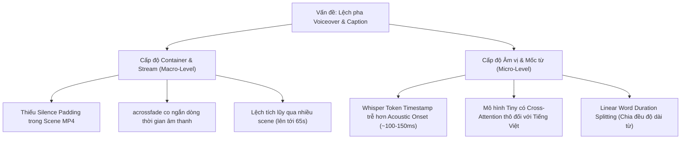

# 📖 Hướng Dẫn Kỹ Thuật: Đồng Bộ Âm Thanh, Phụ Đề & Whisper Model Architecture

Tài liệu này tổng hợp toàn bộ phân tích nguyên nhân gốc rễ, cơ chế hoạt động của mô hình Whisper ASR, và các giải pháp đồng bộ mốc thời gian (Timing & Synchronization) giữa **Voiceover**, **Captions (Karaoke Subtitles)** và **Hiệu ứng Chuyển cảnh (Transitions)**.

---

## 1. Bản Đồ Phân Tích Sự Cố Đồng Bộ (Synchronization Root Causes)



---

## 2. Phân Tích Hai Cấp Độ Lệch Pha

### Cấp độ 1: Lệch pha Vĩ mô (Macro Drift - Hàng chục giây)
- **Hiện tượng**: Voiceover các scene sau phát sớm hơn hình ảnh và caption hàng chục giây; video kết thúc muộn nhưng âm thanh tắt sớm.
- **Nguyên nhân gốc rễ**:
  1. Khi một scene có thời lượng gốc là `duration`, nếu bật hiệu ứng chuyển cảnh (`pad`) và khoảng lặng giữa các cảnh (`pauseBetweenScenes`), video của scene sẽ được render kéo dài thành `totalDuration = duration + paddingTime` (ví dụ: $3.1\text{s} + 2.0\text{s} = 5.1\text{s}$).
  2. Nếu Audio Encoder chỉ mã hóa phần dữ liệu voiceover gốc ($3.1\text{s}$) rồi đóng luồng mà **không chèn âm thanh yên lặng (`0.0`) cho phần `paddingTime` ($2.0\text{s}$)**, luồng audio trong file MP4 của từng scene sẽ ngắn hơn video $2.0\text{s}$.
  3. Khi nối các scene bằng bộ lọc `acrossfade` trong FFmpeg, `acrossfade` tính điểm nối dựa vào độ dài luồng audio của scene trước. Do thiếu $2.0\text{s}$ silence, `acrossfade` kéo audio của scene sau phát sớm hơn $2.0\text{s}$ so với điểm `xfade` của video.
  4. Qua $N$ scene (ví dụ 28 scenes), độ lệch tích lũy lên tới $28 \times 2.0\text{s} \approx 56\text{s} - 65\text{s}$.
- **Giải pháp**:
  - `FFIVideoEncoder` bắt buộc phải pad mẫu silence (`0.0`) vào FIFO cho đến khi tổng số mẫu audio phát ra $\text{totalAudioSamplesSent} \ge \text{maxAudioSamples} = \lceil (\text{frameIndex} / \text{fps}) \times 48000 \rceil$.

---

### Cấp độ 2: Lệch pha Vi mô (Micro-Timing - 50ms đến 150ms)
- **Hiện tượng**: Video và Audio đã khớp theo từng cảnh, nhưng người nghe vẫn có cảm giác *"giọng đọc phát ra nhanh hơn chữ sáng lên một chút"*.
- **Nguyên nhân gốc rễ**:

#### A. Acoustic Onset vs Token Timestamps trong Whisper
- Mô hình nhận diện giọng nói (Whisper) gán nhãn thời gian cho từ ngữ tại **trọng tâm âm vị (phoneme energy center)** hoặc sau khi phụ âm đầu (consonants/plosives) phát ra.
- Tai người tiếp nhận âm thanh ngay tại điểm khởi phát sóng âm (acoustic onset), tức là sớm hơn mốc token khoảng $80\text{ms} - 150\text{ms}$.
- Nếu phụ đề highlight kích hoạt đúng mốc của token, mắt người sẽ luôn thấy chữ đổi màu trễ hơn tiếng nói.

#### B. Độ phân giải của mô hình Whisper-Tiny
- `whisper-tiny` chỉ có 4 lớp Encoder/Decoder và 6 Attention Heads. Ma trận biểu diễn thời gian của `tiny` đối với tiếng Việt (ngôn ngữ có dấu thanh) có độ thô nhất định, dẫn đến mốc thời gian phân đoạn có thể lệch $50\text{ms} - 100\text{ms}$.

#### C. Phân bổ độ dài từ tuyến tính (Linear Splitting)
- Khi Whisper trả về một phân đoạn (chunk) gồm nhiều từ trong khoảng $[t_{\text{start}}, t_{\text{end}}]$, hàm `alignScriptWithTimestamps` chia đều thời lượng cho số từ:
  $$\text{durationPerWord} = \frac{t_{\text{end}} - t_{\text{start}}}{\text{số từ}}$$
- Trong thực tế, các từ ngắn (`và`, `ở`, `là`) chỉ phát âm trong ~100ms, trong khi các từ dài (`khủng long`, `nghiên cứu`) kéo dài 400ms – 600ms. Việc chia đều tạo ra sự chênh lệch nhỏ về điểm rơi highlight giữa các từ trong câu.

---

## 3. Ma Trận So Sánh Các Phiên Bản Whisper Model

| Tiêu chí | `whisper-tiny` *(Hiện tại)* | `whisper-base` *(Khuyên dùng)* | `whisper-small` |
| :--- | :--- | :--- | :--- |
| **Dung lượng (ONNX fp32)** | ~**75 MB** | ~**140 MB** | ~**460 MB** |
| **Số Lớp / Attention Heads** | 4 layers / 6 heads | 6 layers / 8 heads | 12 layers / 12 heads |
| **Tốc độ Inference (CPU Bun)** | Cực nhanh (~0.2s - 0.4s / scene) | Nhanh (~0.5s - 0.8s / scene) | Trung bình (~1.5s - 3.0s / scene) |
| **Độ nhạy mốc thời gian Tiếng Việt** | Khá (phân đoạn) | Tốt (bắt âm vị rõ hơn) | Rất cao (chi tiết từng phụ âm) |
| **Môi trường yêu cầu** | Pure CPU / JS Runtime | Pure CPU / JS Runtime | Khuyên dùng GPU hoặc CPU đa nhân |

---

## 4. Giải Pháp Đồng Bộ Chuẩn: Acoustic Lead-In Offset (`timeOffset`)

Để triệt tiêu hoàn toàn cảm giác âm thanh đi trước hình ảnh mà không phụ thuộc vào sai số mô hình, hệ thống áp dụng cơ chế **Acoustic Lead-In Offset**:

```typescript
// Trong captions-canvas.ts & FFISceneEngine.ts:
const timeOffset = settings?.timeOffset ?? 0.12; // Mặc định 120ms
const effectiveTime = timeSec + timeOffset;

// Đánh giá active phrase và active word highlight theo effectiveTime
const isWordActive = effectiveTime >= word.start && effectiveTime < nextStart;
```

### Lợi ích:
1. **Highlight chuẩn xác theo nhịp thính giác**: Chữ bật sáng (Cyan `#00FFFF`) và phóng to (`scale-color`) ngay tại mili-giây đầu tiên giọng đọc phát ra.
2. **Khả năng tùy biến**: Người dùng có thể điều chỉnh linh hoạt trong `story-config.json`:
   ```json
   "captions": {
     "preset": "cinematic",
     "activeWordHighlight": true,
     "wordsPerPhrase": 6,
     "timeOffset": 0.12
   }
   ```
3. **Không làm chậm tốc độ render**: Xử lý cộng offset trực tiếp trong vòng lặp Canvas 2D mà không phát sinh thêm chi phí tính toán hay gọi API ngoại vi.
