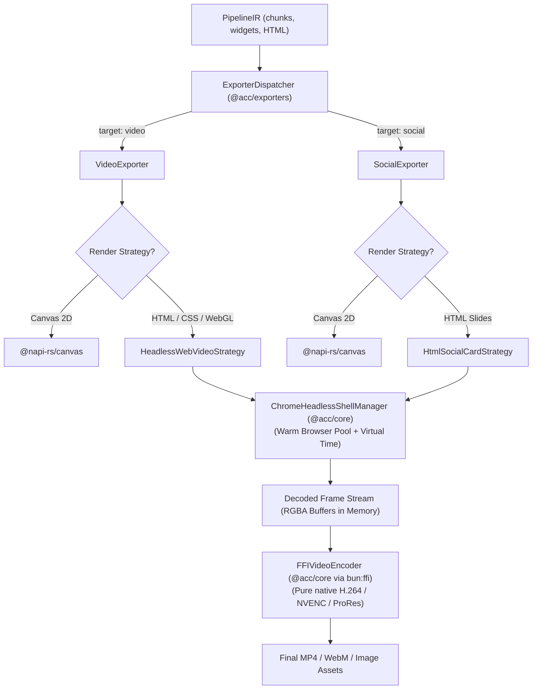

# Deterministic Rendering & Frame Capture via Headless Chrome & Bun

> **System Brainstorming & Architecture Blueprint**  
> **Document:** `docs/brainstorming/DETERMINISTIC_RENDERING_AND_FRAME_CAPTURE_HEADLESS_CHROME.md`  
> **Scope:** Web-as-a-Motion-Graphics-Engine, CDP Virtual Time, Compositor Step-Driver & Direct Exporter Integration  
> **Applicability:** `@acc/exporters` (Video & Social), Pipeline 2 (DB Templating), Pipeline 5 (Rule/Math Logic)  
> **Date:** October 2026

---

## 1. Executive Summary & Problem Formulation

In automated media creation, the modern web platform (**HTML5, CSS Animations, SVG path manipulation, WebGL/Three.js, D3.js, GSAP, and Canvas2D**) represents an expressive and flexible motion graphics runtime. Any designer or frontend developer can create kinetic typography, complex charts, or 3D scenes using web standards.

However, attempting to render web pages into broadcast-quality video using standard screen-recording or naive headless screenshotting (`page.screenshot()` in Puppeteer) results in **dropped frames, stuttering animations, font loading race conditions (FOUT), and non-deterministic visual output**.

**Deterministic Rendering & Frame Capture** solves this by decoupling the browser's render pipeline entirely from real-world wall-clock time:

$$\mathcal{F}(k) = \text{Render}\Big(\text{DOM}, \; t_{\text{virtual}} = k \cdot \Delta t, \; \text{Seed} = S\Big) \quad \forall \; k \in [0, N-1]$$

This blueprint analyzes how to implement bit-exact deterministic rendering and frame capture using **Bun**, **Puppeteer / CDP**, and **`chrome-headless-shell`**, its high-value content applications, and how to pipe captured frames directly into `@acc/exporters` with zero disk I/O.

---

## 2. Why Naive Headless Web Rendering Fails Determinism

```
Real-Time Naive Render (Tied to Wall-Clock Time):
Real Time: 0ms    16ms     32ms     48ms (CPU/GPU Stall!) 120ms
Frames:    [F0]   [F1]     [F2]           (DROPPED)        [F3 - Jumped ahead!]
Result: Stuttering pacing, missed animation frames, non-reproducible renders.

Virtual Time Deterministic Render (Step-Driven Compositor):
Virtual T: 0ms    16.6ms   33.3ms   50.0ms   66.6ms       83.3ms
Frames:    [F0]   [F1]     [F2]     [F3]     [F4]         [F5]
Result: Bit-exact 60.000 FPS. A heavy Three.js shader taking 2000ms to compute 
        still produces a frame with exactly Δt = 16.666ms elapsed time.
```

| Failure Factor | Naive Puppeteer / Screen Recording | Deterministic Web Capture Protocol |
| :--- | :--- | :--- |
| **Wall-Clock Clock Drift** | CSS animations, `requestAnimationFrame` (RAF), and `<video>` tags advance against the system monotonic clock. Heavy compute triggers dropped frames. | **CDP Virtual Time & Compositor Stepping**: Time only advances when explicitly instructed via `HeadlessExperimental.beginFrame`. |
| **Non-Deterministic Runtimes** | Dynamic layouts, particle systems, and charts calling `Math.random()` or `Date.now()` yield divergent renders on each run. | **Injected Seeded PRNG & Virtual Clock**: Global overrides for `Math.random` (Mulberry32) and `performance.now()`. |
| **Font & Asset FOUT Shifts** | Capturing before web fonts and vector assets settle causes text clipping, layout jumps, or missing icons. | **Explicit Layout & Font Barrier**: Enforces `await document.fonts.ready` and image decoding barriers prior to the first frame. |
| **Cross-Platform Raster Variance**| DirectWrite (Windows), FreeType (Linux), and CoreText (macOS) use different font hinting and subpixel anti-aliasing. | **Strict Browser Flags**: Normalizes rendering with `--font-render-hinting=none`, `--disable-font-subpixel-positioning`, and `--force-color-profile=srgb`. |
| **IPC Bottlenecks & Disk I/O** | Writing millions of temporary PNGs to disk and invoking child process FFmpeg creates massive disk thrashing and high latency. | **In-Memory Pipe to Native FFI**: Decoded frame buffers stream directly into `@acc/core`'s native `FFIVideoEncoder` via `bun:ffi`. |

---

## 3. The 3-Tier Deterministic Web Stack Architecture

```
┌────────────────────────────────────────────────────────────────────────┐
│                              BUN PROCESS                               │
│  ┌────────────────────────┐         ┌───────────────────────────────┐  │
│  │ HeadlessSessionManager │         │   FFIVideoEncoder (bun:ffi)   │  │
│  └───────────┬────────────┘         └───────────────▲───────────────┘  │
└──────────────┼──────────────────────────────────────┼──────────────────┘
   CDP Command │ (beginFrame tick)       Zero-Copy    │ Native RGBA
   via WS Pipe │                         Buffer Pass  │ Memory
┌──────────────▼──────────────────────────────────────┴──────────────────┐
│                   CHROME-HEADLESS-SHELL PROCESS                        │
│                                                                        │
│  ┌──────────────────────────────────────────────────────────────────┐  │
│  │ Tier 1: Injected Deterministic Harness                           │  │
│  │  - Seeded PRNG (Mulberry32) replacing Math.random                │  │
│  │  - Virtual performance.now() & Date.now()                        │  │
│  │  - Step-driven RAF & GSAP time synchronizer                      │  │
│  │  - document.fonts.ready barrier                                  │  │
│  └──────────────────────────────────┬───────────────────────────────┘  │
│                                     │                                  │
│  ┌──────────────────────────────────▼───────────────────────────────┐  │
│  │ Tier 2: CDP HeadlessExperimental.beginFrame Controller           │  │
│  │  - Manual Compositor Heartbeat (e.g. 16.666ms per step)          │  │
│  │  - Software/Fixed Skia Rasterizer (sRGB, No sub-pixel hinting)   │  │
│  └──────────────────────────────────────────────────────────────────┘  │
└────────────────────────────────────────────────────────────────────────┘
```

### Why `chrome-headless-shell`?
In modern Chromium (v112+), Google separated the headless browser implementation from **`chrome-headless-shell`**:
* **Stripped Footprint:** Completely omits tab managers, window controls, extensions, and default browser UI overhead.
* **Rapid Cold-Start:** Launches in under 50ms and consumes only ~40MB RAM (vs >150MB for full Chrome).
* **Native Compositor Control:** Directly exposes the `HeadlessExperimental` CDP domain without UI synchronization delays.

---

## 4. Technical Implementation Mechanics

### 4.1 Browser Flags for Cross-Platform Pixel Parity

```typescript
export const DETERMINISTIC_CHROME_FLAGS = [
  '--headless=new',
  '--disable-gpu',                     // Forces Skia / SwiftShader software rasterizer for cross-OS parity
  '--force-color-profile=srgb',        // Eliminates OS display color gamut differences
  '--font-render-hinting=none',        // Eliminates subpixel font layout jitter
  '--disable-font-subpixel-positioning',
  '--hide-scrollbars',
  '--mute-audio',
  '--disable-threaded-animation',      // Forces animations to update synchronously on the compositor clock
  '--disable-threaded-scrolling',
  '--no-sandbox'
];
```

### 4.2 Injected Deterministic Harness (`evaluateOnNewDocument`)

Prior to executing any document scripts, the browser runtime is patched with deterministic primitives:

```javascript
// 1. Seeded Pseudo-Random Number Generator (Mulberry32)
(function setupDeterministicEnvironment(seed = 4242) {
  let s = seed >>> 0;
  Math.random = function() {
    s = (s + 0x6D2B79F5) | 0;
    let t = Math.imul(s ^ (s >>> 15), 1 | s);
    t = (t + Math.imul(t ^ (t >>> 7), 61 | t)) ^ t;
    return ((t ^ (t >>> 14)) >>> 0) / 4294967296;
  };

  // 2. Virtual Clock
  let virtualTime = 0;
  window.performance.now = () => virtualTime;
  Date.now = () => 1700000000000 + virtualTime;

  // 3. Animation Tick Synchronizer (for GSAP, Three.js, Canvas)
  window.__advanceVirtualClock = function(deltaMs) {
    virtualTime += deltaMs;
    if (typeof window.__accOnFrameTick === 'function') {
      window.__accOnFrameTick(virtualTime, deltaMs);
    }
  };
})();
```

### 4.3 CDP Compositor Step-Driver (`HeadlessExperimental.beginFrame`)

```typescript
import puppeteer from 'puppeteer-core';

export async function captureDeterministicWebStream(options: {
  htmlUrl: string;
  width: number;
  height: number;
  fps: number;
  totalDurationMs: number;
  onFrame: (pngBuffer: Buffer, frameIndex: number) => Promise<void>;
}) {
  const { htmlUrl, width, height, fps, totalDurationMs, onFrame } = options;

  const browser = await puppeteer.launch({
    executablePath: getChromeHeadlessShellPath(),
    args: DETERMINISTIC_CHROME_FLAGS,
    defaultViewport: { width, height, deviceScaleFactor: 1 }
  });

  const page = await browser.newPage();
  const client = await page.target().createCDPSession();

  // 1. Decouple from wall-clock time
  await client.send('Emulation.setVirtualTimePolicy', {
    policy: 'pauseIfNetworkFetchesPending',
    budget: 0
  });

  await page.goto(htmlUrl, { waitUntil: 'networkidle0' });
  await page.evaluate(() => document.fonts.ready); // Freeze font metric barrier

  const totalFrames = Math.ceil((totalDurationMs / 1000) * fps);
  const frameIntervalMs = 1000 / fps;
  const frameIntervalTicks = (1000000 / fps); // Microseconds for CDP ticks
  let currentTick = 1000000;

  for (let f = 0; f < totalFrames; f++) {
    // A. Step page-level JS animation clock
    await page.evaluate((dt) => (window as any).__advanceVirtualClock(dt), frameIntervalMs);

    // B. Command Chromium compositor to render the frame tick and return the raster
    const { screenshotData } = await client.send('HeadlessExperimental.beginFrame', {
      frameTimeTicks: currentTick,
      interval: frameIntervalTicks,
      noDisplay: false,
      screenshot: { format: 'png' }
    });

    currentTick += frameIntervalTicks;

    const frameBuffer = Buffer.from(screenshotData, 'base64');
    await onFrame(frameBuffer, f);
  }

  await browser.close();
}
```

---

## 5. Applications in Automated Content Creation

Integrating deterministic web rendering unlocks rich content generation capabilities:

| Content Domain | Pipeline & Format | Production Implementation |
| :--- | :--- | :--- |
| **1. Dynamic Data Visualizations** | **Pipeline 2 & 5** (Video / Social) | Animated Bar Chart Races, D3.js force-directed graphs, dynamic candlestick stock charts, and geographical heatmaps rendered with fluid 60fps pacing regardless of CPU load. |
| **2. Scrollytelling $\to$ Video Transmutation** | **Pipeline 2 & 3** (Video 9:16) | Converting GSAP ScrollTrigger or Locomotive scroll web articles into vertical TikTok/Reels explainer videos. Progressively scrolls via `window.scrollTo(0, scrollHeight * (f / totalFrames))` to capture smooth parallax motion. |
| **3. Programmatic Code & Terminal Tutorials** | **Pipeline 5** (#113, Video) | Monaco Editor (VS Code engine in browser) typing out code with syntax token highlights and diagnostics popups without needing simulated canvas mockups. |
| **4. Kinetic Typography & CSS Text Effects** | **Pipeline 4 & 5** (Video) | Modern variable fonts with breathing weights (`font-variation-settings`), SVG stroke-dashoffset reveals, and CSS warp filters that are trivial in CSS but complex in native C filters. |
| **5. Multi-Slide Social Carousels** | **Pipeline 2** (Format 2, Social) | Generating multi-slide LinkedIn and Instagram carousels (PNG/WebP) with guaranteed font layout stability across dev machines and cloud containers. |
| **6. Visual Regression Testing** | **Core Testing** (`autogenerated-tests/`) | Pixel-hash structural similarity ($SSIM = 1.0$) verification ensuring template updates introduce zero visual regressions. |

---

## 6. Integration Blueprint with `@acc/exporters`



### Proposed Modules in the ACC Monorepo:

1. **`ChromeHeadlessShellManager` (`packages/core/src/headless/`):**
   * Manages binary discovery and installation in `path.join(os.homedir(), '.')` following the `GLOBAL-STORAGE` rule.
   * Maintains a warm browser instance pool to eliminate 50ms startup latency between jobs.
2. **`HeadlessWebVideoStrategy` (`packages/exporters/src/video/strategies/`):**
   * Implements video frame generation for HTML/WebGL templates.
   * Steps the virtual clock and streams RGBA frames directly into `FFIVideoEncoder.encodeRgbaFrame()`.
   * **Zero disk I/O**: Frames are held in memory and handed directly to native FFmpeg encoders.
3. **`HtmlSocialCardStrategy` (`packages/exporters/src/social/strategies/`):**
   * Produces static single-frame or multi-slide carousel cards (PNG/WebP) with `document.fonts.ready` synchronization.

---

## 7. Comparative Performance & Trade-Offs

| Metric | Standard Screen Recording | Traditional Puppeteer (`screenshot`) | Bun + `chrome-headless-shell` DFE |
| :--- | :--- | :--- | :--- |
| **Pacing Guarantee** | ❌ Stutters during CPU/GPU spikes | ❌ Wall-clock races, skipped frames | **✅ Bit-exact 60 FPS under all loads** |
| **Render Latency** | Real-time bound (1s video takes 1s) | Slow (WebSocket roundtrip per frame) | **Decoupled (fast scenes render >120fps)** |
| **Startup Overhead** | High | Heavy (~150MB+ RAM per process) | **Ultra-light (~40MB RAM, <50ms cold-start)** |
| **Font Stability** | Prone to FOUT race conditions | Prone to FOUT race conditions | **Guaranteed `document.fonts.ready` barrier** |
| **Memory / Disk I/O**| Writes temporary video/PNG files | Writes temporary files or base64 JSON | **Direct in-memory pipe to `FFIVideoEncoder`** |
