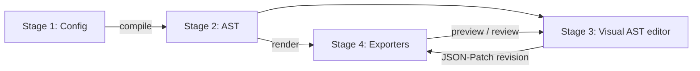

# Four-Stage Content Generation Architecture (Brainstorm)

Status: Draft / exploration. Not implemented.

## 1. Goals
- One declarative entry point (Stage 1 config) supporting **6 content pipelines**.
- A compiled, fully-resolved **JSON AST** (Stage 2) that is the single source of truth for output.
- A **visual editor** (Stage 3) that edits the AST, never the Stage 1 config.
- A **deterministic renderer/exporter** (Stage 4) that consumes only the AST and fans out to 6 exporters.
- Unbounded loop `Stage 3 <-> Stage 4` until the user is satisfied.

## 2. Workflows

- **A (automatic):** 1 -> 2 -> 4
- **B (iterative):** 1 -> 2 -> 4 -> 3 -> 4 -> 3 -> 4 ... (loop forever)
- **C (edit-first):** 1 -> 2 -> 3 -> 4

## 3. Stage 1 — Pipeline Config
A superset of `story-config.json`, discriminated by `pipeline`. Common fields (`platform`, `style`, `audio`, `output`) are shared; each pipeline has its own `source`/`params` block.

```jsonc
{
  "configVersion": 2,
  "pipeline": "scraper-summarizer",   // see §3.1
  "common": { "language": "en", "brand": {}, "seed": 12345 },
  "params": { /* pipeline specific */ },
  "outputs": [ { "exporter": "video", "preset": "tiktok-9x16" } ]
}
```

### 3.1 The 6 pipelines
| # | id | Name | Input | Compiler responsibility |
|---|----|------|-------|-------------------------|
| 1 | `scraper-summarizer` | Event-Driven Scraper & Summarizer | Webhook/cron/RSS/URL triggers | Fetch -> clean -> LLM summarize -> scene/beat plan. Snapshot fetched content into AST assets (determinism). |
| 2 | `db-templating` | Database Injection & Programmatic Templating | Rows (SQL/CSV/API) + template | Bind rows to template slots; one AST per row (batch fan-out). |
| 3 | `repurpose-recycle` | Repurposing / Asset Extraction & Recycling | Existing video/audio/article/PDF | Extract clips, transcripts, images, quotes; re-sequence into new AST. |
| 4 | `generative-story` | Autonomous Generative Storytelling | Premise/prompt/persona | LLM outline -> script -> image/voice generation; record prompts and generated asset hashes. |
| 5 | `rule-math` | Rule-based & Math Logic Generation | Formulas, rules, data series | Pure functions to charts, counters, infographics, procedural timing. No AI. |
| 6 | `ambient-loop` | Infinite Ambient & Procedural Loops | Generator params (noise, palettes, loops) | Emit a *parametric*, seamless-loop AST (unbounded time or loopable period). |

Each pipeline implements the `PipelinePlanner` interface (§4.4). Config-schema editing uses a per-pipeline JSON Schema; the Stage 1 editor is a form generated from it.

### Stage 1 editor UI (pipeline-driven)
- Pipeline picker -> shows only that pipeline's form (trigger/source panel, params, preview of resolved data).
- Output picker lists exporters (§6) compatible with the pipeline.
- Live validation against the JSON Schema; "Compile" button -> Stage 2.

## 4. Stage 2 — AST Specification

### 4.1 Principles
1. **Fully resolved:** no network, no LLM, no randomness needed to render. All non-deterministic inputs are materialized as assets or seeds.
2. **Deterministic frame evaluation:** `render(ast, t) -> frame` is a pure function of `ast` and time/frame index `t`. Same AST + same engine version => bit-identical output (see §4.5).
3. **Exporter-neutral:** describes *content and time*, with exporter-specific hints isolated in `targets`.
4. **Patchable:** every node has a stable ID so edits are JSON-Patch (RFC 6902) operations.
5. **Hashable:** content-addressed assets and per-node hashes enable incremental re-render.

### 4.2 Top-level shape
```jsonc
{
  "astVersion": "1.0",
  "id": "proj_01H...",
  "revision": 7,
  "parentRevision": 6,
  "source": { "configHash": "sha256:...", "pipeline": "generative-story", "compiledAt": "..." },
  "determinism": { "seed": 12345, "engineVersion": "x.y.z", "clock": { "fps": 30, "timebase": "frames" } },
  "assets": { "asset_a1": { "type": "image|video|audio|font|data|text", "uri": "cas://sha256:...", "meta": {}, "provenance": { "generator": "...", "prompt": "..." } } },
  "timeline": {
    "duration": { "frames": 900 },            // or { "loop": { "period": 600 } } or { "unbounded": true }
    "tracks": [
      { "id": "trk_v1", "kind": "video|audio|text|shape|data|control",
        "clips": [ {
          "id": "clp_1", "assetRef": "asset_a1",
          "start": 0, "length": 120,           // in frames, integers only
          "layout": { "x": 0, "y": 0, "w": 1080, "h": 1920, "z": 1 },
          "props": { "opacity": { "keyframes": [ { "f": 0, "v": 0, "ease": "linear" }, { "f": 15, "v": 1 } ] } },
          "effects": [ { "id": "fx_1", "type": "kenburns", "params": {} } ],
          "transitionIn": { "type": "crossfade", "length": 12 },
          "origin": "generated", "locked": false
        } ] }
    ]
  },
  "semantic": { "scenes": [ { "id": "scn_1", "title": "", "clipIds": ["clp_1"], "narration": "" } ] },
  "targets": {
    "video":  { "presets": { "tiktok-9x16": { "w": 1080, "h": 1920, "fps": 30, "codec": "h264" } } },
    "web":    { "template": "article-basic", "slots": {} },
    "social": { "cards": [], "thread": [] },
    "audio":  { "loudnessLUFS": -16 },
    "interactive": { "components": [] },
    "live":   { "rtmpUrlEnv": "ACC_RTMP_URL", "loop": true }
  }
}
```

### 4.3 Node model
- **Clips** are time-bound (frame-integer `start`/`length`). Use integer frames to avoid float drift.
- **Property animation:** keyframes or **expression nodes** (pure functions of frame `f`, with a restricted, sandboxed expression language — math ops, `sin`, `noise(seed, f)`, `lerp`). No arbitrary JS.
- **Data bindings:** `{ "bind": "data.rows[3].title" }` resolves at compile time (pipeline 2/5) or at eval time from sealed data assets.
- **Generators (pipeline 5/6):** `generator` clips: `{ "type": "procedural", "kernel": "noise-field", "params": {}, "seed": ... }`, evaluated per frame from `(params, seed, f)`.
- **Semantic layer** (`semantic`) is optional metadata for non-timeline exporters (web article, thread, podcast chapters) and for editor navigation.
- **Provenance:** every generated asset records generator, model, prompt, params -> allows "regenerate this clip".

### 4.4 Compiler interface (Stage 1 -> 2)
```ts
interface PipelinePlanner<C> {
  id: PipelineId;
  configSchema: JSONSchema;
  resolve(config: C, ctx: CompileCtx): Promise<ResolvedInputs>;   // network / LLM / DB; results snapshotted
  plan(inputs: ResolvedInputs, ctx: CompileCtx): AstDocument;     // pure
}
```
- Split `resolve` (impure, cached by content hash) from `plan` (pure) so re-compiles are cheap and reproducible.
- **Recompile merge policy:** nodes with `origin:"user"` or `locked:true` are preserved; generated nodes are replaced; conflicts are reported in a diff for the user.

### 4.5 Deterministic frame rendering (later stage)
Requirements the AST must satisfy so a later frame-evaluation engine is possible:
- Integer frame clock; time in seconds is derived (`f / fps`).
- Sealed inputs (content-addressed assets; no live fetch).
- All randomness via `seed` + counter-based PRNG keyed by `(seed, nodeId, frame)`, so any frame can be rendered independently (random access, parallel workers, resumable).
- Pure `evaluate(ast, f) -> SceneGraph(f)` followed by `rasterize(SceneGraph) -> RGBA`. Evaluation is stateless across frames (no accumulation); stateful effects (particles, physics) must be expressed as closed-form of `f` or checkpointed via keyframed state snapshots.
- Engine version pinned in `determinism.engineVersion`; golden-frame hash tests in `/autogenerated-tests/`.
- Enables: scrubbing in the editor, chunked/parallel render, live-stream "render ahead" for pipeline 6, and diffing renders by frame hash.

## 5. Stage 3 — Visual AST Editor
- **Pipeline-aware workspace**: panels vary by pipeline.
  | Pipeline | Extra panels |
  |---|---|
  | 1 | Source/summary diff, trigger log, citation list |
  | 2 | Data table + row picker, slot mapping, batch preview |
  | 3 | Source media browser, cut/segment extractor, transcript-based editing |
  | 4 | Script/beat board, prompt & regenerate-per-clip, asset gallery |
  | 5 | Formula/rule editor, data-series inspector, parameter sliders |
  | 6 | Generator param panel, loop-seam preview, infinite-time scrub |
- **Common**: multi-track timeline, canvas preview (using the Stage 4 draft renderer), inspector bound to the AST schema, asset bin, keyframe/curve editor, undo/redo, revision history.
- **Output-aware views**: the editor view switches by exporter - timeline for video/audio/live, block/article layout for web, card canvas for social, component tree for interactive.
- **Edit model:** every action emits JSON-Patch -> new `revision` (append-only `ast/rev-NNN.json`; `current` pointer). Collaboration-ready (CRDT optional later).
- **Regenerate hooks:** "Regenerate clip" invokes the owning pipeline planner for just that node subtree.

## 6. Stage 4 — Unified Exporter Dispatcher (`@acc/exporters`)
```
Dispatcher(ast, outputs[])
 ├─ Static Web      -> HTML/MD/SSG, WordPress/Ghost/Webflow adapters
 ├─ Social Network  -> X threads, LinkedIn, quote cards, infographic PNG
 ├─ Video Engine    -> 9:16 / 16:9 MP4/WebM (FFmpeg via bun:ffi only)
 ├─ Audio Engine    -> MP3/WAV, audiobook chapters, SFX/BGM mix
 ├─ Interactive Web -> HTML5 / D3 / React-Vue widget / WebGL bundle
 └─ Live Stream     -> RTMP/FLV 24/7 from procedural AST
```
```ts
interface Exporter {
  id: ExporterId;
  supports(ast: AstDocument): CapabilityReport;       // what maps cleanly / what is dropped
  validate(ast, options): Diagnostic[];
  export(ast, options, ctx: { signal: AbortSignal; onProgress(p: Progress): void }): Promise<ExportResult>;
  preview?(ast, range, quality: 'draft'): AsyncIterable<Frame | Artifact>;
}
```
- Dispatcher runs exporters in parallel (DAG), shares the frame-evaluation cache, and records `ExportResult` (artifact paths, hashes, AST revision) in `renders/`.
- **Capability matrix** (pipeline x exporter) drives which outputs the Stage 1 editor offers:
  | | Web | Social | Video | Audio | Interactive | Live |
  |---|---|---|---|---|---|---|
  | 1 Scraper | yes | yes | yes | yes | partial | no |
  | 2 DB template | yes | yes | yes | partial | yes | no |
  | 3 Repurpose | yes | yes | yes | yes | partial | partial |
  | 4 Generative story | yes | yes | yes | yes | yes | partial |
  | 5 Rule/math | yes | yes | yes | partial | yes | yes |
  | 6 Ambient loop | no | partial | yes | yes | yes | yes |
- Incremental: render cache keyed by `(nodeHash, engineVersion, target)`; after a Stage 3 edit only dirty clips/frames re-render -> fast loop.
- Live exporter: consumes AST in `loop`/`unbounded` mode, renders ahead into a ring buffer, hot-swaps to a new AST revision at a loop boundary.
- Existing constraints still apply: FFmpeg only via `bun:ffi`, zero per-frame allocations, `FFmpegManager.prepare()` at entrypoints.

## 7. Project on-disk layout
```
project/
  config.json            # Stage 1
  ast/rev-001.json ...   # Stage 2/3 revisions
  ast/current            # pointer
  assets/                # content-addressed store
  renders/<rev>/<exporter>/...
```

## 8. Milestones
1. **M1:** AST schema v1 + validator + JSON-Patch revision store (`src/ast/`).
2. **M2:** Compile existing `story-config.json` -> AST (backward-compat; the current flow becomes a "legacy" pipeline). Video exporter reads the AST and renders identically (golden test).
3. **M3:** Deterministic `evaluate(ast, f)` core + frame-hash tests.
4. **M4:** Exporter dispatcher + Social/Static Web exporters.
5. **M5:** Visual editor MVP (timeline + inspector + draft preview) and the 3 <-> 4 loop.
6. **M6:** Pipelines 5 and 2 (deterministic, no AI) first; then 4, 1, 3; then 6 + live exporter.

## 9. Risks / Open questions
- Expression language scope vs. security (sandboxing, no I/O).
- Stateful effects vs. random-access determinism (closed-form vs. checkpoints).
- Cross-platform floating-point determinism (prefer integer/fixed-point math in the rasterizer, or pin to software paths).
- Editor stack: Bun-served web UI (React) vs. desktop shell. Needs a decision.
- Mapping timeline AST onto non-timeline outputs (web article, thread): rely on `semantic` layer; define loss rules in `supports()`.
- Rule 8-point `story-config.json` sync will apply once `configVersion: 2` is implemented (types, schema, specs, guides, auto-config, sample, README).
- Batch pipelines (2) produce N ASTs; define project/batch grouping.
