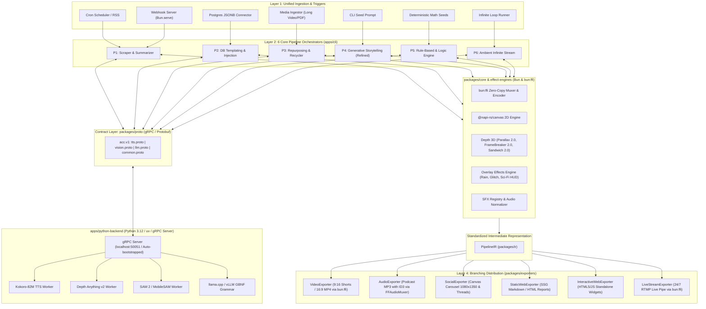
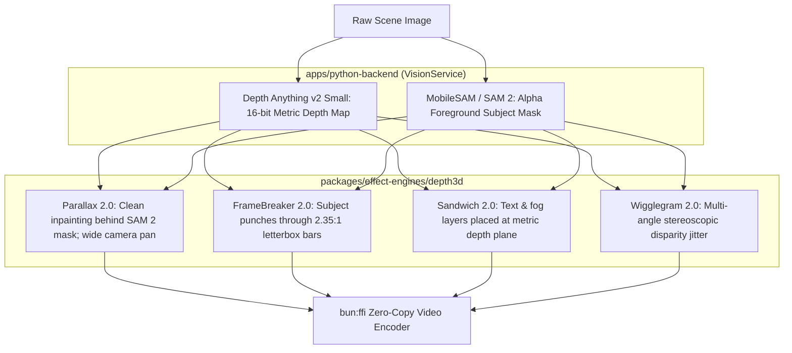

# ACC Master Implementation Plan (v3.0 - Refined & Verified)
## Turborepo Monorepo, gRPC AI Subsystem & 6-Pipeline Multi-Channel Engine

---

## 1. Executive Summary & Core Architectural Foundations

### 1.1. Core Thesis
> **"Build a decoupled, high-performance monorepo engine where Bun/TypeScript manages media rendering and pipeline orchestration, communicating via binary gRPC with an isolated Python AI backend, producing a standardized, future-proof Intermediate Representation (IR) that branches out into multi-channel distribution."**

### 1.2. Non-Negotiable System Principles & Logic Validations
1. **ZERO-REGRESSION GUARANTEE**:
   - `bun run cli.ts ./sample-story`, all existing CLI arguments, and `story-config.json` schema **MUST REMAIN 100% FUNCTIONAL**.
   - **Logic Fix**: To prevent breaking existing unit/stress tests in `autogenerated-tests/` and legacy scripts, the `src/` directory will retain lightweight **Shim/Barrel Facades** (`src/renderer.ts`, `src/core/FFmpegManager.ts`, `src/types.ts`) that re-export from new workspace packages.
2. **STRICT `bun:ffi` ZERO-COPY RENDERING (ZERO FFMPEG SPAWN)**:
   - All video encoding, audio DSP/mixing, subtitle burning, and RTMP live streaming **MUST exclusively use `bun:ffi`** (`libavcodec`, `libavformat`, `libavutil`, `swscale`, `swresample` via `FFIVideoEncoder`, `FFAudioMuxer`, `FFIConcatMuxer`, `FFIAudioDSP`).
   - `child_process.spawn('ffmpeg')` and `fluent-ffmpeg` are permanently prohibited.
3. **STRATEGY & FACADE PATTERNS**:
   - Every multi-backend domain (gRPC vs. Stdio IPC, Kokoro vs. VieNeu TTS, Depth Anything v2 vs. MiDaS, Canvas vs. Puppeteer) **MUST** implement the Strategy and Facade patterns for zero-downtime hot-swapping and resilient fallbacks.
4. **PORTABLE, LOCAL-FIRST AI MODELS (< 600MB Active Inference Memory)**:
   - **TTS**: Kokoro-82M (~80MB, broadcast quality, near-instant CPU synthesis).
   - **Depth**: Depth Anything v2 Small (~98MB, metric precision).
   - **Segmentation**: MobileSAM / SAM 2 Tiny (~39MB, instant subject mask extraction).
   - **Local LLM**: Qwen 2.5 3B-Instruct (GGUF Q4_K_M, ~1.9GB RAM) with strict GBNF JSON grammar.
   - **Logic Fix (Lazy Model Loading)**: Models are loaded on-demand via Lazy Singletons and support memory offloading after an idle timeout to prevent memory spikes on low-spec machines.
5. **AUTOMATIC DAEMON BOOTSTRAP**:
   - **Logic Fix**: The user is NEVER required to start the Python gRPC server manually in a separate terminal. The Bun runtime checks if the gRPC server is healthy on `127.0.0.1:50051`; if offline, `IPCFacade` automatically bootstraps `apps/python-backend` via `bun x uv run src/server.py` in the background within <1.5s.
6. **PRIMARY FOCUS**:
   - Priority 1: **Pipeline 1 (Event-Driven Scraper & Summarizer)**.
   - Priority 2: **Refining Pipeline 4 (Generative Storytelling with Depth Anything v2 + SAM 2)**.

---

## 2. High-Level System Architecture



---

## 3. Monorepo Directory Topology (`Turborepo` + `Bun Workspaces`)

```
acc-monorepo/
├── turbo.json                           # Turborepo task graph & caching rules
├── package.json                         # Root workspace definition & proxy scripts
├── bun.lock                             # Unified Bun lockfile
├── tsconfig.json                        # Root path mappings (@acc/core, @acc/proto, etc.)
├── cli.ts                               # Root proxy CLI ensuring backward compatibility
├── schema/
│   ├── story-config.schema.json         # Backward-compatible story configuration schema
│   └── pipeline.schema.json             # Generalized schema for all 6 pipelines
│
├── src/                                 # SHIM FACADES FOR ZERO REGRESSION
│   ├── renderer.ts                      # Re-exports from apps/cli/pipelines/04-generative-story
│   ├── types.ts                         # Re-exports from packages/ir & packages/core
│   └── core/
│       ├── FFmpegManager.ts             # Re-exports from packages/core
│       └── AssetContext.ts              # Re-exports from packages/core
│
├── packages/                            # REUSABLE TYPESCRIPT LIBRARIES
│   ├── proto/                           # Protobuf contracts & generated code
│   │   ├── proto/acc/v1/
│   │   │   ├── common.proto             # Shared structs (BoundingBox, Status, AudioMeta)
│   │   │   ├── tts.proto                # Streaming Kokoro & F5-TTS RPC
│   │   │   ├── vision.proto             # Depth Anything v2 & SAM 2 RPC
│   │   │   └── llm.proto                # GBNF JSON Grammar constrained LLM RPC
│   │   ├── src/generated/               # Code-generated TypeScript interfaces & stubs
│   │   └── package.json
│   │
│   ├── core/                            # Native Core Primitives
│   │   ├── src/
│   │   │   ├── FFmpegManager.ts         # Shared binary & dynamic library loader
│   │   │   ├── ffmpeg-ffi/              # Zero-copy FFI bindings (avcodec, avformat, etc.)
│   │   │   ├── AssetContext.ts          # Immutable asset state & ~/.acc global storage
│   │   │   ├── logger.ts                # Structured logger
│   │   │   └── ipc/                     # Auto-bootstrapping gRPC client + Stdio fallback
│   │   └── package.json
│   │
│   ├── ir/                              # Canonical Intermediate Representation
│   │   ├── src/
│   │   │   ├── PipelineIR.ts            # Root IR contract
│   │   │   ├── ContentChunk.ts          # Atomic chunk / slide / scene
│   │   │   ├── VisualLayer.ts           # Depth maps, subject masks, effects
│   │   │   └── AudioComposition.ts      # Multi-track audio, SFX markers, ducking
│   │   └── package.json
│   │
│   ├── effect-engines/                  # Multimedia Visual & Audio Effects
│   │   ├── src/
│   │   │   ├── depth3d/                 # Parallax 2.0, FrameBreaker 2.0, Sandwich 2.0
│   │   │   ├── overlay-effects/         # Rain, Snow, Glitch, SciFi HUD, Light Leaks
│   │   │   └── sound-effects/           # Sound Effects Registry, UI, Cinematic, Foley
│   │   └── package.json
│   │
│   └── exporters/                       # Multi-Channel Branching Exporters
│       ├── src/
│       │   ├── base/BaseExporter.ts
│       │   ├── video/VideoExporter.ts   # 9:16 / 16:9 MP4 via FFIVideoEncoder
│       │   ├── audio/AudioExporter.ts   # Podcast MP3 with chapters via FFAudioMuxer
│       │   ├── social/CarouselExporter.ts # 1080x1350 PNG via @napi-rs/canvas
│       │   ├── static-web/MarkdownSSGExporter.ts
│       │   ├── interactive-web/WidgetExporter.ts
│       │   └── live-stream/RTMPStreamExporter.ts # bun:ffi zero-copy live stream
│       └── package.json
│
└── apps/                                # EXECUTABLE APPLICATIONS & SERVICES
    ├── cli/                             # Primary Bun Executable
    │   ├── src/
    │   │   ├── index.ts                 # CLI entry router (run, story, scrape, sfx, overlay)
    │   │   ├── commands/                # Migrated SFX & Overlay interactive CLI commands
    │   │   └── pipelines/               # The 6 Pipeline Orchestrators
    │   │       ├── 01-scraper/          # Pipeline 1: Event-Driven Scraper & Summarizer
    │   │       ├── 02-db-templating/    # Pipeline 2: Database Injection & Templating
    │   │       ├── 03-repurposing/      # Pipeline 3: Repurposing & Recycler
    │   │       ├── 04-generative-story/ # Pipeline 4: Visual Storytelling (Migrated & Refined)
    │   │       ├── 05-rule-logic/       # Pipeline 5: Rule-based & Math Logic
    │   │       └── 06-ambient-loops/    # Pipeline 6: Infinite Ambient Stream
    │   └── package.json
    │
    └── python-backend/                  # Dedicated Python AI gRPC Service
        ├── pyproject.toml               # Managed by 'uv' (torch, grpcio, kokoro, etc.)
        ├── package.json                 # Turborepo task bridge
        ├── src/
        │   ├── server.py                # Main gRPC Server (127.0.0.1:50051)
        │   ├── generated/               # Python Protobuf stubs
        │   └── services/
        │       ├── tts_service.py       # Kokoro-82M streaming service
        │       ├── vision_service.py    # Depth Anything v2 + MobileSAM worker
        │       └── llm_service.py       # llama.cpp GBNF JSON Grammar worker
        └── tests/
```

---

## 4. Canonical Domain Contract (`PipelineIR`)

```typescript
// packages/ir/src/PipelineIR.ts

export type PipelineId = 
  | 'scraper-summarizer'      // Pipeline 1
  | 'db-templating'           // Pipeline 2
  | 'repurposing-recycler'    // Pipeline 3
  | 'generative-storytelling' // Pipeline 4
  | 'rule-logic'              // Pipeline 5
  | 'ambient-loops';          // Pipeline 6

export interface SegmentationMaskRef {
  maskPathOrBuffer: string | Buffer;  // SAM 2 / MobileSAM Alpha mask
  subjectClass: string;               // 'human' | 'product' | 'foreground'
  boundaryRect: { x: number; y: number; width: number; height: number };
}

export interface DepthMapRef {
  depthMapPathOrBuffer: string | Buffer; // Depth Anything v2 16-bit metric map
  minDepthMeters?: number;
  maxDepthMeters?: number;
}

export interface VisualAsset {
  type: 'image' | 'video' | 'canvas' | 'manim' | 'shader_buffer';
  sourcePathOrBuffer: string | Buffer;
  resolution: { width: number; height: number };
  subjectMask?: SegmentationMaskRef;     // For FrameBreaker 2.0 & Sandwich 2.0
  depthMap?: DepthMapRef;                // For Parallax 2.0 & Wigglegram 2.0
  appliedEffects?: Array<{
    effectId: string;
    variant: string;
    intensity: number;
  }>;
}

export interface ContentChunk {
  id: string;
  order: number;
  text?: string;                         // Narration text or raw summary
  spokenAudioPath?: string;              // Audio synthesized by Kokoro
  durationMs: number;
  visualAsset?: VisualAsset;
  metadata?: Record<string, unknown>;    // Stock tickers, math step results, etc.
}

export interface AudioComposition {
  narrationTrack?: {
    sampleRate: number;
    channels: number;
    loudnessLufs: number;                // EBU R128 (-14 LUFS)
  };
  backgroundMusic?: {
    audioPath: string;
    volume: number;
    loop: boolean;
  };
  sfxMarkers: Array<{
    id: string;
    offsetMs: number;
    durationMs: number;
    audioPath: string;
    volume: number;
    category: 'foley' | 'cinematic' | 'ui' | 'diegetic';
  }>;
  ducking: {
    enabled: boolean;
    attenuationDb: number;               // -16dB to -18dB
    attackMs: number;
    releaseMs: number;
  };
}

export interface PipelineIR {
  schemaVersion: '3.0.0';
  pipelineId: PipelineId;
  metadata: {
    jobId: string;
    title: string;
    createdAt: string;                   // ISO 8601
    tags: string[];
    author?: string;
  };
  chunks: ContentChunk[];
  audioComposition: AudioComposition;
  structuredData?: Record<string, unknown>; // Tabular / JSONB payload for P2 SSG & widgets
  distributionHints: {
    supportedExporters: Array<'video' | 'audio' | 'social' | 'static-web' | 'interactive-web' | 'live-stream'>;
    targetAspectRatios: Array<'9:16' | '16:9' | '1:1'>;
  };
}
```

---

## 5. Strategic Deep-Dive: Priority 1 (Event-Driven Scraper & Summarizer)

### 5.1. Data Ingestion Architecture
- **Webhooks**: High-performance HTTP endpoint hosted via `Bun.serve({ port: 3001 })` receiving JSON alerts (GitHub releases, crypto liquidation alerts, CMS updates).
- **Cron Scraper**: Periodic scraper reading RSS feeds or scraping web pages with Cheerio/Readability.

### 5.2. Zero-Hallucination Local LLM Grammar
- Communicates via `packages/proto/proto/acc/v1/llm.proto` with `apps/python-backend`.
- The Python worker enforces a strict GBNF JSON grammar using `llama.cpp` (Qwen 2.5 3B-Instruct model):
  ```json
  {
    "title": "string",
    "key_points": ["string", "string", "string"],
    "urgency_level": "low | medium | high | critical",
    "voiceover_script": "string (under 60 words)",
    "category": "finance | tech | breaking"
  }
  ```

### 5.3. Branching Multi-Channel Distribution & AV Sync
- **AV Sync Formula**: When syncing Kokoro TTS voiceover with Canvas-rendered slides in `VideoExporter`, the exact frame count is deterministically computed to avoid variable frame rate drift:
  $$\text{TotalFrames} = \left\lceil \frac{\text{DurationMs} \times \text{FPS}}{1000} \right\rceil$$
- **Branching Outputs**:
  1. **Static Web**: Emits Markdown post with Frontmatter for static blog/newsletter generators.
  2. **Social**: `@napi-rs/canvas` compiles a 1080x1080 breaking alert card with urgency badge in <8ms.
  3. **Audio**: Calls `TTSFacade` (Kokoro-82M) to generate voiceover, muxes with an intro chime via `FFAudioMuxer`, outputs `morning_briefing.mp3`.
  4. **Video**: Takes key point frames rendered via `@napi-rs/canvas`, synchronizes with Kokoro voiceover, encodes 1080x1920 MP4 via `FFIVideoEncoder`.

---

## 6. Strategic Deep-Dive: Priority 2 (Refining Pipeline 4 - Visual Storytelling)

### 6.1. Seamless Migration of Legacy Story Engine
1. The entire rendering logic from `src/renderer.ts` is relocated to `apps/cli/src/pipelines/04-generative-story/GenerativeStoryPipeline.ts`.
2. A transparent adapter translates existing `story-config.json` into `PipelineIR`.
3. The root `cli.ts` proxies commands: `bun run cli.ts ./sample-story` translates to calling `GenerativeStoryPipeline.render()`.
4. Tests in `autogenerated-tests/` pass with **zero regressions**.

### 6.2. Upgraded 3D Depth Suite with Depth Anything v2 & SAM 2


### 6.3. CLI Migration for Sound Effects & Overlays
- `sound-effects-cli.ts` $\to$ `apps/cli/src/commands/sfx.ts` (proxied via `bun run sound-effects`).
- `overlay-effects-cli.ts` $\to$ `apps/cli/src/commands/overlay.ts` (proxied via `bun run overlay-effects`).
- Interactive inquiry wizards (`askChoice`, `askYesNo`) remain fully functional.

---

## 7. Clarifications for Pipelines 2, 3, 5, 6

| Pipeline | Ingestion & Data Strategy | Core Processing | Exporters |
| :--- | :--- | :--- | :--- |
| **Pipeline 2: DB Templating** | **Data**: Smartphone specs, crypto metrics, housing stats.<br>**Ingestion**: Pipeline 1 auto-scrapes into PostgreSQL table `content_entities(id, category, data JSONB)`. | Data injected into `@napi-rs/canvas` layouts. Bar Chart Racing animated in memory. | **Static Web** (SEO comparison articles), **Social** (1080x1350 spec carousels), **Video** (Chart racing). |
| **Pipeline 3: Repurposing** | Ingests long MP4 webinars or PDF books. | Whisper.cpp extracts word timestamps $\to$ LLM extracts hooks $\to$ YOLO tracks active speaker face coordinates. | **Video** (TikTok 9:16 auto-cropped with hardcoded karaoke subtitles), **Social** (Twitter 7-tweet thread). |
| **Pipeline 5: Rule & Math** | Seed mathematical formulas / calculus problems. | Deterministic Python/JS math solver (LLMs forbidden from calculating) $\to$ Manim sidecar renders animation frames. | **Video** (Hand-drawn equation solving animation), **Social** (Formula flashcards), **Static Web** (Cheat sheets). |
| **Pipeline 6: Ambient Loops** | Procedural WebGL / Shader loop + 30s music loops. | AudioCraft/Procedural synth mixer $\to$ raw RGBA frames & PCM audio pushed directly to `bun:ffi` RTMP muxer (Zero-OBS). | **Live Stream** (24/7 continuous YouTube Live broadcast using <400MB RAM). |

---

## 8. Complete Phased Implementation Roadmap

### Phase 0: Turborepo Monorepo & Workspace Scaffolding (Zero-Regression)
*Objective: Transform repository structure into a clean Monorepo without breaking any existing commands or workflows.*
- [ ] **Task 0.1**: Initialize `turbo.json` and configure `workspaces: ["packages/*", "apps/*"]` in root `package.json`.
- [ ] **Task 0.2**: Create `packages/core` and migrate `FFmpegManager.ts`, `ffmpeg-ffi/`, `AssetContext.ts`, `logger.ts`.
- [ ] **Task 0.3**: Create `packages/ir` and implement canonical `PipelineIR.ts` and related interfaces.
- [ ] **Task 0.4**: Create `apps/cli` and move existing `renderer.ts` logic into `apps/cli/src/pipelines/04-generative-story/`.
- [ ] **Task 0.5**: Setup root proxy `cli.ts` and shims in `src/` so `bun run cli.ts ./sample-story` and `bun run render` execute seamlessly.
- [ ] **Verification**: Run `bun run cli.ts ./sample-story` $\to$ output video must match baseline bit-for-bit.

### Phase 1: Protobuf Contracts & Python gRPC Backend Integration
*Objective: Build the typed communication bridge between Bun and the Python AI runtime.*
- [ ] **Task 1.1**: Create `packages/proto` with `common.proto`, `tts.proto`, `vision.proto`, `llm.proto`.
- [ ] **Task 1.2**: Set up code-generation (`buf generate` or `protoc`) producing TypeScript types and Python stubs.
- [ ] **Task 1.3**: Initialize `apps/python-backend` using `uv` with `grpcio`, `torch`, `numpy`.
- [ ] **Task 1.4**: Implement `server.py` supporting standard TCP (`127.0.0.1:50051`) with auto-bootstrap in `IPCFacade`.
- [ ] **Task 1.5**: Implement `IPCFacade` and `GRPCAIStrategy` in `packages/core`, with fallback to legacy `StdioLineBufferStrategy`.
- [ ] **Verification**: Run gRPC ping-pong test between Bun client and Python server.

### Phase 2: Branching Exporter Suite
*Objective: Implement decoupled exporters in `packages/exporters`.*
- [ ] **Task 2.1**: Implement `BaseExporter.ts` contract.
- [ ] **Task 2.2**: Implement `VideoExporter.ts` (wrapping `FFIVideoEncoder` and `FFAudioMuxer` for 9:16 and 16:9 MP4).
- [ ] **Task 2.3**: Implement `AudioExporter.ts` (producing broadcast-compliant MP3 with ID3 chapters).
- [ ] **Task 2.4**: Implement `SocialExporter.ts` (`@napi-rs/canvas` multi-slide PNG carousel generator).
- [ ] **Task 2.5**: Implement `StaticWebExporter.ts` (Markdown article and JSON metadata generator).
- [ ] **Verification**: Pass mock `PipelineIR` through all 4 exporters and inspect disk artifacts.

### Phase 3: Pipeline 4 Refinement (Depth Anything v2 + SAM 2 + bun:ffi)
*Objective: Elevate Visual Storytelling into a cinematic engine.*
- [ ] **Task 3.1**: Implement `VisionService` in Python backend integrating **Depth Anything v2 Small** (~98MB) and **MobileSAM** (~39MB) with lazy loading.
- [ ] **Task 3.2**: Refactor `packages/effect-engines/depth3d`:
  - Upgrade `parallax.ts` $\to$ **Parallax 2.0** (inpainting background behind SAM 2 mask).
  - Upgrade `frame-breaker.ts` $\to$ **FrameBreaker 2.0** (subject mask breaking 2.35:1 letterbox bars).
  - Upgrade `sandwich.ts` $\to$ **Sandwich 2.0** (metric depth slicing).
  - Upgrade `wigglegram.ts` $\to$ **Wigglegram 2.0** (stereoscopic disparity jitter).
- [ ] **Task 3.3**: Migrate `sound-effects-cli.ts` and `overlay-effects-cli.ts` into `apps/cli/src/commands/`.
- [ ] **Verification**: Render `sample-story` with 3D Depth enabled and verify visual quality enhancement.

### Phase 4: Pipeline 1 Implementation (Event-Driven Scraper & Summarizer)
*Objective: Build high-speed event ingestion, local LLM grammar extraction, and multi-channel fanning.*
- [ ] **Task 4.1**: Implement `ScraperEngine.ts` (cron fetcher + `Bun.serve` webhook listener).
- [ ] **Task 4.2**: Implement `LLMService` in Python backend using `llama.cpp` / GBNF JSON grammar for Qwen 2.5 3B.
- [ ] **Task 4.3**: Implement `TTSFacade` with **Kokoro-82M** streaming strategy in Python backend.
- [ ] **Task 4.4**: Wire `01-scraper/ScraperPipeline.ts` to output `NewsDigestIR`.
- [ ] **Task 4.5**: Connect to all 4 exporters (Markdown report, Canvas alert PNG, Morning podcast MP3, 60s recap video).
- [ ] **Verification**: Send mock webhook payload $\to$ verify all 4 channel assets are generated automatically in <10 seconds.

### Phase 5: Pipelines 2, 3, 5, 6 Implementation
*Objective: Complete the remaining specialized pipelines.*
- [ ] **Task 5.1 (Pipeline 2)**: PostgreSQL JSONB connector + Canvas comparison template renderer.
- [ ] **Task 5.2 (Pipeline 3)**: Whisper.cpp timestamps + YOLO active speaker face-tracking 9:16 crop filter.
- [ ] **Task 5.3 (Pipeline 5)**: Deterministic math solver + Manim Python animation worker.
- [ ] **Task 5.4 (Pipeline 6)**: Procedural ambient audio mixer + `bun:ffi` zero-copy RTMP live stream pump.
- [ ] **Verification**: End-to-end execution of sample scenarios for each pipeline.

### Phase 6: Unified CLI, Schemas & Production Tooling
*Objective: Finalize CLI user experience and documentation.*
- [ ] **Task 6.1**: Finalize unified CLI command structure:
  - `acc run <pipeline_id> --config <path> [--exporters video,audio,social]`
  - `acc stream <pipeline_id> --rtmp <url>`
  - `acc serve --port <port>`
- [ ] **Task 6.2**: Synchronize all schemas in `schema/` and documentation in `docs/`.
- [ ] **Task 6.3**: Run full test suite in `autogenerated-tests/`.
