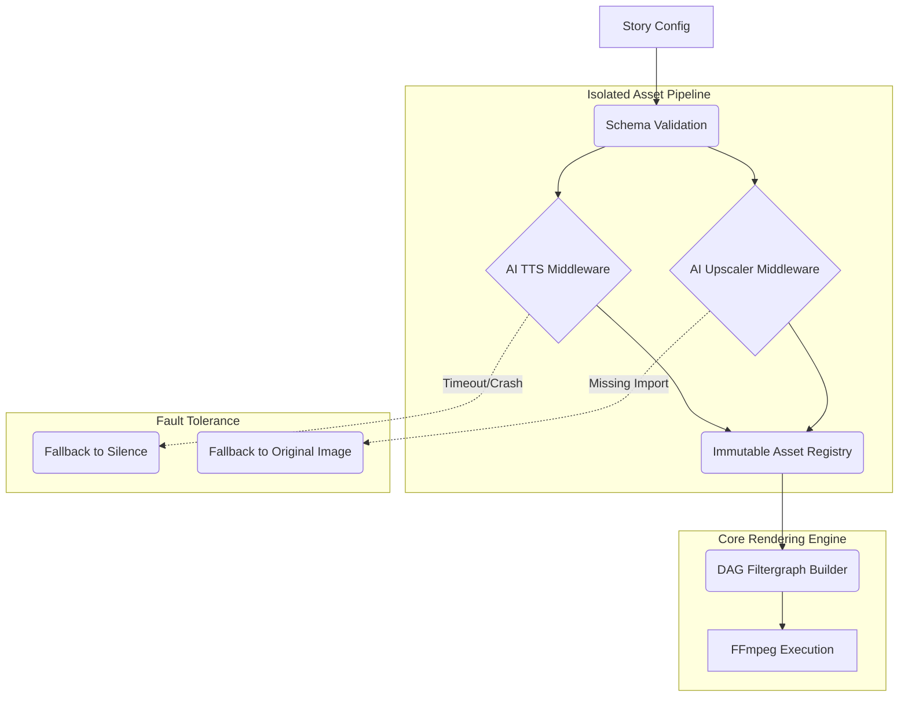

# System Architecture Vision & Stability Roadmap

**Document Status:** Proposed / Active Draft
**Objective:** Decouple monolithic rendering logic, isolate experimental features, and guarantee zero-regression stability for the Visual Storytelling Generator.

---

## 1. Executive Summary

As the project has evolved from a basic slideshow stitcher into a complex multimedia engine (integrating AI upscaling, 3D depth meshes, TTS daemons, and procedural overlay effects), the core architecture has become heavily coupled. Recent regressions (e.g., missing imports crashing the main render, FFmpeg syntax errors from string concatenation) highlight the need for a structural shift.

This document outlines a transition to a **Middleware Pipeline Architecture** combined with a **Directed Acyclic Graph (DAG) for FFmpeg Filters**. This shift will isolate experimental features, sandbox volatile AI tasks, and ensure that bugs in new modules never break the core rendering workflow.

---

## 2. Current Pain Points (The Monolith)

### 2.1. "God Object" Core Renderer (`src/renderer.ts`)
The main rendering loop currently handles file system checks, concurrency pools, hardware acceleration checks, AI binary downloads, execution, and FFmpeg command compilation. 
* **The Weakness:** Tight coupling means a failure in an optional dependency (like an upscaler network timeout) can fatally crash the entire job.

### 2.2. String-Concatenated Filtergraphs
Complex FFmpeg operations (transitions, audio ducking, overlays, scaling) are built using raw string concatenation (e.g., `` `${lastV}${nextV}xfade...` ``).
* **The Weakness:** Highly fragile. A single duplicate stream label (`[v_out]`) or missing semicolon invalidates the entire command. It is virtually impossible to unit-test visually or statically.

### 2.3. Mutable Context State
Modules mutate the configuration object on the fly (e.g., overwriting `scene.resolvedImage` with an upscaled cache path).
* **The Weakness:** Destroys idempotency. If a render fails midway and needs to retry, or if a user wants to preview multiple variations, the original state is lost.

---

## 3. Target Architecture: The Isolated Pipeline

To achieve **Workflow Isolation**, we will adopt a design pattern popularized by robust web servers (Express/Koa) and data pipelines (GStreamer).

### 3.1. The Middleware Pipeline Pattern
Features will no longer be hardcoded into the core renderer. Instead, `renderer.ts` becomes a "Pipeline Orchestrator". Features (TTS, ESRGAN, 3D Depth) are registered as **Middlewares**.



**Fault Isolation:** If a middleware throws an exception, the orchestrator catches it, logs a warning, and skips the mutation, passing the *original asset* to the next stage. The video still renders successfully.

### 3.2. Immutable Asset Registry
Instead of mutating the `scene` configuration in place, middlewares will append generated artifacts to an Immutable Context Payload.
```typescript
// Middleware Output Example
context.assets.register('scene_1', 'image:upscaled', newCachePath);

// Renderer Request
const targetImg = context.assets.getPreferred('scene_1', ['image:upscaled', 'image:original']);
```
This guarantees that the original user configuration is preserved for caching, retries, and debugging.

### 3.3. FFmpeg Directed Acyclic Graph (DAG) Builder
String concatenation for `filter_complex` will be replaced by an Object-Oriented Graph system.
* **Nodes:** Represent filters (`scale`, `xfade`, `overlay`).
* **Edges:** Represent stream routing.
* **Validation:** The DAG compiler will topologically sort the nodes, automatically assign unique labels (e.g., `[v_node_1]`), and throw compilation errors for circular dependencies *before* invoking FFmpeg.

### 3.4. Sub-process Sandboxing (Actor Model)
Highly volatile operations (Python TTS Daemons, GPU-bound AI upscalers) will execute in isolated Worker Threads or external processes with strict **Timeouts and Resource Limits**. If a daemon hangs, the orchestrator will kill it and seamlessly fall back to a safe default.

---

## 4. Incremental Migration Strategy (The Strangler Fig)

We will not rewrite the application from scratch. We will upgrade the system in three safe, non-breaking phases.

### Phase 1: Interfaces & Defensive Fallbacks (Immediate)
* Extract features (`upscaler.ts`, `depth3d.ts`) into formal classes implementing an `IPlugin` interface.
* Wrap all feature invocations in `src/renderer.ts` with strict `try/catch` blocks.
* Ensure every catch block provides a seamless fallback (e.g., return the 2D image if 3D depth fails).

### Phase 2: The DAG Filter Builder (Near-Term)
* Implement the `FFmpegFilterGraph` utility class.
* Migrate the simplest string-based filters (like basic scaling and padding) to the DAG.
* Gradually migrate complex multi-layer overlays (from `overlay-effects-cli.ts`) and transitions (`xfade`) to the DAG system.

### Phase 3: The Pipeline Orchestrator (Long-Term)
* Refactor the core `renderStoryVideo` loop into a `PipelineRunner`.
* Implement a **Dry-Run Mode**: Validate the DAG by running `ffmpeg -f null -` on the generated command (executes in <1 second) to catch syntax errors before committing to a full 10-minute CPU render.
