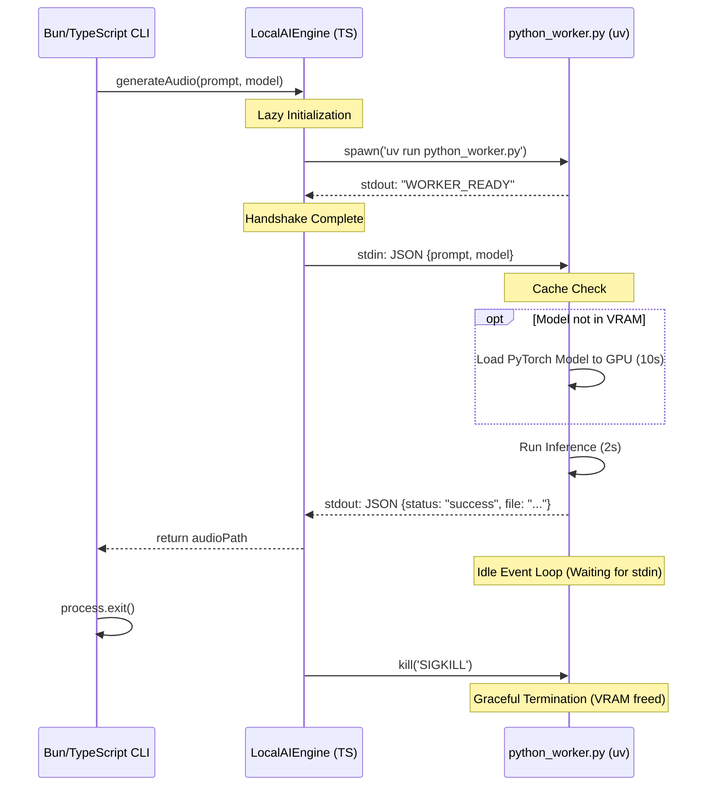

# Local Inference Backend Architecture & Lifecycle

This document explains the architecture and operational lifecycle of the **Local Inference Backend** used for generating Generative AI sound effects natively on the user's machine, without relying on external cloud APIs or API keys.

## 1. Architectural Overview

The system uses a **Strategy Pattern** combined with a **Daemon/Worker IPC (Inter-Process Communication) Pattern** to bridge the TypeScript/Bun environment with the Python Deep Learning ecosystem (PyTorch, Diffusers).

- **TypeScript (`LocalAIEngine.ts`)**: Acts as a Singleton Manager and lifecycle controller.
- **Python (`python_worker.py`)**: Acts as a persistent background daemon holding AI models (e.g., AudioLDM 2) in VRAM and executing inference.



## 2. The 5-Phase Lifecycle

To ensure performance (avoiding 10+ second load times per file) and prevent memory leaks, the bridge is strictly managed through five phases:

### Phase 1: Lazy Initialization
The Python environment is **not** booted when the CLI starts. It is lazily initialized only when the first AI sound effect is requested.
TypeScript utilizes `child_process.spawn` to launch the script using `uv run`. The `uv` package manager automatically reads the PEP 723 inline metadata inside the Python script to provision a virtual environment (`.venv`) and install requirements transparently.

### Phase 2: Handshake (IPC Initialization)
Upon launching, the Python script initializes its imports and outputs `WORKER_READY` to standard output. 
TypeScript blocks the generation pipeline, listening to `stdout` until this exact flag is received, ensuring requests are not sent into a void.

### Phase 3: Model Memory Caching
When Python receives a generation request via `stdin`, it checks an internal dictionary `_pipelines`. 
- **First Run**: It downloads the model from Hugging Face Hub (if not locally cached) and loads the massive 2GB-5GB weights into the GPU (CUDA) or CPU.
- **Subsequent Runs**: It bypasses the loading sequence entirely, routing the prompt directly to the warmed-up model, speeding up batch generation exponentially.

### Phase 4: Idle Event Loop
The Python worker is driven by a `for line in sys.stdin:` loop. 
When no tasks are queued, the process enters an **Idle state** (0% CPU usage) while retaining the model in VRAM. It wakes up instantly when TypeScript pipes a new JSON string into `stdin`, processes the audio via `diffusers`, saves the `.wav`, and writes a success JSON back to `stdout`.

### Phase 5: Graceful Termination
When the TypeScript CLI finishes its execution or is forcefully interrupted (e.g., `Ctrl+C`), it triggers events bound to `process.on('exit')`, `SIGINT`, and `SIGTERM`. 
The `LocalAIEngine` intercepts these events and sends a termination signal to the Python child process. This guarantees that the Python daemon is killed instantly, averting zombie processes and ensuring 100% of the VRAM/RAM is released back to the operating system.

## 3. Dependency Management (PEP 723)

Instead of a fragmented `requirements.txt`, the Python script is self-contained using PEP 723 inline script metadata. The `transformers` library is strictly pinned to `<4.39.0` to avoid generation bugs inherent in the GPT2 architecture of AudioLDM 2.

```python
# /// script
# requires-python = ">=3.10"
# dependencies = [
#     "torch",
#     "diffusers",
#     "transformers<4.39.0",
#     "soundfile",
#     "scipy"
# ]
# ///
```

