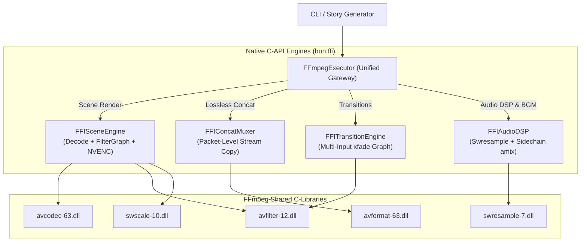

# 🏛️ Comprehensive Plan: 100% Migration from `Bun.spawn` to Native `bun:ffi`

## 1. Kết quả điều tra hiện trạng (Investigation Findings)

### 1.1. Tại sao `FFmpegExecutor.ts` vẫn gọi `Bun.spawn`?
Trong bước refactor trước, chúng ta đã gỡ bỏ `fluent-ffmpeg` và thay thế thành công hàm đo thời lượng bằng Native FFI (`getMediaDurationFFI` trực tiếp từ `avformat_open_input`).
Tuy nhiên, trong `src/core/FFmpegExecutor.ts`:
- Class `FFmpegCommand` hiện tại vẫn đang đóng vai trò là một **Command-Line Builder** (nối chuỗi tham số CLI: `-i`, `-filter_complex`, `-c:v`, `-map`, v.v.).
- Phương thức `FFmpegCommand.run()` vẫn đang gọi:
  ```typescript
  const proc = Bun.spawn({
    cmd: [ffmpegPath, ...args],
    stdout: 'pipe',
    stderr: 'pipe',
  });
  ```
- Do đó, khi `src/renderer.ts` thực hiện render từng cảnh (`renderSingleScene`), ghép chuyển cảnh (`concatenateWithTransitions`), mix nhạc nền BGM, hay chạy Whisper và Overlays, tiến trình `ffmpeg.exe` thực chất **vẫn được khởi tạo và chạy ngầm** thông qua `Bun.spawn`.

---

### 1.2. Phân tích các tham số phức tạp đang truyền vào `spawn`
Toàn bộ hệ thống hiện đang dựa vào các cụm cờ CLI vô cùng phức tạp:

| Vị trí gọi | Thao tác thực tế | Danh sách tham số phức tạp | Thách thức khi chuyển sang FFI |
| :--- | :--- | :--- | :--- |
| **`renderer.ts: renderSingleScene`** | Loop ảnh / cắt B-roll video + Audio + Subtitles + Pad | `-loop 1`, `-t`, `-stream_loop -1`, `-filter_complex "scale=...:force_original_aspect_ratio=decrease,pad=...,subtitles='...',tpad=...,amix=..."`, `-shortest`, `-c:v h264_nvenc\|libx264`, `-crf`, `-preset`, `-c:a aac` | Cần phối hợp đồng thời: Decoder ảnh/video $\rightarrow$ FilterGraph (`libavfilter`) $\rightarrow$ Hardware Encoder $\rightarrow$ Container Muxer. |
| **`renderer.ts: concatenateVideos`** | Ghép nối stream lossless | `-f concat -safe 0 -i list.txt -c copy -map 0` | Không cần decode, nhưng cần đọc từng packet `AVPacket` qua `av_read_frame`, tính toán lại `pts`/`dts` lũy kế và ghi vào output bằng `av_interleaved_write_frame`. |
| **`renderer.ts: concatenateWithTransitions`** | Chuyển cảnh `xfade` & `acrossfade` đa kênh | N inputs song song, chuỗi `xfade=transition=fade:duration=1:offset=...`, `acrossfade=d=1`, stream mapping `-map [v_trans_i] -map [a_trans_i]` | `libavfilter` phải nhận đồng thời $N$ input streams, duy trì đồng bộ timestamp giữa âm thanh và hình ảnh. |
| **`renderer.ts: BGM Auto-Ducking`** | Lặp nhạc nền + Nén sidechain theo giọng đọc | `-stream_loop -1 -i bgm.mp3`, `asplit=2`, `sidechaincompress=threshold=-24dB:ratio=5:attack=10:release=300`, `amix=inputs=2:duration=first` | Cần cấu hình filtergraph âm thanh phức tạp với các input pad bất đối xứng về tốc độ lấy mẫu (Sample Rate) và số kênh. |
| **`overlay-effects/stacker.ts`** | Chồng lớp hiệu ứng đa chu kỳ (Polyrhythmic Overlays) | `-c:v libvpx-vp9 -stream_loop -1 -i overlay.webm`, `overlay=shortest=1:format=auto` hoặc `blend=all_mode=screen` | Alpha channel blending (`yuva420p` sang `yuv420p`) trong bộ nhớ RAM. |
| **`whisper.ts`** | Trích xuất audio 16kHz Mono PCM | `-vn -ar 16000 -ac 1 -c:a pcm_s16le -f wav` | Sử dụng `libswresample` để resample audio buffer trực tiếp trong RAM không qua file trung gian. |

---

## 2. Kiến trúc giải pháp (Architectural Solution)

> [!IMPORTANT]
> **Không thể và không nên viết một trình "Generic CLI String Parser" bằng FFI**:
> Mã nguồn của `ffmpeg.c` trong FFmpeg CLI dài hơn 15.000 dòng C chuyên chỉ để parse string CLI. Nếu chúng ta cố parse chuỗi `-c:v`, `-map`, `-filter_complex` trong JS, code sẽ cực kỳ mỏng manh và dễ gây sập bộ nhớ (Segfault).
>
> **Giải pháp chuẩn công nghiệp**: Thay thế `FFmpegCommand` bằng **Bộ 4 Pipeline FFI Chuyên biệt (Specialized FFI Engines)**:



---

## 3. Lộ trình triển khai chi tiết (Implementation Phases)

### Giai đoạn 1: Chuẩn hóa TimeBase, Timestamp & Codec Context (`FFIVideoEncoder`)
- **Vấn đề đã thấy ở lần chạy trước**: `[libx264] The encoder timebase is not set` $\rightarrow$ Mã hóa thất bại và phải fallback.
- **Triển khai**:
  - Mapping cấu trúc `AVCodecContext` để gán đúng `time_base = {1, fps}` và `framerate = {fps, 1}` bằng `makeAVRational(1, fps)`.
  - Thiết lập cơ chế fallback phần cứng chuẩn: Thử mở `h264_nvenc` $\rightarrow$ nếu không có GPU NVIDIA thì fallback sang `libx264`.
  - Cấu hình CRF / Preset / Bitrate trực tiếp qua `av_opt_set` và `av_opt_set_int`.

### Giai đoạn 2: In-Memory Lossless Concat Engine (`FFIConcatMuxer`)
- **Mục tiêu**: Loại bỏ hoàn toàn `-f concat` và file tạm `concat_list.txt`.
- **Triển khai**:
  - Mở từng video phân đoạn bằng `avformat_open_input`.
  - Khởi tạo file đích bằng `avformat_alloc_output_context2`.
  - Copy codec parameters của stream video/audio từ phân đoạn 1 sang file đích.
  - Chạy vòng lặp `av_read_frame`:
    - Cộng dồn thời lượng của các phân đoạn trước vào `pkt.pts` và `pkt.dts`.
    - Ghi thẳng sang file đích bằng `av_interleaved_write_frame` mà **không cần giải mã hay encode lại** (tốc độ copy cực nhanh, 0% CPU loss).

### Giai đoạn 3: Engine FilterGraph & Phụ đề ASS trong RAM (`FFIFilterGraph`)
- **Mục tiêu**: Thay thế toàn bộ chuỗi `-filter_complex`, `-vf scale`, `subtitles=...`.
- **Triển khai**:
  - Hoàn thiện module `FFIFilterGraph.ts`:
    - Tạo `buffersrc` (video & audio) và `buffersink`.
    - Sử dụng `avfilter_graph_parse2` để compile toàn bộ chuỗi đồ thị (scale, pad, subtitles, tpad). Thư viện `libavfilter-12.dll` đã biên dịch sẵn `libass`, tự động render font phụ đề.
    - Đưa `AVFrame` vào qua `av_buffersrc_add_frame_flags` $\rightarrow$ Rút frame đã áp hiệu ứng qua `av_buffersink_get_frame`.

### Giai đoạn 4: Audio Resampler & Ducking (`FFIAudioDSP`)
- **Mục tiêu**: Thay thế lệnh spawn của `whisper.ts` và logic mix BGM trong `renderer.ts`.
- **Triển khai**:
  - `whisper.ts`: Dùng `libswresample` (`swr_alloc_set_opts2`, `swr_convert`) để convert trực tiếp audio sang 16kHz Mono S16LE trong bộ nhớ RAM, trả về `Buffer` cho Whisper ONNX mà không tạo file `.wav` rác.
  - BGM Auto-Ducking: Cấu hình đồ thị audio 2 ngõ vào (`[0:a]` và `[1:a]`) với các node `sidechaincompress` và `amix` qua `FFIFilterGraph`.

### Giai đoạn 5: Tích hợp vào `FFmpegExecutor` & Gỡ bỏ 100% `Bun.spawn`
- **Mục tiêu**: Chuyển hướng các phương thức của `FFmpegCommand` sang các FFI Engine tương ứng.
- **Triển khai**:
  - Sửa đổi `FFmpegCommand.run()`: Thay vì gọi `Bun.spawn`, phương thức sẽ phân tích ngữ cảnh đầu vào (render scene đơn, concat, hay transition) và ủy quyền thực thi trực tiếp cho FFI Engine tương ứng trong cùng tiến trình Bun.
  - Xóa bỏ hoàn toàn lời gọi `Bun.spawn` khỏi toàn bộ codebase.

---

## 4. Quản lý rủi ro kỹ thuật (Technical Risks & Defense)

| Rủi ro kỹ thuật | Mức độ | Phương án xử lý |
| :--- | :--- | :--- |
| **Segmentation Fault (Truy cập con trỏ C không hợp lệ)** | Cao | Luôn bọc các hàm cấp phát FFI trong cấu trúc `try { ... } finally { av_free... }`. Kiểm tra giá trị con trỏ pointer khác `0n` trước khi truy xuất. |
| **Lỗi rò rỉ bộ nhớ (Memory Leak)** | Trung bình | Giải phóng mọi `AVFrame`, `AVPacket`, `AVFormatContext` ngay sau mỗi chu kỳ xử lý frame. Gọi `av_frame_unref` trước khi tái sử dụng frame buffer. |
| **Xung đột Timestamp (Non-monotonous DTS)** | Trung bình | Khi chuyển giữa các cảnh hoặc lặp lại audio BGM, luôn tính toán lại `pts = pts + previous_duration` để đảm bảo timestamp tăng đơn điệu, tránh hỏng file MP4. |

---

## 5. Tiêu chí hoàn thành (Definition of Done)
1. Trong toàn bộ thư mục `src/` không còn tồn tại bất kỳ dòng lệnh `spawn`, `Bun.spawn`, hay `exec`.
2. Lệnh `bun run cli.ts ./sample-story` chạy hoàn tất từ đầu đến cuối chỉ với các thư viện `.dll` / `.so` được nạp trong bộ nhớ RAM qua `bun:ffi`.
3. Video đầu ra `output/*.mp4` đồng bộ hoàn hảo giữa hình ảnh, âm thanh, phụ đề karaoke, chuyển cảnh `xfade` và nhạc nền BGM.
