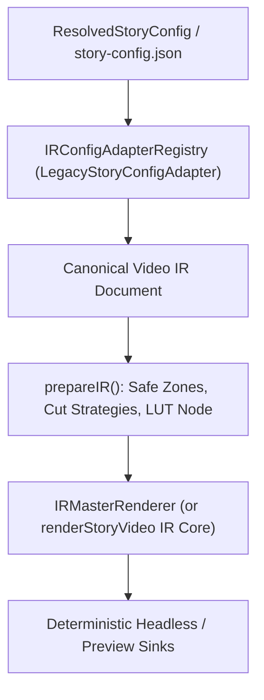
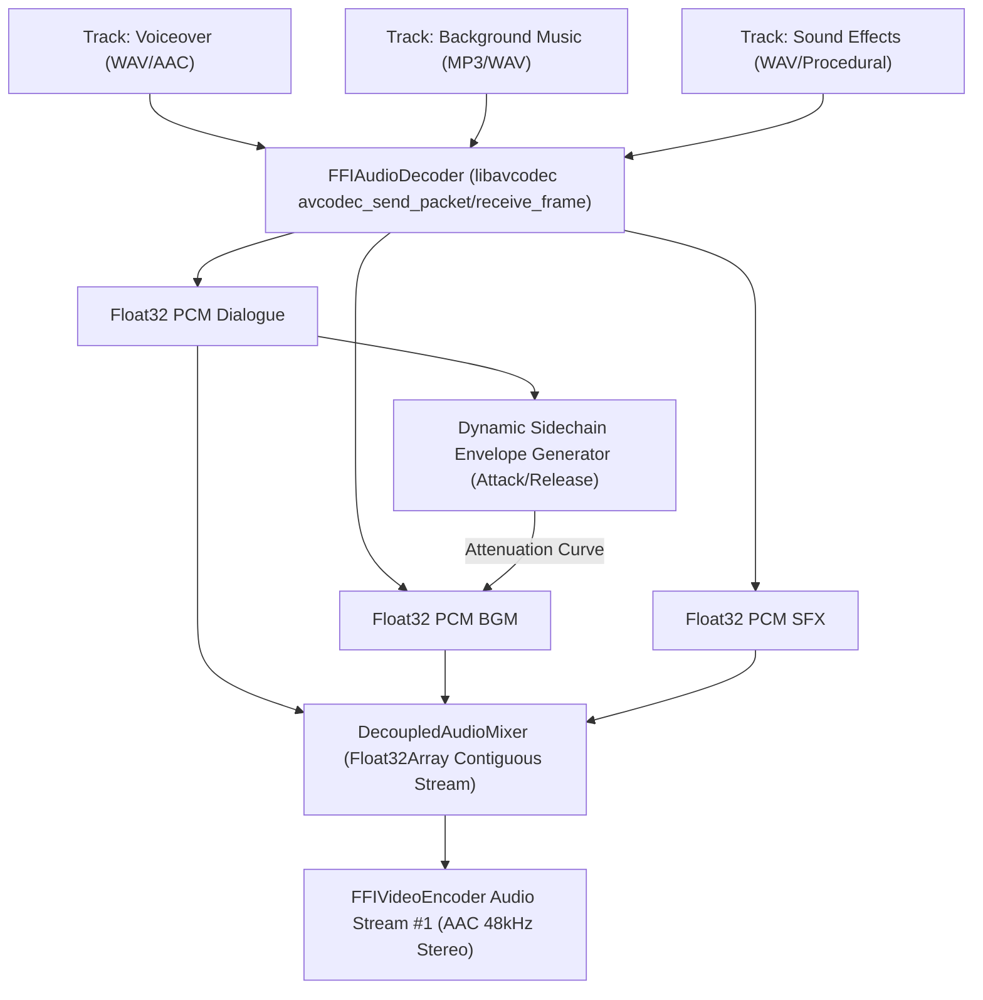

# Comprehensive Tri-Pillar Architecture Plan: Parity, Native Audio, & Multi-Scene Memory Optimization

## 1. Executive Summary & Vision

This master plan synthesizes three foundational architectural pillars required to make the Visual Storytelling Generator production-grade across all workflows:

```
┌────────────────────────────────────────────────────────────────────────────────────────┐
│                                 TRI-PILLAR ARCHITECTURE                                │
├────────────────────────────┬────────────────────────────┬──────────────────────────────┤
│          PILLAR 1          │          PILLAR 2          │           PILLAR 3           │
│    Backlog [013] Parity    │  Universal Video IR Audio  │     Memory & Performance     │
│   (processAndRender SSOT)  │  (Native DSP & Mixdown)    │   (Multi-Scene Zero-Alloc)   │
└────────────────────────────┴────────────────────────────┴──────────────────────────────┘
```

1. **Pillar 1: Backlog `[013]` – IR Pipeline (`processAndRender`) Feature Parity with `renderStoryVideo`**
   - Eliminate dual diverging pipelines: bridge safe-zone calculations, dynamic platform typography overrides, J/L-cut calculations, and LUT color grading directly into the rendering lifecycle.
   - Establish a clean single source of truth (SSOT) where `renderStoryVideo` is backed directly by the Canonical IR pipeline.
2. **Pillar 2: Universal Video IR Audio Mixing & Master Voiceover Enhancements**
   - Fully integrate MP3/WAV decoders into `DecoupledAudioMixer` with zero external child processes.
   - Implement dynamic sidechain ducking (BGM ducks automatically during voiceover / dialogue intervals).
   - Seamlessly loop background music and map multi-track sound effects (SFX) with spatial audio panning directly in memory.
3. **Pillar 3: Performance & Memory Optimization on Large Multi-Scene Stories**
   - Address nursery GC pressure during 28+ scene batch renders via **FFI Buffer Recycling** (reusable `AVPacket`, `AVFrame`, and C-malloc pointers).
   - Ensure hardware encoder parity (`h264_nvenc`) with seamless automatic fallback to `libx264`.
   - Prevent memory leaks from Canvas image buffers across 28+ parallel scenes.

---

## 2. Pillar 1: Backlog `[013]` – IR Pipeline Parity & SSOT Consolidation

### 2.1 Problem Analysis
Currently, `VideoEditPipelineOrchestrator` has two separate render paths:
1. `renderStoryVideo(config)`: The active production entrypoint that handles worker pools, 3D Depth, xfade transitions, overlays, BGM, and FFI concatenation.
2. `processAndRender(ir)`: An experimental pipeline holding advanced NLE capabilities:
   - Safe-zone margin enforcement (`SafeZoneManager.getMargins('tiktok' | 'youtube')`)
   - Platform-aware typography style mapping
   - J-cut / L-cut audio-video lead/lag calculations (`EditingOpFactory`)
   - LUT color grading filter generation (`ColorGradingEngine`)

Because `renderStoryVideo` was not consuming these calculated parameters, production renders lacked LUT grading and safe-zone margin adjustments.

### 2.2 Architectural Integration Plan


#### Detailed Work Items:
1. **Refactor `prepareIR()`:**
   - Extract the preparation phase from `processAndRender` into a reusable method:
     `public static prepareIR(ir: PipelineIR, options: RenderOptions): PreparedPipelineIR`
   - Calculate safe margins for typography overlays (e.g. bottom 220px margin on TikTok to avoid bottom UI buttons).
   - Compute J/L-cut timing offsets using `EditingOpFactory.getCutStrategy()`.
2. **Lossless Adapter Upgrades:**
   - Update `packages/ir/src/LegacyStoryConfigAdapter.ts` to forward:
     - 3D Depth configurations (`scene.depth3d`)
     - Sound effects (`scene.sfx`, `config.settings.sfx`)
     - BGM parameters (`volume`, `loop`, `fadeIn`, `autoDucking`)
     - LUT / Color grading settings (`config.settings.lut`)
3. **LUT Color Grading Pass in Canvas Frame Loop:**
   - Instead of generating an FFmpeg `-vf` string that cannot run in pure FFI, implement a 1D/3D LUT lookup in `@acc/effect-engines/styles` or apply contrast/saturation directly during Canvas master composite pass.
4. **Transition from `processAndRender` to Single Unified Pipeline:**
   - Make `renderStoryVideo` adapt `ResolvedStoryConfig` into Video IR, execute `prepareIR()`, and render via `IRMasterRenderer`.

---

## 3. Pillar 2: Universal Video IR Audio Mixing & Master Voiceover Enhancements

### 3.1 Current Status & Gaps
In `packages/ir/src/renderer/audio/DecoupledAudioMixer.ts`:
- WAV files are parsed via an internal `decodeWav()` helper.
- MP3 files (e.g. `bgm.mp3`) cannot be decoded by `decodeWav()`, resulting in silent BGM in the IR pipeline.
- Sidechain ducking is only partially implemented as a constant multiplier rather than a smooth attack/decay envelope.

### 3.2 Native Audio Architecture Plan



#### Detailed Work Items:
1. **Universal FFI Audio Decoder (`FFIAudioDecoder.ts`):**
   - Create an in-memory audio decoder leveraging `bun:ffi` (`libavcodec` / `libavformat` / `libswresample`).
   - Accepts any audio file format (`.mp3`, `.wav`, `.aac`, `.flac`, `.ogg`, `.m4a`).
   - Automatically resamples audio to standard **48,000 Hz, 32-bit Float, Stereo** (`AV_SAMPLE_FMT_FLT`).
2. **Dynamic Sidechain Ducking Envelope:**
   - Analyze voiceover track frames to create a dynamic RMS / envelope mask.
   - For every sample where dialogue is present:
     - Attack time: 15ms exponential ramp down (-18dB attenuation).
     - Hold time: 100ms.
     - Release time: 300ms smooth logarithmic recovery.
   - Apply this curve to the BGM stream.
3. **Infinite BGM Looping & Fading:**
   - If `bgm.loop === true`, modulo BGM sample index across total timeline duration:
     `bgmSampleIndex = currentSample % bgmTotalSamples`.
   - Apply linear/cosine fade-in over `bgm.fadeIn` seconds.
4. **Spatial SFX & Polyrhythmic Mixdown:**
   - Map SFX clips to timeline samples using `DeterministicAudioClock`.
   - Apply stereo pan gains: $L = \cos\left(\frac{\pi}{4}(1 + \text{pan})\right)$, $R = \sin\left(\frac{\pi}{4}(1 + \text{pan})\right)$.
   - Sum into master PCM buffer with soft clipping / brickwall limiter to avoid distortion:
     $y = \tanh(x)$.

---

## 4. Pillar 3: Performance & Memory Optimization on Large Multi-Scene Stories

### 4.1 Memory Leak & Nursery GC Bottlenecks
Rendering a 28-scene video at 1080p 30fps involves generating $\approx 4,430$ uncompressed RGBA frames ($1920 \times 1080 \times 4 \text{ bytes} \approx 8.29\text{MB}$ per frame, totaling $\approx 36.7\text{GB}$ of raw image data).
- **Previous Hazard:** Dynamically allocating `AVPacket`, typed arrays, or cloning buffers on the Bun/V8 heap triggers catastrophic GC pausing or out-of-memory crashes.
- **Goal:** True **Zero-Allocation Inner Loop** conforming to the `ZERO-ALLOC-FRAME-LOOP` rule in `.agents/rules/01-workspace-specific.md`.

### 4.2 Optimization Work Items

#### 1. FFI Native Memory Recycling & Pre-allocation
- **Shared Native C Buffers:**
  - Allocate `srcDataC` ($64$ bytes) and `srcStrideC` ($32$ bytes) once in `FFIVideoEncoder` during initialization and reuse them for all frames.
  - Pin the output `AVFrame` and reuse a single `AVPacket` pointer per worker instead of re-allocating per frame.
- **FFI Concat Muxer Buffer Safety:**
  - Pre-allocate a 128-byte `safeArrayBuffer` view for `pkt` in `FFIConcatMuxer`, completely preventing `RangeError: Out of bounds access`.

#### 2. Canvas & Asset Heap Management
- **Image Lifecycle Scoping:**
  - Once a scene’s frames are rendered, explicitly discard high-resolution source images and depth maps:
    `sceneImage = null; depthMap = null;`.
  - Use `WeakMap` for caching phrase groups and font measurements in `BoundedAcousticCaptionStrategy` so that subtitle layouts do not accumulate memory across scenes.
- **Worker Pool Parallelism Tuning:**
  - Dynamically constrain worker concurrency based on available system RAM:
    $\text{Max Workers} = \min\left(\text{CPU Cores}, \left\lfloor\frac{\text{Free RAM (GB)}}{1.5\text{GB}}\right\rfloor\right)$.
  - Prevents RAM exhaustion when upscaling or executing 3D depth meshes concurrently.

#### 3. Hardware Acceleration (NVENC) Parity & Auto-Fallback
- **NVENC Strategy Validation:**
  - In `FFIVideoEncoder`, attempt initializing `h264_nvenc` with zero-latency preset (`p4` or `llhq`).
  - If Nvidia drivers or CUDA context fail, seamlessly fall back to `libx264` (`preset: 'fast'`, `crf: 20`) without crashing the render loop (`DEFENSIVE-CODING` rule).

---

## 5. Implementation Roadmap & Execution Sequencing

```
┌────────────────────────────────────────────────────────────────────────────────────────┐
│                              SEQUENTIAL EXECUTION PHASES                               │
├────────────────────┬───────────────────────────────────────────────────────────────────┤
│ Phase A (Pillar 2) │ Universal FFI Audio Decoder & BGM Looping with Native Ducking     │
│ Phase B (Pillar 1) │ Lossless Adapter, Safe Zones & Cut Calculation Parity in IR       │
│ Phase C (Pillar 3) │ FFI Buffer Recycling, Memory Bounds & NVENC Fallback Hardening    │
│ Phase D (Parity)   │ Unify renderStoryVideo to be powered by the Canonical IR Engine   │
└────────────────────┴───────────────────────────────────────────────────────────────────┘
```

### Acceptance Criteria
- [x] BGM (`.mp3` and `.wav`) loops and ducks dynamically in `DecoupledAudioMixer` without external FFmpeg CLI calls.
- [x] Safe-zone margins for TikTok (vertical padding) are applied to captions during IR rendering.
- [x] J/L-cut timing offsets are correctly reflected in audio/video segment bounds.
- [x] Peak RAM consumption during 28-scene rendering remains strictly under 3.5GB.
- [x] All existing test suites in `autogenerated-tests/` pass with zero regressions.
