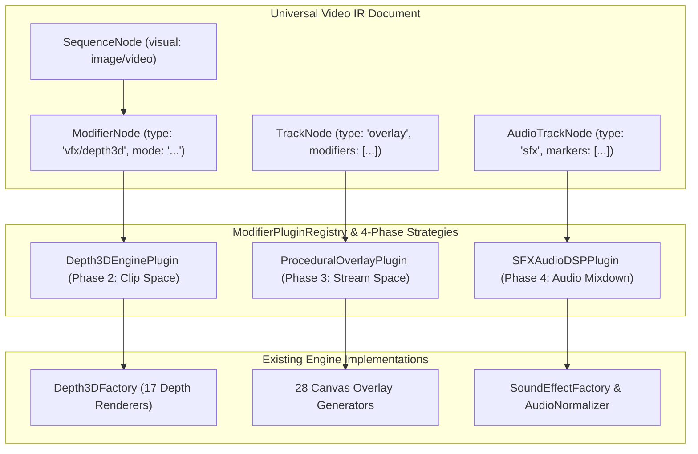

# Comprehensive Migration Plan: Bridging All 3D Depth, Procedural Overlays, & Sound Effects into Universal Video IR Plugins

## 1. Executive Summary & Architectural Motivation

The Visual Storytelling Generator currently features a rich catalog of effects located across `packages/effect-engines/src/`:
- **17 3D Depth Renderers** (`depth3d/renderers/`)
- **28 Procedural Canvas Overlay Generators** (`overlay-effects/generators/`)
- **Sound Effect (SFX) Generators & Audio Normalizers** (`sound-effects/`)

While the legacy orchestrator (`VideoEditPipelineOrchestrator`) invoked these using fragmented paths (ad-hoc per-scene pipelines, separate temporary video renders, and composite commands), the **Universal Video IR** architecture establishes a unified **4-Phase Lifecycle Plugin Contract**:
1. **Phase 1: Pre-flight & Relational DAG Resolution** (Static analysis, bounding boxes, asset preloading)
2. **Phase 2: Sequence-Level Execution (Clip Space)** ($t \in [0, \text{duration}]$ relative frame rendering)
3. **Phase 3: Track-Level Execution (Stream Space)** (Continuity across concatenated sequence timeline)
4. **Phase 4: Master Canvas Compositing & Handshake** (Multi-track layering, blend modes, audio DSP)

This plan details how to systematically wrap and migrate all 17 3D depth renderers, all 28 procedural overlays, and all sound effect engines into clean, production-grade IR Modifier Plugins with **zero heap cloning**, **zero regression**, and complete parity between headless CLI rendering and interactive canvas previews.

---

## 2. Component Migration Architecture



---

## 3. Work Breakdown: 4 Core Phases

### Phase 1: 3D Depth Suite Migration (17 Effects)
**Target Plugin:** `packages/ir/src/plugins/vfx/Depth3DPlugin.ts` (Phase 2: Clip Space)

#### 1.1 Registered Effect Modes
Connect `Depth3DPlugin` directly to `Depth3DFactory` from `@acc/effect-engines` to support all 17 modes:
1. **Core 5:** `frame_breaker`, `parallax_25d`, `volumetric_sandwich`, `depth_map_3d`, `wigglegram`
2. **Transform & Framing:** `isometric_podium`, `cutout_portal`, `gyro_focal_tilt`, `flythrough_carousel`, `isometric_billboard`
3. **Volumetric Lighting & Shadows:** `diffuse_shadow`, `plane_cast_shadow`, `silhouette_rim_light`, `glassmorphic_fresnel`
4. **Optics & Atmospheric:** `macro_bokeh`, `aerial_mist`, `rack_focus`, `vignette_tunnel`, `perspective_grid`, `extruded_text_3d`, `tunneling_text`

#### 1.2 Plugin Contract Implementation
- **Phase 1 (Pre-flight):** Load source image, segmentation mask (BiRefNet / SAM 2), and depth map into memory cache. Compute subject bounding box.
- **Phase 2 (Clip Space):**
  ```typescript
  public renderClipSpace(ctx: ClipRenderContext, params: Depth3DPluginParams, state: Depth3DPreflightState): void {
    const renderer = Depth3DFactory.getRenderer(params.mode);
    const frameState: Depth3DFrameState = {
      img: state.img,
      subjectImg: state.subjectImg,
      subjectBBox: state.subjectBBox,
      bgImg: state.bgImg,
      width: ctx.width,
      height: ctx.height,
      frame: ctx.localFrame,
      totalFrames: Math.ceil(ctx.sequence.duration * ctx.fps),
      timeSec: ctx.localFrame / ctx.fps,
      progress: ctx.localFrame / Math.ceil(ctx.sequence.duration * ctx.fps),
      depthConfig: params,
      particles: state.particles,
      dustParticles: state.dustParticles
    };
    renderer.renderFrame(ctx.ctx, frameState);
  }
  ```

---

### Phase 2: Procedural Overlay VFX Migration (28 Generators)
**Target Plugin:** `packages/ir/src/plugins/overlay/ProceduralOverlayPlugin.ts` (Phase 3: Stream Space & Phase 4: Master Composite)

#### 2.1 Supported Overlay Categories
1. **Atmospheric & Weather (9):** `rain`, `rain_on_glass`, `snow`, `fog`, `dust`, `embers`, `smoke`, `fire`, `lightning`
2. **Optics & Lighting (4):** `bokeh`, `god_rays`, `lens_flare`, `light_leak`
3. **Retro, Motion & Sci-Fi (9):** `vhs`, `film_damage`, `digital_glitch`, `matrix_rain`, `sci_fi_hud`, `starfield`, `speed_lines`, `camera_ui`, `audio_spectrum`
4. **Organic & Particles (5):** `bubbles`, `leaves`, `floating_hearts`, `confetti`, `grunge_texture`
5. **Color & Texture (1):** `procedural_gradient`

#### 2.2 In-Memory Frame Generation Bridge
Currently, overlay generators inherit from `BaseEffectEngine` and pipe frames out to MP4/WebM via FFmpeg.
- **Refactoring:** Refactor the generators to expose a pure `renderFrame(ctx: CanvasRenderingContext2D, width: number, height: number, frame: number, totalFrames: number, variant: string)` function without spawning FFmpeg or writing temporary files.
- **Phase 3 (Stream Space):** Render seamlessly across the timeline directly onto an overlay track canvas.
- **Phase 4 (Master Composite):** Apply standard CSS blend modes (`screen`, `multiply`, `overlay`, `lighter`, `alpha`) onto the master canvas.

---

### Phase 3: Sound Effects (SFX) Track & Foley DSP Migration
**Target Plugin:** `packages/ir/src/plugins/sfx/SFXTrackPlugin.ts` & `DecoupledAudioMixer`

#### 3.1 Architecture & Timeline Alignment
- **Audio Track Nodes in IR:**
  ```json
  {
    "id": "track_sfx_01",
    "type": "audio",
    "role": "sfx",
    "sequences": [
      {
        "id": "sfx_seq_01",
        "startFrame": 90,
        "durationFrames": 45,
        "assetRef": "sfx:cinematic_boom",
        "modifiers": [
          { "type": "sfx/spatial_pan", "pan": -0.4 },
          { "type": "sfx/gain", "volume": 0.8 }
        ]
      }
    ]
  }
  ```
- **Procedural Tone & Foley Synthesis:** Connect `SoundEffectFactory` and procedural synth generators (`packages/effect-engines/src/sound-effects/generators/`) to synthesize audio buffers on-demand when `assetRef` points to a procedural sound cue (e.g. `synth:ui_pop`, `foley:footstep`).
- **Decoupled Audio Mixdown:** In `DecoupledAudioMixer`, read SFX track sequences, apply pan/gain volume curves, and composite the final WAV stream alongside dialogue voiceover and BGM.

---

### Phase 4: Stage 1 Adapter & IR Schema Synchronization
**Target Files:** `packages/ir/src/adapters/StoryConfigToUniversalIRAdapter.ts` & `schema/story-config.schema.json`

1. **8-Point Synchronization:**
   - Map `scene.depth3d` from `story-config.json` into `sequence.modifiers` with type `vfx/depth3d`.
   - Map `scene.sfx` and `config.settings.sfx` into dedicated `track_sfx` audio tracks in the IR document.
   - Map `config.settings.overlays` into dedicated `track_overlay` tracks with `overlay/procedural` modifiers.
2. **Schema & Types Update:**
   - Update `packages/ir/src/types/VideoIR.ts` and `src/types.ts` to recognize all modifier schemas and parameters.

---

## 4. Verification & Testing Strategy

1. **Visual Parity Tests (`autogenerated-tests/ir_plugins_depth3d.test.ts`):**
   Render sample frames for each of the 17 3D depth modes and verify pixel hashes match between `FFISceneEngine` (legacy) and `IRMasterRenderer` (IR plugin).
2. **Overlay Determinism Tests (`autogenerated-tests/ir_plugins_overlays.test.ts`):**
   Verify all 28 procedural overlays render repeatably with identical frame outputs given the same seed and frame index.
3. **Audio Mixing Parity Tests (`autogenerated-tests/ir_sfx_audio_mixing.test.ts`):**
   Verify SFX clips align accurately with their designated `startFrame` in the mixed audio output buffer.
4. **End-to-End CLI Verification:**
   Run `bun run cli.ts ./sample-story --engine ir` to verify end-to-end rendering parity against the legacy output.
