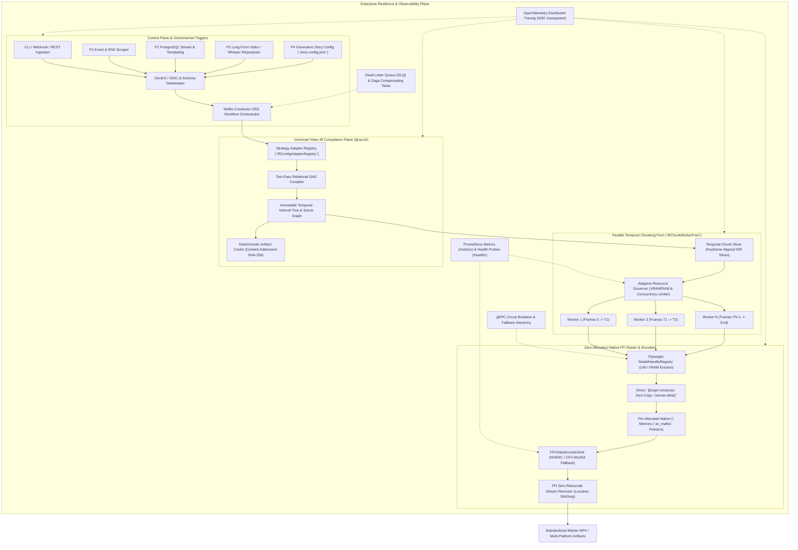

# 🏛️ Enterprise-Grade Master Implementation Plan: High-Throughput Universal IR, Canonical Transition & Omnichannel Resilience

## 1. Executive Summary & Strategic Blueprint

The **Visual Storytelling Generator & Autonomous Content Creator (ACC)** has achieved functional and visual parity between the legacy `renderStoryVideo` engine and the **Universal Video IR Engine** (`packages/ir`), featuring:
- Bit-identical mathematical frame rendering (`DETERMINISTIC-HANDSHAKE-BACKPRESSURE`).
- Zero-copy native buffer ingestion (`ZERO-ALLOC-FRAME-LOOP`).
- Rich multi-plane 3D Depth support (AI segmentation subject pop-outs, volumetric sandwich typography, continuous optical transitions, parallax physics).

By synthesizing this baseline with the **Enterprise Transformation Framework** (`docs/brainstorming/ENTERPRISE_GRADE_TRANSFORMATION_FRAMEWORK.md`), this master implementation plan elevates the platform into an **enterprise-grade, high-availability, zero-trust media generation system**.

The plan harmonizes the 3 strategic user options across **6 comprehensive execution phases**:

```
┌─────────────────────────────────────────────────────────────────────────────────────────────────────────────────────┐
│                                 ENTERPRISE MASTER IMPLEMENTATION PHASING MATRIX                                     │
├───────────────────────┬─────────────────────────┬─────────────────────────┬─────────────────────────────────────────┤
│ Option 1 (Chunking)   │ Option 2 (Unification)  │ Option 3 (Omnichannel)  │ Enterprise Pillars (Framework Alignment)│
├───────────────────────┼─────────────────────────┼─────────────────────────┼─────────────────────────────────────────┤
│ Phase 1: Parallel IR  │ Phase 2: Canonical P4   │ Phase 4: Omnichannel    │ Phase 3: Distributed Resilience & SAGAs │
│ Temporal Chunk Pool   │ Migration & Legacy Prune│ Fan-Out (P1, P2, P3)    │ Phase 5: Zero-Trust & Observability     │
│ & Zero-Loss Concat    │ to IR AST Primary       │ with Conductor FORK_JOIN│ Phase 6: 5-Tier QA & Chaos Hardening    │
└───────────────────────┴─────────────────────────┴─────────────────────────┴─────────────────────────────────────────┘
```

---

## 2. End-to-End Enterprise Architecture Diagram



---

## 3. Detailed Phased Implementation Roadmap

---

### Phase 1: High-Throughput Multi-Worker Temporal Chunking (Option 1 Core)
**Strategic Objective**: Eliminate the 4-minute rendering bottleneck for 2-minute videos, slashing turnaround to $<45\text{s}$ across multi-core CPUs and GPUs while enforcing bit-identical mathematical parity.

#### 1.1 `IRChunkWorkerPool` Architecture
- **Location**: `packages/ir/src/workers/IRChunkWorkerPool.ts`
- **Design Pattern**: Object Pool & Master-Worker Pattern.
- **Worker Isolation**: Spawn bounded Bun native `Worker` threads or sub-processes passing sliced, immutable sub-trees of `VideoIRDocument`.
- **Dynamic Slicing Strategy**:
  $$\text{Chunk Size} = \left\lceil \frac{\text{Total Frames}}{\text{Concurrency}} \right\rceil$$
  Boundary frames align with keyframe IDR intervals and scene boundary cuts to guarantee zero boundary seam artifacts.
- **Hardware-Aware Concurrency**: Auto-detect available logical CPU cores and NVENC encoding sessions (`Math.min(cpuCores - 1, maxGpuStreams)`).

#### 1.2 Zero-Loss FFI Fast Chunk Concatenation
- **Location**: `packages/ir/src/workers/FFIChunkConcatMuxer.ts`
- Each worker outputs an intermediate bit-matched transport chunk (`.mp4`) with identical SPS/PPS headers, GOP size, timebases, and audio sample rates (48kHz 32-bit float stereo).
- Concatenate chunks via native `bun:ffi` packet remuxing (zero video transcoding overhead, raw packet bitstream copy) in $<500\text{ms}$.

#### 1.3 Deterministic Handshake & Merkle Parity Protocol
- **Strict Compliance**: Adhere to `DETERMINISTIC-HANDSHAKE-BACKPRESSURE`.
- Each chunk worker executes its own isolated `FrameBackpressureLock`.
- In test/verification mode, each worker outputs an SHA-256 chunk hash. The master orchestrator computes a combined Merkle root:
  $$\text{RootHash} = \text{SHA256}(\text{ChunkHash}_1 \parallel \text{ChunkHash}_2 \parallel \dots \parallel \text{ChunkHash}_N)$$
  Preserving 100% bit-identical hash parity across single-worker and multi-worker runs.

---

### Phase 2: Canonical Pipeline 4 Migration & Legacy Deprecation (Option 2 Core)
**Strategic Objective**: Transition `GenerativeStoryPipeline` permanently to Universal Video IR, eradicating fragile legacy rendering forks, ad-hoc string-based FFmpeg filtergraphs, and intermediate disk files.

#### 2.1 Unification in `StoryOrchestratedRenderStage`
- **Location**: `apps/cli/src/pipelines/04-generative-story/stages/StoryOrchestratedRenderStage.ts`
- Promote `useIRBackend: true` to become the sole, mandatory execution engine.
- Transform incoming `PipelineExecutionContext` and `story-config.json` directly into a typed `VideoIRDocument` using `IRConfigAdapterRegistry.getInstance().transform(config, { baseDir })`.

#### 2.2 Complete Legacy Codebase Deprecation & Pruning
- Retire legacy per-scene intermediate file rendering (`scene_0.mp4`, `scene_1.mp4`, temporary ASS subtitle files written to disk).
- Prune ad-hoc string filtergraph builders (`FFmpegFilterGraph.ts`) in favor of composable IR Track Modifiers (`@acc/effect-engines`).
- Maintain a legacy backward-compatibility facade (`renderStoryVideo`) purely as an adapter routing through `IRChunkWorkerPool` to ensure zero regression for existing CLI commands.

#### 2.3 Strict Schema & Contract Synchronization
- Enforce the **STORY-CONFIG-8POINT-SYNC** across all 8 architectural touchpoints:
  1. `src/types.ts`
  2. `schema/story-config.schema.json`
  3. `docs/STORY_CONFIG_SPEC.md`
  4. `docs/..._GUIDE.md`
  5. `cli.ts` / `src/renderer.ts` / `src/platforms.ts` / `src/styles.ts`
  6. `auto-config.ts`
  7. `sample-story/story-config.json`
  8. `README.md`

---

### Phase 3: Enterprise Resilience, VRAM Isolation & SAGA Workflows (Enterprise Pillar 2)
**Strategic Objective**: Guarantee continuous fault tolerance, isolate native memory/VRAM, and manage distributed transactions with automated compensation.

#### 3.1 Adaptive Resource Governor & VRAM/RAM Watchdog
- **Location**: `packages/core/src/resilience/AdaptiveResourceGovernor.ts`
- Continuously monitor system memory pressure (`os.freemem()`) and GPU VRAM via NVML / Nvidia-SMI.
- **Dynamic Throttle**: If available system RAM drops below $2.0\text{ GB}$ or VRAM exceeds $90\%$, pause incoming frame acquisition via backpressure locks.
- **Dynamic Encoder Downgrade**: Automatically switch NVENC hardware encoding to CPU `libx264` dynamically without crashing the render process.

#### 3.2 `ModelHandleRegistry` & LRU VRAM Eviction
- **Location**: `packages/core/src/models/ModelHandleRegistry.ts` (extending `FlyweightModelRegistry`).
- Track memory usage of AI models (Depth Anything v2, SAM 2, Kokoro/VieNeu TTS).
- Enforce LRU eviction (`evictLowestPriorityHandle()`) when VRAM thresholds are breached.
- Implement reference counting locks to prevent unloading active models mid-stream.

#### 3.3 Circuit Breakers & Hierarchical Fallbacks
- **Location**: `packages/core/src/resilience/RenderCircuitBreaker.ts`
- Wrap all AI sidecars, external APIs, and cloud operations with circuit breakers.
- **Fallback Hierarchy**:
  - AI Depth failure $\to$ Procedural 2D Ken Burns motion.
  - AI Upscale failure $\to$ Native high-res canvas scaling.
  - Neural TTS failure $\to$ Ambient audio bed + kinetic subtitles.
  - GPU VRAM Exhaustion $\to$ CPU fallback processing.

#### 3.4 Conductor SAGA Distributed Transactions & DLQ
- Every pipeline execution is registered as a Conductor SAGA.
- On catastrophic render or publishing failure, execute compensation tasks:
  - Clean up orphaned S3/Cloudflare R2 temporary assets.
  - Revoke ephemeral CDN distribution tokens.
  - Route error payloads to the Dead Letter Queue (DLQ) with contextual debugging snapshots.

---

### Phase 4: Omnichannel Pipelines 1, 2, 3 Expansion (Option 3 Core & Pillar 1)
**Strategic Objective**: Implement Canonical Pipelines 1, 2, and 3 under Netflix Conductor OSS `FORK_JOIN` DAGs. **Strict architectural constraint**: Only pipelines with **video output** compile directly into the Universal Video IR (`VideoIRDocument`); non-video output artifacts (audio-only podcasts, static infographics/PNG summaries, markdown/text alerts) bypass the Video IR engine completely and emit directly via dedicated audio/image pipelines.

#### 4.1 Output-Type Routing Matrix
| Pipeline | Output Modality | Pipeline Routing & Rendering Engine |
| :--- | :--- | :--- |
| **Pipeline 1** (Event Scraper) | **Video** (Alert Video, Ticker Brief) | Direct compilation to **Universal Video IR** (`packages/ir`) |
| **Pipeline 1** (Event Scraper) | **Audio / Text** (Podcast, Newsflash text) | Direct Audio DSP / Text Exporter (**Bypasses Video IR**) |
| **Pipeline 2** (DB Templating) | **Video** (Bar Chart Race, Stat Timeline) | Direct compilation to **Universal Video IR** (`packages/ir`) |
| **Pipeline 2** (DB Templating) | **Static Image** (Infographic PNG, Carousels) | Headless Canvas / DOM Rasterizer (**Bypasses Video IR**) |
| **Pipeline 3** (Repurposing) | **Video** (9:16 Auto-Crop Short, Highlight Reel) | Direct compilation to **Universal Video IR** (`packages/ir`) |
| **Pipeline 3** (Repurposing) | **Audio / Text** (Podcast Cut, SRT/Transcript) | Pure FFI Audio Slicer / Text Exporter (**Bypasses Video IR**) |

#### 4.2 Pipeline 1: Event-Driven Scraper & Summarizer (`01-event-scraper`)
- **Triggers**: Webhooks, RSS feeds, financial market ticks.
- **Video Path**: Translates headline summaries and financial metrics into declarative IR documents featuring kinetic lower-third tickers (`overlay/lower_third_ticker`) and synthesized newsroom audio with sidechain ducking.
- **Audio/Text Path**: Directly emits audio files (AAC/MP3) or text feeds without constructing a `VideoIRDocument`.

#### 4.3 Pipeline 2: Database Injection & Programmatic Templating (`02-database-templating`)
- **Triggers**: PostgreSQL change data capture (CDC) / row triggers.
- **Video Path**: Compiles structured tabular time-series into programmatic Canvas charts (Bar Chart Race, comparative stat tables) as native IR visual tracks with synchronized acoustic captions.
- **Static Asset Path**: Directly writes standalone SVG/PNG infographic assets.

#### 4.4 Pipeline 3: Asset Repurposing & Auto-Crop (`03-asset-repurposing`)
- **Triggers**: Long-form 16:9 4K YouTube videos, podcasts.
- **Video Path**: Executes Whisper word-level timing, runs face detection for 9:16 vertical crop coordinates, and maps speech highlights into IR timed subtitle tracks with kinetic word-level popups.
- **Audio/Transcript Path**: Directly slices audio or writes subtitles (VTT/SRT).

#### 4.5 1-to-N Omnichannel Fan-Out with HITL Gates
- Leverage Conductor OSS `FORK_JOIN` to render multi-aspect ratio outputs (16:9 YouTube, 9:16 TikTok/Reels, 1:1 LinkedIn) in parallel from a single master IR timeline when target format is video.
- Implement Human-in-the-Loop (HITL) review gates via the Liquid Glass UI before automated publishing.

---

### Phase 5: Zero-Trust Security, Dynamic Secrets & Observability (Enterprise Pillars 3 & 4)
**Strategic Objective**: Establish unified distributed telemetry and end-to-end security compliance.

#### 5.1 OpenTelemetry & Distributed Tracing
- Instrument all HTTP endpoints, Conductor workers, Python gRPC sidecars, and FFI pipelines with W3C Trace Context (`traceparent`, `tracestate`).
- Unified `trace_id` and `span_id` correlating Bun TypeScript task workers, Python sidecars, and native FFmpeg pipelines.

#### 5.2 Prometheus Metrics & K8s Health Probes
- Expose `/healthz/liveness`, `/healthz/readiness`, and `/metrics` on `acc serve`.
- Export real-time gauges and histograms:
  - `acc_render_frames_per_second` (Gauge)
  - `acc_render_frame_latency_ms` (Histogram with p50, p90, p99 percentiles)
  - `acc_memory_rss_bytes` & `acc_native_c_alloc_bytes` (Gauges)
  - `acc_vram_utilization_ratio` (Gauge)
  - `acc_worker_pool_active_count` (Gauge)

#### 5.3 Zero-Trust Identity & Dynamic Secrets
- Enforce OAuth2 / OIDC authentication and role-based access control (RBAC).
- Implement service-to-service mutual TLS (mTLS) between Bun task workers and Python gRPC sidecars.
- Fetch API keys and cloud storage secrets dynamically from HashiCorp Vault or AWS Secrets Manager.
- Enforce automated namespace-scoped log sanitation (`Logger` in `@acc/core`) redacting authorization tokens and PII.

---

### Phase 6: 5-Tier Continuous Quality Engineering & Chaos Hardening (Enterprise Pillar 5)
**Strategic Objective**: Prevent regressions and memory leaks through continuous multi-tier automated validation.

```
┌─────────────────────────────────────────────────────────────────────────────────────────────────────────┐
│                                5-TIER ENTERPRISE QA & VALIDATION HARNESS                                │
├─────────────────────────────────────────────────────────────────────────────────────────────────────────┤
│ Tier 1: Unit, Integration & Protobuf Contract Testing (`bun test` + `buf breaking`)                     │
│ Tier 2: C/FFI Native Memory Leak & Zero-Copy Safety Harness (ASan / 10,000-Frame Loop Audit)            │
│ Tier 3: 3-Tier Performance Benchmarks (`mitata` micro, `oha` HTTP load, `hyperfine` CLI timing)         │
│ Tier 4: Deterministic Visual & Audio Regression Engine (Xorshift128+ PRNG, SSIM >= 0.99, Delta E < 1.0) │
│ Tier 5: Chaos Engineering & Production Fault Injection (VRAM Starvation, S3 Partitions, Worker Chaos)   │
└─────────────────────────────────────────────────────────────────────────────────────────────────────────┘
```

#### 6.1 Formal Retention Protocol (`/autogenerated-tests`)
- All verification test files are permanently retained in `/autogenerated-tests/`:
  1. `enterprise_parallel_chunking.test.ts`: Verify bit-identical hash parity between 1-worker and 4-worker chunked rendering.
  2. `pipeline_unification_regression.test.ts`: Verify 28-scene benchmark renders without regression and 0 memory leaks.
  3. `resilience_circuit_breaker.test.ts`: Verify fallback paths trigger correctly when AI sidecars fail.
  4. `ffi_memory_leak_stress.test.ts`: 10,000-frame continuous run with ASan leak detection.

#### 6.2 3-Tier Benchmark Suite (`benchmarks/`)
- **Microbenchmarks (`mitata`)**: Hot-path FFI allocations (`av_frame_alloc` $<2.5\,\mu\text{s}$), Flyweight lookup ($<15\,\text{ns}$).
- **Load Testing (`oha`)**: Daemon webhook ingestion ($>5,000\,\text{req/s}$, p95 latency $<25\,\text{ms}$).
- **Macro CLI (`hyperfine`)**: E2E CLI command startup ($<120\,\text{ms}$) and dry-run AST compilation ($<80\,\text{ms}$).

---

## 4. Phase Execution Matrix & Key Acceptance Criteria

| Phase | Core Deliverable | Target Metric / Acceptance Criteria | Framework Pillar Alignment | Priority |
| :--- | :--- | :--- | :--- | :---: |
| **Phase 1** | `IRChunkWorkerPool` & FFI Zero-Loss Chunk Remuxer | 2-min video renders in $<45\text{s}$ across 4–8 cores; 100% bit-identical hash parity | Pillar 1, 2 | 🔴 Highest |
| **Phase 2** | Canonical Pipeline 4 Migration & Legacy Deprecation | `GenerativeStoryPipeline` runs exclusively through IR; legacy render scripts pruned | Pillar 1, 7 | 🔴 Highest |
| **Phase 3** | Adaptive Resource Governor, VRAM Eviction & SAGAs | Zero OOM crashes under 24GB stress; seamless fallbacks on GPU exceptions; DLQ active | Pillar 2, 7 | 🟡 High |
| **Phase 4** | Omnichannel Pipelines 1, 2, 3 Implementation | Video targets for P1 (Ticker), P2 (DB Charts), P3 (Auto-crop) compile to IR; non-video paths (podcasts/infographics) bypass IR directly | Pillar 1, 6 | 🟡 High |
| **Phase 5** | Zero-Trust, Vault Secrets & OpenTelemetry | End-to-end W3C distributed tracing; Prometheus `/metrics` live; mTLS verified | Pillar 3, 4 | 🟢 Normal |
| **Phase 6** | 5-Tier QA Harness, Benchmarks & Chaos Verification | ASan memory leaks = 0; Visual SSIM $\ge 0.99$; `mitata`/`oha`/`hyperfine` SLA pass | Pillar 5 | 🟢 Normal |

---

## 5. Architectural Compliance & Master Rules Verification

- **`DETERMINISTIC-HANDSHAKE-BACKPRESSURE`**: Absolute rule enforced across all chunk workers via discrete frame math (`timeSec = globalFrame / fps`) and synchronized Merkle root chunk hashing.
- **`ZERO-ALLOC-FRAME-LOOP`**: Zero heap cloning inside render loops; direct native buffer ingestion (`canvas.data()`) and pre-allocated native C memory structs (`av_malloc`).
- **`STORY-CONFIG-8POINT-SYNC`**: Strict synchronization across all 8 configuration and documentation components on any schema expansion.
- **`HISTORY-GIT-ARCHIVAL`**: Sequential 3-digit history logging in `docs/history/` and commit standard `[XXX] <type>(<scope>): <summary>`.
- **`AUTOGENERATED-TESTS-MANDATE`**: Formal test retention exclusively in `/autogenerated-tests/` using `bun:test`.
- **System Architecture Anchor**: Primary alignment with `docs/SYSTEM_ARCHITECTURE_DOCUMENT.md`.
