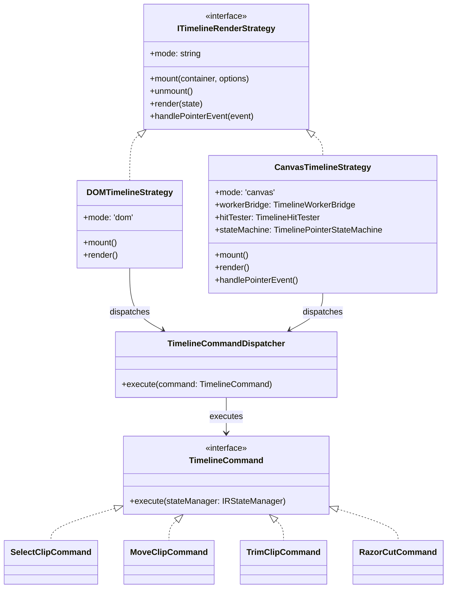

# Master Implementation Plan (Iteration 19): Design Pattern Architecture for Universal Canvas Scratch Pooling & Dual-Mode Studio Timeline

## Goal Description
1. **Universal Canvas Scratch Pooling**: Replace transient `createCanvas` allocations with `UniversalCanvasProvider.acquireScratchCanvas` and `releaseScratchCanvas` across all IR plugins (`Camera3DPlugin`, `Depth3DPlugin`, `CanvasParticleOverlayPlugin`), vision strategies (`DepthAnything`, `DptLarge`, `HeuristicDepth`, `GrabCut`), and `packages/effect-engines` generators (`fire`, `fog`, `smoke`, `bokeh`, `grunge`, `vhs`, etc.).
2. **Design-Pattern-Driven Dual-Mode Studio Timeline (DOM & Canvas)**:
   - Enable clean, regression-free coexistence of DOM and Canvas timelines with a user toggle (`[ DOM | Canvas ]`).
   - Implement battle-tested design patterns:
     - **Strategy Pattern (`ITimelineRenderStrategy`)**: Cleanly decouples DOM and Canvas rendering lifecycles.
     - **Command Pattern (`TimelineCommand`)**: Unifies all timeline mutations (selection, drag/move, trimming, razor cuts) so both DOM and Canvas invoke identical business logic.
     - **State Machine Pattern (`TimelinePointerStateMachine`)**: Manages canvas pointer interactions (`Idle`, `Hovering`, `DraggingClip`, `TrimmingClip`) with strict state transitions and dynamic cursor feedback (`grab`, `col-resize`).
     - **Service Pattern (`TimelineHitTester` & `TimelineMagneticSnapService`)**: Pure mathematical calculation services for O(log N) hit-testing and magnetic snap targets.

---

## 1. Scratch Canvas Pooling Architecture

```mermaid
flowchart TD
    subgraph Consumers ["Per-Frame Visual Renderers"]
        Camera3D["Camera3DPlugin (uNear, uFar, uTiny)"]
        Depth3D["Depth3DPlugin (relightCanvas, uBaseCanvas)"]
        Particles["CanvasParticleOverlayPlugin (uScratch)"]
        Effects["Effect Generators (Fire, Fog, Smoke, Grunge, Bokeh)"]
        Vision["Vision Strategies (DepthAnything, GrabCut)"]
    end

    subgraph Pool ["CanvasScratchPool (packages/core-isomorphic)"]
        Acquire["UniversalCanvasProvider.acquireScratchCanvas(w, h)"]
        Tiers["Tiered Resolution Buckets (256x256 -> 4K)"]
        Release["UniversalCanvasProvider.releaseScratchCanvas(canvas)"]
        Acquire --> Tiers
        Release --> Tiers
    end

    Consumers -->|borrow| Acquire
    Consumers -->|return (finally)| Release
```

### Key Changes
1. **`packages/core-isomorphic/src/canvas/UniversalCanvasProvider.ts`**:
   - Ensure ESM-safe static and instance delegates to `CanvasScratchPool`.
   - Guarantee zero circular dependencies and clean bundling in both Node.js and browser/worker environments.
2. **`packages/core-isomorphic/src/canvas/types.ts`**:
   - Add optional `acquireScratchCanvas` and `releaseScratchCanvas` to `ICanvasAdapter`.
3. **`packages/effect-engines`**:
   - Implement `acquireScratchCanvas` and `releaseScratchCanvas` in `NapiCanvasAdapter` and `BrowserCanvasAdapter`.
   - Update overlay effect generators (`fire.ts`, `fog.ts`, `smoke.ts`, `bokeh.ts`, `grunge_texture.ts`, `vhs.ts`) to use `adapter.acquireScratchCanvas` / `releaseScratchCanvas` with standard `try / finally` blocks.
   - Update vision strategies (`DepthAnythingV2BaseStrategy.ts`, `DptLargeStrategy.ts`, `HeuristicDepthStrategy.ts`, `GrabCutFallbackStrategy.ts`, `utils.ts`).
4. **`packages/ir`**:
   - Update `Camera3DPlugin.ts`, `Depth3DPlugin.ts`, and `CanvasParticleOverlayPlugin.ts` to acquire transient scratch canvases via `UniversalCanvasProvider.acquireScratchCanvas` and release them cleanly in `finally` blocks.

---

## 2. Design Patterns for Dual-Mode Studio Timeline



### Pattern 1: Strategy Pattern (`ITimelineRenderStrategy`)
- **Interface**: `apps/studio/src/lib/timeline/strategies/ITimelineRenderStrategy.ts`
  - Defines common contract for mounting, unmounting, synchronizing viewport/zoom, and receiving timeline state updates.
- **Implementations**:
  - `DOMTimelineStrategy`: Handles virtualized DOM rows, dnd-kit context, React clip items, audio waveform components, and DOM trim handles.
  - `CanvasTimelineStrategy`: Handles dedicated Web Worker OffscreenCanvas, Interval Tree culling, LOD waveform rendering, thumbnail LRU caching, and canvas pointer interaction.
- **Context**: `Timeline.tsx` toggles active strategy via `timelineMode` (`'dom'` vs `'canvas'`). When one is active, the other is unmounted or suspended, eliminating duplicate rendering and GPU thrashing.

### Pattern 2: Command Pattern (`TimelineCommand` / `TimelineCommandDispatcher`)
- **Location**: `apps/studio/src/lib/timeline/commands/TimelineCommands.ts`
- **Commands**:
  - `SelectClipCommand({ clipId: string })`: Updates selected sequence in `IRStateManager` and selects track.
  - `MoveClipCommand({ clipId: string, trackId: string, targetFrame: number })`: Moves sequence along timeline with boundary validation.
  - `TrimClipCommand({ clipId: string, handle: 'start' | 'end', targetFrame: number })`: Trims sequence duration/start frame, preserving asset source offsets.
  - `RazorCutCommand({ clipId: string, splitFrame: number })`: Splits sequence into two adjacent clips at the playhead.
- **Benefit**: Zero code duplication. Both DOM drag-and-drop and Canvas pointer interaction construct and dispatch the exact same commands to `IRStateManager`, ensuring 100% business logic parity.

### Pattern 3: State Machine Pattern (`TimelinePointerStateMachine`)
- **Location**: `apps/studio/src/lib/timeline/interaction/TimelinePointerStateMachine.ts`
- **States**:
  - `IdleState`: Continuously hit-tests mouse position on canvas:
    - Clip Body -> sets cursor to `grab` or `pointer`.
    - Trim Left Handle (within 8px of clip start) -> sets cursor to `col-resize`, tooltip `Trim In`.
    - Trim Right Handle (within 8px of clip end) -> sets cursor to `col-resize`, tooltip `Trim Out`.
    - Empty Track -> sets cursor to `default`.
  - `DraggingClipState`: Tracks mouse movement, computes frame offset, invokes `TimelineMagneticSnapService`, calculates ghost position, and dispatches `MoveClipCommand` on pointer up.
  - `TrimmingClipState`: Tracks handle drag (`start` or `end`), calculates trimmed frame bounds with magnetic snapping, updates ghost boundary, and dispatches `TrimClipCommand` on pointer up.
- **Benefit**: Completely encapsulates canvas mouse events, preventing tangled state, missed mouse-up events, and cursor glitches.

### Pattern 4: Service Pattern (`TimelineHitTester` & `TimelineMagneticSnapService`)
- **Location**: `apps/studio/src/lib/timeline/interaction/TimelineHitTester.ts`
  - Pure mathematical hit-test queries against clip layout entries (`[x, y, w, h]`).
  - Supports 3 distinct hit targets: `ClipBody`, `TrimStartHandle`, `TrimEndHandle`.
- **Location**: `apps/studio/src/lib/timeline/interaction/TimelineMagneticSnapService.ts`
  - Pure mathematical calculation of nearest magnetic snap points (clip start/end, playhead frame, ruler markers) within a configurable pixel radius (e.g. 10px).

---

## 2.1 Grill-Me Consensus Architectural Decisions

1. **Pointer Event Capture (Main-Thread Interaction Overlay)**:
   - Use a transparent overlay canvas on the main thread for mouse/pointer events (`pointerdown`, `pointermove`, `pointerup`).
   - Provides 0ms instant cursor switching (`grab`, `col-resize`, razor cursor) and reliable browser pointer capture (`setPointerCapture`) while delegating pixel rasterization to the Web Worker.
2. **Cross-Lane Drag & Drop Constraints**:
   - Strict track type enforcement: video clips only drop to video tracks, audio clips only to audio tracks.
   - On collision with existing clips, snap to the nearest free gap or prevent overlap with red invalid feedback.
3. **Dual-Mode Sequence Splitting (Razor Tool & Playhead)**:
   - Playhead Split: pressing 'S' splits the selected clip at the current playhead frame.
   - Razor Tool: pressing 'C' or selecting Scissors mode renders an interactive vertical cut indicator on mouse hover and splits the clip at the clicked frame on click.
4. **Trimming & Snapping HUD Feedback**:
   - Vertical cyan guideline across all tracks when snapped to clip boundaries or playhead.
   - Semi-transparent ghost bounding box previewing the drag/trim target position in real time.
   - Floating timecode badge displaying current frame and offset delta (`+/- frames`).
5. **Selection Scope (Phase 1)**:
   - Single Clip Selection only to guarantee rock-solid stability and zero regression before introducing complex multi-selection.
6. **Track Headers (Hybrid Architecture)**:
   - Sticky HTML/DOM cards on the left (Mute, Lock, Reorder, Volume) paired seamlessly with the Canvas timeline body on the right.

---

## 3. UI/UX Polishing for Canvas Mode
To make the Canvas timeline just as intuitive and visually clear as the DOM timeline:
1. **Visual Styling**:
   - Distinct sequence category colors (video: `#3b82f6`, audio: `#10b981`, text/titles: `#8b5cf6`, vfx: `#ec4899`).
   - Active clip selection outline: 2px cyan (`#06b6d4`) ring with subtle outer glow.
   - Distinct trim handle grips drawn on hover/selection (vertical bar notches at left and right edges).
   - High-contrast typography: Clip ID, start timecode, and duration readouts.
2. **Interactive Feedback**:
   - Visual drag ghost showing target track and frame during drag.
   - Magnetic cyan guideline extending across all tracks when snapping occurs.
3. **Mode Switcher in Timeline Header**:
   - Toggle button group in Timeline top toolbar: `[ DOM | Canvas ]` with persistent memory in `localStorage`.

---

## 4. Execution Steps

1. **Step 1: Canvas Scratch Pooling**
   - Update `UniversalCanvasProvider.ts` and `ICanvasAdapter` with ESM-safe scratch pool methods.
   - Wire `acquireScratchCanvas` and `releaseScratchCanvas` into effect-engines (`fire.ts`, `fog.ts`, `smoke.ts`, `bokeh.ts`, etc.) and vision strategies.
   - Wire `acquireScratchCanvas` and `releaseScratchCanvas` into IR plugins (`Camera3DPlugin`, `Depth3DPlugin`, `CanvasParticleOverlayPlugin`).
2. **Step 2: Timeline Command & Service Infrastructure**
   - Implement `TimelineCommands.ts` and `TimelineCommandDispatcher`.
   - Implement pure `TimelineHitTester.ts` and `TimelineMagneticSnapService.ts`.
3. **Step 3: Canvas Pointer State Machine**
   - Implement `TimelinePointerStateMachine.ts` handling `pointerdown`, `pointermove`, `pointerup` on the canvas overlay.
4. **Step 4: Strategy Pattern & Timeline Dual-Mode Integration**
   - Implement `ITimelineRenderStrategy`, `DOMTimelineStrategy`, and `CanvasTimelineStrategy`.
   - Update `Timeline.tsx` with Mode Toggle `[ DOM | Canvas ]`.
   - Enhance `timeline.worker.ts` with selection highlight rings, trim handle grips, and drag ghost feedback.
5. **Step 5: Testing & Verification**
   - Automated tests for `CanvasScratchPool`, `TimelineHitTester`, `TimelineCommands`, and `TimelinePointerStateMachine`.
   - Full monorepo build verification (`bun run build`).
