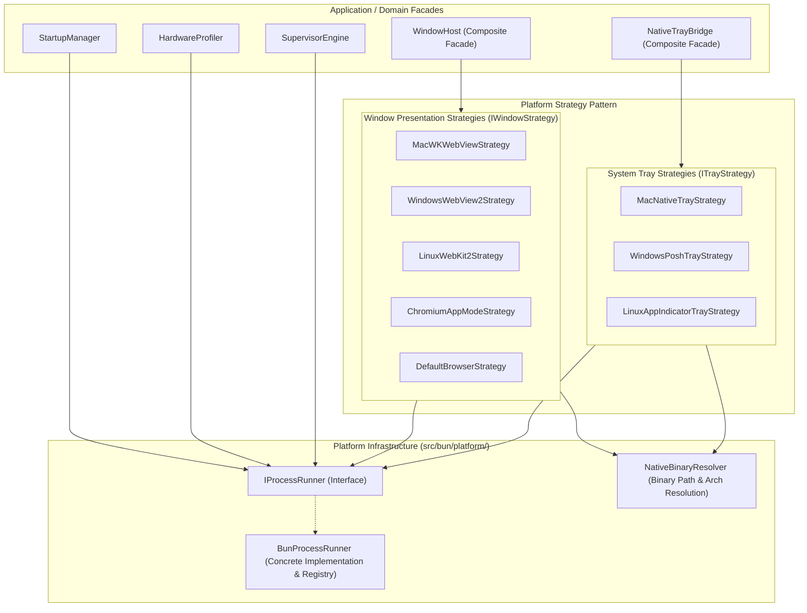

# Master Implementation Plan - Iteration 34
# AI-Supervisor Desktop Architecture: Clean Subprocess Abstraction & Strategy Pattern Refactoring

## 1. Executive Summary & Context
In the current implementation of `@acc/ai-supervisor`, subprocess management (`spawn(...)`) is dispersed across multiple modules ([`WindowHost.ts`](../apps/ai-supervisor/src/bun/WindowHost.ts), [`NativeTrayBridge.ts`](../apps/ai-supervisor/src/bun/NativeTrayBridge.ts), [`StartupManager.ts`](../apps/ai-supervisor/src/bun/StartupManager.ts), [`SupervisorEngine.ts`](../apps/ai-supervisor/src/bun/SupervisorEngine.ts), [`HardwareProfiler.ts`](../apps/ai-supervisor/src/bun/HardwareProfiler.ts)).

This ad-hoc design exhibits multiple architectural anti-patterns:
1. **Primitive Obsession & Leakage**: Direct usage of `spawn` with disparate handling of process exits, buffers, signals, error codes, and child lifecycles.
2. **Zombie Process Risk**: Child processes (native WKWebView, system trays, external daemons) lack unified, deterministic shutdown hooks and registry tracking.
3. **Tight Coupling & Untestability**: High-level domain services depend on Node/Bun OS child processes directly instead of abstractions, preventing isolated unit testing without spawning actual GUI windows or system utilities.
4. **Duplication of Platform Strategy Logic**: Platform switching (`process.platform`) is repeated redundantly across presentation, tray, and daemon runners.

### Refactoring Objectives
Under `/principal-polyglot-architect`, `/typescript-coding`, and `/enterprise-clean-coder`:
- **Centralize OS Execution**: Introduce an explicit, typed `IProcessRunner` infrastructure boundary managing child process lifecycles, structured concurrency, PID registry, and graceful cleanup.
- **Polymorphic Strategy Pattern**: Refactor `WindowHost` and `NativeTrayBridge` into composable, isolated strategies conforming to clean domain interfaces (`IWindowStrategy`, `ITrayStrategy`).
- **Zero Raw Spawns in Core Logic**: Eliminate raw `spawn` calls from high-level business services; all process executions route through `IProcessRunner`.
- **ThemeSwitcher UI Visibility Assurance**: Remove responsive hiding (`hidden sm:inline`) so the theme switcher is prominently visible with explicit labels and `data-testid` on all viewport widths.

---

## 2. Architecture & Component Seams



---

## 3. Work Breakdown & Detailed Tasks

### Phase 1: Platform Process Runner Abstraction (`src/bun/platform/`)
- **`IProcessRunner.ts`**:
  - `execute(cmd: string[], options?: ExecuteOptions): Promise<Result<ExecutionSuccess, ProcessError>>`: Run to completion with timeout, capturing stdout/stderr without throwing uncaught exceptions.
  - `spawnManaged(cmd: string[], options?: SpawnManagedOptions): ManagedProcess`: Spawn long-running child process registered in an internal tracking table with deterministic auto-kill on parent exit (`SIGINT`, `SIGTERM`, `beforeExit`).
  - `which(tool: string): Promise<string | null>`: Memoized binary resolution across `$PATH`.
- **`BunProcessRunner.ts`**:
  - Concrete implementation wrapping `Bun.spawn` with process tree cleanup, proper stdio pipe streaming, and BigInt memory/PID safety.
  - Lifecycle hook to kill all active child processes when supervisor terminates.
- **`NativeBinaryResolver.ts`**:
  - Encapsulates resolution of universal Mach-O binaries, PyGObject scripts, and Windows PowerShell assets.

### Phase 2: Window Host Strategy Pattern Refactoring (`src/bun/platform/strategies/window/`)
- Define `IWindowStrategy.ts`:
  ```ts
  export interface WindowOptions {
    readonly title: string;
    readonly url: string;
    readonly width?: number;
    readonly height?: number;
  }

  export interface WindowHandle {
    readonly pid: number;
    close(): Promise<void>;
  }

  export interface IWindowStrategy {
    readonly name: string;
    isSupported(): Promise<boolean>;
    launch(options: WindowOptions): Promise<WindowHandle>;
  }
  ```
- Implement modular concrete strategies:
  1. `MacWKWebViewStrategy.ts`: Launches pre-compiled `webview_host_mac` via `IProcessRunner`.
  2. `WindowsWebView2Strategy.ts`: Launches WebView2 helper or Edge app mode via `IProcessRunner`.
  3. `LinuxWebKit2Strategy.ts`: Launches `webview_host_linux.py` via `IProcessRunner`.
  4. `ChromiumAppModeStrategy.ts`: Cross-platform fallback searching for Chrome/Edge/Brave `--app` mode.
  5. `DefaultBrowserStrategy.ts`: Safe terminal fallback using OS open commands.
- Refactor `WindowHost.ts` into a lightweight composite that iterates prioritized strategies and delegates without containing raw OS spawn logic.

### Phase 3: System Tray Strategy Pattern Refactoring (`src/bun/platform/strategies/tray/`)
- Define `ITrayStrategy.ts`:
  ```ts
  export interface ITrayStrategy {
    readonly name: string;
    isSupported(): Promise<boolean>;
    start(menu: TrayMenuDefinition, callbacks: TrayCallbacks): Promise<TrayHandle>;
  }
  ```
- Implement modular concrete strategies:
  1. `MacNativeTrayStrategy.ts`: Interfaces with universal binary `tray_runner_mac` using stdin/stdout protocol via `IProcessRunner`.
  2. `WindowsPoshTrayStrategy.ts`: Interfaces with `tray_runner_win.ps1` via `IProcessRunner`.
  3. `LinuxAppIndicatorTrayStrategy.ts`: Interfaces with `tray_runner_linux.py` via `IProcessRunner`.
- Refactor `NativeTrayBridge.ts` to be a pure domain facade holding the active strategy.

### Phase 4: Refactor StartupManager, HardwareProfiler & SupervisorEngine
- Replace all ad-hoc `spawn` calls in `HardwareProfiler.ts` (`nvidia-smi`, `sysctl`) with `processRunner.execute(...)`.
- Replace `launchctl` and PowerShell commands in `StartupManager.ts` with `processRunner.execute(...)`.
- Use `processRunner.spawnManaged(...)` in `SupervisorEngine.ts` for managed Python/Worker/Ollama daemons.

### Phase 5: ThemeSwitcher UI Visibility & Accessibility Fix
- In `apps/ai-supervisor/src/ui/components/ThemeSwitcher.tsx`:
  - Remove `hidden sm:inline` on `{current().name}` so the theme name is always displayed.
  - Add explicit `data-testid="theme-switcher"` and `data-testid="theme-dropdown"`.
  - Ensure high-contrast styling with active color swatch and icon.
- Rebuild UI via `bun run build:ui` and verify outputs.

### Phase 6: Automated Verification & Testing
- Unit test `BunProcessRunner` with process registration, timeout, and exit cleanup.
- Unit test `WindowHost` with mock `IWindowStrategy` implementations verifying fallback order.
- Unit test `NativeTrayBridge` with mock `ITrayStrategy`.
- Run comprehensive test suite:
  - `bun test autogenerated-tests/native_tray_cross_platform.test.ts`
  - `bun test autogenerated-tests/supervisor_solid_ui.test.ts`
  - `bun test autogenerated-tests/theme_switcher.test.ts`

---

## 4. Verification Criteria & Success Metrics
1. **Zero Unmanaged Spawns**: All subprocesses in `apps/ai-supervisor/src` are spawned exclusively through `IProcessRunner`.
2. **Zombie Elimination**: Terminating the supervisor process reliably kills any child WKWebView / system tray / daemon child processes without holding port 3333.
3. **100% Mockable**: Window and Tray logic can be verified in headless CI environments without native displays.
4. **UI Visual Validation**: ThemeSwitcher is prominently visible with text label and interactive menu on all screen sizes.
5. **Clean Compilation**: `bun test autogenerated-tests/` exits 0 with zero regressions.
