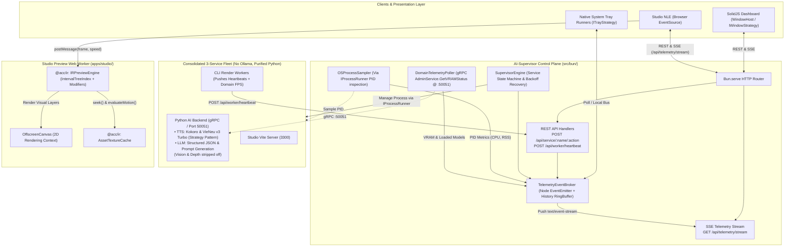

# Master Implementation Plan - Iteration 35
# AI-Supervisor Platform-Decoupled Fleet Control Plane (REST + SSE), Python Backend Unified AI Inference & Studio IR Sync

## 1. Executive Summary & Architecture Context
Recent architectural milestones in Iterations 33 and 34 radically modernized `@acc/ai-supervisor`:
1. **Frontend Architecture Modernization (Iteration 33)**: Migrated the dashboard to SolidJS + Ark UI + Tailwind CSS v4, built via a sub-second native Bun pipeline (`scripts/build-ui.ts`) with fine-grained reactive stores (`supervisorStore.ts`, `themeStore.ts`).
2. **Native Asset Pipeline Hardening**: Purged all runtime compilations (`spawn('swiftc', ...)`) in favor of a verified build-time script (`scripts/compile-native.ts`) outputting universal Mach-O binaries.
3. **Subprocess Infrastructure Decoupling (Iteration 34)**: Introduced `IProcessRunner` and `BunProcessRunner` along with the Polymorphic Strategy Pattern (`IWindowStrategy`, `ITrayStrategy`) to eliminate raw, unmanaged `spawn(...)` calls.

### The Next Evolutionary Leap: Iteration 35
Now, the application architecture must expand from basic process launching to an enterprise **Fleet Control Plane** operating in harmony with the **Universal Video IR Preview Engine**, while consolidating all AI inference into a purified, specialized Python backend:
- **Consolidation & Specialization of AI Inference**:
  - **Drop Ollama Sidecar**: Completely eliminate the external Ollama daemon. LLM text & structured JSON generation runs directly in Python via `LLMService.GenerateStructuredJson`.
  - **Strip Off Vision from Python Backend**: Remove `VisionService` and `VisionEngine` (BiRefNet/depth estimation) from the Python backend entirely. Visual segmentation and depth estimation remain decoupled and executed via the core monorepo's isomorphic ONNX runtime (`UniversalOnnxRuntimeProvider`) / FFI.
  - **Pluggable Multi-Engine TTS with Strategy Pattern**:
    - Refactor `tts_engine.py` into a clean Strategy Pattern (`ITTSSynthesisStrategy`) supporting:
      1. **VieNeu-v3-Turbo Strategy**: Ultra-fast Vietnamese/multilingual neural speech synthesis.
      2. **Kokoro Strategy**: Lightweight English/multilingual expressive speech synthesis.
      3. **Cadence Tone Strategy**: Deterministic zero-dependency sine/cadence speech fallback.
    - Provide dynamic runtime strategy selection via request parameter `model_strategy` (`"kokoro"` vs `"vieneu"`).
  - Simplify fleet management to **3 core services**: `python-backend` (focused on TTS + LLM), `worker`, and `studio`.
  - Reclaim 4GB–8GB of system RAM/VRAM previously required by duplicate model daemon processes.
- **Decoupled REST + SSE Fleet Architecture**: Replace ad-hoc HTTP polling with a structured REST command interface and a high-performance **Server-Sent Events (SSE)** telemetry stream (`GET /api/telemetry/stream`), natively consumable by browser `EventSource` and desktop tray widgets with automatic reconnection.
- **Universal OS Process & Domain Sampling**:
  - Automatically sample OS-level metrics (`cpuPercent`, `memoryRssMb`, `uptimeSeconds`, `status`) across all 3 supervised services (`python-backend`, `worker`, `studio`) using process table inspections via `IProcessRunner`.
  - Poll Python backend domain-level VRAM & loaded models via gRPC `AdminService.GetVRAMStatus`.
  - Accept granular domain-level heartbeats (`POST /api/worker/heartbeat`) from specialized CLI render workers (`renderFps`, `vramUsedMb`, `currentFrame`, `totalFrames`, `activeJobId`).
- **Zero-Reinvention Studio IR Preview Integration**:
  - Eliminate duplicated preview logic in `apps/studio/src/workers/preview.worker.ts` by directly mounting and running `@acc/ir`'s production components (`IRPreviewEngine`, `ModifierPluginRegistry`, `IntervalTreeIndex`, `DeterministicMotionEvaluator`, `AssetTextureCache`).
  - Wire live telemetry into `TelemetryCompanionCard.tsx` via `EventSource` with a compliant 5-state component matrix (Connected, Reconnecting, Empty, Error, Disabled).

---

## 2. System Architecture & Seams



---

## 3. Detailed Component Refactoring & Implementation Plan

### Component 1: `apps/ai-supervisor` (REST API & Real-Time SSE Telemetry)

#### [MODIFY] Fleet Consolidation & Python AI Backend Specialization
- **Strip Off Vision from Python Backend**:
  - Remove `VisionService` registration from `server.py` and delete/deprecate `vision_engine.py`.
  - Monorepo visual workflows continue to rely on isomorphic core ONNX pipelines (`UniversalOnnxRuntimeProvider`) without burdening the supervisor Python service.
- **TTS Strategy Pattern (`VieNeu-v3-Turbo` & `Kokoro`)**:
  - Refactor `tts_engine.py` into an extensible Strategy Pattern:
    ```python
    from abc import ABC, abstractmethod

    class ITTSSynthesisStrategy(ABC):
        @abstractmethod
        def synthesize(self, text: str, voice_id: str, speed: float) -> tuple[bytes, int, int, int]:
            """Returns (audio_bytes, sample_rate, channels, duration_ms)"""
            pass

    class KokoroTTSStrategy(ITTSSynthesisStrategy):
        ...

    class VieNeuV3TurboTTSStrategy(ITTSSynthesisStrategy):
        ...

    class CadenceToneFallbackTTSStrategy(ITTSSynthesisStrategy):
        ...
    ```
  - `TTSEngine` dynamically delegates to `KokoroTTSStrategy` (default for English/multilingual) or `VieNeuV3TurboTTSStrategy` (optimized for Vietnamese neural speech) based on request parameter `model_strategy`.
- **Remove `OllamaManager.ts` & Ollama Service Registration**:
  - Delete `OllamaManager.ts` (or deprecate in isolation) and purge `this.initService("ollama", 11434)` from `SupervisorEngine.ts`.
  - Remove all Ollama startup flags (`--ollama-port`, `OLLAMA_HOST`) passed to child worker CLI commands.
  - Remove Ollama service card and console tabs from SolidJS UI (`FleetGrid.tsx`, `ConsoleSection.tsx`, `SettingsModal.tsx`).
  - Update `configStore.ts` to drop `ollamaPort`, `ollamaModel`, and `ollamaAutoUnload`.
  - All LLM operations (structured script generation, scene reasoning, prompt synthesis) route through `python-backend`'s gRPC `LLMService.GenerateStructuredJson`.

#### [NEW] `apps/ai-supervisor/src/bun/telemetry/TelemetryEventBroker.ts`
- **Pattern**: Observer / Publish-Subscribe with a bounded circular history buffer (last 60 seconds).
- **Core Interfaces (Unified Python AI + Worker Domain Metrics)**:
  ```ts
  export interface PythonBackendDomainTelemetry {
    type: 'python-backend';
    vramUsedMb: number;
    freeVramBytes: number;
    totalVramBytes: number;
    cachedModelCount: number;
    activeModels: Array<{
      name: string;
      vramMb: number;
      accessCount: number;
    }>;
  }

  export interface WorkerDomainTelemetry {
    type: 'worker';
    activeJobId?: string;
    currentFrame?: number;
    totalFrames?: number;
    renderFps?: number;
    vramUsedMb?: number;
  }

  export type SidecarDomainTelemetry =
    | PythonBackendDomainTelemetry
    | WorkerDomainTelemetry;

  export interface SidecarTelemetry {
    name: string;
    pid: number | null;
    status: ServiceStatus;
    cpuPercent: number;
    memoryRssMb: number;
    uptimeSeconds: number;
    crashCount: number;
    domain?: SidecarDomainTelemetry;
  }

  export interface FleetTelemetrySnapshot {
    timestamp: number;
    system: {
      cpuCount: number;
      totalMemoryMb: number;
      freeMemoryMb: number;
      hardwareTier: string;
    };
    services: Record<string, SidecarTelemetry>;
  }
  ```
- **Stream Factory**: `createEventStream(signal: AbortSignal): ReadableStream<Uint8Array>`
  - Encodes `text/event-stream` chunks (`event: telemetry\ndata: {...}\n\n`).
  - Emits keep-alive comments (`: ping\n\n`) every 15s to keep connections alive through proxies and browsers.

#### [NEW] `apps/ai-supervisor/src/bun/telemetry/OSProcessSampler.ts`
- Samples child processes using `IProcessRunner` without external heavy dependencies:
  - On Darwin/Linux: Queries `ps -o %cpu,rss -p <pid>`.
  - On Windows: Queries `Get-Process -Id <pid>` or `wmic process where ProcessId=<pid> get WorkingSetSize`.
  - Injects sampled resource metrics directly into `TelemetryEventBroker` for the 3 active services (`python-backend`, `worker`, `studio`).

#### [NEW] `apps/ai-supervisor/src/bun/telemetry/DomainTelemetryPoller.ts`
- **Native Protocol Poller**:
  - Periodically polls `AdminService.GetVRAMStatus` (via gRPC port 50051) every 2 seconds when `python-backend` is `RUNNING`.
  - Retrieves loaded AI model names (`kokoro`, `birefnet`, `llama`), active VRAM allocation, and cache hit counts.
  - Merges domain results into `TelemetryEventBroker` under `python-backend.domain`.

#### [MODIFY] `apps/ai-supervisor/src/bun/SupervisorEngine.ts`
- Route internal child process spawning (`python-backend`, `worker`, `studio`, `ollama`) through `IProcessRunner` to complete the Iteration 34 architectural migration.
- Implement exponential backoff auto-recovery for crashing services:
  - Backoff delay: $t_{\text{backoff}} = \min(1000 \times 2^{\text{crashCount}}, 30000)\text{ ms}$.
  - Transition service state to `CRASH_LOOP` when crash limit (5 retries) is exceeded.
- Register PID changes with `OSProcessSampler`.

#### [MODIFY] `apps/ai-supervisor/src/bun/index.ts`
- Expose SSE endpoint `GET /api/telemetry/stream` returning `text/event-stream`.
- Expose Worker Heartbeat ingest `POST /api/worker/heartbeat`.
- Connect `TelemetryEventBroker` to the native tray bridge to keep tray status icons and tooltips synchronized in real-time.

#### [MODIFY] `apps/ai-supervisor/src/ui/stores/supervisorStore.ts`
- Upgrade from 2000ms periodic polling to native `EventSource('/api/telemetry/stream')`.
- Fine-grained signal updates for telemetry grid and service cards upon received SSE events.
- Automatic fallback to HTTP polling if `EventSource` encounters an unrecoverable network failure.

---

### Component 2: `apps/studio` (IR Preview Engine Integration & Telemetry Companion)

#### [MODIFY] `apps/studio/src/workers/preview.worker.ts`
- **Zero-Reinvention**: Directly instantiate `IRPreviewEngine` from `@acc/ir`:
  ```ts
  import { IRPreviewEngine, AssetTextureCache } from '@acc/ir';

  let previewEngine: IRPreviewEngine | null = null;
  const textureCache = new AssetTextureCache();

  self.onmessage = async (e: MessageEvent) => {
    const { type, payload } = e.data;
    switch (type) {
      case 'INIT':
        offscreenCanvas = payload.canvas;
        ctx = offscreenCanvas.getContext('2d');
        previewEngine = new IRPreviewEngine(payload.timeline);
        self.postMessage({ type: 'READY' });
        break;

      case 'UPDATE_TIMELINE':
        if (previewEngine) {
          previewEngine.updateTimeline(payload.timeline);
        }
        break;

      case 'SEEK':
        if (previewEngine && ctx) {
          // Adaptive Level-of-Detail downscaling when scrubbing fast
          if (payload.speed && Math.abs(payload.speed) >= 2) {
            previewEngine.setLODScale(0.5);
          } else {
            previewEngine.setLODScale(1.0);
          }
          await previewEngine.seek(payload.frame, ctx, { textureCache });
          self.postMessage({ type: 'FRAME_ACK', frame: payload.frame });
        }
        break;
    }
  };
  ```

#### [MODIFY] `apps/studio/src/components/preview/TelemetryCompanionCard.tsx`
- Implement live `EventSource('/api/telemetry/stream')` hook.
- Implement the strict 5-State Component Matrix:
  1. **Default**: Real-time streaming gauges (FPS, Worker RSS, VRAM, Accelerator Tier).
  2. **Loading**: Pulse shimmer while establishing SSE handshake.
  3. **Empty**: "Fleet Idle - No Active Rendering Workers".
  4. **Error**: Disconnected alert badge with a manual "Retry Connection" button.
  5. **Disabled**: Subdued state when telemetry is toggled off by user.
- Compliant with WCAG 2.1 AA keyboard accessibility and semantic design tokens.

---

## 4. Verification & Quality Assurance Strategy

### Automated Test Suites
1. **AI-Supervisor REST & SSE Telemetry (`autogenerated-tests/ai_supervisor_sse.test.ts`)**:
   - Verify `TelemetryEventBroker` registers subscribers and emits SSE-compliant chunks (`text/event-stream`).
   - Verify `POST /api/worker/heartbeat` successfully ingests and broadcasts domain metrics.
   - Verify `OSProcessSampler` correctly parses OS-level CPU/RSS stats for mock PIDs.
   - Verify exponential backoff delay calculation and `CRASH_LOOP` state transition.
2. **Platform Process Runner Isolation (`autogenerated-tests/platform_process_runner_strategies.test.ts`)**:
   - Ensure 0 unmanaged `spawn` calls remain in application logic.
3. **Studio Universal IR Preview Worker (`autogenerated-tests/studio_ir_preview_worker.test.ts`)**:
   - Verify `IRPreviewEngine` in Web Worker executes `seek()` on `OffscreenCanvas`.
   - Verify adaptive LOD downscaling triggers when shuttle scrubbing speed $|v| \ge 2\times$.
4. **Monorepo Compilation & Static Analysis**:
   - `bun run --cwd apps/ai-supervisor build`
   - `bun run --cwd apps/studio build`
   - `npx tsc --noEmit` across all workspaces.

---

## 5. Architectural Alignment Check
- **Backlog Tracking**: Formally documented in [`docs/backlogs/039_ai_supervisor_rest_sse_and_studio_ir_preview_sync.md`](../docs/backlogs/039_ai_supervisor_rest_sse_and_studio_ir_preview_sync.md) and indexed in [`docs/backlogs/README.md`](../docs/backlogs/README.md).
- **Zero-Stub Mandate**: All proposed modules contain concrete production code with immediate active call-sites.
- **Enterprise Standards**: Strict TypeScript (`satisfies`, discriminated unions, no `any`), WCAG 2.1 AA accessibility, and Hexagonal / Clean Architecture boundaries.
