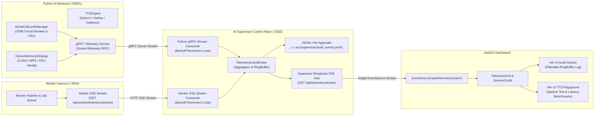

# Master Implementation Plan: Iteration 37 - Inverted Telemetry Ingestion Architecture & Ark UI Fleet Observability

## Executive Summary & Architecture Consensus (Post Grill-Me Alignment)

Following our detailed architectural alignment:
1. **Inverted Telemetry Ingestion Architecture**:
   - **Python AI Backend**: Exposes a gRPC server streaming RPC (`rpc StreamTelemetry(TelemetryRequest) returns (stream TelemetryEvent)`) on port 50051. Streams real-time VRAM allocation, GPU utilization, active model states, and instant OOM circuit breaker alerts.
   - **Worker Daemon**: Exposes a standard SSE endpoint (`GET /api/worker/telemetry/stream` on port 4000) emitting render FPS, active job ID, and frame progress.
   - **Supervisor Control Plane**: Connects as a streaming client to both sidecars on startup. Automatically reconnects with exponential backoff (`1s -> 2s -> 5s -> 10s`) on disconnection, flagging sidecars as `RECONNECTING` without crashing the supervisor.
2. **Supervisor SSE Fan-out strictly for UI Clients**:
   - AI-Supervisor aggregates fleet telemetry and serves `GET /api/telemetry/stream` strictly for the SolidJS web UI.
   - SolidJS dashboard replaces its 3 separate HTTP `setInterval` polling loops with a native `EventSource('/api/telemetry/stream')` connection.
3. **Ark UI Model Lifecycle & OOM Audit Drawer**:
   - Uses `@ark-ui/solid` Drawer.
   - Dual persistence: in-memory sliding ring-buffer (last 200 events) for real-time UI filtering (All, OOM Intercepts, Evictions, Registrations), plus append-only JSONL log (`~/.acc/supervisor/audit_events.jsonl`) for post-mortem forensics across restarts.
4. **Interactive Neural TTS Playground**:
   - Uses `@ark-ui/solid` Dialog and Slider.
   - Dynamically adapts: executes real inference if model weights (`kokoro` / `vieneu`) and PyTorch are present with sufficient VRAM; otherwise seamlessly falls back to high-fidelity cadence synthesis.
   - Full interactive testing: text input, voice selector, speed slider (0.5x–2.0x), audio playback, latency and RTF benchmarks.
5. **Studio Decoupling**:
   - `apps/studio/src/components/preview/TelemetryCompanionCard.tsx` and `DiagnosticTelemetryCard.tsx` remain untouched as requested.

---

## Architectural Topology Diagram

---

## Phased Implementation Roadmap

### Phase 1: Python AI Backend gRPC Server Streaming Telemetry
- **Files**:
  - `packages/proto/proto/acc/v1/telemetry.proto` (Add `TelemetryService` with `rpc StreamTelemetry(TelemetryRequest) returns (stream TelemetryEvent)`)
  - `apps/ai-supervisor/python-backend/src/services/telemetry_service.py` (Implement gRPC servicer)
  - `apps/ai-supervisor/python-backend/src/server.py` (Register servicer on gRPC port 50051)
  - `apps/ai-supervisor/python-backend/src/services/model_lifecycle_manager.py` (Hook event callbacks into stream queue)
  - `apps/ai-supervisor/python-backend/tests/test_telemetry_streaming.py` (Unit tests)

### Phase 2: Worker Daemon SSE Telemetry Stream
- **Files**:
  - `apps/worker/src/index.ts` / `apps/worker/src/server.ts`
  - Add `GET /api/worker/telemetry/stream` using standard HTTP Server-Sent Events headers.
  - Broadcast render FPS, frame progress, and active job ID.

### Phase 3: Supervisor Stream Consumers & Dual Persistence
- **Files**:
  - `apps/ai-supervisor/src/bun/telemetry/PythonGrpcStreamConsumer.ts` (New)
  - `apps/ai-supervisor/src/bun/telemetry/WorkerSseStreamConsumer.ts` (New)
  - `apps/ai-supervisor/src/bun/telemetry/TelemetryEventBroker.ts`
  - `apps/ai-supervisor/src/bun/index.ts`
  - Implement backoff reconnection loops (`1s -> 2s -> 5s -> 10s`).
  - Dual persistence: in-memory ring-buffer (200 items) + append to `~/.acc/supervisor/audit_events.jsonl`.
  - Fan out aggregated events over Supervisor's `GET /api/telemetry/stream`.

### Phase 4: SolidJS Dashboard Native `EventSource` Refactor
- **Files**:
  - `apps/ai-supervisor/src/ui/stores/supervisorStore.ts`
  - `apps/ai-supervisor/src/ui/components/Header.tsx`
  - Delete the 3 `setInterval` polling timers.
  - Connect via `new EventSource('/api/telemetry/stream')`.
  - Handle stream reconnection status badge in Header (`LIVE`, `RECONNECTING`, `OFFLINE`).

### Phase 5: Ark UI Model Lifecycle & OOM Audit Drawer
- **Files**:
  - `apps/ai-supervisor/src/ui/components/AuditDrawer.tsx` (New)
  - `apps/ai-supervisor/src/ui/App.tsx`
  - Ark UI `Drawer` primitive with filter tabs (All, OOM Intercepts, Evictions, Registrations).
  - 5-state UI matrix (*Default, Loading, Empty, Error, Disabled*).

### Phase 6: Interactive Neural TTS Playground Modal
- **Files**:
  - `apps/ai-supervisor/src/ui/components/TtsPlaygroundModal.tsx` (New)
  - `apps/ai-supervisor/src/ui/components/ServiceCard.tsx`
  - Ark UI `Dialog` and `Slider`.
  - Dynamic execution: Kokoro / VieNeu / Cadence tone fallback.
  - Audio playback with latency and RTF benchmarks.

---

## Verification & Quality Gates
1. Run `pytest apps/ai-supervisor/python-backend/tests/test_telemetry_streaming.py -q --tb=short`.
2. Run `bun test` on Supervisor stream consumers.
3. Run `bun run build:ui` in `apps/ai-supervisor` to ensure zero compilation or JSX errors.
