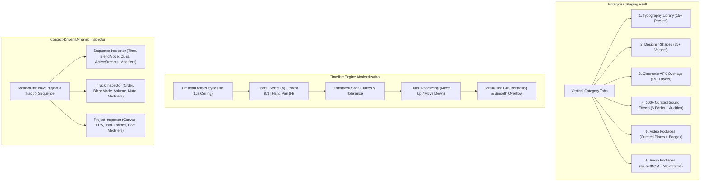

# Master Integration Plan Iteration 11: Studio Enterprise UI/UX Enhancement (LeftSidebar, RightSidebar, Timeline Engine)

**Document ID:** `docs/master_integration_plan_iteration11.md`  
**Paired Plan:** [`apps/studio/doc/implementation_plan_23.md`](file:///c:/Users/Admin/workspace/git/acc/apps/studio/doc/implementation_plan_23.md)  
**Status:** `[ ] Planned`  
**Scope:** `apps/studio/src/components/`, `apps/studio/src/lib/`, `autogenerated-tests/`

---

## Goal Description
Transform ACC Studio into an enterprise-grade NLE workstation with three core architectural pillars:
1. **LeftSidebar Creative Staging Library:**
   - Categorized vertical navigation tabs: `Typography`, `Shapes`, `VFX Overlays`, `SFX (100+)`, `Video Footages`, and `Audio Footages`.
   - Rich Typography library with top-quality creative titles, subtitles, callouts, and kinetic presets.
   - Designer Shapes library with geometric, callout, frame, and badge presets.
   - Cinematic VFX Overlays with animated film burns, anamorphic flares, HUD reticles, glitch matrix, and atmosphere particles.
   - 100+ curated Sound Effects organized into 6 functional sound banks (Whooshes, Impacts, UI Clicks, Riser/Transitions, Cyber/Glitch, Ambience) with real-time Web Audio audition previews.
   - Production Video Footages (Cyberpunk City, Matrix Rain, Nebula, HUD Wireframe, Film Burns) with poster thumbnails and resolution badges.
   - Production Audio Footages (Synthwave, Cinematic Tension, Lo-Fi Chill, Space Ambience) with inline waveform player and BPM tags.
2. **RightSidebar Dynamic Context-Driven Multi-Tier Inspector:**
   - Breadcrumb navigation: `[Project > Track > Sequence]`.
   - **Sequence Inspector:** Full editing form for sequence properties including `time` (start/duration/relational), `blendMode` (`normal`, `screen`, `multiply`, `overlay`, `add`), `cues` (karaoke words & text timing), `activeStreams`, and sequence-level modifiers.
   - **Track Inspector:** Dedicated property editing for tracks (`name`, `order`, `type`, `blendMode`, `volume`, `visible/muted`, `track modifiers`).
   - **Project/Global Inspector:** Global settings (`canvasSize`, `fps`, `colorSpace`, `contentId`, document-level modifiers, total timeline duration).
3. **Timeline Engine Hardening & Modernization:**
   - Fix playback ceiling bug: remove the artificial 10-second (300 frames) fallback bug by binding strictly to `timeline.totalFrames`.
   - Hand Pan tool: click-and-drag timeline canvas navigation with inertial momentum cursor.
   - Track reordering mechanism: native order shifting via up/down controls and drag reordering.
   - High-precision magnetic snap: visual snap guidelines when dragging sequences and trim handles.
   - Large timeline performance: virtualized track & clip rendering for dozens of tracks and hundreds of clips.
4. **Complete Elimination of Client-Specifics & Isomorphic Unification of `@acc/ir`:**
   - Eliminate `@acc/ir/client`, `packages/ir/src/client.ts`, `packages/ir/src/plugins/clientRegistry.ts`, and all 10 fake client plugin stubs.
   - Decouple static Node `fs` from `Depth3DPlugin`, `Camera3DPlugin`, `UniversalAudioMixer`, and `AssetMetadataProber`.
   - Make `@acc/ir` the single, canonical, 100% isomorphic package for both browser and server runtimes.

---

## User Review Required
> [!IMPORTANT]
> - **Timeline Frame Duration Sync:** Currently, `totalFrames` in `App.tsx` and `Timeline.tsx` defaults to `irState.timeline?.totalDurationFrames || 300`. In `VideoIR`, `totalDurationFrames` is not a property on `ResolvedTimeline`—the real property is `timeline.totalFrames`. This caused the player to cap playback at 300 frames (10 seconds) regardless of actual content length. We will fix this by accessing `timeline.totalFrames`.
> - **Inspector Selection Hierarchy:** Clicking on a clip selects `Sequence` inspector; clicking on a track header selects `Track` inspector; clicking on empty canvas or timeline background returns to `Project/Global` inspector, with persistent top breadcrumb pills to switch between them at any time.

---

## Proposed Architectural Flow



---

## Detailed Component Plans

### 1. LeftSidebar Staging Library & Retained-Mode Modifiers System [x] (Completed: 2026-10-18, [History Entry 268](history/268_studio_iteration11_phase1_leftsidebar_retained_plugins.md))
- **Files:**
  - `packages/ir/src/plugins/shape/ShapeModifierPlugin.ts` (NEW: handles vector drawing for rect, circle, star, polygon, pill, border, gradient, cornerRadius in clip-space)
  - `packages/ir/src/plugins/sfx/ProceduralSFXModifierPlugin.ts` (NEW: handles procedural DSP Float32Array synthesis for whooshes, impacts, clicks, risers, ambient drones)
  - `packages/ir/src/plugins/index.ts` (registered `ShapeModifierPlugin` and `ProceduralSFXModifierPlugin` in core registry)
  - `packages/ir/src/client.ts` (exported new plugins for client bundling)
  - `apps/studio/src/lib/library/sfxBank.ts` (NEW: 104 curated sound definitions mapped to procedural synthesis parameters across 6 banks)
  - `apps/studio/src/lib/library/stagingPresets.ts` (expanded with 104 SFX, 15+ typography, 15+ shapes, 15+ overlays, curated video and audio footages)
  - `apps/studio/src/components/LeftSidebar.tsx` (vertical category tabs, search filter, sound audition buttons, video/audio footage cards)
  - `autogenerated-tests/studio_phase1_leftsidebar_retained_plugins.test.ts` (11 unit/integration tests)

#### Retained-Mode Scene Graph & Canvas Interaction:
- **Zero Raw Assets for Generated Elements:** Everything dropped into the project other than raw user media files (typography, shapes, visual effect overlays, sound effects) is modeled purely through sequences with structured `modifiers`:
  - `transform` modifier: handles spatial positioning, rotation, scale, opacity, and GSAP motion easing curves.
  - Domain modifier: `text/style` (captions/typography), `shape/draw` (vector geometry), `overlay/canvas_particles` or `overlay/hologram_hud` (VFX), `sfx/procedural` (audio).
- **On-Canvas Adjustability:** Every visual element dropped onto the canvas integrates directly with `CanvasTransformOverlay` and Preview 8-point handles, allowing users to resize, rotate, and reposition on-canvas, with immediate two-way synchronization to the RightSidebar inspector.

#### Typography Categories:
- **Cinematic & Film:** Cinematic Bold Title, Neon Cyberpunk, 3D Block Letter, Retro VHS Sans.
- **Editorial & Social:** Minimalist Lower Third, TikTok Headline, Quote Highlight, News Ticker.
- **Dynamic & Kinetic:** Kinetic Word Strobe, Glitch Reveal, Karaoke Bounce, Typewriter Terminal.

#### Shapes Library:
- **Framing & Cards:** Glassmorphic Card, Letterbox Mask, Rounded Pill, Polar Spotlight.
- **Accents & Pointers:** Target Reticle, Directional Arrow, Geometric Hexagon, Holographic Ring.
- **Badges & HUD:** Cyber Tech Badge, Warning Caution Tape, Broadcast Live Pill.

#### VFX Overlays:
- **Atmosphere:** Anamorphic Sun Flare, Cyber Spikes, Floating Embers, Volumetric Dust.
- **Cinematic Textures:** 35mm Film Grain, Light Leak Flash, VHS Glitch Noise, Prism Distortion.

#### 100+ Curated SFX Catalog (6 Sound Banks):
- **Bank 1: Whooshes & Swishes (20 items):** Fast Air Whoosh, Heavy Low Swish, Jet Flyby, Digital Snap Whoosh, Cybernetic Sweep...
- **Bank 2: Impacts & Booms (20 items):** Cinematic Sub Bass Drop, Heavy Metal Clang, Glass Shatter, Punch Impact, Digital Bass Thud...
- **Bank 3: UI Clicks & Cues (20 items):** Mechanical Switch, Mouse Click, Bubble Pop, Subtle Blip, Tech Beep, Menu Tap...
- **Bank 4: Risers & Transitions (15 items):** Tension Pitch Riser, White Noise Build, Cybernetic Warp, Rewind Tape, Stutter Sweep...
- **Bank 5: Cyber & Glitch (15 items):** Data Stream Chirp, System Malfunction, Error Alert, Hologram Flicker, Robot Servo...
- **Bank 6: Ambient Drones & FX (10 items):** Spacecraft Hum, Rain Storm Ambience, Neon Street Drone, Computer Server Room...

#### Video Footages Library (Royalty-Free & Curated Footage Presets):
- **Cyberpunk Urban City:** 4K high-density neon traffic stream plate.
- **Matrix Digital Rain:** Vertical falling code green matrix loop.
- **Deep Space Nebula:** Cosmic starry nebula particle slow drift.
- **Hologram Tech HUD Sphere:** 3D rotating wireframe planet telemetry loop.
- **35mm Cinematic Film Burn:** Vintage analog organic frame light leak.
- **Visual Presentation:** Animated poster thumbnail, duration badge (`5.0s`, `10.0s`), resolution tag (`4K`, `1080p`), and instant drag/insert into timeline video tracks.

#### Audio Footages Library (Full-Length Music & Ambient Scores):
- **Synthwave 2099 Cyber Track:** Retrowave analog synth arpeggios with 80s drum groove (30s).
- **Cinematic Trailer Tension:** Low cello drone building into massive hybrid orchestral brass braam (25s).
- **Lo-Fi Chill Hop Beat:** Warm vinyl crackle with relaxed electric piano chords (30s).
- **Deep Space Ambient Drone:** Sub-bass rumble with ethereal reverberated choral pads (40s).
- **Visual Presentation:** Dynamic waveform pill card with inline Play/Pause audition button, duration readout, BPM tag, and instant drag/insert into timeline audio tracks.

---

### 2. RightSidebar Dynamic Multi-Tier Inspector `[x] Completed (docs/history/272_studio_multi_tier_inspector_and_state_commands.md)`
- **Files:**
  - `apps/studio/src/lib/ir/irState.ts` (extended state: `inspectorMode: 'sequence' | 'track' | 'project'`, `selectedTrackId: string | null`, `setInspectorMode()`, `setSelectedTrackId()`)
  - `apps/studio/src/lib/commands/UpdateTrackCommand.ts` (NEW: undoable track property updates for name, blendMode, volume, opacity, mute with 500ms `tryMerge`)
  - `apps/studio/src/lib/commands/ReorderTrackCommand.ts` (NEW: undoable track order shifting up/down in `doc.tracks`)
  - `apps/studio/src/lib/commands/UpdateSequencePropsCommand.ts` (NEW: undoable sequence updates for blendMode, activeStreams, cues, and relational timing)
  - `apps/studio/src/lib/commands/UpdateProjectMetaCommand.ts` (NEW: undoable project meta updates for canvasSize, globalFps, colorSpace)
  - `apps/studio/src/components/RightSidebar.tsx` (interactive breadcrumb header `[Project > Track > Sequence]`, Sequence Form, Track Form, Project Form)
  - `apps/studio/src/components/Timeline.tsx` (track header click selection, empty area background click to select Project)
  - `apps/studio/src/components/Preview.tsx` (empty canvas margin click to select Project)

#### Inspection State Machine & Navigation:
- **Interactive Breadcrumb Pills:** Persistent header pills `[Project: {title}] > [Track: {name}] > [Sequence: {id}]`. Clicking any pill switches the active inspection tier immediately without losing the underlying selection context.
- **Context-Sensitive Triggers:**
  - Clicking a sequence in Timeline or Viewport: selects Sequence, tracks its parent Track, switches `inspectorMode = 'sequence'`.
  - Clicking a track header in Timeline: selects Track, switches `inspectorMode = 'track'`.
  - Clicking empty canvas margin outside frame or empty timeline area below tracks: switches `inspectorMode = 'project'`.

#### Sequence Form Sections (Collapsible Accordions):
1. **Header & Identification:** Sequence ID, Type badge, Asset source selector.
2. **Timing & Sync:** Segmented toggle for Absolute (Start frame, Duration frames with seconds conversion) vs Relational DAG triggers (`after`, `syncWith`, `offsetFrames`, `matchLengthOf`).
3. **Compositing & Blending:** `blendMode` dropdown (`normal`, `screen`, `multiply`, `overlay`, `add`, `color_dodge`, `soft_light`) and stream routing tags.
4. **Text & Cues Editor:** (For `text` sequences or sequences with subtitle cues) Table of timed cue entries with `startOffsetMs`, `endOffsetMs`, and subtitle text editing.
5. **Modifiers Stack:** Dynamic modifier cards with parameters and motion curve selectors.

#### Track Form Sections:
1. **Track Metadata:** Track ID, editable display Name, Type badge (`video`, `audio`, `timed_text`).
2. **Track Ordering:** "Move Up" and "Move Down" buttons dispatching `ReorderTrackCommand` with instant live timeline track reordering.
3. **Compositing & Layer Styling:** Track-level `blendMode` and track opacity slider (0..100%).
4. **Audio Bus Controls:** (For audio tracks) Track master gain slider (0..200% / -inf..+6dB), mute toggle, and pan slider (-100%..+100%).
5. **Track Modifiers Stack:** Track-level modifier chain.

#### Project / Global Form Sections:
1. **Aspect Ratio Presets & Resolution:** 1-click aspect ratio buttons:
   - `16:9 Landscape` (1920x1080)
   - `9:16 Vertical / Shorts / Reels` (1080x1920)
   - `1:1 Square` (1080x1080)
   - `21:9 Ultra-Wide` (2560x1080)
   - Alongside custom Width & Height numerical inputs.
2. **Project Performance & Frame Rate:** Global FPS selector (`24 fps Cinema`, `30 fps Standard`, `60 fps High-Frame-Rate`).
3. **Color Space:** `sRGB`, `Display P3`, `Rec.709`.
4. **Timeline Metrics:** Readout of calculated `totalFrames`, total seconds, track count, and clip count.
5. **Document Master Modifiers:** Master modifier chain (global color grading, master bloom, particle ambiance).

#### Undo/Redo Semantic Debouncing:
- Continuous edits on the same target property within 500ms (such as dragging a slider or typing numerical dimensions) automatically merge via `tryMerge` into a single atomic undo/redo history point.

---

### 3. Timeline Engine Modernization
- **Files:**
  - `apps/studio/src/components/Timeline.tsx`
  - `apps/studio/src/components/timeline/TimecodeRuler.tsx`
  - `apps/studio/src/App.tsx`

#### Enhancements:
1. **Total Duration Bug Fix:**
   - In `App.tsx` line 152: change `irState.timeline?.totalDurationFrames` to `irState.timeline?.totalFrames ?? 300`.
   - In `Timeline.tsx` line 264: change `irState.timeline?.totalDurationFrames` to `irState.timeline?.totalFrames ?? 300`.
   - Result: Playback accurately tracks full 270+ frames or multi-minute timelines without early loop.
2. **Hand Pan Tool (`H`):**
   - Active when `activeTool === 'hand'`.
   - Dragging the timeline canvas pans `scrollLeft` smoothly using mouse delta.
3. **Track Reordering Controls:**
   - Up/Down arrows and drag handle in track headers to reorder tracks in document order.
   - Dispatches track reorder command updating `doc.tracks` order and re-compiles DAG.
4. **Enhanced Magnetic Snapping & Guides:**
   - Calculates snap points from all sequence starts/ends, current playhead frame, and 1-second grid.
   - Renders a vertical cyan magnetic snap guideline when active clip or trim handle snaps within 4px.
5. **Timeline Overflow & Performance:**
   - Sticky track headers on the left while lanes scroll horizontally.
   - Smooth horizontal zoom and vertical scroll isolation.

---

### 4. Complete Elimination of Client-Specifics & Isomorphic Unification of `@acc/ir`
- **Paired Implementation Plan:** [`apps/studio/doc/implementation_plan_24.md`](file:///c:/Users/Admin/workspace/git/acc/apps/studio/doc/implementation_plan_24.md)
- **Files to Modify/Delete:**
  - `packages/ir/src/plugins/clientRegistry.ts` (DELETE: eliminate 10 dummy plugin stubs and `createClientPluginStub`)
  - `packages/ir/src/client.ts` (DEPRECATE/DELETE: eliminate artificial `@acc/ir/client` subpath in favor of canonical `@acc/ir`)
  - `packages/ir/src/plugins/vfx/Depth3DPlugin.ts` (remove `import fs from 'fs'` and `fs.existsSync` check)
  - `packages/ir/src/plugins/vfx/Camera3DPlugin.ts` (remove `import fs from 'fs'` and `fs.existsSync` check)
  - `packages/ir/src/renderer/audio/UniversalAudioMixer.ts` (remove static `import fs from 'fs'` in `writeWavToDisk`)
  - `packages/ir/src/prober/AssetMetadataProber.ts` (remove static `import fs from 'fs'` and isolate Node header sniffer)
  - `packages/ir/src/server.ts` (NEW: isolate server-only batch FFI tools: `IRChunkWorkerPool`, `FFIChunkConcatMuxer`)
  - `packages/ir/src/index.ts` (canonical 100% isomorphic single source of truth)
  - `packages/ir/package.json` (update exports to alias `./client` to `./src/index.ts` and add `./server`)
  - `apps/studio/` (migrate all imports from `@acc/ir/client` to `@acc/ir`, switch `registerClientModifierPlugins` to `registerCoreModifierPlugins`)

#### Key Objectives:
1. **Zero Dummy Stubs:** Every modifier plugin (`ColorGradingPlugin`, `BlendModePlugin`, `CanvasParticleOverlayPlugin`, `Depth3DPlugin`, `Camera3DPlugin`, `TransitionCrossfadePlugin`) runs its real implementation in both browser (Studio Preview) and server (Headless Exporter).
2. **Single Canonical Package:** All client and server components import from `@acc/ir` directly.
3. **Clean Isomorphic Bundles:** Zero Node `fs` or `path` externalization warnings during `bun run --cwd apps/studio build`.

---

## Verification Plan

### Automated Tests
Run comprehensive studio and engine regression tests:
```powershell
bun test autogenerated-tests/ir_renderer_web_server_parity.test.ts
bun test autogenerated-tests/video_ir_phase4_engine.test.ts
bun test autogenerated-tests/studio_phase7_master_e2e_hardening.test.ts
bun test autogenerated-tests/studio_client_export_phase3.test.ts
```

New dedicated automated test suite:
```powershell
bun test autogenerated-tests/studio_sidebar_timeline_enhancements.test.ts
```
- Verifies `sfxBank.ts` contains 100+ unique sound effect definitions with valid procedural audio generators.
- Verifies `IRStateManager` track selection, sequence property updates, and track reordering commands.
- Verifies timeline totalFrames correctly resolves beyond 300 frames.

### Production Build
```powershell
bun run studio:build
```
Ensure zero TypeScript compilation errors, clean asset packaging, and bundle size within limits.

### Manual Verification
1. Open Studio in browser (`bun run studio`).
2. **LeftSidebar:** Click through the vertical tabs (Typography, Shapes, VFX Overlays, SFX, Video Footages, Audio Footages). Audition sounds in SFX and Audio Footages; drag Video or Title presets into timeline.
3. **RightSidebar:** Click sequence to inspect cues and blend mode; click track header to inspect track volume and order; click empty timeline background to inspect Project Settings.
4. **Timeline:** Play project past frame 300 to confirm no artificial 10s stop. Use Hand Pan tool (`H`) to drag-pan timeline. Test track reorder buttons and magnetic snap guidelines.
