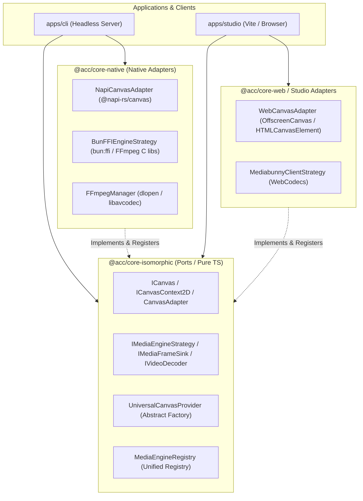

# Architectural Blueprint: Isolating & Organizing Platform-Dependent Libraries (@napi-rs/canvas, bun:ffi) for Zero Regressions
# Master Integration Plan (Iteration 14)

## Goal Description
In an isomorphic TypeScript/Bun monorepo powering both native headless video generation (Bun/Node CLI, native FFmpeg C shared libraries, GPU shaders) and web-based visual authoring (Studio Vite, HTML5 Canvas, WebGL/WebGPU, WebCodecs), mixing platform-dependent native libraries (`@napi-rs/canvas`, `bun:ffi`, `dlopen`) with shared application logic leads to:
1. **Bundler Breakage**: Vite / Rollup build failures when encountering C++ native bindings (`.node`), Node-specific built-ins (`child_process`, `fs`), or Bun-specific modules (`bun:ffi`).
2. **Platform Coupling & Regressions**: Direct imports of `@napi-rs/canvas` or `bun:ffi` spread throughout pipelines, exporters, and effect engines prevent cross-platform reuse and testability.
3. **Fragile Maintenance**: Upgrading native dependencies or targeting new environments (e.g. Electron, WebAssembly, Cloud Run Linux containers) risks breaking existing rendering pipelines.

This plan details a robust, production-grade architectural organization using **Monorepo Package Boundary Splitting**, the **Contract-based Abstract Factory + Strategy Pattern**, **Unified Engine Registries**, and a **Dual-Layer Regression Harness** (compile-time bundler/lint enforcement + bit-identical cross-platform test suite).

---

## Architecture Overview & Design Patterns

### 1. Hexagonal Architecture / Ports & Adapters Boundary



---

## 4-Pillar Structural Design

### Pillar 1: Monorepo Package Boundary Splitting

Split media and native execution into explicit, isolated workspace packages:

| Package | Environment | Allowed Dependencies | Prohibited Dependencies |
| :--- | :--- | :--- | :--- |
| `@acc/core-isomorphic` | Universal (Browser, Node, Bun, Worker) | Pure TS algorithms, math, data structures, contracts/interfaces | `bun:ffi`, `@napi-rs/canvas`, `child_process`, `fs`, `worker_threads` |
| `@acc/core-native` | Server Only (Bun / Node C++ ABI) | `bun:ffi`, `@napi-rs/canvas`, `fs`, native shared C `.so`/`.dylib`/`.dll` | DOM globals, browser `window`, client-only APIs |
| `@acc/core-web` | Client Only (Browser / Vite) | DOM `HTMLCanvasElement`, `OffscreenCanvas`, WebCodecs, WebAudio | `@napi-rs/canvas`, `bun:ffi`, C++ node addons |

#### `package.json` Conditional Exports Pattern
In `@acc/core` (or root packages), enforce resolution conditions:
```json
{
  "name": "@acc/core",
  "exports": {
    "./isomorphic": {
      "import": "./src/isomorphic/index.ts",
      "types": "./src/isomorphic/index.ts"
    },
    "./native": {
      "bun": "./src/native/index.ts",
      "node": "./src/native/index.ts",
      "default": "./src/native/index.ts"
    },
    "./web": {
      "browser": "./src/web/index.ts",
      "default": "./src/web/index.ts"
    }
  }
}
```

---

### Pillar 2: Contract-Based Abstract Factory + Strategy Pattern

#### 1. Canvas Port Contract (`@acc/core-isomorphic`)
Callers never touch `@napi-rs/canvas` or `HTMLCanvasElement` directly. They program strictly to the `ICanvasInstance` and `ICanvasContext2D` interfaces:

```typescript
// packages/core-isomorphic/src/canvas/types.ts
export interface ICanvasContext2D {
  drawImage(image: any, dx: number, dy: number, dw?: number, dh?: number): void;
  getImageData(sx: number, sy: number, sw: number, sh: number): ImageData;
  putImageData(imagedata: ImageData, dx: number, dy: number): void;
  fillRect(x: number, y: number, w: number, h: number): void;
  clearRect(x: number, y: number, w: number, h: number): void;
  // Canvas standard 2D context methods...
}

export interface ICanvasInstance {
  readonly width: number;
  readonly height: number;
  getContext(contextId: '2d'): ICanvasContext2D;
  toBuffer(mimeType?: string): Buffer | Uint8Array;
  toDataURL(mimeType?: string): string;
  getRawCanvas(): unknown;
}

export interface ICanvasAdapter {
  readonly name: string;
  readonly environment: 'web' | 'node' | 'custom';
  isSupported(): boolean;
  createCanvas(width: number, height: number): ICanvasInstance;
  loadImage(source: string | Buffer | Uint8Array | Blob): Promise<any>;
}
```

#### 2. Native Adapter (`@acc/core-native`)
`@napi-rs/canvas` is imported **only** inside this isolated adapter file:

```typescript
// packages/core-native/src/canvas/NapiCanvasAdapter.ts
import { createCanvas, loadImage, Image } from '@napi-rs/canvas';
import type { ICanvasAdapter, ICanvasInstance, ICanvasContext2D } from '@acc/core-isomorphic';

export class NapiCanvasAdapter implements ICanvasAdapter {
  public readonly name = 'napi-rs';
  public readonly environment = 'node' as const;

  public isSupported(): boolean {
    return typeof process !== 'undefined' && (Boolean(process.versions?.node) || Boolean((process.versions as any)?.bun));
  }

  public createCanvas(width: number, height: number): ICanvasInstance {
    const raw = createCanvas(width, height);
    return {
      width,
      height,
      getContext: (id: '2d') => raw.getContext(id) as unknown as ICanvasContext2D,
      toBuffer: (mime?: string) => raw.toBuffer(mime as any),
      toDataURL: (mime?: string) => raw.toDataURL(mime as any),
      getRawCanvas: () => raw,
    };
  }

  public async loadImage(source: string | Buffer | Uint8Array): Promise<any> {
    return loadImage(source);
  }
}
```

#### 3. Universal Canvas Factory (`@acc/core-isomorphic`)
Exposes static creation methods with lazy strategy registration and zero native imports:

```typescript
// packages/core-isomorphic/src/canvas/UniversalCanvasProvider.ts
export class UniversalCanvasProvider {
  private static adapters = new Map<string, ICanvasAdapter>();
  private static defaultAdapter: ICanvasAdapter | null = null;

  public static registerAdapter(adapter: ICanvasAdapter, isDefault = false): void {
    this.adapters.set(adapter.name, adapter);
    if (isDefault || !this.defaultAdapter) {
      this.defaultAdapter = adapter;
    }
  }

  public static createCanvas(width: number, height: number, preferredAdapter?: string): ICanvasInstance {
    const adapter = preferredAdapter ? this.adapters.get(preferredAdapter) : this.defaultAdapter;
    if (!adapter) {
      throw new Error(`[UniversalCanvasProvider] No canvas adapter registered for environment.`);
    }
    return adapter.createCanvas(width, height);
  }
}
```

---

### Pillar 3: Dynamic Registration & Bootstrapping Lifecycle

To eliminate circular dependencies and ensure that client bundles never import native adapters:

1. **Native Bootstrap (CLI / Server Entrypoint)**:
   ```typescript
   // apps/cli/src/bootstrap.ts
   import { UniversalCanvasProvider, MediaEngineRegistry } from '@acc/core-isomorphic';
   import { NapiCanvasAdapter, BunFFIEngineStrategy, FFmpegManager } from '@acc/core-native';

   export async function bootstrapServer(): Promise<void> {
     await FFmpegManager.prepare();
     UniversalCanvasProvider.registerAdapter(new NapiCanvasAdapter(), true);
     MediaEngineRegistry.register(new BunFFIEngineStrategy());
   }
   ```

2. **Web Bootstrap (Studio Vite Entrypoint)**:
   ```typescript
   // apps/studio/src/bootstrap.ts
   import { UniversalCanvasProvider, MediaEngineRegistry } from '@acc/core-isomorphic';
   import { WebCanvasAdapter, MediabunnyClientStrategy } from '@acc/core-web';

   export function bootstrapClient(): void {
     UniversalCanvasProvider.registerAdapter(new WebCanvasAdapter(), true);
     MediaEngineRegistry.register(new MediabunnyClientStrategy());
   }
   ```

3. **Domain Code Consumption (Pipelines, Plugins, VFX)**:
   ```typescript
   // apps/cli/src/pipelines/01-scraper/stages/ScraperCardCompositionStage.ts
   // BEFORE (Fragile Direct Native Import):
   // import { createCanvas } from '@napi-rs/canvas';

   // AFTER (Isomorphic, Regression-Free Contract):
   import { UniversalCanvasProvider } from '@acc/core-isomorphic';

   const canvas = UniversalCanvasProvider.createCanvas(1080, 1920);
   const ctx = canvas.getContext('2d');
   ```

---

### Pillar 4: Dual-Layer Regression Guardrails

#### 1. Compile-Time Guardrail: Ban Native Imports via Linter & Bundler
- **ESLint / Dependency Rule**:
  Configure `no-restricted-imports` or `dependency-cruiser` in isomorphic/client packages:
  ```json
  {
    "rules": {
      "no-restricted-imports": ["error", {
        "paths": [
          { "name": "@napi-rs/canvas", "message": "Import via UniversalCanvasProvider from @acc/core-isomorphic instead." },
          { "name": "bun:ffi", "message": "Import bun:ffi only within @acc/core-native." },
          { "name": "child_process", "message": "Raw child_process forbidden. Use FFmpegManager / MediaEngineStrategy." }
        ]
      }]
    }
  }
  ```
- **Vite Rollup Guard**:
  Studio's `vite.config.ts` maintains an external assertion plugin that fails the build if any `.node` or `bun:ffi` symbol is referenced in the bundle graph.

#### 2. Runtime Parity Test Harness
A formal `bun:test` suite verifying:
- **API Parity**: `NodeCanvasAdapter` and `WebCanvasAdapter` (via JSDOM / OffscreenCanvas mock) produce identical drawing commands and bounding boxes.
- **Pixel / Digest Parity**: Drawing the same primitives (rectangles, text layout, gradients) produces matching RGBA byte lengths and deterministic checksums across runtimes.
- **Media Engine Parity**: `BunFFIEngineStrategy` and fallback engines generate matching container durations and stream counts.

---

## Migration Roadmap


1. **Phase 1: Contract Extraction**:
   - Define `ICanvasInstance`, `ICanvasAdapter`, and `IVideoDecoder` in `@acc/core-isomorphic`.
   - Ensure `UniversalCanvasProvider` and `MediaEngineRegistry` have zero native imports.
2. **Phase 2: Adapter Encapsulation**:
   - Relocate `NapiCanvasAdapter` and `BunFFIEngineStrategy` into `@acc/core-native`.
   - Update `FFIVideoDecoder` to accept and produce `ICanvasInstance` instead of raw `@napi-rs/canvas` types.
3. **Phase 3: Direct Import Cleanup**:
   - Replace the ~20 direct imports of `@napi-rs/canvas` across `apps/cli/src/pipelines/`, `packages/effect-engines/`, and `packages/exporters/` with `UniversalCanvasProvider.createCanvas()`.
4. **Phase 4: Guardrails & Parity Testing**:
   - Add lint rule blocking direct native imports outside `@acc/core-native`.
   - Add automated parity test in `/autogenerated-tests/platform_native_parity.test.ts`.

---

## Verification Plan

### Automated Tests
1. **Lint Check**:
   ```bash
   bun run lint
   ```
2. **Parity Unit Suite**:
   ```bash
   bun test autogenerated-tests/platform_native_parity.test.ts
   ```
3. **Production Client Build Check (Vite)**:
   ```bash
   cd apps/studio && bun run build
   ```
   *Asserts 0 bundle leakage, 0 Rollup unresolved native module warnings.*

### Manual / Developer Verification
- Run CLI video generation pipeline (`bun run apps/cli/src/index.ts`) and confirm zero regression in output MP4.
- Open Studio Web UI (`bun run dev`), drag timeline clips, and verify waveform, canvas preview, and WebGL rendering work seamlessly.
