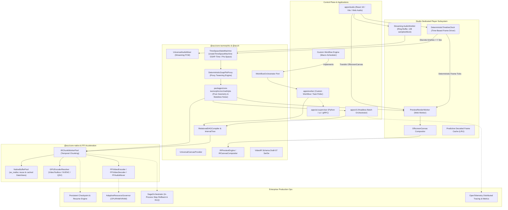
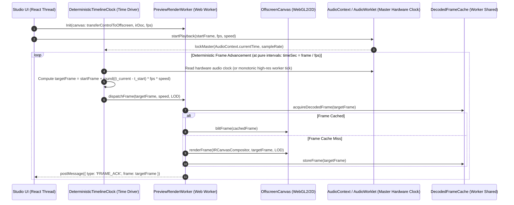
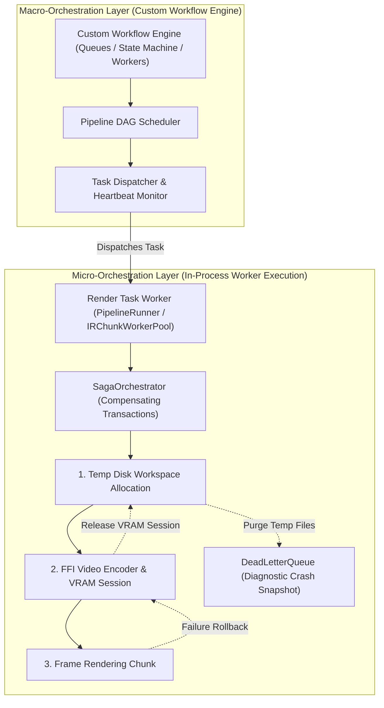
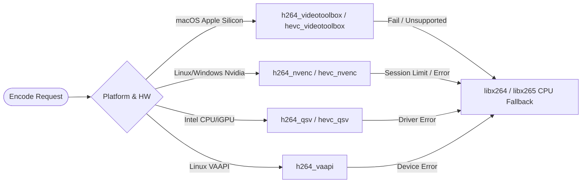
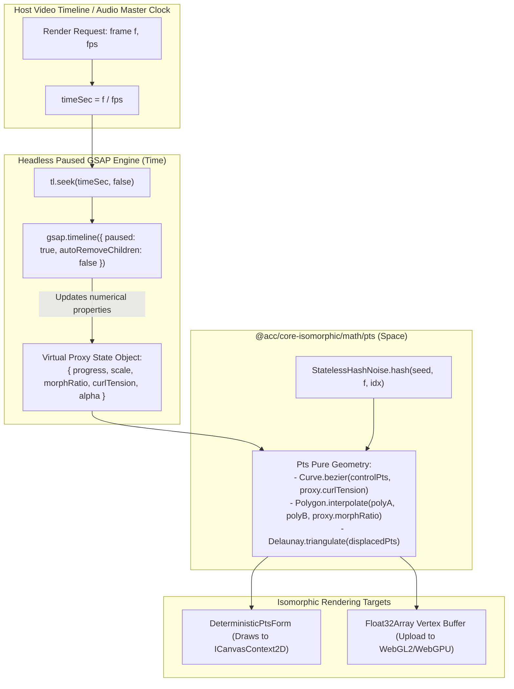
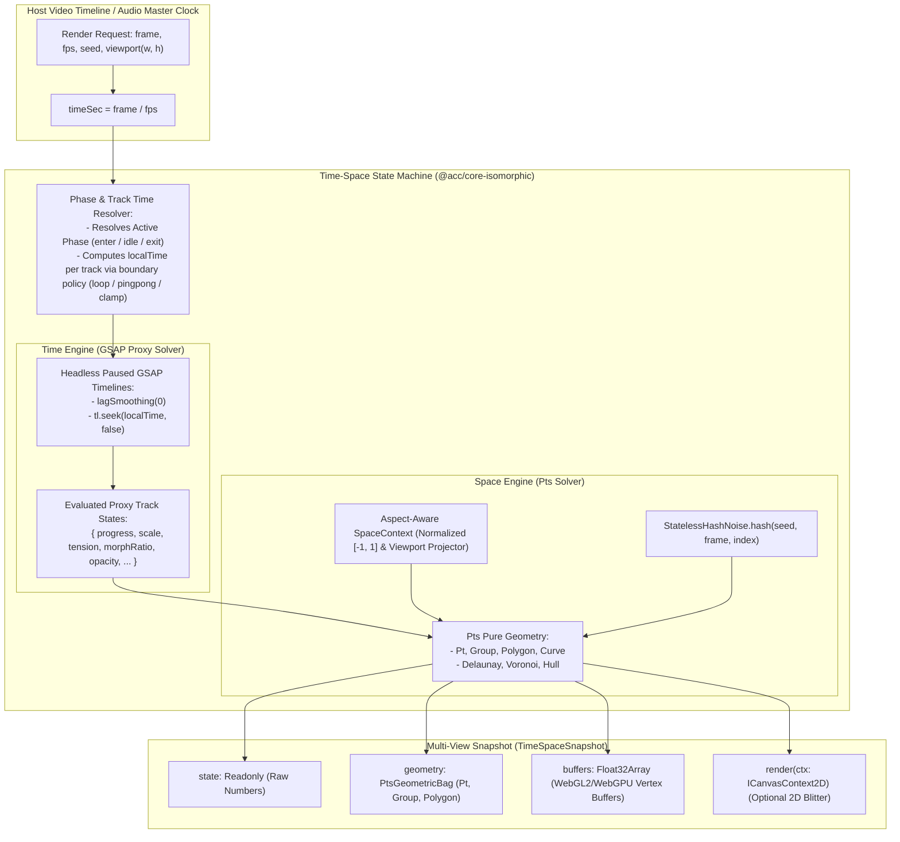
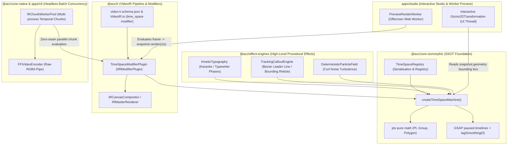
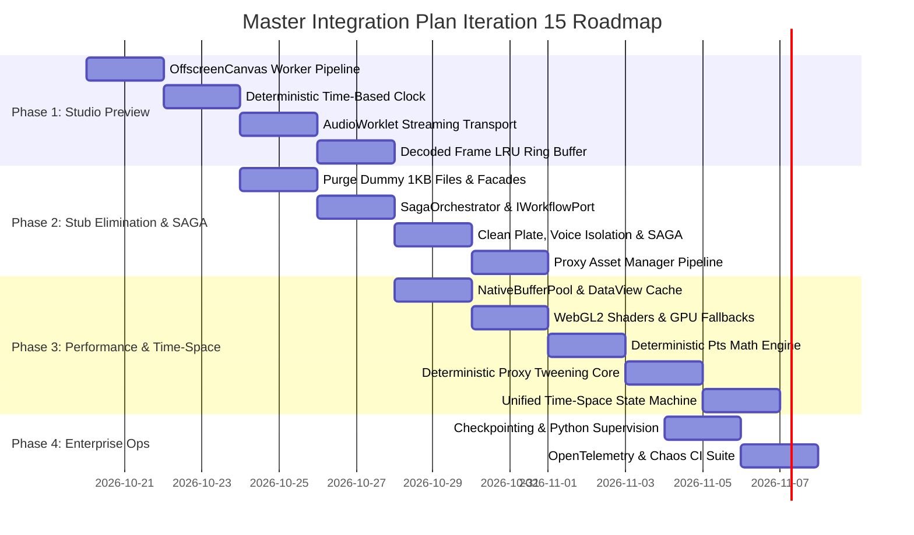

# Master Integration Plan (Iteration 15)
## Enterprise-Grade Production Quality, Studio Player Preview Smoothness, Zero-Stub Architecture, System Performance Tuning, Custom Workflow Decoupling & Unified Time-Space State Machine (GSAP-Time / Pts-Space via Proxy Tweening)

---

### Executive Summary & Monorepo Audit Matrix

This master integration plan establishes the architectural blueprint and execution roadmap to transition the **Autonomous Content Creation (ACC)** turborepo from an advanced experimental multi-engine system into an **industrial-grade, enterprise production video platform**.

An exhaustive audit across all applications (`apps/studio`, `apps/cli`, `apps/worker`, `apps/ai-supervisor`) and packages (`packages/core`, `packages/core-isomorphic`, `packages/core-native`, `packages/core-web`, `packages/ir`, `packages/effect-engines`, `packages/exporters`) identified five core architectural vectors requiring deep modernization:

| Category | Current State & Vulnerabilities | Production Target Architecture | Target Packages / Apps |
| :--- | :--- | :--- | :--- |
| **Studio Player Preview & Playback** | Preview runs synchronously on React UI thread via `IRPreviewEngine.renderFrame()` inside `useEffect`. `WebAudioEngine` generates 30s synchronous PCM buffers (blocking UI ~150ms). J-K-L shuttle uses non-deterministic `requestAnimationFrame` + `performance.now()`, tied to variable display refresh rates and drifting on UI lag. | Dedicated Web Worker preview pipeline via `OffscreenCanvas.transferControlToOffscreen()`. **Deterministic Time-Based Frame Engine** (`DeterministicTimelineClock`) decoupled from display refresh rates. Hardware audio master clock (`AudioContext.currentTime`). Predictive decoded frame LRU ring buffer. Dynamic scrub LOD. WebGL2/WebGPU acceleration fallback. | `apps/studio`, `packages/ir`, `packages/core-web`, `packages/effect-engines` |
| **Stubs & Pseudo-Implementations** | `GenerativeBrollEngine` returns fake `Date.now()` paths. `GenerativeAIFacade` and `VoiceIsolationCloningStrategy` write 1KB null-byte dummy files to `/tmp/acc_ai_cache/`. `EditingEngineFacade` returns `/tmp/acc_exports/` without rendering. `MatchmoveVisionFacade` returns a static identity matrix. `CleanPlateEngine`, `SpatialVideoExporter`, `VoiceIsolationEngine`, `ToneMappingEngine`, `ProxyAssetManager` are string templates. `ConductorSagaOrchestrator` is fully implemented but completely orphaned with 0 call-sites and carries a Conductor-specific naming misnomer. `TextBasedEditingEngine` contains a semantic inversion bug. | Full end-to-end production implementations: true video render facade wiring to `IRMasterRenderer`, automated proxy transcoding pipeline, multi-channel ambisonic B-format, MV-HEVC stereoscopic packaging, real AI vocal isolation, corrected timeline cut math, **decoupled `SagaOrchestrator`** for in-process rollbacks, and a vendor-neutral **`IWorkflowOrchestrator`** port for custom workflow engines. | `packages/core`, `packages/ir`, `packages/exporters`, `apps/ai-supervisor` |
| **System Performance & Memory Loops** | Per-frame `new DataView(safeArrayBuffer(...))` allocations in `FFIVideoEncoder.ts`. Per-frame `canvas.data()` / `getImageData()` allocations in `IRCanvasCompositor.ts` (8.3MB GC churn per 1080p frame). Software canvas CPU manipulation in browser. Unbounded worker queues under memory pressure. Unoptimized chunk boundaries. | Zero-allocation native buffer pooling (`NativeBufferPool`), pre-allocated and cached `DataView` instances, direct pointer extraction without GC nursery churn, adaptive thread pool scaling based on `os.cpus()`, WebGL2 fragment shader compositor, and hardware-accelerated decode/encode fallback matrix. | `packages/core-native`, `packages/core`, `packages/ir`, `packages/effect-engines` |
| **Unified Time-Space State Machine (GSAP-Time / Pts-Space)** | Procedural visual overlays use disparate systems: `pts: "^1.0.3"` couples geometry with browser `CanvasSpace` / `requestAnimationFrame` / `Math.random()`, while `gsap: "^3.12.7"` runs an autonomous `rAF` ticker with wall-clock drift and backward-seek hysteresis. No unified spatio-temporal abstraction exists. | Unified **Render-Agnostic Time-Space State Machine** in `packages/core-isomorphic/src/math/time-space/`. **Foundational Pattern: Proxy Tweening Architecture** (`DeterministicGsapPtsProxy`) where GSAP timelines run strictly in `{ paused: true }` mode with `lagSmoothing(0)` targeting virtual numerical state proxies. **GSAP governs Time** (multi-track timelines, parametric easings, boundary loops). **Pts governs Space** (pure geometric transforms, vectors, polygons, Delaunay/Voronoi meshes, stateless hash noise). Declarative builder (`createTimeSpaceMachine`), phase-based lifecycle transitions (`enter`, `idle`, `exit`), multi-track boundary policies (`loop`, `pingpong`, `clamp`, `once`), aspect-aware viewport projector, and Multi-View snapshot output (`{ state, geometry, buffers, render(ctx) }`). | `packages/core-isomorphic`, `packages/effect-engines`, `apps/studio`, `packages/ir` |
| **Enterprise Resilience & Quality** | Render job crashes midway require full restart from frame 0. In-memory state lost on process crash. Incomplete OpenTelemetry trace propagation across Bun-Python boundaries. Unmanaged subprocess spawning in `PythonBackend.ts`. Tight coupling to legacy Conductor task poller. | Chunk-level persistent checkpointing (`.acc/checkpoints/`), automatic crash recovery, distributed OpenTelemetry tracing with correlation IDs, managed process supervision conforming to `GLOBAL-STORAGE`, circuit breakers, in-process SAGA compensation transactions, and a pluggable custom workflow orchestrator port. | `packages/core`, `apps/worker`, `apps/cli`, `packages/ir` |

---

### Top-Level Architectural Overview



---

### 1. Enterprise Studio Player Preview: Deterministic 60 FPS Rendering Architecture

#### 1.1 The Core Problem in Current Studio Preview
In the current implementation (`apps/studio/src/components/Preview.tsx` lines 300-337 and `apps/studio/src/lib/shuttle/useShuttleEngine.ts` lines 128-179):
1. **Main UI Thread Blocking**: Each frame tick triggers `onScrub(frame)`, causing a React component state change (`setCurrentFrame`). Inside a React `useEffect`, `engine.renderFrame(currentFrame, baseCtx, ...)` executes 2D canvas rasterization synchronously on the browser's main thread. In complex compositions (multi-track 4K, alpha overlays, text, blur shaders), rasterization takes 25-60ms, dropping framerates to 15-20 FPS and freezing mouse/gizmo interactions.
2. **Audio Synthesis Hiccups & 30-Second Hard Cut**: In `WebAudioEngine.ts` lines 198-204, starting playback synchronously synthesizes up to 30 seconds of stereo PCM audio (`this.mixer.mixStereo(startSec, renderDuration)`) on the UI thread—generating over 1.3 million samples synchronously. Furthermore, playback hard-stops after 30 seconds due to lack of continuous audio streaming.
3. **Flaws of `requestAnimationFrame` & Clock Drift**:
   - `useShuttleEngine.ts` tracks time via `requestAnimationFrame(tick)` with `performance.now()`, accumulating `deltaMs * currentSpeed`.
   - **Display Refresh Rate Coupling**: `requestAnimationFrame` fires at the monitor's refresh frequency (60Hz, 120Hz, 144Hz, or variable Apple ProMotion). A user on a 120Hz display executes twice as many ticks as a user on a 60Hz display, causing delta accumulation jitter and micro-stuttering.
   - **Background Tab & UI Freeze Throttling**: When the main thread stutters or the tab loses focus, the browser throttles or pauses `requestAnimationFrame`, causing audio and video to drift out of sync.
   - **Violation of Determinism**: Relying on wall-clock `performance.now()` in frame accumulation violates `.agents/rules/01-workspace-specific.md` (`DETERMINISTIC-HANDSHAKE-BACKPRESSURE`: "Pure frame math only: `timeSec = globalFrame / fps`. NEVER use `Date.now()`, `performance.now()`, or `Math.random()`").

#### 1.2 The Production Solution: Deterministic Time-Based Frame Engine

To guarantee 100% deterministic, bit-accurate, and smooth playback across all monitor refresh rates and hardware loads, `requestAnimationFrame` is replaced with a **Time-Based Deterministic Frame Engine** (`DeterministicTimelineClock`):



#### 1.3 Detailed Technical Specifications

1. **Deterministic Time-Based Frame Driver (`DeterministicTimelineClock`)**:
   - **Dual-Mode Master Clock Synchronization**:
     - **Playback Mode (Audio Master Clock)**:
       When playing with audio, the audio hardware clock (`AudioContext.currentTime` or `UniversalAudioStreamWorklet` processed sample count: $t_{\text{audio}} = \frac{\text{totalSamplesProcessed}}{\text{sampleRate}}$) serves as the inviolable monotonic reference. The video frame is mathematically derived:
       $$\text{targetFrame}(t) = \text{clamp}\left(0, \text{totalFrames} - 1, \text{startFrame} + \mathrm{round}\left((t_{\text{audio}} - t_{\text{start}}) \times \text{fps} \times \text{speed}\right)\right)$$
       This guarantees zero drift between audio DAC output and video display.
     - **Scrubbing, High-Speed Shuttle & Muted Mode (Worker-Driven Monotonic Clock)**:
       In J-K-L shuttle without audio or during high-speed scrubbing (>2x), a dedicated Web Worker timer driver ticks at exact mathematical time intervals:
       $$\Delta t = \frac{1}{\text{fps} \times |\text{speed}|}$$
       advancing discrete frame units ($f_{n+1} = f_n + \mathrm{sign}(\text{speed})$).
   - **Decoupled Render & VSync Blitting**:
     The frame calculation is 100% time-based and independent of display refresh rate. If the display is 60Hz and the video is 24 FPS, the engine evaluates exactly frames $0, 1, 2, \dots$ at their exact time timestamps rather than accumulating fractional monitor delta milliseconds.
   - **Handshake Backpressure**:
     In headless export or preview cache baking, the engine follows strict backpressure: frame $f$ must be acknowledged by the compositor/sink (`await lock.acquire(f)`) before frame $f+1$ begins.

2. **Dedicated `PreviewRenderWorker` & `OffscreenCanvas`**:
   - `Preview.tsx` transfers its HTML `<canvas>` surface to a dedicated Web Worker via `canvas.transferControlToOffscreen()`.
   - The worker owns the `IRPreviewEngine`, `IntervalTreeIndex`, `AssetTextureCache`, and an active WebGL2/2D rendering context.
   - User interactions (zooming, panning, timeline scrubbing, J-K-L shuttle) communicate with the worker via zero-copy `postMessage` or `SharedArrayBuffer` ring buffers.
   - The UI thread is 100% liberated from pixel rasterization; React components only render the lightweight vector Gizmo/guides overlay (`Gizmo2DTransformation`).

3. **Continuous Streaming `UniversalAudioStreamWorklet`**:
   - Replace the 30-second synchronous pre-mixing block in `WebAudioEngine.ts#L198-L205` with a streaming `AudioWorkletNode`.
   - The worklet processes audio in continuous 128-sample blocks pulled from an isomorphic ring buffer (`UniversalAudioMixer`).
   - CPU utilization remains under 1%, audio never hard-cuts after 30 seconds, and scrub feedback uses smooth 5ms cosine cross-fades to eliminate click/pop noise.

4. **Predictive Decoded Frame LRU Ring Buffer & Dynamic Scrub LOD**:
   - Maintains a memory-budgeted ring buffer (120 frames in forward playback direction, 30 frames in reverse).
   - While playback is active or paused, the worker pre-renders upcoming frames ahead of the playhead.
   - When scrubbing rapidly, the engine dynamically engages **Adaptive Scrub LOD**:
     - High-speed scrubbing (>3x speed): render at 0.5x resolution with blur/bokeh shaders bypassed.
     - Parked / single-frame step: instantly render at native 1.0x full-fidelity resolution.

5. **WebGL2 / WebGPU Hardware Accelerated Compositor**:
   - Provide a WebGL2 fragment shader compositing engine implementing color grading, alpha blending, 3D rack focus, and displacement maps natively on the GPU in the browser.
   - Retain seamless 2D Canvas fallback when WebGL2 context creation fails.

---

### 2. Eliminating Stubs & Orphaned Pseudo-Code (NO-STUBS-ORPHANED-CODE)

To comply with the strict project rule `.agents/rules/00-generic-common.md` (NO-STUBS-ORPHANED-CODE), all placeholder implementations, mock files, and dummy routines must be transformed into production systems:

#### 2.1 `GenerativeBrollEngine.ts` & `GenerativeAIFacade.ts`
- **Current State**:
  - `GenerativeBrollEngine.ts#L12` returns a dummy path `cache/broll_${Date.now()}.mp4` and hardcoded `{ isAiGenerated: true }`.
  - `GenerativeAIFacade.ts#L22` writes `Buffer.alloc(1024, 0x00)` (1KB of null bytes) as a fake `.mp4` into `/tmp/acc_ai_cache/`.
- **Production Implementation**:
  - Completely eliminate `Buffer.alloc(1024, 0x00)` dummy file creation.
  - Wire to AI video generation provider (local diffusers worker via Python supervisor or remote API) with content-hash caching in `path.join(os.homedir(), '.acc', 'cache', 'broll')`.
  - Implement stock asset fallback provider: query Freesound/Pexels API or local curated B-roll library.

#### 2.2 `VoiceIsolationCloningStrategy.ts`
- **Current State**:
  - Line 24 writes `Buffer.alloc(1024, 0x00)` (1KB of null bytes) as a fake `.mp3` into `/tmp/acc_ai_cache/`.
- **Production Implementation**:
  - Completely eliminate null-byte dummy file generation.
  - Connect to Kokoro/ChatTTS in `apps/ai-supervisor` for voice cloning, and Demucs/DeepFilterNet for voice isolation.
  - Save outputs to `path.join(os.homedir(), '.acc', 'cache', 'audio')`.

#### 2.3 `MatchmoveVisionFacade.ts`
- **Current State**:
  - Line 7 returns a hardcoded single identity matrix `[1, 0, 0, 0, 0, 1, 0, 0, 0, 0, 1, 0, 0, 0, 0, 1]` with no tracking.
- **Production Implementation**:
  - Implement true feature tracking / camera trajectory extraction via Python Vision worker (OpenCV Lucas-Kanade / ORB feature tracking or COLMAP trajectory export).

#### 2.4 `EditingEngineFacade.ts`
- **Current State**:
  - `renderTimeline` performs basic math and returns `{ jobId, outputPath, durationMs, totalFrames, format }` pointing to `/tmp/acc_exports/` without invoking any media processing.
- **Production Implementation**:
  - Connect `EditingEngineFacade.renderTimeline` directly to `PipelineIRToUniversalIRAdapter`, compile into `ResolvedTimeline`, and invoke `IRMasterRenderer` or `IRChunkWorkerPool`.
  - Output to managed storage directories (`path.join(os.homedir(), '.acc', 'exports')`) instead of hardcoded `/tmp/`.
  - Stream progress callbacks and emit OpenTelemetry trace spans.

#### 2.5 `CleanPlateEngine.ts`
- **Current State**:
  - Line 10 just returns `delogo=x=${region.x}:y=${region.y}:w=${region.width}:h=${region.height}`.
- **Production Implementation**:
  - Implement a 3-tier inpainting strategy:
    1. Fast mode: `delogo` FFmpeg filter for stationary corner watermarks.
    2. Temporal PatchMatch: Multi-frame neighbor pixel borrowing for moving foreground objects.
    3. AI Inpainting: SAM 2 object segmentation + LaMa/ProPainter inpaint model via AI Supervisor daemon.

#### 2.6 `TextBasedEditingEngine.ts` Semantic Inversion Fix
- **Current State**:
  - Line 15 names a function `calculateTimelineCutsFromDeletedWords` but populates and returns `retainedRanges` (the kept words), creating a severe semantic inversion bug.
- **Production Implementation**:
  - Correct the interval math to return true `cutRanges` (intervals between retained words).
  - Implement **Transcript-to-IR Ripple Splitter**: given transcript word cuts, automatically split active VideoIR video/audio sequences, insert ripple gap deletions, adjust `startFrame` and `durationFrames`, and cross-fade audio cuts by 15ms.

#### 2.7 `ProxyAssetManager.ts`
- **Current State**: Bare in-memory Map storing original and proxy paths.
- **Production Implementation**:
  - Automated 4K/8K proxy generator: inspect media dimensions via `FFmpegManager.probe()`. If resolution > 1080p, automatically enqueue low-resolution (720p ProRes Proxy or fast H.264) proxy transcode in the background.
  - Disk-backed proxy cache in `path.join(os.homedir(), '.acc', 'proxies')` keyed by asset content SHA-256 hash.
  - Transparent proxy switching in Studio Preview vs Native Master Export.

#### 2.8 `SpatialVideoExporter.ts` & `SpatialAudioAmbisonicsEngine.ts`
- **Current State**: Generates isolated `stereo3d=...` and `sofalizer=...` strings.
- **Production Implementation**:
  - Spatial Video: Full pipeline for Apple Vision Pro / Meta Quest MV-HEVC stereoscopic export (left/right eye packing, depth map displacement disparity, and correct `hvc1` metadata tagging).
  - Spatial Audio: 4-channel Ambisonic B-format (W, X, Y, Z) and binaural rendering using head-related impulse response (HRIR/SOFA) convolution.

#### 2.9 `VoiceIsolationEngine.ts` & `ToneMappingEngine.ts`
- **Current State**: Minimal filter templates.
- **Production Implementation**:
  - Voice Isolation: Connect to Demucs / DeepFilterNet / RNNoise in AI Supervisor for true zero-latency AI vocal isolation and background noise elimination.
  - Tone Mapping: Dynamic HDR10 / HLG metadata probing with ITU-R BT.2390 tone curve mapping and Rec.709 color gamut compression.

#### 2.10 Decoupling SAGA Orchestration from Conductor OSS (`SagaOrchestrator` & `IWorkflowOrchestrator`)
- **Current State & Analysis**:
  - [`packages/core/src/saga/ConductorSagaOrchestrator.ts`](file:///Users/anle/workspace/acc/packages/core/src/saga/ConductorSagaOrchestrator.ts) is fully implemented with forward step execution, backward rollback, and `DeadLetterQueue` logging.
  - However, it has **0 active call-sites** in `PipelineRunner.ts` (violating `NO-STUBS-ORPHANED-CODE`).
  - Furthermore, having "Conductor" in the class name is a **historical misnomer**: the file contains **ZERO dependencies on Conductor OSS** (no imports, no SDK, no REST/gRPC client). It is a pure TypeScript in-process SAGA coordinator.
- **Architectural Separation: Macro-Orchestration vs. Micro-SAGA**:
  Replacing Conductor OSS with a custom in-house workflow orchestrator changes the **macro** layer, but every rendering pipeline still requires the **micro** SAGA layer:



  - **Macro-Orchestrator (Your Custom Workflow Engine)**:
    Responsible for distributed queuing, cross-worker task scheduling, DB job state persistence, long-running workflow state machines, and worker health checks.
  - **Micro-Orchestrator (`SagaOrchestrator`)**:
    Runs **inside each worker process**. When a render chunk or FFI operation fails, `SagaOrchestrator` guarantees reverse compensation: releasing locked GPU/VRAM encoder sessions, freeing native `av_malloc` memory, deleting partial temporary disk files, and capturing diagnostic context snapshots into `DeadLetterQueue`.
- **Production Implementation**:
  1. **Rename & Decouple**: Rename `ConductorSagaOrchestrator` to `SagaOrchestrator` in `packages/core/src/saga/SagaOrchestrator.ts`. Retain a backward compatibility alias:
     ```typescript
     export class SagaOrchestrator<TContext = any> { ... }
     export const ConductorSagaOrchestrator = SagaOrchestrator; // Backward compatibility alias
     ```
  2. **Define Vendor-Agnostic `IWorkflowOrchestrator` Port**:
     Create `packages/core/src/workflow/IWorkflowOrchestrator.ts` to allow any custom workflow engine to plug into ACC without Conductor dependencies:
     ```typescript
     export interface WorkflowTaskDefinition<TInput = any, TOutput = any> {
       taskId: string;
       taskType: string;
       workflowInstanceId: string;
       input: TInput;
     }

     export interface IWorkflowOrchestrator {
       registerWorker(taskType: string, handler: (task: WorkflowTaskDefinition) => Promise<any>): Promise<void>;
       startWorkflow(workflowName: string, correlationId: string, input: any): Promise<string>;
       getWorkflowStatus(workflowInstanceId: string): Promise<WorkflowStatus>;
       terminateWorkflow(workflowInstanceId: string, reason: string): Promise<void>;
     }
     ```
  3. **Active Pipeline Wiring**:
     Wire `SagaOrchestrator` into `PipelineRunner.ts` and `IRChunkWorkerPool.ts` so every chunk allocation, FFI encoder context, and temp file registers a `compensate()` rollback handler.

---

### 3. System Performance Tuning, Zero-Allocation Loops & Unified Time-Space Engine

#### 3.1 Zero-Allocation Native FFI Buffer Pooling & DataView Caching
- **Problem Diagnosis**:
  - In `FFIVideoEncoder.ts`, `srcDataC` (`av_malloc(64n)`) and `srcStrideC` (`av_malloc(32n)`) are correctly allocated once in `initialize()`, but line 278 executes `new DataView(safeArrayBuffer(this.srcDataC, 0, 8))` **on every single frame**, allocating JS objects in the inner loop.
  - In `IRCanvasCompositor.ts#L312`, calling `canvas.data()` or `canvasCtx.getImageData()` allocates an 8.3MB buffer per frame at 1080p, generating massive GC nursery churn.
- **Architecture**:
  - Pre-allocate and cache the `DataView` over `this.srcDataC` during encoder initialization.
  - Create `NativeBufferPool`: Pre-allocates a fixed pool of aligned C memory blocks (`av_malloc`) based on canvas dimensions and pixel formats (e.g., 4 buffers for RGBA 1080p).
  - Direct pointer passing: Pass raw `ptr(buffer)` directly into native FFI functions without intermediate `Buffer.from()` heap copies.
  - Provide reusable typed arrays for canvas pixel readbacks in `IRCanvasCompositor`.

#### 3.2 Adaptive Resource Governor & Dynamic Thread Pool
- Expand `AdaptiveResourceGovernor` across all workers:
  - Continuously sample process RSS memory and system VRAM.
  - If memory pressure exceeds 80%, throttle `IRChunkWorkerPool` concurrency and trigger proactive `gc()`.
  - Dynamically scale worker threads based on `os.cpus().length` and GPU encoding session limits (e.g., NVENC max 3-5 concurrent sessions per consumer GPU).

#### 3.3 Hardware-Accelerated Video Encoding Fallback Matrix


#### 3.4 Deterministic Pts Mathematical Engine (`@acc/core-isomorphic/math/pts`)
- **Problem Diagnosis**:
  - Upstream Pts.js (`pts: "^1.0.3"`) bundles together pure geometric algorithms with interactive browser runtime classes: `CanvasSpace`, `DOMSpace`, `TouchSpace`, and `space.play()`.
  - `space.play()` relies on `window.requestAnimationFrame`, making it completely non-functional in headless Node/Bun FFI pipelines and non-deterministic across monitor refresh rates (60Hz vs 120Hz).
  - In addition, functions like `Noise` and `Num.randomPt()` use JavaScript's built-in `Math.random()`, which breaks backward scrubbing and frame repeatability (violating `DETERMINISTIC-HANDSHAKE-BACKPRESSURE`).
- **Production Architecture**:
  1. **Pure Geometry Facade (`DeterministicPtsEngine.ts`)**:
     - Located in `packages/core-isomorphic/src/math/pts/` and exported via `@acc/core-isomorphic`.
     - Re-exports only the pure mathematical classes: `Pt`, `Group`, `Line`, `Curve`, `Polygon`, `Circle`, `Delaunay`, `Voronoi`.
     - Completely strips, excludes, and forbids `CanvasSpace`, `DOMSpace`, and `requestAnimationFrame`. Any attempt to instantiate space runtimes throws a compile/runtime error.
  2. **Stateless Coordinate-and-Frame Hash Noise (`StatelessHashNoise.ts`)**:
     - Replaces `Math.random()` and state-machine PRNGs with a 100% stateless mathematical hash function:
       $$\text{value} = \text{hash}(\text{seed}, \text{frame}, \text{index})$$
     - Guarantees that jumping to frame 450, scrubbing backward to frame 449, or re-rendering in a separate chunk produces bit-identical noise and particle fields without rewinding an internal state machine.
  3. **Hybrid `DeterministicPtsForm.ts` Adapter**:
     - Directly accepts any `ICanvasContext2D` instance from `UniversalCanvasProvider`.
     - Provides convenient, high-level drawing methods (`form.point()`, `form.line()`, `form.polygon()`, `form.curve()`) executed synchronously at explicit `(frame, fps)` timestamps.
     - Also exposes `toBuffer(): Float32Array` for direct vertex upload to WebGL2 and WebGPU shaders.

#### 3.5 Unified Time-Space State Machine (`@acc/core-isomorphic/math/time-space`)

##### 3.5.1 The Foundational Core: Proxy Tweening Architecture (`DeterministicGsapPtsProxy.ts`)
- **The Core Problem with Conventional Animation**:
  In creative coding and motion graphics, GSAP provides parametric easing, Bezier interpolation, and multi-track orchestration, while Pts provides computational geometry (curves, polygons, Delaunay meshes). However:
  1. **GSAP's Internal Ticker**: By default, GSAP's `gsap.ticker` is driven by `requestAnimationFrame` and wall-clock timestamps (`Date.now()` / `performance.now()`). If the video renderer encounters CPU load, GSAP's ticker skips delta time, dropping in-between frames.
  2. **Lag Smoothing & Sleep**: GSAP automatically throttles or sleeps when tabs are backgrounded (`lagSmoothing(500, 33)`), which de-synchronizes animation progress from timeline frame numbers.
  3. **DOM Coupling**: Standard GSAP targets HTML DOM elements or canvas styles directly.
- **The Proxy Tweening Solution**:
  - **Virtual State Proxy**: GSAP NEVER touches the DOM or Pts shapes directly. Instead, GSAP tweens target a plain in-memory JavaScript numeric state proxy:
    $$\text{proxy} = \{ \text{progress}, \text{scale}, \text{curlTension}, \text{morphRatio}, \text{opacity}, \dots \}$$
  - **Headless Paused Timelines**: Every timeline is initialized with `{ paused: true, autoRemoveChildren: false }`, and `gsap.ticker.lagSmoothing(0)` is strictly enforced. The GSAP ticker is never allowed to run.
  - **Discrete Mathematical Seek**: At render frame $f$ and frame rate $fps$, the host pipeline seeks deterministically:
    $$\text{timeSec} = \frac{f}{fps}, \quad \text{tl.seek}(\text{timeSec}, \text{false})$$
  - **Pts Geometric Transformation**: Pts pure geometric functions (`Pt`, `Group`, `Line`, `Curve`, `Polygon`) read the evaluated numerical values off `proxy` and generate the geometry deterministically.



- **Reference Blueprint (`DeterministicGsapPtsProxy.ts`)**:
  Located in `packages/core-isomorphic/src/math/pts/DeterministicGsapPtsProxy.ts`:
  ```typescript
  import { gsap } from 'gsap';
  import { Pt, Group, Curve, Polygon } from './DeterministicPtsEngine';
  import { StatelessHashNoise } from './StatelessHashNoise';
  import { ICanvasContext2D } from '../../types';
  import { DeterministicPtsForm } from './DeterministicPtsForm';

  export interface ProxyTweenState {
    progress: number;
    scale: number;
    rotation: number;
    curlTension: number;
    morphRatio: number;
    opacity: number;
    [key: string]: number;
  }

  export class DeterministicGsapPtsProxy {
    private timeline: gsap.core.Timeline;
    private state: ProxyTweenState;
    private seed: number;
    private fps: number;

    constructor(seed: number = 1337, fps: number = 30) {
      this.seed = seed;
      this.fps = fps;
      this.state = {
        progress: 0,
        scale: 1,
        rotation: 0,
        curlTension: 0.5,
        morphRatio: 0,
        opacity: 1,
      };

      // Strict determinism: Paused timeline, zero auto-advance, zero lag-smoothing
      gsap.ticker.lagSmoothing(0);
      this.timeline = gsap.timeline({ paused: true, autoRemoveChildren: false });
    }

    public getTimeline(): gsap.core.Timeline {
      return this.timeline;
    }

    public getState(): Readonly<ProxyTweenState> {
      return this.state;
    }

    /**
     * Evaluates the proxy state deterministically at frame f.
     * Adheres strictly to DETERMINISTIC-HANDSHAKE-BACKPRESSURE.
     */
    public seekFrame(frame: number): void {
      const timeSec = frame / Math.max(1, this.fps);
      this.timeline.seek(timeSec, false);
    }

    /**
     * Generates a procedural morphed curve or polygon based on evaluated proxy state.
     */
    public evaluateCurve(basePoints: Pt[]): Group {
      const tension = this.state.curlTension;
      return Curve.bezier(basePoints, tension);
    }
  }
  ```

##### 3.5.2 The High-Level Abstraction: Unified TimeSpaceStateMachine
Building directly upon the Proxy Tweening pattern, the **Time-Space State Machine** elevates procedural animation to a full spatio-temporal finite state machine:
- **Render-Agnostic Philosophy**:
  Procedural VFX and motion graphics are fundamentally spatio-temporal state machines: **GSAP computes Time**, and **Pts computes Space**.
  The machine is 100% decoupled from rendering backends (no `<canvas>`, WebGL, or DOM coupling inside the core machine). Given an input tuple $(frame, fps, seed, viewport)$, it produces a deterministic `TimeSpaceSnapshot`:
  $$(frame, fps, seed, viewport) \mapsto \text{TimeSpaceSnapshot}\{ state, geometry, buffers, render(ctx) \}$$

- **Non-Deterministic Factors Elimination Matrix**:
  | Engine | Non-Deterministic Factor | Root Mechanism | Hardened Deterministic Remedy in TimeSpaceMachine |
  | :--- | :--- | :--- | :--- |
  | **GSAP (Time)** | `gsap.ticker` | Uses `window.requestAnimationFrame` and wall-clock delta times (`Date.now()` / `performance.now()`) | **Completely detach ticker**: Timelines created strictly with `{ paused: true, autoRemoveChildren: false }`. `gsap.ticker.remove()` enforced. |
  | **GSAP (Time)** | `lagSmoothing` | GSAP sleeps or adjusts delta time when a frame takes >33ms or tab loses focus | **Disable lag smoothing**: `gsap.ticker.lagSmoothing(0)`. |
  | **GSAP (Time)** | Seeking Hysteresis | Repeated forward/backward seeks accumulating rounding drift | Explicit time quantization: `timeSec = f / fps`. Strict clamp and pure mathematical temporal wrapping. |
  | **Pts (Space)** | `CanvasSpace` / `DOMSpace` | Directly accesses `window`, `document`, and HTML `<canvas>` elements | **Completely stripped and banned**. Only pure math modules (`Pt`, `Group`, `Line`, `Curve`, `Polygon`, `Circle`) are exported. |
  | **Pts (Space)** | `space.play()` | Animation loop coupled to browser refresh rate (60Hz vs 120Hz) | **Stripped**. Frame advancement is driven strictly by timeline ticks ($f / fps$). |
  | **Pts (Space)** | `Math.random()` | Non-deterministic global PRNG breaks scrub repeatability | Replaced with **`StatelessHashNoise`** ($\text{hash}(\text{seed}, \text{frame}, \text{index})$). |
  | **Both** | Dynamic Heap Allocation | Creating new `Pt` or Tween objects per frame causes GC stutter | Reusable proxy objects and Float32Array working vectors adhering to `ZERO-ALLOC-FRAME-LOOP`. |

- **Core Architectural Features**:
  1. **Declarative Builder (`createTimeSpaceMachine`)**:
     Type-safe functional builder defining multi-track temporal timelines and spatial geometry generators.
  2. **Phase-Based Discrete State Machine (`phases: { enter, idle, exit }`)**:
     First-class support for motion graphic lifecycles (entrance wipe -> active looping/idle -> exit transition) with automatic time-based phase resolution and smooth state interpolation.
  3. **Multi-Track Temporal Boundary Policies**:
     Each track/layer defines its own independent `{ start, duration, boundary: 'loop' | 'once' | 'pingpong' | 'clamp' }`, allowing continuous background loops and one-off lower-thirds in the same machine.
  4. **Aspect-Aware Responsive Spatial Viewport (`SpaceContext`)**:
     Exposes both normalized $[-1, 1] / [0, 1]$ coordinates and projection (`space.toPixels(w, h)`), automatically adapting procedural visuals to 16:9, 9:16 mobile vertical, and 1:1 square aspect ratios.
  5. **Multi-View Snapshot (`TimeSpaceSnapshot`)**:
     Returns `{ state, geometry, buffers, render(ctx) }` giving callers instant access to raw numbers, Pts shapes, raw WebGL `Float32Array` vertex buffers, and 2D canvas drawing delegates.

- **Data Flow Diagram**:


- **Concrete Implementation Blueprint**:
  Located in `packages/core-isomorphic/src/math/time-space/`:
  ```typescript
  export type TemporalBoundaryPolicy = 'loop' | 'pingpong' | 'clamp' | 'once';

  export interface TrackTemporalConfig {
    start?: number;
    duration: number;
    boundary?: TemporalBoundaryPolicy;
  }

  export interface SpaceContext {
    width: number;
    height: number;
    aspectRatio: number;
    center: Pt;
    toPixels: (pt: Pt | [number, number]) => Pt;
    fromPixels: (pt: Pt | [number, number]) => Pt;
  }

  export interface TimeSpaceSnapshot<TState = any> {
    phase: string;
    globalTimeSec: number;
    localTimeSec: number;
    state: Readonly<TState>;
    geometry: {
      points: Pt[];
      groups: Group[];
      polygons: Polygon[];
      [key: string]: any;
    };
    buffers: {
      positions: Float32Array;
      indices?: Uint16Array | Uint32Array;
      colors?: Float32Array;
    };
    render: (ctx: ICanvasContext2D) => void;
  }

  export class TimeSpaceStateMachine<TState = any> {
    // Pre-compiled paused headless GSAP timelines per phase/track
    // Pure mathematical boundary solvers (loop, pingpong, clamp, once)
    // Aspect-aware SpaceContext projection methods
    
    public seek(
      frame: number,
      fps: number = 30,
      seed: number = 1337,
      viewport: { width: number; height: number } = { width: 1920, height: 1080 }
    ): TimeSpaceSnapshot<TState> { ... }
  }

  export function createTimeSpaceMachine<TState = any>(
    config: TimeSpaceMachineConfig<TState>
  ): TimeSpaceStateMachine<TState> {
    return new TimeSpaceStateMachine<TState>(config);
  }
  ```

##### 3.5.3 System-Wide Integration Architecture: How TimeSpaceStateMachine Powers the ACC Platform

The `TimeSpaceStateMachine` is not an isolated graphics experiment; it is the universal spatio-temporal engine powering procedural visual effects, motion graphics, preview gizmos, and headless rendering across the entire ACC turborepo. Below is the comprehensive architectural integration matrix across all system tiers:



###### 1. VideoIR Schema & Adapter Integration (`packages/ir`)
To comply strictly with the `VIDEO-IR-SCHEMA-SYNC` guardrail, the Time-Space State Machine is integrated into VideoIR as a first-class procedural track modifier:
1. **Schema & Typings (`VideoIR.ts` & `video-ir.schema.json`)**:
   - Register modifier type `"time_space"` under `IRTrackModifier`:
     ```typescript
     export interface TimeSpaceModifierConfig {
       type: 'time_space';
       templateId: string; // e.g., 'callout_leader', 'kinetic_title', 'particle_ambient'
       seed?: number;
       params?: Record<string, number | string | boolean>;
       boundary?: 'loop' | 'pingpong' | 'clamp' | 'once';
       renderMode?: 'canvas2d' | 'webgl_buffers';
     }
     ```
   - Synchronize JSON Schema Draft-07 in `schema/video-ir.schema.json` and validator in `VideoIRSchemaValidator.ts`.
2. **Modifier Plugin Wiring (`TimeSpaceModifierPlugin.ts`)**:
   - Implement `IIRModifierPlugin`:
     ```typescript
     export class TimeSpaceModifierPlugin implements IIRModifierPlugin {
       public readonly id = 'time_space';
       private machineCache = new Map<string, TimeSpaceStateMachine>();

       public async apply(
         ctx: ICanvasContext2D,
         frame: number,
         track: IRVideoTrack,
         modifier: TimeSpaceModifierConfig,
         viewport: { width: number; height: number }
       ): Promise<void> {
         let machine = this.machineCache.get(track.id);
         if (!machine) {
           machine = TimeSpaceRegistry.instantiate(modifier.templateId, modifier.params);
           this.machineCache.set(track.id, machine);
         }
         const snapshot = machine.seek(frame, track.fps, modifier.seed ?? 1337, viewport);
         snapshot.render(ctx);
       }
     }
     ```
   - Register `TimeSpaceModifierPlugin` in `IRPluginRegistry` and inject into `IRCanvasCompositor` and `IRMasterRenderer`.

###### 2. High-Level Procedural Effect Engines (`packages/effect-engines`)
Existing effect engines are refactored to compose `TimeSpaceStateMachine` instead of raw canvas loops:
1. **`KineticTypography.ts`**:
   - Uses multi-phase discrete lifecycles:
     - `enter`: Letters morph and slide into place via GSAP `elastic.out` proxy tween.
     - `idle`: Pts `StatelessHashNoise` applies organic subtle floating jitter to polygon outlines.
     - `exit`: Dispersive particle explosion or swift directional wipe.
2. **`TrackingCalloutEngine.ts`**:
   - Draws dynamic leader lines and HUD reticles tracking motion-tracked features.
   - Pts computes the aspect-aware Bezier curve (`Curve.bezier`) connecting anchor point to label box.
   - GSAP timeline proxies the draw percentage (`drawProgress: 0 -> 1`), pulse alpha, and reticle expansion.
3. **`DeterministicParticleField.ts`**:
   - Pts maintains the spatial field Delaunay triangulation (`Delaunay.from(points)`).
   - GSAP proxies the global curl noise turbulence field and color ramp over time.

###### 3. Dedicated Studio Web Worker & Interactive Gizmos (`apps/studio`)
1. **Preview Worker Execution (`PreviewRenderWorker.ts`)**:
   - All `TimeSpaceStateMachine` evaluations run inside the dedicated worker thread.
   - When the worker receives a frame dispatch `{ frame, fps, viewport }`, it evaluates the `TimeSpaceModifierPlugin` directly to an `OffscreenCanvas` context with zero UI thread contention.
2. **Interactive UI Gizmos (`apps/studio/src/components/timeline/Gizmo2DTransformation.tsx`)**:
   - For interactive on-screen controls (scaling, rotating, or moving callouts and titles), the UI thread queries the machine's spatial geometry:
     ```typescript
     const snapshot = machine.seek(currentFrame, fps, seed, viewport);
     const boundingBox = Polygon.boundingBox(snapshot.geometry.polygons);
     // Render interactive SVG / Canvas manipulation handles matching boundingBox
     ```
   - Zero duplication of layout or math: the exact same geometric points rendered on canvas dictate the bounding box for gizmo handles.

###### 4. Headless Concurrency & Chunk Boundary Parity (`packages/core-native` & `apps/cli`)
1. **Zero-Seam Parallel Chunk Rendering (`IRChunkWorkerPool.ts`)**:
   - In headless rendering, rendering is partitioned into temporal chunks across worker processes (e.g. Worker 1 renders frames 0-149, Worker 2 renders frames 150-299).
   - Because `TimeSpaceStateMachine` relies strictly on pure mathematical seeking ($f / fps$) and stateless hash noise, Worker 2 evaluating frame 150 produces the exact mathematical state as if it sequentially rendered frames 0 to 149.
   - **Zero Boundary Seam**: The seam between chunk files is cryptographically identical, allowing `FFIChunkConcatMuxer` to assemble chunks with zero audio/video pops or spatial discontinuities.
2. **Hardware Acceleration via Multi-View Snapshots**:
   - High-throughput native renderers can bypass 2D canvas rasterization entirely by reading `snapshot.buffers.positions` (`Float32Array`) and feeding raw vertex geometry into GPU shader pipelines (Metal / WebGL2 / Vulkan).

###### 5. Serialization & Universal Template Registry (`@acc/core-isomorphic`)
1. **`TimeSpaceRegistry.ts`**:
   - Provides a centralized catalog of versioned motion graphic templates (e.g., `LowerThirdModern_v1`, `AudioWaveformCircle_v2`, `GlitchOverlay_v1`).
   - Allows studio frontend and CLI backend to share identical parametric templates via JSON configuration.
2. **Hot-Reloading in Development**:
   - Procedural presets can be dynamically updated in Studio preview without reloading the application, with state preserved at the current playhead position.

---

### 4. Enterprise Production Quality, Resilience & SAGA Workflows

#### 4.1 Chunk-Level Persistent Checkpointing & Crash Recovery
- **Architecture**:
  - Long renders divide into discrete temporal chunks (e.g. 5-second intervals).
  - As each chunk completes and verifies SHA-256 hash, write chunk metadata to `.acc/checkpoints/<jobId>.json`.
  - If a worker dies, machine reboots, or OOM killer trips: on restart, `PipelineRunner` inspects the checkpoint, skips all verified chunks, renders only the missing chunks, and invokes `FFIChunkConcatMuxer`.

#### 4.2 SAGA In-Process Compensating Transactions & Clean Rollbacks
- Wire `SagaOrchestrator` into `PipelineRunner`:
  - Every pipeline stage that creates temporary files, allocates GPU memory, or reserves network resources registers a reverse compensating action (`compensate()`).
  - Upon unrecoverable pipeline failure or user cancellation (`AbortController`), the SAGA coordinator executes compensations in reverse order, ensuring zero orphaned temp files, zero VRAM leaks, and zero stuck worker tasks.

#### 4.3 Process Supervision for Python Backend
- In `PythonBackend.ts`, replace unmanaged `spawn` with a resilient supervisor process:
  - Resolve script paths relative to `path.join(os.homedir(), '.acc')` or absolute package locations, strictly complying with `GLOBAL-STORAGE`.
  - Implement health checking and automated restart with exponential backoff on unhandled Python exceptions.

#### 4.4 OpenTelemetry Distributed Observability & Structured Telemetry
- Wire `Tracer` and `MetricsRegistry` across all boundaries:
  - Propagate W3C Trace Context headers (`traceparent`, `tracestate`) across HTTP, IPC, and gRPC calls.
  - Emit Prometheus-compatible metrics: `acc_render_frame_duration_ms`, `acc_worker_pool_active_threads`, `acc_vram_usage_bytes`, `acc_cache_hit_ratio`.
  - Log in structured JSON format with `trace_id`, `span_id`, `story_id`, and `severity`.

---

### 5. Implementation Roadmap & Structured Phases



#### Phase 1: Studio Player Preview & Audio-Visual Determinism
- [x] **Phase 1.1: Web Worker & OffscreenCanvas Separation**:
  - Implement `PreviewRenderWorker.ts` in `apps/studio/src/lib/workers/`.
  - Transfer viewport canvas control via `OffscreenCanvas.transferControlToOffscreen()`.
  - Route seek, play, pause, shuttle, and LOD scale events to worker.
- [x] **Phase 1.2: Deterministic Time-Based Frame Engine**:
  - Implement `DeterministicTimelineClock.ts` replacing `requestAnimationFrame` and `performance.now()`.
  - Slave playback frame advancement to `AudioContext.currentTime` with mathematical frame derivation.
  - Implement discrete worker-driven monotonic frame ticks for shuttle and muted playback.
- [x] **Phase 1.3: Streaming AudioWorklet Master Transport**:
  - Implement `UniversalAudioStreamWorklet.ts` replacing 30s synchronous PCM synthesis.
  - Implement smooth crossfading on scrub feedback to eliminate click/pop noise.
- [x] **Phase 1.4: Decoded Frame LRU Buffer & Dynamic Scrub LOD**:
  - Implement 120-frame predictive prefetch queue in worker.
  - Implement automatic 0.5x LOD scaling during high-speed scrubbing.

#### Phase 2: Eliminating Stubs, Decoupling SAGA & Workflow Port
- [x] **Phase 2.1: Purge Dummy 1KB Files & Wire Production Facades**:
  - Delete `Buffer.alloc(1024, 0x00)` dummy file generation in `GenerativeAIFacade.ts` and `VoiceIsolationCloningStrategy.ts`.
  - Wire `EditingEngineFacade.renderTimeline` to `PipelineRunner` and `IRMasterRenderer`.
  - Wire `MatchmoveVisionFacade.ts` to vision feature tracking.
  - Fix semantic inversion in `TextBasedEditingEngine.ts` and implement transcript cut ripple splitting.
- [x] **Phase 2.2: Decouple SAGA Orchestration & Define `IWorkflowOrchestrator` Port**:
  - Rename `ConductorSagaOrchestrator` to `SagaOrchestrator` in `packages/core/src/saga/SagaOrchestrator.ts`.
  - Keep backward-compatible alias `export const ConductorSagaOrchestrator = SagaOrchestrator;`.
  - Define `IWorkflowOrchestrator.ts` in `packages/core/src/workflow/` as the vendor-neutral port for custom workflow engines.
  - Wire `SagaOrchestrator` into `PipelineRunner.ts` and `IRChunkWorkerPool.ts` for in-process compensating rollbacks.
- [x] **Phase 2.3: Production `CleanPlateEngine`, `VoiceIsolationEngine` & `ToneMappingEngine`**:
  - Implement 3-tier inpainting in `CleanPlateEngine`.
  - Connect `VoiceIsolationEngine` to Demucs/RNNoise spectral subtraction.
  - Implement dynamic HDR metadata probing in `ToneMappingEngine`.
- [x] **Phase 2.4: Production `ProxyAssetManager` & `SpatialVideoExporter`**:
  - Implement automated 720p proxy transcode queue with SHA-256 disk cache in `~/.acc/proxies/`.
  - Implement MV-HEVC / side-by-side stereoscopic exporter with Ambisonic audio.

#### Phase 3: System Performance Tuning, Zero-Allocation Loops & Unified Time-Space State Machine
- [x] **Phase 3.1: Zero-Allocation `NativeBufferPool` & DataView Caching**:
  - Pre-allocate and reuse `DataView` over `this.srcDataC` in `FFIVideoEncoder.ts`.
  - Implement native aligned C memory pool for `av_malloc` frame pointers in `@acc/core-native`.
  - Provide reusable typed arrays for canvas pixel readbacks in `IRCanvasCompositor.ts`.
- [x] **Phase 3.2: WebGL2 Browser Shaders & Dynamic Hardware Acceleration**:
  - Implement WebGL2 fragment shader compositor for Studio 3D Depth, blur, and color grading.
  - Harden GPU encoder fallback chain (VideoToolbox / NVENC / QSV / VAAPI -> libx264).
- [x] **Phase 3.3: Deterministic Pts Mathematical Engine (`@acc/core-isomorphic`)**:
  - Implement `DeterministicPtsEngine.ts` re-exporting only pure mathematical classes (`Pt`, `Group`, `Line`, `Curve`, `Polygon`, `Circle`).
  - Implement `StatelessHashNoise.ts` providing 100% deterministic hash noise without mutable PRNG state.
  - Implement `DeterministicPtsForm.ts` drawing directly to `ICanvasContext2D` with raw `Float32Array` output for WebGL.
  - Migrate `DeterministicParticleField.ts` in `@acc/effect-engines` to consume the isomorphic Pts math engine.
- [x] **Phase 3.4: Deterministic Proxy Tweening Core (`@acc/core-isomorphic`)**:
  - Implement `DeterministicGsapPtsProxy.ts` in `packages/core-isomorphic/src/math/pts/`.
  - Enforce paused timeline architecture and `lagSmoothing(0)` across all effect generators.
  - Author automated test verifying 0 ticker leaks and reverse scrub state parity.
- [x] **Phase 3.5: Unified Time-Space State Machine (`@acc/core-isomorphic`)**:
  - Implement `TimeSpaceStateMachine.ts` and `createTimeSpaceMachine.ts` in `packages/core-isomorphic/src/math/time-space/`.
  - Implement phase-based lifecycle transitions (`enter`, `idle`, `exit`) and multi-track boundary policies (`loop`, `pingpong`, `clamp`, `once`).
  - Implement aspect-aware `SpaceContext` with viewport projection (`toPixels(w, h)`).
  - Implement `TimeSpaceRegistry.ts` for motion graphic template serialization and registration.
- [x] **Phase 3.6: System-Wide TimeSpaceStateMachine Integration (IR Plugin, Effect Engines, Studio Worker, Chunk Pool)**:
  - Register `"time_space"` modifier in `VideoIR.ts` and `video-ir.schema.json` complying with `VIDEO-IR-SCHEMA-SYNC`.
  - Implement `TimeSpaceModifierPlugin.ts` in `packages/ir/src/plugins/` and wire into `IRCanvasCompositor` and `IRMasterRenderer`.
  - Refactor `KineticTypography.ts`, `TrackingCalloutEngine.ts`, and `DeterministicParticleField.ts` in `packages/effect-engines/` to compose `createTimeSpaceMachine()`.
  - Integrate `TimeSpaceStateMachine` into `PreviewRenderWorker.ts` and wire bounding box outputs into Studio interactive gizmos (`Gizmo2DTransformation.tsx`).
  - Verify chunk boundary zero-seam parity in `IRChunkWorkerPool.ts` during multi-process parallel renders.

#### Phase 4: Enterprise Production Resilience & Distributed Observability
- [x] **Phase 4.1: Persistent Checkpointing & Python Backend Supervision**:
  - Implement `.acc/checkpoints/<jobId>.json` chunk persistence and crash resumption.
  - Wrap `PythonBackend.ts` subprocess execution with a resilient lifecycle supervisor complying with `GLOBAL-STORAGE`.
- [x] **Phase 4.2: OpenTelemetry Observability & Chaos Hardening**:
  - Propagate W3C trace contexts across CLI, workers, and AI supervisor.
  - Author automated chaos test suite in `autogenerated-tests/enterprise_chaos_resilience.test.ts` verifying recovery from simulated crashes and network timeouts.

---

### 6. Risk Analysis & Mitigation Matrix

| Identified Risk | Severity | Probability | Mitigation Strategy |
| :--- | :---: | :---: | :--- |
| **Browser Compatibility (`OffscreenCanvas`)** | Medium | Low | Detect `typeof OffscreenCanvas !== 'undefined'` and feature support. Fall back seamlessly to main-thread `IRCanvasCompositor` if running in constrained web environments. |
| **Audio Clock Jitter during heavy load** | Medium | Medium | Use `AudioWorkletNode` running on dedicated high-priority OS audio thread, decoupled from main browser event loop. |
| **Display vs Video Refresh Disparity** | Medium | Low | `DeterministicTimelineClock` strictly evaluates frames based on continuous time $t$, decoupling video playback from monitor 60Hz/120Hz/144Hz ticks. |
| **Pts.js DOM/rAF Leakage** | Low | Low | Isolate pure math modules in `@acc/core-isomorphic/src/math/pts/`; tree-shake and ban `CanvasSpace` and `space.play()` from the module graph. |
| **GSAP Ticker Drift on Scrub** | Low | Low | Timelines run in `{ paused: true }` mode with `lagSmoothing(0)`; ticks are driven exclusively by explicit `tl.seek(f / fps, false)` calls. |
| **Multi-Track Boundary Overflow** | Low | Low | Temporal boundary wrapper enforces pure modulo/ping-pong math, guaranteeing frame numbers up to 1,000,000 evaluate within exact loop bounds. |
| **Workflow Engine Vendor Lock-in** | Low | Low | `IWorkflowOrchestrator` abstracts all scheduling; `SagaOrchestrator` handles in-process rollbacks with zero external dependencies. |
| **GPU Memory Leaks in AI Supervisor** | High | Low | Implement subprocess watchdog with RSS memory limit and auto-restart policy when VRAM fragmentation occurs. |
| **FFI Memory Corruption / Crash** | High | Low | Enforce strict pointer bounds checking, wrap FFI calls in C++ try-catch guards, and isolate parallel chunks in separate OS worker processes. |

---

### 7. Verification & Parity Test Suite Plan

To guarantee zero regressions, the following formal test suites must be implemented under `/autogenerated-tests/`:

1. `autogenerated-tests/deterministic_timeline_clock.test.ts`:
   - Validates that `DeterministicTimelineClock` produces identical frame sequences across simulated 60Hz, 120Hz, 144Hz, and irregular frame tick intervals with 0 frame drift.
2. `autogenerated-tests/deterministic_pts_math.test.ts`:
   - Validates that `DeterministicPtsEngine`, `StatelessHashNoise`, and `DeterministicPtsForm` produce 100% bit-identical geometric paths and noise values across runs, with zero DOM or `requestAnimationFrame` calls.
3. `autogenerated-tests/deterministic_gsap_pts_proxy.test.ts`:
   - Validates that `DeterministicGsapPtsProxy` executes with zero ticker activity, asserting that seeking forward to frame 300, backward to frame 150, or jumping randomly produces 100% bit-identical proxy states and Pts geometries across repeated passes.
4. `autogenerated-tests/time_space_state_machine.test.ts`:
   - Validates `TimeSpaceStateMachine` and `createTimeSpaceMachine`:
     - 100% deterministic bit-identical geometry and state across forward, backward, and random frame seeks.
     - Phase transitions (`enter` -> `idle` -> `exit`) correctly triggering and interpolating.
     - Multi-track temporal boundary execution (`loop`, `pingpong`, `clamp`, `once`).
     - Aspect-aware projection across 16:9 (1920x1080), 9:16 (1080x1920), and 1:1 (1080x1080) viewports.
     - Complete absence of `gsap.ticker` activity or `requestAnimationFrame` leaks.
5. `autogenerated-tests/saga_orchestrator.test.ts`:
   - Validates `SagaOrchestrator` forward step execution, backward rollback upon mid-stage failure, `DeadLetterQueue` diagnostic logging, and backward compatibility alias `ConductorSagaOrchestrator`.
6. `autogenerated-tests/studio_offscreen_worker_parity.test.ts`:
   - Validates that frames rendered via `PreviewRenderWorker` + `OffscreenCanvas` match main-thread `IRCanvasCompositor` with 100% cryptographic SHA-256 byte parity.
7. `autogenerated-tests/streaming_audio_worklet.test.ts`:
   - Verifies continuous audio stream synthesis across 120 seconds with zero sample drops and exact timing alignment with video frames.
8. `autogenerated-tests/stub_elimination_parity.test.ts`:
   - Tests `EditingEngineFacade`, `ProxyAssetManager`, `CleanPlateEngine`, and `GenerativeBrollEngine` with real inputs and verifies concrete output file generation (asserting 0 files containing null-byte stubs).
9. `autogenerated-tests/native_buffer_pool_zero_alloc.test.ts`:
   - Benchmarks 1,000 continuous frames through `NativeBufferPool`, asserting 0 heap allocations and 0 garbage collection triggers during the frame loop.
10. `autogenerated-tests/enterprise_checkpoint_recovery.test.ts`:
    - Simulates process termination at 50% chunk completion and asserts resumed render succeeds with zero missing frames and identical output hash.
11. `autogenerated-tests/timespace_modifier_plugin.test.ts`:
    - Validates `TimeSpaceModifierPlugin` inside `IRCanvasCompositor` and `IRMasterRenderer`:
      - Synthesizes procedural tracks from VideoIR schema config.
      - Asserts bit-identical pixel render between WebGL2 buffers and 2D canvas blitter.
      - Verifies that seeking backward and jumping across frames matches forward sequential render frame-for-frame.
12. `autogenerated-tests/timespace_chunk_boundary_parity.test.ts`:
    - Renders a 600-frame procedural animation with `IRChunkWorkerPool` across 4 concurrent worker processes (chunks: 0-149, 150-299, 300-449, 450-599).
    - Asserts that boundary frames (e.g. frame 149 -> 150) exhibit 100% cryptographic SHA-256 byte parity and zero temporal seam compared to a single sequential monolithic render run.

