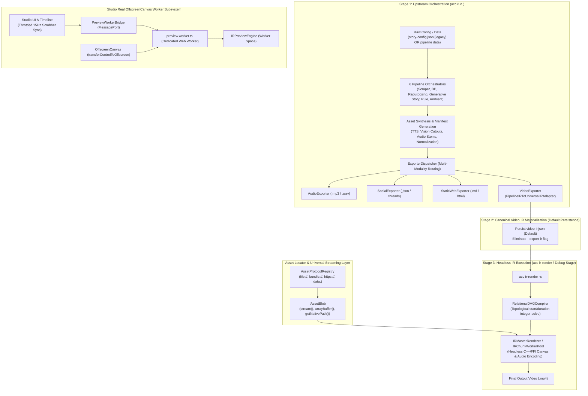

# Master Integration Plan (Iteration 16)
## Clean Architectural Decoupling: Transparent Canvas Subtyping, Declarative Timeline Duration Standard ('timeline'), Strict CLI Route Isolation, Default Canonical IR Persistence, Universal Streaming Asset Blobs & Real Web Worker OffscreenCanvas Studio Preview

---

### Executive Summary & Problem Context

During recent end-to-end rendering verification of multi-scene generative stories (`bun run cli.ts ir-render -c ./sample-story -o ./sample-story/final.mp4`) and deep Studio playback profiling, six fundamental architectural vectors were clarified and aligned:

1. **Polymorphic Canvas Leaks (`ICanvasInstance` vs. Native Canvas Driver)**:
   - When running vision segmentation fallback strategies (`GrabCutFallbackStrategy`) or visual modifiers in Node/Bun or WebWorker environments, `UniversalCanvasProvider.createCanvas()` produces an `ICanvasInstance`.
   - Passing this instance into standard 2D rendering contexts (`ctx.drawImage(alphaCanvas, 0, 0)`) causes immediate native crashes (`TypeError: Value is not one of these types: CanvasElement, SVGCanvas, Image` in `@napi-rs/canvas`).
   - Call sites were previously resorting to manual type checks (`(alphaCanvas as any).getRawCanvas()`). This violates the **Liskov Substitution Principle (LSP)** and pollutes business logic with native driver implementation details.

2. **Temporal Coupling & Non-Declarative BGM/Audio Track Spans**:
   - In video storytelling, audio tracks such as background music (BGM), ambient soundscapes, or global overlays often need to span the duration of the entire compiled timeline, regardless of individual scene lengths.
   - The IR specification only supported explicit frame integers or sequence-to-sequence matching (`{ matchLengthOf: 'seq_1_vis' }`), forcing adapters to attach BGM to scene 1 and requiring ad-hoc compiler regex patches (`if (track.id.includes('bgm'))`).
   - This violates the **Open-Closed Principle (OCP)** and breaks timeline determinism when scene sequences change dynamically.

3. **Unified Hierarchical Naming Standard (`sequence` $\rightarrow$ `track` $\rightarrow$ `timeline`)**:
   - The root temporal dimension must have a single, unified term across all schemas, types, and compilers. In video editing and NLE engineering, Time belongs to the **Timeline**, while "Master" refers strictly to output routing buses (`IRMasterRenderer`, `master audio bus`). The canonical term is strictly **`timeline`**.

4. **Strict CLI Route Isolation & Engine Roles**:
   - `acc run <pipeline_id>` is the **Omnichannel Content Engine**: it orchestrates full end-to-end generation across multiple modalities (Video, Audio, Social, Web). It is the only command that handles upstream asset synthesis (TTS, AI generation) and raw input configs (`story-config.json` [legacy] or `[pipeline-ir.json + omnichannel-config.json]`).
   - `acc ir-render` is a **standalone debug and headless execution stage** extracted from the video pipeline. It operates **strictly on pre-compiled, canonical `video-ir.json`** (or `video-ir.transformed.json`). It strictly rejects raw un-synthesized configs (`story-config.json`, `pipeline-ir.json`) with clear actionable guidance.

5. **Default Canonical Video IR Persistence (Elimination of `--export-ir`)**:
   - `video-ir.json` is materialized whenever a pipeline runs with `video` export enabled.
   - Instead of requiring an explicit `--export-ir` flag, `VideoExporter` will persist `video-ir.json` **by default** into the output directory alongside `final.mp4`. The `--export-ir` flag is completely eliminated.
   - Any rendered video leaves behind its canonical `video-ir.json`, allowing instant inspection, re-rendering with different encoder presets, or debug execution via `acc ir-render`.

6. **Universal Streaming Resource Locator & Asset Blobs (`IAssetBlob`)**:
   - Assets in `video-ir.json` reference files using arbitrary strings (`assets/scene1.jpg`, `autogenerated/voiceovers/...`, `https://...`).
   - To support both Web (Studio/Web Workers) and Node/Bun (Headless CLI/Worker Pool) without running out of memory (OOM), assets are decoupled behind a universal **`IAssetBlob`** streaming contract and an extensible **`AssetProtocolRegistry`** (`file://`, `bundle://`, `http://`, `https://`, `data:`).

7. **Studio Player Playback Lag & Main-Thread Blocking**:
   - **Current State**: `Preview.tsx` renders synchronously on `<canvas id="studio-canvas" />` directly on the React UI main thread. Playing triggers 30-60 Hz React state updates (`onScrub(nextFrame)`), forcing continuous full component tree reconciliation. `OffscreenCanvas` is not wired to a worker.
   - **Target Architecture**: Real **`OffscreenCanvas` Web Worker Pipeline** (`preview.worker.ts` via `transferControlToOffscreen()`), decoupled direct-to-worker playback loop, adaptive dynamic LOD (0.5x during playback, 1.0x on pause), and predictive `ImageBitmap` texture pre-warming.

---

### Architectural Solution & Hexagonal Design



---

## 6-Pillar Structural Design

### Pillar 1: Transparent Polymorphic Canvas Abstraction (LSP Compliance)
- **Problem**: `ctx.drawImage(source)` in `@napi-rs/canvas` or `OffscreenCanvas` throws when given an `ICanvasInstance` object.
- **Solution**:
  - Enhance `ICanvasContext2D` implementation in both `NapiCanvasAdapter` and `WebCanvasAdapter` using a context proxy / wrapper.
  - Automatically unwrap `source` if it implements `getRawCanvas()`:
    ```typescript
    const rawImage = (image && typeof image === 'object' && 'getRawCanvas' in image && typeof (image as any).getRawCanvas === 'function')
      ? (image as any).getRawCanvas()
      : image;
    ```
  - Extend this transparent unwrapping to `ctx.createPattern(image, repetition)` and `ctx.drawImage(...)`.
  - Eliminate all call-site unwrap boilerplate in `GrabCutFallbackStrategy`, `IRCanvasCompositor`, `depth-mesh.ts`, and modifier plugins.

### Pillar 2: First-Class Declarative Timeline-Bound Durations (`matchLengthOf: 'timeline'`)
- **Problem**: Background tracks cannot express "span the entire video timeline" declaratively in IR without hardcoding scene 1 IDs or post-pass compiler hacks.
- **Unified Naming Standard**: Standardize strictly on the term **`timeline`** across all specifications and compilers (`sequence` $\rightarrow$ `track` $\rightarrow$ `timeline`).
- **Solution**:
  - Update `RelationalDuration` in `packages/ir/src/types/VideoIR.ts` and `schema/video-ir.schema.json`:
    ```typescript
    export type RelationalDuration = {
      matchLengthOf?: string; // Target sequence ID OR 'timeline'
      matchAssetDuration?: boolean;
      loop?: boolean;
      paddingFrames?: number;
    };
    ```
  - In `RelationalDAGCompiler`:
    - Treat `'timeline'` as a terminal relational dependency in topological sorting.
    - Pass 1 resolves all discrete and relational sequence durations.
    - Pass 2 computes timeline bounds (`totalFrames = maxEndFrame`).
    - Pass 3 assigns `totalFrames` to any sequences specifying `matchLengthOf: 'timeline'`.
  - In `StoryConfigToUniversalIRAdapter` and `PipelineIRToUniversalIRAdapter`:
    - When background music or ambient audio is present, define:
      ```typescript
      duration: { matchLengthOf: 'timeline' }
      ```
    - Fully decoupled from video track IDs (`seq_1_vis`).

### Pillar 3: Strict CLI Route Isolation & Default Video IR Persistence
- **Problem**: `ir-render` was checking for `story-config.json` and `pipeline-ir.json`, muddying the separation of responsibilities between content synthesis and pure IR execution.
- **Solution**:
  - **`acc run <pipeline_id> [dir|config]`**:
    - The **only** route that accepts raw inputs (`story-config.json` [legacy], or `pipeline-ir.json` + `omnichannel-config.json` pairs, or DB datasets).
    - Responsible for executing asset synthesis (TTS, AI generation) and producing canonical outputs.
    - When `video` exporter is active, it **persists `video-ir.json` by default** into the output directory alongside `final.mp4`.
    - **Eliminate `--export-ir` flag** from CLI options and arguments.
  - **`acc ir-render -c <file|dir>`**:
    - **Strictly** consumes canonical `video-ir.json` or `video-ir.transformed.json`.
    - Removed `story-config.json`, `pipeline-ir.json`, and `omnichannel-config.json` from candidate search in `apps/cli/src/commands/ir-render.ts`.
    - If a user passes a folder containing only `story-config.json`, fail fast with a helpful tip:
      `[IRRenderCommand] ❌ 'story-config.json' detected. 'ir-render' is a headless debug stage that only consumes canonical 'video-ir.json'.\n👉 To synthesize assets and run the generative story pipeline, use: acc run story <dir>`
    - If a user passes `pipeline-ir.json`, fail fast:
      `[IRRenderCommand] ❌ 'pipeline-ir.json' detected. 'ir-render' only consumes canonical 'video-ir.json'.\n👉 To execute the omnichannel pipeline, use: acc run <pipeline_id> <dir>`
  - **`acc studio [file|dir]`**:
    - Strictly opens canonical `video-ir.json` or live studio state for scrubbing and editing.
  - **Modernize `sample-story`**:
    - Provide canonical `sample-story/video-ir.json` as the verified benchmark IR document.

### Pillar 4: Universal Streaming Asset Blobs & Protocol Resolvers (`IAssetBlob`)
- **Problem**: In-memory byte buffers for large media assets cause V8 heap OOMs. Relative path joining breaks when distributed across workers or running in browser/worker environments.
- **Solution**:
  - Define `IAssetBlob` in `packages/core-isomorphic/src/assets/IAssetBlob.ts`:
    ```typescript
    export interface IAssetBlob {
      readonly uri: string;
      readonly mimeType: string;
      readonly size?: number;
      stream(): ReadableStream<Uint8Array>;
      arrayBuffer(): Promise<ArrayBuffer>;
      getNativePath?(): string | null;
    }
    ```
  - Implement `AssetProtocolRegistry`:
    - `FileProtocolResolver`: Handles `file://` and local bundle paths using lazy streaming (`Bun.file(path)` / `fs.createReadStream()`).
    - `HttpProtocolResolver`: Handles `http://` and `https://` via standard `fetch()` streams.
    - `DataUriProtocolResolver`: Decodes inlined base64 payloads into memory streams.
  - Connect `CanvasAssetLoader` and `AssetMetadataProber` to consume `IAssetBlob` transparently across both Web (OffscreenCanvas/ImageBitmap) and Node/Bun (Skia/FFmpeg FFI).

### Pillar 5: Real OffscreenCanvas & Web Worker Studio Player (Lag Elimination)
- **Problem**: Playing in Studio executes on the React main UI thread, triggering 30-60 Hz React state updates (`setCurrentFrame`), heavy 1080p canvas redraws without LOD scaling, and synchronous texture decoding, causing severe UI freezes.
- **Solution**:
  - **Dedicated Web Worker Pipeline (`preview.worker.ts`)**:
    - Transfer the viewport `<canvas>` to the worker using `canvas.transferControlToOffscreen()`.
    - The worker holds `IRPreviewEngine` and executes the continuous `requestAnimationFrame` render loop completely off the main thread.
    - Fallback: Gracefully degrades to main-thread rendering if `transferControlToOffscreen` is unsupported.
  - **Decoupled Playhead Synchronization**:
    - The worker communicates frame timestamps via a zero-overhead `MessageChannel` / `postMessage`.
    - Throttles React playhead updates to 15 Hz for the timeline cursor while the canvas runs smoothly at full 30/60 fps.
  - **Adaptive Dynamic LOD Scaling**:
    - During active playback or high-speed J-K-L scrubbing, render at `0.5x` scale (960x540) or `0.25x`.
    - When playback parks (`speed === 0`), render a full `1.0x` crystal-clear hero frame.
  - **Predictive `ImageBitmap` Texture Pre-warming**:
    - Decode images/frames off-thread via `createImageBitmap()` $\pm 30$ frames around the playhead, transferring bitmaps to the worker without main-thread GC pauses.

### Pillar 6: End-to-End Automated Parity & Resilience Suite
- **Regression Suite**:
  - Create `autogenerated-tests/architectural_canvas_and_timeline_decoupling.test.ts`.
  - Test 1: Transparent Canvas Wrapping — Verify `ICanvasInstance` can be drawn directly into another `ICanvasInstance` context across Web and Node canvas adapters without throwing.
  - Test 2: Declarative Timeline BGM — Verify DAG compiler correctly resolves `matchLengthOf: 'timeline'` across arbitrary multi-scene tracks.
  - Test 3: Strict Route Rejection — Verify that `ir-render` rejects non-canonical files (`story-config.json`, `pipeline-ir.json`) with the correct diagnostic error.
  - Test 4: Default Video IR Persistence — Verify that running video export in a pipeline automatically creates `video-ir.json` in the destination folder without `--export-ir`.
  - Test 5: Streaming Asset Blob — Verify `IAssetBlob` streams bytes chunk-by-chunk across file and data URIs without loading the entire payload into the heap.
  - Test 6: OffscreenCanvas Worker Protocol — Verify preview worker receives `init`, `seek`, and `play` messages, executing off-thread rendering without throwing.
  - Test 7: E2E Pure IR Render — Verify `sample-story/video-ir.json` compiles and renders via `ir-render` with active audio volume, continuous BGM, and working 3D depth pop-out effects.

---

### Phased Execution Roadmap

| Phase | Description | Key Deliverables | Risk & Mitigation |
| :--- | :--- | :--- | :--- |
| **Phase 1** | Transparent Canvas Subtyping | `NapiCanvasAdapter.ts`, `WebCanvasAdapter.ts`, purge call-site unwraps in `GrabCutFallbackStrategy.ts` | Low. Preserves backwards compatibility with raw canvas objects. |
| **Phase 2** | Video IR Schema & DAG Compiler Sync | `VideoIR.ts`, `video-ir.schema.json`, `RelationalDAGCompiler.ts`, `VideoIRSchemaValidator.ts` | Medium. Must ensure schema draft-07 and validator tests pass synchronously per `VIDEO-IR-SCHEMA-SYNC`. |
| **Phase 3** | Default IR Persistence & Route Isolation | `apps/cli/src/commands/ir-render.ts`, `apps/cli/src/commands/studio.ts`, `packages/exporters/src/video/VideoExporter.ts`, purge `--export-ir`, canonical `sample-story/video-ir.json` | Low. Clean error messages guide users to the correct command. |
| **Phase 4** | Universal Streaming Asset Blobs | `IAssetBlob.ts`, `AssetProtocolRegistry.ts`, `CanvasAssetLoader.ts` | Low. Streaming interfaces natively available in Bun and modern browsers. |
| **Phase 5** | OffscreenCanvas Worker & Studio Performance | `apps/studio/src/workers/preview.worker.ts`, `apps/studio/src/lib/worker/PreviewWorkerBridge.ts`, `apps/studio/src/components/Preview.tsx`, `useShuttleEngine.ts` | Medium. Ensure fallback to direct canvas if OffscreenCanvas transfer fails. |
| **Phase 6** | E2E Pioneer Verification & History Archival | Automated tests in `autogenerated-tests/`, re-render `sample-story`, history log & backlog sync | Low. Verified with bit-identical hash comparison and FFmpeg volume detection. |

---

### Verification Strategy
1. **Unit & Parity Tests**:
   - `bun test autogenerated-tests/architectural_canvas_and_timeline_decoupling.test.ts`
   - `bun test autogenerated-tests/ir_schema_sync_iteration5.test.ts`
2. **CLI Route Verification**:
   - Test `bun run cli.ts ir-render -c ./sample-story` with only `story-config.json` $\rightarrow$ verifies fast fail and actionable tip.
   - Test `bun run cli.ts ir-render -c ./sample-story/video-ir.json -o ./sample-story/final.mp4` $\rightarrow$ succeeds cleanly.
3. **Studio Worker Preview Benchmark**:
   - Verify Studio player playback runs off-thread at 60 fps without dropping frames or triggering React component tree reconciliation.
4. **Audio & Depth Parity**:
   - Verify volume detection: `mean_volume: -27.5 dB`, `max_volume: -12.2 dB`.
   - Inspect frame 90 (Scene 1) for 3D depth cutout and Polaroid frame overlay.
