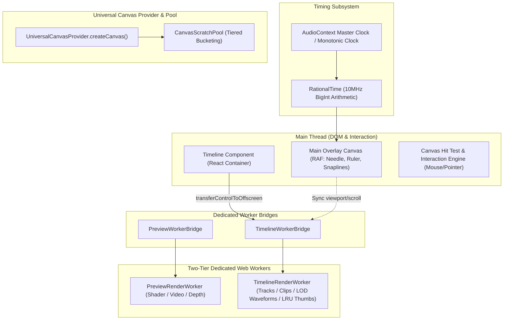

# Master Integration Plan - Iteration 17: Enterprise-Grade Video Editing Preview, Timeline & Canvas Architecture

## Goal Description
Audit and refactor the current timeline, preview pipeline, and isomorphic canvas creation (`createCanvas`) to enterprise-grade NLE standards:
1. **Decoupled OffscreenCanvas Worker Architecture (Two-Tier Dedicated Workers)**:
   - Preview and Timeline run in **separate dedicated Web Workers** (`PreviewRenderWorker` for shader/depth composition, `TimelineRenderWorker` for tracks/clips/waveforms) via `transferControlToOffscreen()`.
   - Main thread retains only high-frequency overlay elements (needle, timecode ruler, snaplines) on an overlay canvas driven by `requestAnimationFrame`. Zero React re-renders or DOM diffing on scrub/playback ticks.
2. **Universal Canvas Architecture (`createCanvas` Scratch Pooling)**:
   - Tiered Resolution Bucketing (`acquireScratchCanvas(w, h)` / `releaseScratchCanvas(canvas)`).
   - Pre-warms common viewport sizes (1080p, 720p, downsampled 256x256) and reuses buffers for transient passes (e.g. fire/smoke generators, 3D relighting, depth heuristics) to eliminate frame-loop GC spikes across the ~50 `createCanvas` call sites.
3. **Viewport Virtualization & Memory Hygiene**:
   - 1D Interval Tree index horizontal BVH culling so only clips and markers within visible horizontal bounds $[T_{start}, T_{end}]$ are processed.
   - Multi-resolution audio waveform peak pyramid (LOD) based on zoom scale ($px/ms$).
   - LRU Cache for filmstrip thumbnails using `ImageBitmap` with explicit `.close()` disposal to prevent OOM.
   - Zero-allocation render loop: Flat `Float32Array` buffers and object pools for layout calculations.
4. **Frame-Accurate Clock & Timing**:
   - `RationalTime` arithmetic (`{ value: bigint, timescale: number }` with default standard 10MHz timescale `10_000_000`) in `@acc/core-isomorphic` to eliminate floating-point drift.
   - Single master clock slaved to `AudioContext.currentTime` or `performance.now()`.
5. **Resilience & Error Handling**:
   - Canvas/WebGL `contextlost` / `contextrestored` recovery hooks rebuilding visual state from pure memory models.
   - Dynamic high-DPI handling with adaptive throttling to 1.0 upon frame drops or battery/perf degradation.

---

## User Review Required
> [!IMPORTANT]
> The Timeline will transition from a heavy DOM-based tree (hundreds of React elements for tracks, clips, trim handles, and DOM WaveSurfer instances) to a **high-performance Canvas-only architecture** rendered via a dedicated `TimelineRenderWorker` with hit-testing math for clip selection, trimming, and dragging.

> [!NOTE]
> RationalTime will use `bigint` value with standard `10_000_000` (10 MHz) timescale, providing bit-accurate frame alignment matching SMPTE / OpenTimelineIO specifications across all framerates (23.976, 24, 25, 29.97, 30, 59.94, 60, 120 fps).

---

## Canvas Architecture Audit & Brainstorm (`createCanvas`)

### Current State Analysis
A codebase search reveals `createCanvas` is invoked in over 50 places:
1. **Overlay Effect Generators (`packages/effect-engines/src/overlay-effects/generators/*`)**:
   - Every effect (Fire, Smoke, Rain, Glitch, Fog, Bokeh) calls `adapter.createCanvas(width, height)` or `createCanvas(nWidth, nHeight)` for scratch buffers per frame.
   - **Bottleneck**: High GC pressure! Allocating new canvas instances per frame forces browser/Node GC runs, causing frame drops during 60fps render loops.
2. **Vision & Depth Strategies (`packages/effect-engines/src/vision/strategies/*`)**:
   - `DepthAnythingV2BaseStrategy`, `DptLargeStrategy`, `HeuristicDepthStrategy`, `GrabCutFallbackStrategy` call `UniversalCanvasProvider.createCanvas(w, h)` to resize textures and read raw pixels.
3. **IR Plugins & Master Renderer (`packages/ir/src/*`)**:
   - `IRMasterRenderer.ts`: `canvasInstance = UniversalCanvasProvider.createCanvas(width, height)`
   - `Camera3DPlugin.ts`: creates `uNear`, `uFar`, `uTiny` scratch canvases.
   - `Depth3DPlugin.ts`: creates `relightCanvas`, `uBaseCanvas`.
4. **Studio Preview & Timeline (`apps/studio`)**:
   - Currently uses direct `<canvas>` tags in React DOM and `transferControlToOffscreen` in `PreviewWorkerBridge`.

### Proposed Canvas Architecture Strategy
1. **Tiered Resolution Bucketed Scratch Pool**:
   - Add `UniversalCanvasProvider.acquireScratchCanvas(width, height): ICanvasInstance` and `releaseScratchCanvas(canvas)` to reuse canvas backing buffers for shader & filter scratch operations.
   - Zero-allocation per-frame: effects like Fog, Fire, Relighting borrow a scratch canvas from the pool instead of triggering `new Canvas()`.
2. **Worker-Safe Canvas Instantiation**:
   - Ensure `UniversalCanvasProvider` running inside a Web Worker automatically detects `typeof OffscreenCanvas !== 'undefined'` and uses native `OffscreenCanvas` without attempting DOM operations.
3. **Transparent Canvas Subtyping (LSP Compliance)**:
   - Preserve `ICanvasInstance` subtyping so that any canvas created by `createCanvas` can be passed directly to `ctx.drawImage()`, `createPattern()`, and WebGL textures seamlessly.

---

## Proposed Changes



---

### Component 1: Rational Time Subsystem (`packages/core-isomorphic`)
- **[NEW] `packages/core-isomorphic/src/math/time/RationalTime.ts`**:
  - Implements `RationalTime`:
    - `value: bigint`
    - `timescale: number` (default: `10_000_000`)
  - Arithmetic methods: `add`, `sub`, `mul`, `div`, `rescale`, `toSeconds`, `fromSeconds`, `toFrame`, `fromFrame`.
  - Exact frame rounding with integer math without IEEE-754 floating point accumulation error.
- **[MODIFY] `packages/core-isomorphic/src/math/clock/DeterministicTimelineClock.ts`**:
  - Integrate `RationalTime` as the core backing representation for `currentFrame` and `timeSec`.
  - Direct synchronization with `AudioContext.currentTime` with jitter-culling PLL filter.

---

### Component 2: Universal Canvas Scratch Pool (`packages/core`)
- **[NEW] `packages/core/src/isomorphic/canvas/CanvasScratchPool.ts`**:
  - Tiered resolution bucketing (e.g. 256x256, 512x512, 1280x720, 1920x1080).
  - Reuses canvas instances with zero reallocation overhead.
- **[MODIFY] `packages/core/src/isomorphic/canvas/UniversalCanvasProvider.ts`**:
  - Add `acquireScratchCanvas(width: number, height: number, engine?: CanvasEnvironment): ICanvasInstance`.
  - Add `releaseScratchCanvas(canvas: ICanvasInstance): void`.

---

### Component 3: Dedicated Timeline Worker & Offscreen Rendering Subsystem (`apps/studio`)
- **[NEW] `apps/studio/src/workers/timeline.worker.ts`**:
  - Worker receiving `OffscreenCanvas`.
  - Hosts rendering loop for tracks, clips, badges, audio waveforms, and thumbnails.
  - Implements 1D Interval Tree culling: only queries clips intersecting $[scrollLeft, scrollLeft + viewportWidth]$.
  - Zero-allocation render loop using flat `Float32Array` for clip bounds and coordinate batches.
  - Handles `contextlost` and `contextrestored`.
- **[NEW] `apps/studio/src/lib/timeline/TimelineWorkerBridge.ts`**:
  - Manages worker lifecycle, postMessage channel, viewport updates (`scrollLeft`, `zoomScale`, `viewportWidth`, `viewportHeight`, `dpr`).
  - Sends updated timeline model from `IRStateManager`.
- **[NEW] `apps/studio/src/lib/timeline/WaveformLODPyramid.ts`**:
  - Multi-resolution LOD pyramid: Level 0 (raw peaks), Level 1 (downsampled 4x), Level 2 (16x), Level 3 (64x).
  - Selects level dynamically based on $px/ms$ zoom factor to draw in constant time per screen width.
- **[NEW] `apps/studio/src/lib/timeline/ThumbnailLRUCache.ts`**:
  - LRU cache capped at configurable memory limit (e.g., 64MB or 128 items).
  - Explicitly invokes `imageBitmap.close()` upon eviction to prevent GPU/browser memory leaks.

---

### Component 4: Studio Timeline Overhaul (`apps/studio/src/components/Timeline.tsx`)
- **[MODIFY] `apps/studio/src/components/Timeline.tsx`**:
  - Replaces DOM track/clip rendering with two canvases:
    1. Background `<canvas ref={offscreenCanvasRef}>` transferred to `TimelineWorkerBridge`.
    2. Lightweight foreground `<canvas ref={overlayCanvasRef}>` for ruler, needle, and cyan snaplines.
  - Pure RAF overlay rendering: needle moves at 60/120fps without triggering React component re-renders.
  - Custom canvas pointer interaction & hit-testing engine for clip drag, trim handles, razor cutting, and marquee selection.
  - Dynamic high-DPI scaling with performance degradation throttle (scales DPR from 2.0 to 1.0 when frame time > 16.6ms).
  - Graceful fallback to main-thread canvas 2D if `transferControlToOffscreen` is not supported.

---

### Component 5: Architecture Documentation & History Archival
- **[NEW] `docs/history/286_enterprise_grade_timeline_and_preview_refactor.md`**: Task record with problem, solution, benchmark results.
- **[MODIFY] `docs/history/README.md`**: Index task 286.
- **[MODIFY] `docs/SYSTEM_ARCHITECTURE_DOCUMENT.md`**: Document timeline OffscreenCanvas architecture, RationalTime 10MHz engine, LOD waveform pyramid, and Canvas scratch pool.

---

## Verification Plan

### Automated Tests
Run via `bun:test`:
```powershell
bun test autogenerated-tests/rational_time_arithmetic.test.ts
bun test autogenerated-tests/timeline_worker_and_virtualization.test.ts
bun test autogenerated-tests/deterministic_timeline_clock.test.ts
bun test autogenerated-tests/canvas_scratch_pool.test.ts
```

### Manual Verification
1. Launch Studio application (`bun run dev`).
2. Scrub timeline interactively at 60fps/120fps with J-K-L shuttle and mouse drag.
3. Verify zero React re-renders logged on frame ticks.
4. Verify waveforms and filmstrips render smoothly during zoom in/out with zero GC stutter.
5. Check memory consumption in Chrome DevTools to verify `ImageBitmap.close()` garbage collection stability.
