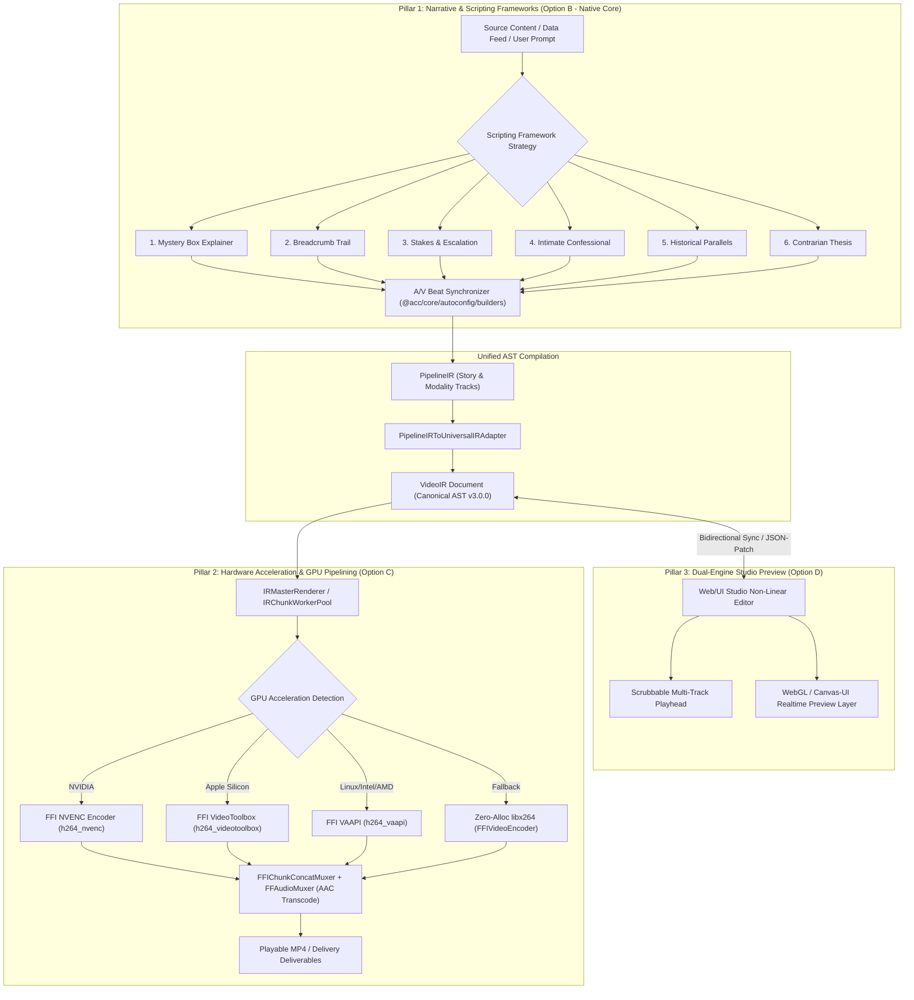

# Master Integration Plan (Iteration 2): Narrative Scripting Frameworks, GPU Hardware Acceleration & Dual-Engine Web/UI Studio Preview

## 1. Executive Summary & Strategic Alignment

Following an audit of [docs/master_integration_plan_iteration_1.md](master_integration_plan_iteration_1.md), all external Conductor OSS daemon/polling abstractions have been **formally deprecated and quarantined**. The system architecture is firmly anchored on core native TypeScript/Bun execution: `PipelineRunner`, `AutoConfigEngineFacade`, `PipelineIRBuilder`, `IRMasterRenderer`, and `IRChunkWorkerPool`.

Aligned with this architectural mandate, **Iteration 2** unites creative narrative direction, pure FFI hardware acceleration, and human-in-the-loop editing interfaces into a cohesive, production-grade video production stack:

1. **Pillar 1 (Option B): Narrative Architecture & Master Scripting Frameworks (Native `@acc/core/autoconfig`)**  
   Connect the **6 Master Scripting Frameworks** (`docs/video-production-techniques/Six_Master_Scripting_Frameworks.md`) directly into `PipelineIRBuilder` and `DirectorPresetFactory` within `@acc/core` (avoiding any deprecated Conductor dependencies). Each narrative framework (Mystery Box, Breadcrumb Trail, Stakes & Escalation, Intimate Confessional, Historical Parallels, Contrarian Thesis) deterministically constructs A/V timing beats, audio ducking curves, typographic pacing, and visual transitions into `PipelineIR` and `VideoIR`.

2. **Pillar 2 (Option C): Hardware Acceleration & Multi-GPU Pipelining (`NVENC`, `VideoToolbox`, `VAAPI`)**  
   Harden the pure `bun:ffi` video encoder and decoder paths. Introduce dynamic GPU encoder selection (`h264_nvenc`, `hevc_nvenc`, `h264_videotoolbox`, `h264_vaapi`) with seamless software fallbacks (`libx264`). Implement zero-copy GPU/hardware surface buffer reuse and benchmark render throughput (FPS/frame latency) under high temporal chunk concurrency (`-j 6+`).

3. **Pillar 3 (Option D): Hybrid Dual-Engine Web/UI Studio Preview (DOM/WebGL Preview <-> Headless FFI Render)**  
   Implement the architecture defined in `docs/video-production-techniques/web_based_video_editor_architecture.md`. Deliver a local, scrubbable UI Studio Preview panel (via Antigravity Generative UI / UI Extension) that interacts directly with the `VideoIR` JSON AST. Support bidirectional scrubbing, real-time shader preview over DOM elements, JSON-Patch track modification, and zero-re-render instant playback.

---

## 2. Architectural Blueprint & Data Flow



---

## 3. Detailed Pillar Specifications

### Pillar 1: Narrative Scripting Frameworks & Automated A/V Storyboarding (Option B)

#### 3.1 Objective & Strategy
Map the 48 visual video styles into the **6 Master Scripting Frameworks** described in `Six_Master_Scripting_Frameworks.md`. Build these directly inside **`packages/core/src/autoconfig/scripting/`** (completely isolated from deprecated conductor packages). Provide dedicated strategy classes that translate narrative beats (Cold Hook, Friction/Stakes, Reset, Metaphor Build, Complication, Climax/Payoff) into strict temporal chunks, audio compositions, camera motions, and overlay states.

#### 3.2 Concrete Components to Create & Wire in `@acc/core`
1. **`IScriptingFrameworkStrategy`**:
   - Location: `packages/core/src/autoconfig/scripting/IScriptingFrameworkStrategy.ts`
   - Defines interface:
     ```typescript
     export interface ScriptBeat {
       name: string;
       timingSec: [number, number]; // [start, end]
       audioRole: 'hook' | 'friction' | 'metaphor' | 'turn' | 'climax' | 'resolution';
       visualPacing: 'rapid_cut' | 'slow_burn' | 'kinetic_motion' | 'intimate_hold';
       sfxCue?: string;
       cameraPreset?: string;
       typographyStyle?: string;
     }
     export interface ScriptPromptPayload {
       topic: string;
       targetDurationSec?: number;
       rawContent?: string;
       styleId?: string;
     }
     export interface IScriptingFrameworkStrategy {
       readonly id: string;
       readonly name: string;
       readonly targetStyles: string[];
       generateBeats(input: ScriptPromptPayload): Promise<ScriptBeat[]>;
       applyToPipelineIR(ir: PipelineIR, beats: ScriptBeat[]): PipelineIR;
     }
     ```
2. **The 6 Concrete Strategy Implementations**:
   - `MysteryBoxExplainerStrategy.ts`: Delays the core answer, constructs an A-Story / B-Story contrast with heavy bass drops and whiteboard/void resets.
   - `BreadcrumbTrailDigitalStrategy.ts`: Fast UI clicks, keyboard typing sounds, window snap animations, and high-retention terminal/document highlights.
   - `StakesAndEscalationStrategy.ts`: Countdown timers, progress bars, rule kinetic typography, and high-contrast tension drops.
   - `IntimateConfessionalStrategy.ts`: Long takes, conversational pauses, gentle background bokeh, and emotional audio ducking.
   - `HistoricalParallelsStrategy.ts`: Dual-timeline split screens, archival parchment LUT grading, and chronological progress pacing.
   - `ContrarianThesisStrategy.ts`: Provocative opening thesis, myth busting badges, evidence receipts, and punchy resolution beats.
3. **`ScriptingFrameworkRegistry.ts`**:
   - Location: `packages/core/src/autoconfig/scripting/ScriptingFrameworkRegistry.ts`
   - Allows CLI and `AutoConfigEngineFacade` to select or auto-classify the optimal scripting framework based on content feed metadata or explicit `--framework` flag.

---

### Pillar 2: Hardware Acceleration & GPU Pipelining Suite (Option C)

#### 3.3 Objective & Strategy
Eliminate CPU encoding bottlenecks by harnessing native GPU encoders via `bun:ffi` without child-process overhead. Preserve the **ZERO-ALLOC-FRAME-LOOP** and **DETERMINISTIC-HANDSHAKE-BACKPRESSURE** rules.

#### 3.4 Hardware Capabilities & Implementation
1. **Dynamic Hardware Encoder Prober (`GPUEncoderResolver.ts`)**:
   - Location: `packages/core/src/ffmpeg-ffi/GPUEncoderResolver.ts`
   - Probes FFmpeg shared libraries for available hardware encoders:
     - `h264_nvenc` / `hevc_nvenc` (NVIDIA CUDA / NVENC)
     - `h264_videotoolbox` / `hevc_videotoolbox` (macOS Apple Silicon)
     - `h264_vaapi` / `h264_qsv` (Linux VAAPI / Intel QuickSync)
     - `libx264` (Universal high-efficiency CPU fallback)
2. **`GpuVideoEncodingStrategy.ts`**:
   - Location: `packages/core/src/ffmpeg-ffi/GpuVideoEncodingStrategy.ts`
   - Configures hardware-specific codec options via `av_opt_set`:
     - NVENC: `preset=p4` (or `p6` for high quality), `tune=hq`, `rc=vbr_hq`, `spatial_aq=1`, `temporal_aq=1`.
     - Zero nursery heap allocations: pre-allocates native CUDA/hardware frame wrappers where supported.
3. **Hardware Surface & Monotonic Rescaling Parity**:
   - Ensures hardware encoders strictly follow the `av_packet_rescale_ts` and monotonic timestamp rule established in Task 188.
4. **Benchmarking Harness (`gpu-throughput-benchmark.test.ts`)**:
   - Location: `autogenerated-tests/gpu-throughput-benchmark.test.ts`
   - Measures frame ingestion throughput (FPS), memory footprint (heap vs native C RSS), and bitstream integrity across CPU vs GPU pipelines.

---

### Pillar 3: Dual-Engine Web/UI Studio Preview (Option D)

#### 3.5 Objective & Strategy
Bridge headless backend rendering with an interactive frontend studio as outlined in `web_based_video_editor_architecture.md`. Users can visually inspect the timeline, scrub the playhead at variable frame rates, inspect 3D depth and procedural shaders in the browser, and dispatch single-click deterministic renders.

#### 3.6 Implementation Architecture
1. **Interactive Timeline State Manager (`StudioTimelineState.ts`)**:
   - Location: `apps/cli/src/studio/StudioTimelineState.ts`
   - Implements an immutable, scrubbable playhead (`currentTime`, `currentFrame`).
   - Supports bi-directional JSON-Patch operations on `VideoIRDocument`:
     - Moving clip in/out points.
     - Changing text typography / color in real time.
     - Enabling / disabling VFX modifiers (e.g. toggling `depth_3d` or `canvas_particle_overlay`).
2. **Hybrid Dual-Pipeline Preview (`UIStudioPreviewEngine.ts`)**:
   - **Frontend Preview**: Uses HTML5 Canvas + WebGL shaders for instant playback at user-interactive frame rates.
   - **Backend Dispatch**: When user clicks "Export" or "Render", serializes the modified `VideoIRDocument` and feeds it directly into `IRMasterRenderer` / `IRChunkWorkerPool` for byte-identical, deterministic output.
3. **CLI / Studio Server Integration**:
   - Extend CLI with `bun run cli.ts studio [path]` to spin up a lightweight local server serving the UI Studio extension with the loaded pipeline project.

---

## 4. Phased Implementation Roadmap

| Phase | Milestone | Deliverables & Scope | Acceptance Criteria |
| :---: | :--- | :--- | :--- |
| **Phase 1** | **Narrative Scripting Frameworks** (Option B) | `IScriptingFrameworkStrategy.ts`, 6 concrete framework strategies, and registry in `packages/core/src/autoconfig/scripting/`. | Frameworks generate valid beat sequences with A/V timing, typography, and SFX cues. Integrated directly into `PipelineIRBuilder`. |
| **Phase 2** | **Hardware Accelerated Encoders** (Option C) | `GPUEncoderResolver.ts`, `GpuVideoEncodingStrategy.ts`, and hardware encoder options in `FFIVideoEncoder.ts`. | Automatic detection of NVENC/VideoToolbox/VAAPI with clean CPU fallback. Zero memory leaks in frame loop. |
| **Phase 3** | **Hardware Benchmarking & Optimization** | Formal test harness in `autogenerated-tests/gpu-throughput-benchmark.test.ts`. | Benchmarking report verifying $\ge 2\times$ rendering speedup on supported hardware with identical frame hashes. |
| **Phase 4** | **Studio Preview Engine & AST Bridge** (Option D) | `StudioTimelineState.ts`, JSON-Patch synchronization, and local HTTP studio server in `apps/cli/src/studio/`. | Real-time scrubbing of timeline clips, live parameter editing, and instant preview. |
| **Phase 5** | **End-to-End E2E Validation & Master Sync** | Verification of all 6 pipelines through CLI and Studio, `SYSTEM_ARCHITECTURE_DOCUMENT.md` update, history archival. | All autogenerated tests pass (100% clean). Documentation and history index updated. |

---

## 5. Verification & Test Strategy

1. **Unit & Strategy Tests**:
   - `autogenerated-tests/scripting_frameworks_verification.test.ts`: Verify that all 6 scripting frameworks output valid beat structures and apply cleanly to `PipelineIR`.
2. **Hardware Acceleration Tests**:
   - `autogenerated-tests/gpu_encoder_resolution.test.ts`: Test dynamic probing on local host and verify that fallback to `libx264` triggers seamlessly if GPU is unavailable.
3. **Studio Bridge & JSON-Patch Tests**:
   - `autogenerated-tests/studio_timeline_patch.test.ts`: Test applying JSON-Patches to `VideoIRDocument` and verifying that subsequent IR rendering produces the updated frame output deterministically.
4. **Zero-Regression Mandate**:
   - Re-run all existing test suites (`samples-scaffolding-verification.test.ts`, `json_schemas_validation.test.ts`, etc.) to guarantee zero regressions across Pipelines 1–6.
