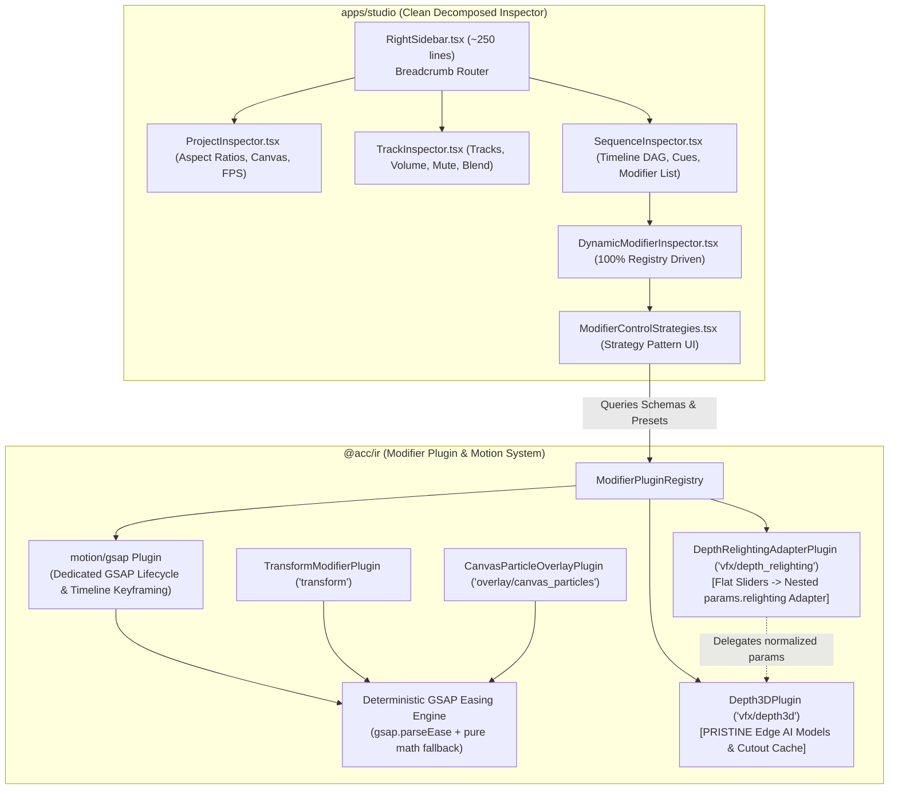

# Master Integration Plan (Iteration 20 Extension): RightSidebar Decomposition, Dedicated 'motion/gsap' Plugin & Pristine Edge AI Depth3D

## 1. Goal Description

This iteration achieves three foundational architectural goals:
1. **Decompose `RightSidebar.tsx`** from a **3,209-line monolith** into a clean **~250-line shell** routing to subcomponents (`ProjectInspector`, `TrackInspector`, `SequenceInspector`), with **100% of modifiers** driven dynamically via `ModifierPluginRegistry` and `DynamicModifierInspector`.
2. **Dedicated `motion/gsap` Modifier Plugin & Shared GSAP Easing Utility**:
   - Establish a dedicated `motion/gsap` modifier plugin in `ModifierPluginRegistry` that manages sequence-level GSAP timeline lifecycle animations (`intro`, `steady`, `outro`, easing curves, and keyframes).
   - Provide a shared deterministic GSAP easing utility in `@acc/ir` that both `TransformModifierPlugin` and `CanvasParticleOverlayPlugin` leverage for deterministic frame-accurate physics and lifecycle rendering.
3. **Pristine Edge AI `Depth3DPlugin` Architecture**:
   - Keep [`Depth3DPlugin.ts`](file:///c:/Users/Admin/workspace/git/acc/packages/ir/src/plugins/vfx/Depth3DPlugin.ts) **pristine and untouched** regarding its AI subject cutout caching, depth-map resolution, and Edge AI surface normal generation.
   - Implement `vfx/depth_relighting` as a dedicated alias adapter plugin with its own schema that cleanly unrolls flat UI parameters (`lightX`, `lightY`, `lightZ`, `lightColor`) into `params.relighting` before delegating to `Depth3DPlugin`.

---

## 2. Architectural Design & Alignment



---

## 3. Detailed Component Plan

### Component 1: Dedicated `motion/gsap` Modifier Plugin & Shared Easing Engine

#### [NEW] `packages/ir/src/plugins/motion/GSAPMotionPlugin.ts`
- **Plugin Type**: `'motion/gsap'` (targetScope: `'both'`, targetPhase: `2`).
- **Capabilities**:
  - Direct sequence and track-level GSAP lifecycle animation (`preset`, `intro`, `steady`, `outro`, and custom timeline keyframes).
  - Schema with `'select'` for motion presets (`pop_in`, `slide_left`, `bounce`, `overshoot`, `drift`), numeric sliders for `introDuration` and `outroDuration`, and `'curve'` strategy for GSAP easing curves.
- **Renderer Hook**:
  - Implements `renderClipSpace(ctx, params)` applying the interpolated GSAP transform directly to `ctx.ctx`.

#### [MODIFY] [DeterministicMotionEvaluator.ts](file:///c:/Users/Admin/workspace/git/acc/packages/ir/src/renderer/preview/DeterministicMotionEvaluator.ts)
- Implement `evaluateEase()` using `gsap.parseEase()` when available (or pure mathematical bezier equations for headless environments) to accurately support all GSAP curves: `power1/2/3/4.out/in/inOut`, `back.out`, `elastic.out`, `bounce.out`, `expo.out`, `sine.inOut`.
- Export `GSAP_EASING_PRESETS` and `MOTION_LIFECYCLE_PRESETS` so `@acc/ir`, Studio inspector controls, and particle simulators share the exact same definitions.

#### [MODIFY] [packages/ir/src/plugins/index.ts](file:///c:/Users/Admin/workspace/git/acc/packages/ir/src/plugins/index.ts)
- Register `new GSAPMotionPlugin()`.
- Add alias `'animation/gsap'` -> `GSAPMotionPlugin`.

---

### Component 2: Pristine `Depth3DPlugin` & Dedicated `DepthRelightingAdapterPlugin`

#### [NEW] `packages/ir/src/plugins/vfx/DepthRelightingAdapterPlugin.ts`
- **Plugin Type**: `'vfx/depth_relighting'` (and alias `'vfx/depth3d_relighting'`).
- **Pristine Boundary Guarantee**: Leaves [`Depth3DPlugin.ts`](file:///c:/Users/Admin/workspace/git/acc/packages/ir/src/plugins/vfx/Depth3DPlugin.ts) completely untouched.
- **Dedicated Relighting Schema**:
  - `lightColor` (`color` with neon presets: Cyan Neon `#00d4ff`, Solar Amber `#f59e0b`, Magenta Pulse `#ec4899`, Electric Violet `#8b5cf6`, Pure White `#ffffff`).
  - `lightX` (`number`, min: -10, max: 10, step: 0.1).
  - `lightY` (`number`, min: -10, max: 10, step: 0.1).
  - `lightZ` (`number`, min: 0.5, max: 20, step: 0.5).
  - `diffuse` (`number`, min: 0, max: 3, step: 0.05).
  - `shininess` (`number`, min: 4, max: 128, step: 4).
  - `rimIntensity` (`number`, min: 0, max: 2, step: 0.05).
- **Execution & Adapter Translation**:
  - Intercepts flat keys (`lightX`, `lightY`, `lightZ`, etc.) and packages them into `params.relighting: { enabled: true, lightPosition: [lightX, lightY, lightZ], lightColor, diffuse, ... }`.
  - Forwards the normalized payload directly to `Depth3DPlugin.execute()` and `Depth3DPlugin.renderClipSpace()`.

---

### Component 3: Complete Schema & Parity Alignment for Other Modifiers

#### [MODIFY] [Camera3DPlugin.ts](file:///c:/Users/Admin/workspace/git/acc/packages/ir/src/plugins/vfx/Camera3DPlugin.ts)
- Add schema fields for `fov`, `focalDistance`, `bokehRadius`, and `roll`.
- In `renderClipSpace()`, if explicit `keyframes` are not provided, synthesize a baseline static camera matrix from `params.fov`, `params.focalDistance`, `params.bokehRadius`, and `params.roll`.

#### [MODIFY] [CanvasParticleOverlayPlugin.ts](file:///c:/Users/Admin/workspace/git/acc/packages/ir/src/plugins/overlay/CanvasParticleOverlayPlugin.ts)
- Define canonical `PARTICLE_PRESET_DEFAULTS` in `@acc/ir` and re-export for Studio.
- Expand schema to include `particleCount` and nested `shaders` (`bloom`, `chromaticAberration`).

#### [MODIFY] [CaptionModifierPlugin.ts](file:///c:/Users/Admin/workspace/git/acc/packages/ir/src/plugins/text/CaptionModifierPlugin.ts)
- Normalize `fillColor || color`.
- Expand schema with `fontFamily`, `fontSize`, `fontWeight`, `letterSpacing`, `fillColor`, `glowColor`, and `activeWordHighlight`.

#### [MODIFY] [ProceduralSFXModifierPlugin.ts](file:///c:/Users/Admin/workspace/git/acc/packages/ir/src/plugins/sfx/ProceduralSFXModifierPlugin.ts)
- Accept both `params.synthType` and `params.sfxType`.
- Accept both `params.gain` and `params.volume`.
- Add `sfx_actions` descriptor so the Web Audio `Audition SFX` and `Insert to Track` buttons render cleanly via Strategy Pattern.

---

### Component 4: Decompose `RightSidebar.tsx` (< 300 Lines)

#### [NEW] `apps/studio/src/components/inspector/modifierCatalog.ts`
- Houses `MODIFIER_PRESENTATION_CATALOG`, `PARTICLE_PRESET_DEFAULTS`, `ALL_AVAILABLE_MODIFIERS`, `AVAILABLE_MODIFIERS`, `getAvailableModifiersFromRegistry()`, `formatTimecode()`, and `getSectionIdForModifierType()`.

#### [NEW] `apps/studio/src/components/inspector/ProjectInspector.tsx`
- Project Canvas Dimensions, 1-Click Aspect Ratio pills (`16:9`, `9:16`, `1:1`, `4:5`), FPS Selector, and Duration telemetry.

#### [NEW] `apps/studio/src/components/inspector/TrackInspector.tsx`
- Track Name, Type badge, Reorder Up/Down buttons, Mute/Solo, Height pills, Volume, Pan, and Track Blend Mode.

#### [NEW] `apps/studio/src/components/inspector/SequenceInspector.tsx`
- Sequence Breadcrumb, DAG Relational Timing Card (`after`/`with`/`matchLengthOf`), Blend Mode selector, Subtitle Cues table, and `+ Add Effect` dropdown.
- **Renders `<DynamicModifierInspector />` for ALL attached modifiers** with zero hardcoded accordion exceptions.

#### [MODIFY] [RightSidebar.tsx](file:///c:/Users/Admin/workspace/git/acc/apps/studio/src/components/RightSidebar.tsx)
- Reduced to ~250 lines:
  - Renders top breadcrumbs (`[Project] > [Track] > [Sequence]`).
  - Routes to `<ProjectInspector />`, `<TrackInspector />`, or `<SequenceInspector />`.
  - Re-exports legacy functions/constants (`ParameterSlider`, `ColorPickerRow`, `PARTICLE_PRESET_DEFAULTS`, `MODIFIER_PRESENTATION_CATALOG`, etc.) so existing unit tests and call sites remain 100% backward-compatible.

---

## 4. Verification Plan

### Automated Test Suites
1. **New Comprehensive Parity Suite (`autogenerated-tests/studio_inspector_plugin_parity.test.ts`)**:
   - Asserts `RightSidebar.tsx` line count is `< 350` lines.
   - Tests `motion/gsap` plugin execution and GSAP easing curve evaluations (`elastic.out`, `expo.out`, `bounce.out`, etc.).
   - Tests `DepthRelightingAdapterPlugin` flat-parameter unrolling to `params.relighting` without mutating `Depth3DPlugin`.
   - Tests `camera/3d`, `overlay/canvas_particles`, `text/style`, and `sfx/procedural` parameter parity.
2. **Existing Regression Test Suite**:
   ```bash
   bun test autogenerated-tests/modifier_schema_registry.test.ts autogenerated-tests/studio_json_debugger_roundtrip.test.ts autogenerated-tests/studio_complex_demo.test.ts autogenerated-tests/studio_context_aware_inspector.test.ts autogenerated-tests/studio_phase4_inspector_hud_particles.test.ts autogenerated-tests/studio_phase5_easing_sidebar.test.ts autogenerated-tests/studio_phase6_motion_timeline.test.ts autogenerated-tests/studio_three_audio_wiring.test.ts
   ```
3. **Studio Production Build**:
   ```bash
   bun run --cwd apps/studio build
   ```
