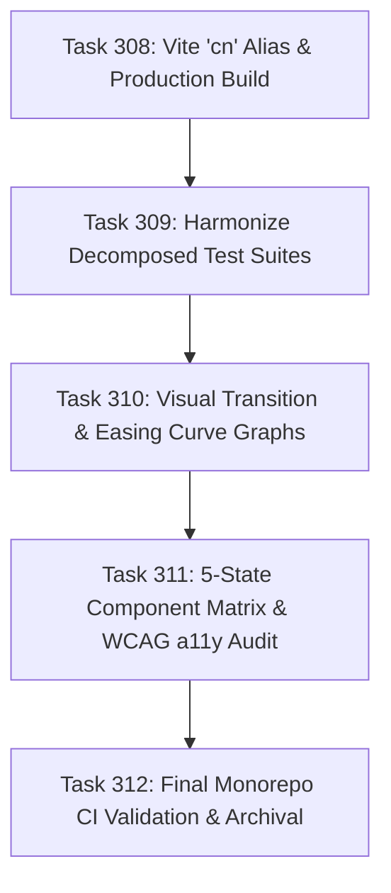

# Master Integration Plan - Iteration 26: Studio Production Build Parity, Visual Easing Curves & Component Test Harmonization

## Goal Description
Following the successful completion of **Iteration 25** (Professional Visual VideoIR JSON Editor & Debugger) and **Tasks 305–307** (Liquid Glass Studio Polish, Unified System Theme Manager & Tailwind v4 Integration), the system requires an authoritative next iteration.

Iteration 26 targets five core pillars across `/frontend-app-architect`, `/ui-ux-design-system`, and `/typescript-node-architect`:
1. **Production Build & Module Resolution Parity (Pillar 1)**: Fix Vite Rollup `cn` alias resolution in `apps/studio/vite.config.ts` so `bun run --cwd apps/studio build` succeeds with zero errors.
2. **Decomposed Component Test Suite Harmonization (Pillar 2)**: Re-align legacy monolithic string-matching tests (in `studio_liquid_glass_theme.test.ts`, `studio_phase1_declarative_vfx.test.ts`, `studio_theme_tokens.test.ts`) that were inspecting `Timeline.tsx` and `Preview.tsx` before they were decomposed into submodules in Tasks 302 and 303.
3. **Visual Easing & Transition Curve Graphs (Pillar 3)**: Elevate `EasingCurveSelector.tsx` and `DynamicModifierInspector.tsx` with interactive SVG/Canvas Bézier preview graphs and keyframe timeline scrubbing.
4. **5-State Component Matrix & WCAG 2.1 AA Audit (Pillar 4)**: Ensure every major panel in `@acc/studio` (Timeline, Preview, Bento Card, Inspectors, Debugger) explicitly renders the mandatory 5 states: *Default*, *Loading* (skeletons), *Empty* (contextual CTA), *Error* (actionable retry), and *Disabled/Read-only*.
5. **Deterministic Playhead & Transport Sync (Pillar 5)**: Complete the reactive loop between `StudioPlayheadController`, `DeterministicTimelineClock`, and `AudioWorklet` for frame-accurate playback transport.

---

## 1. Architectural Analysis & Current State

### 1.1 Vite Production Build Status
When running `bun run --cwd apps/studio build`:
```
[vite]: Rollup failed to resolve import "cn" from "apps/studio/src/components/ui/input.tsx"
```
Shadcn primitives in `apps/studio/src/components/ui/*.tsx` reference `import { cn } from "cn"`. Adding `'cn': path.resolve(__dirname, 'src/lib/utils')` to `apps/studio/vite.config.ts` will resolve all 58+ UI components cleanly without fragile refactoring.

### 1.2 Monolith Decomposition Aftermath
In Tasks 302 & 303, `Timeline.tsx` (1,200+ lines) and `Preview.tsx` (800+ lines) were broken down into clean, single-responsibility submodules (`timeline/TimelineClipItem.tsx`, `timeline/TimelineToolbar.tsx`, `preview/ViewportCanvasLayer.tsx`, `preview/ViewportControlBar.tsx`, etc.). Several earlier tests were directly searching `Timeline.tsx` and `Preview.tsx` for CSS strings (`glass-panel`, `useDraggable`, etc.) which now live in those submodules. Harmonizing these tests ensures our regression test coverage accurately validates the decomposed structure.

---

## 2. Target Deliverables & Sequential Task Breakdown



### Task 308: Production Build Parity & Module Resolution
- Update `apps/studio/vite.config.ts` to alias `'cn'` to `src/lib/utils`.
- Add test `autogenerated-tests/studio_build_and_module_resolution.test.ts` to assert that all internal UI imports resolve cleanly.
- Verify `bun run --cwd apps/studio build` succeeds with exit code 0.

### Task 309: Harmonize Decomposed Studio Test Suites
- Update assertions in `autogenerated-tests/studio_liquid_glass_theme.test.ts`, `autogenerated-tests/studio_theme_tokens.test.ts`, and `autogenerated-tests/studio_phase1_declarative_vfx.test.ts` to check both root coordinators and child components (`components/preview/*`, `components/timeline/*`).
- Target 0 failures across `bun test autogenerated-tests/studio_*.test.ts`.

### Task 310: Visual Easing & Transition Curve Graphing
- Implement `apps/studio/src/components/inspector/TransitionCurveGraph.tsx` using responsive SVG with Bézier curves ($P_0, P_1, P_2, P_3$).
- Provide interactive preset handles (`linear`, `easeInQuad`, `easeOutCubic`, `easeInOutQuart`, `bounce`, `elastic`).
- Integrate with `DynamicModifierInspector.tsx` and `EasingCurveSelector.tsx` for live transition preview.

### Task 311: 5-State Component Matrix & WCAG 2.1 AA Audit
- Follow `/ui-ux-design-system` to ensure:
  - **Timeline**: Render `TimelineEmptyState.tsx` when `tracks.length === 0`, with sample project CTA and keyboard shortcuts reminder.
  - **Preview**: Render skeleton/spinner during media loading and error fallback if asset is missing or corrupted.
  - **Inspector**: Render informative empty state when no sequence is selected.
  - **Contrast & Focus**: Verify focus visible rings (`focus-visible:ring-2 focus-visible:ring-accent-theme`) across all interactive buttons and inputs.

### Task 312: Documentation & Archival
- Document results in `docs/history/308_studio_production_build_parity_and_cn_alias.md` through `312_iteration_26_execution.md`.
- Update `docs/history/README.md`.
- Ensure all CI tests pass.

---

## 3. Verification Plan

### Automated Tests
```bash
# 1. Verify build
bun run --cwd apps/studio build

# 2. Verify build and module resolution tests
bun test autogenerated-tests/studio_build_and_module_resolution.test.ts

# 3. Verify studio theme & decomposed tests
bun test autogenerated-tests/studio_theme_unification.test.ts
bun test autogenerated-tests/studio_liquid_glass_theme.test.ts
bun test autogenerated-tests/studio_visual_json_editor.test.ts

# 4. Verify entire studio test suite
bun test autogenerated-tests/studio_*.test.ts
```

### Manual Verification
1. Launch `bun --cwd apps/studio dev` and inspect browser console for zero errors.
2. Navigate to Inspector, select a transition modifier, and interact with the Bézier curve graph.
3. Test empty timeline view to verify `TimelineEmptyState` renders with active CTA buttons.
