# Master Integration Plan Iteration 27: Dual-Profile Multi-Track Blending & Layer Isolation Architecture

## Goal Description
Resolve incorrect multi-track layer blending, track stacking order, and filter bleed across the Visual Storytelling Generator Studio preview (`apps/studio/src/components/Preview.tsx`), headless workers (`apps/studio/src/workers/preview.worker.ts`), and canonical video renderers (`packages/ir/src/renderer/shared/IRCanvasCompositor.ts`, `packages/ir/src/renderer/IRMasterRenderer.ts`).

### Core Defect Analysis
1. **Track `blendMode` Dropped at Compile Time:** `RelationalDAGCompiler.ts` drops `track.blendMode` and `track.opacity` when constructing `ResolvedTrack`. Changes in `TrackInspector.tsx` never reach the compositor.
2. **Global Buffer Contamination (No Layer Isolation):** All clips blit directly into the destination canvas context. When an overlay track ($V_2$) contains multiple clips or stream modifiers (e.g. blur, color grading), it contaminates the underlying background ($V_1$), rather than compositing $V_2$ into an isolated layer first.
3. **Incomplete Blend Mode Mapping:** Canvas 2D uses specific kebab-case strings (`color-dodge`, `soft-light`, `lighter`), while IR specifies `color_dodge`, `soft_light`, `add`. Several modes currently fail or fall through.
4. **Track Ordering Ambiguity:** Document order vs. timeline visual order (NLE bottom-to-top convention) is not explicitly formalized, causing reordered tracks to paint out of order.
5. **Preview Scrubbing Latency vs. Export Fidelity Conflict:** A naive multi-pass offscreen approach for every track degrades 60fps scrubbing with GC churn, while a pure direct draw fails video export parity.

---

## Architecture: Dual-Profile Multi-Track Compositor

We adopt a **Dual-Profile Compositing Strategy** balancing interactive 60fps scrubbing with export fidelity:

```
┌────────────────────────────────────────────────────────────────────────────────────────┐
│                                DUAL-PROFILE COMPOSITING STRATEGY                       │
├─────────────────────────────────────────────────┬──────────────────────────────────────┤
│               PREVIEW ENGINE                    │           MASTER IR RENDERER         │
│  (60 FPS Interactive / Scrubbing / Workers)     │   (Headless Export / Video Pipeline) │
├─────────────────────────────────────────────────┼──────────────────────────────────────┤
│ • Pre-allocated singleton scratch canvas pool   │ • Strict layer isolation on all      │
│ • Fast-path direct draw for standard V1 track   │   non-empty visual tracks            │
│ • Conditional scratch for blendMode !== normal, │ • Full stream-space filter isolation │
│   opacity < 1.0, or stream-space modifiers      │ • Bit-identical frame hash parity     │
│ • Zero-allocation frame loop (< 3ms latency)    │ • Pre-multiplied alpha halo guard    │
└─────────────────────────────────────────────────┴──────────────────────────────────────┘
```

### Stacking Order Specification (NLE Bottom-to-Top)
- Visual tracks in `doc.tracks` are evaluated such that `Track 0` (V1, bottom layer) renders first.
- Subsequent visual tracks (`Track 1` $\rightarrow$ `Track N`) render sequentially on top.
- `timed_text` (subtitles/captions) render strictly on top of all visual tracks.
- Master composite modifiers apply across the final aggregate canvas.

```mermaid
flowchart TD
    subgraph ExecutionLifecycle["Compositor Frame Pipeline"]
        ClearCanvas["1. Clear Destination Canvas\n(Respect clearColor: transparent for checkerboard, black default)"]
        TrackSort["2. Order Visual Tracks (V1 -> Vn: NLE Bottom-to-Top)"]
        
        subgraph TrackLoop["Per-Track Evaluation"]
            IsMaster{"Mode == 'master'?"}
            CheckCond{"Track has blendMode != 'normal',\nopacity < 1.0, or modifiers?"}
            DirectDraw["Fast Path: Direct Draw to Master Canvas\n(Clip transforms & clip-space modifiers)"]
            ScratchAcquire["Acquire Pre-Allocated Scratch Surface\n(ZERO-ALLOC Scratch Pool)"]
            ScratchClear["Clear Scratch Surface (rgba(0,0,0,0))"]
            ScratchRender["Render Track Sequences to Scratch"]
            ScratchFilter["Apply Track Stream-Space Modifiers to Scratch"]
            ScratchBlit["Blit Scratch -> Master Canvas\nctx.globalCompositeOperation = mapBlendMode(track.blendMode)\nctx.globalAlpha = track.opacity"]
        end
        
        Subtitles["3. Render Timed-Text Tracks (Subtitles Strictly on Top)"]
        MasterMods["4. Apply Document Master Composite Modifiers"]
    end

    ClearCanvas --> TrackSort
    TrackSort --> IsMaster
    IsMaster -- "Yes (Export Quality)" --> ScratchAcquire
    IsMaster -- "No (Preview Speed)" --> CheckCond
    CheckCond -- "No (Base V1)" --> DirectDraw
    CheckCond -- "Yes (Overlay/Blend)" --> ScratchAcquire
    ScratchAcquire --> ScratchClear --> ScratchRender --> ScratchFilter --> ScratchBlit
    DirectDraw --> Subtitles
    ScratchBlit --> Subtitles
    Subtitles --> MasterMods
```



---

## User Review Required

> [!IMPORTANT]
> - **Zero Nursery Heap Allocations:** To preserve the `ZERO-ALLOC-FRAME-LOOP` directive, `IRCanvasCompositor` will manage a single reusable scratch canvas and context resized dynamically only on viewport resolution changes. No new canvas elements will be instantiated per frame.
> - **VIDEO-IR-SCHEMA-SYNC:** `ResolvedTrack` in `packages/ir/src/types/VideoIR.ts` and `RelationalDAGCompiler.ts` will strictly expose `blendMode?: BlendMode` and `opacity?: number`.

---

## Proposed Changes

### 1. Intermediate Representation Core (`packages/ir`)

#### [MODIFY] `packages/ir/src/types/VideoIR.ts`
- Extend `ResolvedTrack` interface:
  ```typescript
  export interface ResolvedTrack {
    id: string;
    type: TrackType;
    blendMode?: BlendMode;
    opacity?: number;
    style?: Record<string, unknown>;
    modifiers?: ModifierNode[];
    sequences: ResolvedSequence[];
  }
  ```
- Ensure `BlendMode` supports all canonical modes:
  ```typescript
  export type BlendMode =
    | 'normal'
    | 'screen'
    | 'multiply'
    | 'overlay'
    | 'add'
    | 'color_dodge'
    | 'soft_light'
    | 'lighten'
    | 'darken'
    | 'difference'
    | 'exclusion';
  ```

#### [MODIFY] `packages/ir/src/compiler/RelationalDAGCompiler.ts`
- Pass `track.blendMode` and `track.opacity` (with fallback to `track.style.opacity`) during track compilation:
  ```typescript
  trackMap.set(track.id, {
    id: track.id,
    type: track.type,
    style: track.style,
    modifiers: track.modifiers,
    blendMode: track.blendMode || (track.style as any)?.blendMode || 'normal',
    opacity: typeof (track.style as any)?.opacity === 'number' ? (track.style as any).opacity : 1.0,
    sequences: [],
  });
  ```

#### [MODIFY] `packages/ir/src/renderer/shared/IRCanvasCompositor.ts`
- Implement `mapBlendModeToCanvasCompositeOperation`:
  - `'normal'` $\rightarrow$ `'source-over'`
  - `'screen'` $\rightarrow$ `'screen'`
  - `'multiply'` $\rightarrow$ `'multiply'`
  - `'overlay'` $\rightarrow$ `'overlay'`
  - `'add'` $\rightarrow$ `'lighter'`
  - `'color_dodge'` $\rightarrow$ `'color-dodge'`
  - `'soft_light'` $\rightarrow$ `'soft-light'`
  - `'lighten'` $\rightarrow$ `'lighten'`
  - `'darken'` $\rightarrow$ `'darken'`
  - `'difference'` $\rightarrow$ `'difference'`
  - `'exclusion'` $\rightarrow$ `'exclusion'`
- Add `executionProfile?: 'preview' | 'master'` to `CanvasCompositorOptions` (defaults to `'preview'`).
- Add pre-allocated singleton scratch canvas/context management with lazy dimension sync (`width`, `height`).
- Refactor track rendering loop:
  - Determine if track requires scratch isolation:
    - Master mode: all non-empty tracks.
    - Preview mode: tracks where `track.blendMode !== 'normal'`, `track.opacity < 1.0`, or `track.modifiers?.length > 0`.
  - Fast-path direct blit for clean standard tracks in preview mode.
  - Scratch path for isolated tracks.
- Honor `options.clearColor`: support `'transparent'` (`ctx.clearRect(0, 0, width, height)`) alongside custom hex colors.

---

### 2. Studio Application Layer (`apps/studio`)

#### [MODIFY] `apps/studio/src/components/Preview.tsx`
- Pass `clearColor: showCheckerboard ? 'transparent' : '#000000'` to both `engine.renderFrame` fallback and `workerBridge.renderFrame`.
- Provide checkerboard styling support when viewport background is transparent.

#### [MODIFY] `apps/studio/src/workers/preview.worker.ts`
- Pass `clearColor` from render messages into `engine.renderFrame`.
- Clear canvas using `clearRect` when transparent clear color is requested.

---

### 3. Canonical Master Renderer (`packages/ir`)

#### [MODIFY] `packages/ir/src/renderer/IRMasterRenderer.ts`
- Explicitly pass `executionProfile: 'master'` in `IRCanvasCompositor.renderFrame` calls to enforce strict per-track layer isolation during video export.

---

### 4. Testing & Verification (`autogenerated-tests`)

#### [NEW] `autogenerated-tests/multi_track_layer_blending_isolation.test.ts`
- Unit and integration tests covering:
  1. `RelationalDAGCompiler` track blendMode & opacity propagation.
  2. Canvas 2D blend mode mapping verification for all 11 blend modes.
  3. Track-level layer isolation: verifying track stream modifiers do not bleed into underlying tracks.
  4. Preview fast-path vs. master strict isolation behavioral parity.
  5. Alpha checkerboard / transparency preservation without forced black clear.
  6. Zero-alloc guarantee during repetitive frame loop rendering.

---

## Verification Plan

### Automated Tests
```bash
# 1. Run new multi-track blending isolation tests
bun test autogenerated-tests/multi_track_layer_blending_isolation.test.ts

# 2. Run existing canonical canvas compositor test suite to verify zero regressions
bun test autogenerated-tests/ir_canvas_compositor_phase2.test.ts

# 3. Workspace build check
bun run build 2>&1 | tail -n 20
```

### Manual Verification
1. Launch Studio (`bun run dev`).
2. Add a video/image clip on Track V1.
3. Add an overlay clip with black background or VFX on Track V2.
4. Open Track Inspector for Track V2, select **Blend Mode: Screen** or **Multiply**.
5. Move Track V2 up/down and verify visual stacking follows NLE bottom-to-top convention.
6. Toggle **Checkerboard Viewport** in HUD and verify alpha transparency renders without forced black background.
