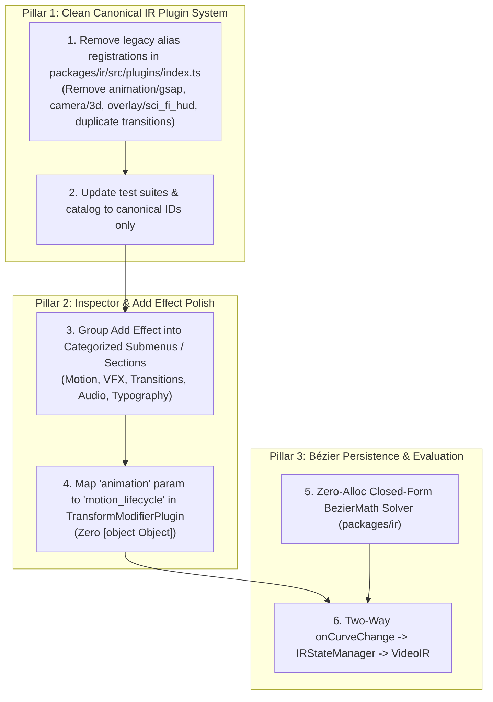

# Master Integration Plan - Iteration 28: Canonical IR Plugin Registry Refactor, Studio Inspector UX Polish & Custom Bézier Easing Suite

## Goal Description
This iteration refactors the core VideoIR plugin registry to be clean, canonical, and zero-legacy (eliminating redundant alias plugins such as `animation/gsap`, duplicate transition registrations, `overlay/sci_fi_hud`, and `camera/3d`), groups and categorizes the "Add Effect" dropdown in `@acc/studio`, eliminates the broken `[object Object]` input in the Sequence Inspector by mapping `animation` to `motion_lifecycle`, and implements closed-form custom Bézier easing persistence.

### Core Problems Addressed
1. **Duplicate / Redundant Plugin Registrations in Core IR Registry**:
   - `packages/ir/src/plugins/index.ts` currently registers both canonical types and legacy aliases:
     - `motion/gsap` AND `animation/gsap`
     - `overlay/hologram_hud` AND `overlay/sci_fi_hud`
     - `vfx/camera_3d` AND `camera/3d`
     - `editorial/transition_crossfade`, `editorial/transition`, `transition`, and individual transition types registered multiple times.
   - Per explicit architecture directive: as there is no first production release yet, we do **not** keep backward-compatibility aliases. The IR plugin system must have a single canonical type per modifier, clean wiring, and zero duplicate registrations.
2. **Unwieldy "Add Effect" Dropdown List in `RightSidebar.tsx`**:
   - The dropdown renders 15+ flat menu items in a single tall column without visual hierarchy or categorization.
   - It needs categorized submenus or grouped visual sections (*Motion & Spatial*, *Visual Effects (VFX)*, *Transitions*, *Audio & SFX*, *Typography & Shapes*) with search/filter capabilities.
3. **`[object Object]` Rendered in "In-canvas Transform" Inspector**:
   - In `TransformModifierPlugin.ts`, the schema defines scalar fields (`x`, `y`, `scale`, `rotation`, `opacity`), but sequence transforms frequently carry an `animation` object (`{ preset, intro, steady, outro }`).
   - In `DynamicModifierInspector.tsx`, `extraRuntimeEntries` detects `animation` and passes it to `inferFieldDescriptor()`, which falls back to `type: "string"` with `defaultValue: String(val)` $\rightarrow$ rendering `"[object Object]"` in a text input.
   - It must instead be formally integrated into `TransformModifierPlugin.ts` schema and recognized as `type: "motion_lifecycle"`, rendered with the interactive `MotionLifecycleControlStrategy` (preset selector, duration sliders, easing curves).
4. **Custom Cubic Bézier Persistence in VideoIR**:
   - Dragging $P_1$ and $P_2$ in `TransitionCurveGraph.tsx` must write `cubic-bezier(x1, y1, x2, y2)` to the active modifier and persist across undo/redo.
   - `DeterministicMotionEvaluator.ts` must parse and evaluate arbitrary `cubic-bezier(...)` strings in closed form without DOM dependencies.

---

## User Review Required
> [!IMPORTANT]
> - **Clean Canonical IR Registry (No Legacy Aliases)**:
>   - `animation/gsap` is removed completely; only `motion/gsap` remains.
>   - `overlay/sci_fi_hud` is removed; only `overlay/hologram_hud` remains.
>   - `camera/3d` is removed; only `vfx/camera_3d` remains.
>   - Duplicate transition registrations in `packages/ir/src/plugins/index.ts` (`editorial/transition_crossfade`, `editorial/transition`, `transition`) are streamlined to the canonical `transition/*` types.
>   - All tests, schemas, and catalog references are updated to reference canonical IDs only.
> - **In-Canvas Transform Animation**: The `animation` field in `TransformModifierPlugin` will map to `motion_lifecycle`, replacing the broken `[object Object]` input with the visual motion preset switcher (Pop In, Slide In, Bounce, etc.) and timing controls.

---

## 1. Architectural Analysis & Component Breakdown



---

## 2. Target Deliverables & Sequential Tasks

### Pillar 1: Canonical IR Plugin Registry Refactor (Zero Legacy Aliases)
#### Task 313: Clean Plugin Registrations in `packages/ir/src/plugins/index.ts`
- Remove all duplicate and legacy alias registrations:
  - Remove `new GSAPMotionPlugin('animation/gsap')` (only `motion/gsap` remains).
  - Remove alias `overlay/sci_fi_hud` (only `overlay/hologram_hud` remains).
  - Remove alias `camera/3d` (only `vfx/camera_3d` remains).
  - Clean up duplicate transition aliases (`editorial/transition_crossfade`, `editorial/transition`, generic `transition` catch-all) to ensure transitions use unambiguous, canonical `transition/*` identifiers.
- Update `packages/ir/src/index.ts` and exports if any alias was re-exported.
- Update `autogenerated-tests/studio_inspector_plugin_parity.test.ts` to assert canonical `motion/gsap` instead of `animation/gsap`.
- In `apps/studio/src/components/inspector/modifierCatalog.ts`, prune legacy alias lookup branches in `getSectionIdForModifierType` and `getModifierPresentation`.

### Pillar 2: Dynamic & Categorized "Add Effect" Dropdown & Transform Inspector Fix
#### Task 314: Dynamic Categorized "Add Effect" Dropdown in `RightSidebar.tsx`
- Refactor the Add Effect menu in `apps/studio/src/components/RightSidebar.tsx`:
  - **Dynamic Registry-Driven Resolution**:
    - The dropdown items must strictly be derived at runtime from `ModifierPluginRegistry.getInstance().listPlugins()` via `getAvailableModifiersFromRegistry()`.
    - If a new plugin is registered dynamically (or custom plugins are loaded), it must automatically appear in the "Add Effect" menu under its designated category (or fallback to an "Other / Custom" group) with appropriate icons and default parameters inferred from `plugin.schema` or presentation catalog.
    - Track filtering remains reactive: filter modifiers by `selectedTrack?.type` (`video`, `audio`, `timed_text`, `data`).
  - **Categorized Submenus & Visual Structure**:
    - Organize effects into logical categories using `DropdownMenuSub`, `DropdownMenuSubTrigger`, and `DropdownMenuSubContent`:
      - **Motion & Spatial**: In-Canvas Transform, GSAP Motions & Easings
      - **Visual Effects (VFX)**: Depth Relighting, 3D Camera, Color Grading, Particle VFX & Shaders, Hologram HUD
      - **Transitions**: Crossfade, Directional Wipe, Push, Zoom In/Out, Glitch
      - **Audio & SFX**: Volume & Gain, Stereo Pan, Parametric EQ, Pitch Shift, Dynamic Ducking, Procedural SFX
      - **Typography & Graphics**: Text & Karaoke, Vector Shapes
      - **Custom & Extensions**: Dynamically registered plugins not covered in the base catalog.
    - Provide category icons, badges, and search filtering across all categories.

#### Task 315: Native `motion_lifecycle` Schema for `TransformModifierPlugin`
- In `TransformModifierPlugin.ts`:
  - Add `animation` to `schema.fields` typed as `motion_lifecycle` with default schema: `{ preset: 'none', intro: { duration: 0.5, ease: 'ease-out' }, outro: { duration: 0.5, ease: 'ease-in' } }`.
- In `DynamicModifierInspector.tsx`:
  - In `inferFieldDescriptor()`, ensure any object with `{ preset }` or matching lifecycle signature maps cleanly to `type: 'motion_lifecycle'`.
  - Provide safe defensive rendering for nested object fields so `"[object Object]"` is never rendered in an input element.

### Pillar 3: Custom Bézier Easing Persistence & Closed-Form Evaluation
#### Task 316: Closed-Form `BezierMath` Solver in `packages/ir`
- Create `packages/ir/src/renderer/preview/BezierMath.ts`:
  - `parseCubicBezier(spec: string): [number, number, number, number] | null`
  - `solveCubicBezier(x1: number, y1: number, x2: number, y2: number, t: number): number`
  - High-precision Newton-Raphson root solver ($f(t) - x = 0$) with bisection fallback ($< 8$ iterations, zero nursery allocations).
- Update `evaluateEase` in `DeterministicMotionEvaluator.ts` to detect `cubic-bezier(...)` strings and evaluate via `solveCubicBezier`.

#### Task 317: Two-Way Curve Wiring in Studio
- Update `TransitionCurveGraph.tsx`'s `onCurveChange` to format as `cubic-bezier(x1, y1, x2, y2)` with fixed 2-decimal precision.
- Wire `onCurveChange` through `EasingCurveSelector.tsx` into `ModifierControlStrategies.tsx` and commit to `IRStateManager.getInstance().updateModifier(seqId, type, nextParams)`.
- Add a "Custom" badge in `EasingCurveSelector.tsx` when the active ease is a custom cubic Bézier.

### Pillar 4: Automated Testing & Verification
#### Task 318: Regression Tests & CI Verification
- Author `autogenerated-tests/studio_canonical_ir_plugins_and_add_effect.test.ts`:
  - Verifies zero duplicate or alias plugin types registered in `registerCoreModifierPlugins`.
  - Verifies `motion/gsap` exists and `animation/gsap` is absent.
  - Verifies categorized Add Effect menu structure.
  - Verifies `transform` with `animation` parameter renders `motion_lifecycle` controls and zero `"[object Object]"` strings.
- Author `autogenerated-tests/deterministic_bezier_evaluator.test.ts`:
  - Verifies `solveCubicBezier` against standard CSS curve values (`linear`, `ease-in`, `ease-out`, `ease-in-out`).
- Document in `docs/history/309_canonical_ir_plugins_and_inspector_polish.md`.

---

## 3. Verification Plan

### Automated Tests
```bash
# 1. Verify clean canonical IR plugin registry & Add Effect categorization
bun test autogenerated-tests/studio_canonical_ir_plugins_and_add_effect.test.ts

# 2. Verify deterministic cubic bezier evaluator
bun test autogenerated-tests/deterministic_bezier_evaluator.test.ts

# 3. Verify all studio tests pass
bun test autogenerated-tests/studio_*.test.ts

# 4. Verify clean production build
bun run build
bun run --cwd apps/studio build
```

### Manual Verification
1. Launch `bun --cwd apps/studio dev`.
2. Click "Add Effect" in Right Sidebar: verify categorized submenus (*Motion*, *VFX*, *Transitions*, *Audio*, *Typography*) with single "GSAP Motion & Easings" and no duplicate "Gsap".
3. Select sequence with In-Canvas Transform: verify "Animation" renders the interactive Motion Lifecycle preset picker instead of `[object Object]`.
4. Open Transition Curve Graph: drag $P_1$ or $P_2$, verify curve updates to `cubic-bezier(...)` with "Custom" badge and persists in sequence VideoIR.
