# Master Integration Plan - Iteration 29: Client-Side Audio-Video WebCodecs Muxing, Keyframe Animation Engine, Universal Canvas Hit-Testing & Timeline Sequence Hover Insight HUD

## Goal Description
Iteration 29 closes four major production-grade features across Studio UI, Core IR, and Media Engine:
1. **Pillar 1: Full Client-Side Audio-Video WebCodecs Muxing**:
   - Currently, `apps/studio` exports video-only MP4s using `MediabunnyClientSink`. While `UniversalAudioMixer` produces master Float32 stereo PCM and `WebAudioEngine` plays preview audio, exported MP4s have zero audio tracks.
   - Upgrade `MediabunnyClientSink` using Mediabunny's `AudioBufferSource` / `AudioSampleSource` (AAC `mp4a.40.2` at 48kHz stereo, 192kbps).
   - Wire `UniversalAudioMixer.mix()` into `App.tsx` during client export, producing fully muxed AV MP4 files directly in the browser with dual-phase progress telemetry (video frames $\rightarrow$ audio muxing).
2. **Pillar 2: Keyframe Animation Engine & Inspector Controls**:
   - `TemporalCurve<number>` in `packages/ir/src/types/modifiers.ts` supports keyframe arrays (`keyframes: Array<{ timeSec: number; value: T; ease?: string }>`), but Studio lacks keyframe authoring controls and `IRPreviewEngine` does not interpolate them.
   - Build `TemporalKeyframeEvaluator.ts` in `packages/ir` powered by the closed-form `BezierMath` solver, supporting linear, step, and custom cubic Béziers.
   - Build an interactive `KeyframeDiamondButton` in `DynamicModifierInspector.tsx` that allows creators to insert, jump between, and delete keyframes at the active playhead frame.
3. **Pillar 3: Universal Canvas Hit-Testing & Interactive Selection System**:
   - Rather than ad-hoc, hardcoded overlays (like `VectorShapeOverlay` or the dead `SubtitlesOverlay`), build a **Universal Canvas Hit-Testing Engine** (`CanvasHitTester.ts`) and a unified **`UniversalCanvasHitOverlay.tsx`**.
   - Supports polymorphic hit-region calculation across **all sequence types**:
     - **Video / Image / Media Clips**: Bounded by transform dimensions (`x`, `y`, `scale`, `width`, `height`).
     - **Subtitles & Captions (`text/style` / TimedText)**: Bounded by text safe zones, font size, phrase width, and `marginV`.
     - **Vector Shapes (`shape/vector`, `shape/draw`)**: Bounded by shape parameters (rect, circle, box).
     - **Procedural Overlays & Motion**: Bounded by effect boundaries or viewport anchor.
   - Provides a cohesive UX:
     - **Hover**: Subtle animated dashed bounds (`border-dashed border-accent-theme/60 bg-accent-theme/5 cursor-pointer`) and sequence type badge.
     - **Click**: Dispatches `IRStateManager.setSelectedSequenceId(seq.id)` and immediately opens/focuses the **Sequence Inspector**.
     - **Double-Click**: Deep-opens the relevant modal (e.g. `CueTimelineDialog` for subtitles, inline editor, or asset picker).
   - Replaces and eliminates hardcoded overlays (`VectorShapeOverlay.tsx` and dead `SubtitlesOverlay.tsx`).
4. **Pillar 4: Timeline Sequence Insight & Rich Hover HUD**:
   - Replace primitive, delayed browser `title` tooltips on timeline clips with an instant, interactive **Liquid Glass Clip Hover HUD** (`TimelineClipHoverHUD.tsx`).
   - Displays:
     - **Header**: Semantic Archetype Icon (`Film`, `Music`, `Type`, `Sparkles`), Sequence ID, Track Name/Type, and SMPTE Timecode (`HH:MM:SS:FF`) + total frames.
     - **Boundary Metrics**: Exact In-point, Out-point, and global timeline offset.
     - **Active Modifiers Summary Pill Row**: Badges for every active modifier attached to the clip (e.g. `[🎨 Color]`, `[⚡ Crossfade]`, `[📐 Transform]`, `[🔊 -3dB]`, `[🌀 Blur]`).
     - **Dialogue / Caption Preview**: If the clip contains subtitles or dialogue cues, displays the formatted text snippet.
     - **Asset Metadata**: If backed by a media asset, shows original dimensions (e.g. `1920x1080 30fps H.264`).
   - Illuminates subtle In/Out tick guides on the timeline ruler when hovering over a clip.

---

## User Review Required

> [!IMPORTANT]
> - **WebCodecs Audio Encoding Codec**: We use AAC (`mp4a.40.2`) as the canonical audio codec for MP4 export. WebCodecs `AudioEncoder` in modern Chromium, Safari, and Firefox supports AAC out-of-the-box.
> - **Universal Polymorphic Hit-Testing**: Hit-testing runs in the Studio Preview viewport using normalized coordinates `[0..1]`. Sequences are evaluated top-to-bottom according to track stacking order (higher tracks take hit precedence over lower tracks).
> - **Elimination of Orphaned Code**: `SubtitlesOverlay.tsx` and `VectorShapeOverlay.tsx` will be completely replaced by the generic `UniversalCanvasHitOverlay.tsx`, adhering to `NO-STUBS-ORPHANED-CODE`.
> - **Zero Jitter Timeline Hover UX**: The `TimelineClipHoverHUD` must use a debounce threshold (120ms) and smart viewport clamping to prevent cursor flickering and clipping at timeline edges.

---

## 1. Architectural Overview & Workflow Matrix

```mermaid
flowchart TD
    subgraph Pillar1["Pillar 1: Complete AV WebCodecs Muxing"]
        IRDoc["VideoIRDocument"] --> UniversalMixer["UniversalAudioMixer.mix()"]
        UniversalMixer --> Float32Stereo["Float32 Stereo PCM (Left + Right)"]
        Float32Stereo --> AudioBuffer["AudioBuffer / AudioData (48kHz, 2ch)"]
        AudioBuffer --> MediabunnySink["MediabunnyClientSink.finalize(audioResult)"]
        VideoFrames["Canvas 2D RGBA Frames"] --> MediabunnySink
        MediabunnySink --> MP4Muxer["Mediabunny Mp4OutputFormat\n(avc1 + mp4a.40.2)"]
        MP4Muxer --> DownloadBlob["Synchronized MP4 File Download"]
    end

    subgraph Pillar2["Pillar 2: Keyframe Engine & Inspector"]
        InspectorUI["DynamicModifierInspector.tsx\nKeyframe Button (◆)"] -->|Add/Remove Keyframe at Current Frame| IRStateKF["IRStateManager (Command Pattern)"]
        IRStateKF --> TemporalCurve["TemporalCurve<T>.keyframes"]
        TemporalCurve --> KeyframeEvaluator["TemporalKeyframeEvaluator.ts\n(BezierMath & Piecewise Easing)"]
        KeyframeEvaluator --> IRPreviewEngine["IRPreviewEngine.renderFrame(f)"]
    end

    subgraph Pillar3["Pillar 3: Universal Canvas Hit-Testing"]
        ActiveSeqs["All Active Sequences at currentFrame"] --> HitTester["CanvasHitTester.ts\n(Polymorphic Bounding Box Resolver)"]
        HitTester -->|Subtitles, Shapes, Media, Overlays| HitOverlay["UniversalCanvasHitOverlay.tsx"]
        HitOverlay -->|Hover| HoverHUD["Dashed Highlight + Type Badge"]
        HitOverlay -->|Click| SelectSeq["IRStateManager.setSelectedSequenceId(seq.id)\n(Focuses Sequence Inspector)"]
        HitOverlay -->|Double Click Subtitle| CueModal["CueTimelineDialog / Inline Text Editor"]
    end

    subgraph Pillar4["Pillar 4: Timeline Sequence Insight HUD"]
        HoverClip["TimelineClipItem onMouseEnter"] --> HoverHUDComp["TimelineClipHoverHUD.tsx\n(Liquid Glass Card)"]
        HoverHUDComp --> SMPTEMetrics["SMPTE Timecodes (In/Out/Duration)"]
        HoverHUDComp --> ModifiersList["Modifier Badges (Transform, Color, Audio, Transitions)"]
        HoverHUDComp --> CueText["Dialogue Cue Text Preview"]
        HoverClip --> SeamRuler["TimelineOverlayHUD In/Out Ruler Guides"]
    end
```



---

## 2. Detailed Technical Specifications & Proposed Changes

### Component Area 1: Client Media Muxing (`@acc/core` & `@acc/studio`)

#### [MODIFY] [`packages/core/src/media-engine/types.ts`](file:///Users/anle/workspace/acc/packages/core/src/media-engine/types.ts)
- Extend `MediaAudioMixResult` to guarantee typed Float32 PCM channels:
```typescript
export interface MediaAudioMixResult {
  readonly sampleRate: number;
  readonly numberOfChannels: number;
  readonly pcmLeft?: Float32Array;
  readonly pcmRight?: Float32Array;
  readonly interleavedPcm?: Float32Array;
  readonly durationSec?: number;
}
```

#### [MODIFY] [`packages/core/src/media-engine/sinks/MediabunnyClientSink.ts`](file:///Users/anle/workspace/acc/packages/core/src/media-engine/sinks/MediabunnyClientSink.ts)
- Import `AudioBufferSource` or `AudioSampleSource` and `AudioSample` from `mediabunny`.
- In `initialize()`:
  - Configure audio parameters (AAC `mp4a.40.2`, 48,000 Hz, 2 channels, 192,000 bps).
  - Prepare `audioSource` and register it on `Output` via `this.output.addAudioTrack(this.audioSource)`.
- In `finalize(audioResult?: MediaAudioMixResult)`:
  - If `audioResult` has PCM data (`pcmLeft`, `pcmRight`), synthesize standard `AudioBuffer` or `AudioSample` chunks in 2048-sample blocks.
  - Pipe each audio chunk into `this.audioSource.add()`.
  - Await `this.audioSource` flush before finalizing `this.output`.

#### [MODIFY] [`apps/studio/src/App.tsx`](file:///Users/anle/workspace/acc/apps/studio/src/App.tsx)
- In `handleStartExport()`:
  - Generate full timeline master audio using `UniversalAudioMixer.mix(irState.doc)` or `WebAudioEngine` master stream.
  - Pass the mixed PCM stereo result to `sink.finalize(audioResult)`.
  - Split progress bar: 0–85% for frame rasterization, 85–100% for audio encoding and MP4 muxing.

---

### Component Area 2: Keyframe Animation Engine & Inspector (`@acc/ir` & `@acc/studio`)

#### [NEW] [`packages/ir/src/renderer/preview/TemporalKeyframeEvaluator.ts`](file:///Users/anle/workspace/acc/packages/ir/src/renderer/preview/TemporalKeyframeEvaluator.ts)
- Pure, zero-alloc evaluator for `TemporalCurve<number>`:
  - Accepts `keyframes: Array<{ timeSec: number; value: number; ease?: string }>` and `timeSec: number`.
  - If before first keyframe $\rightarrow$ returns first keyframe value.
  - If after last keyframe $\rightarrow$ returns last keyframe value.
  - If between keyframes $k_i$ and $k_{i+1}$:
    $$t_{\text{norm}} = \frac{t - t_i}{t_{i+1} - t_i}$$
    $$t_{\text{eased}} = \text{solveCubicBezier}(t_{\text{norm}}, \text{ease})$$
    $$\text{value} = v_i + (v_{i+1} - v_i) \times t_{\text{eased}}$$
- Unit tested for boundary conditions, linear, and cubic Béziers.

#### [MODIFY] [`packages/ir/src/renderer/preview/IRPreviewEngine.ts`](file:///Users/anle/workspace/acc/packages/ir/src/renderer/preview/IRPreviewEngine.ts)
- Integrate `TemporalKeyframeEvaluator` when evaluating sequence transforms and camera motions at `frame / fps`.

#### [NEW] [`apps/studio/src/components/inspector/KeyframeDiamondButton.tsx`](file:///Users/anle/workspace/acc/apps/studio/src/components/inspector/KeyframeDiamondButton.tsx)
- Compact, accessible diamond button (`◆`):
  - Active/Filled (`text-accent-theme`): A keyframe exists at the exact current frame.
  - Inactive/Outline (`text-muted-foreground/50`): No keyframe at current frame.
  - Click action: Dispatches `ToggleKeyframeCommand` through `IRStateManager`.

#### [MODIFY] [`apps/studio/src/components/inspector/DynamicModifierInspector.tsx`](file:///Users/anle/workspace/acc/apps/studio/src/components/inspector/DynamicModifierInspector.tsx)
- For numerical fields in `TransformModifierPlugin` (`x`, `y`, `scale`, `rotation`, `opacity`):
  - Render `KeyframeDiamondButton` alongside numerical sliders.
  - Support switching between static scalar value and keyframed curve.

---

### Component Area 3: Universal Canvas Hit-Testing & Interactive Selection (`@acc/studio`)

#### [NEW] [`apps/studio/src/lib/hit-test/CanvasHitTester.ts`](file:///Users/anle/workspace/acc/apps/studio/src/lib/hit-test/CanvasHitTester.ts)
- Strategy-based bounds calculator:
  - **Subtitle / Caption Sequences**:
    - Calculates horizontal width from active cue text length and font scale.
    - Positions box at bottom safe zone ($y \approx 1.0 - \text{marginV} / 1080$), height $\approx 48\text{px} / 1080$.
  - **Vector Shapes**:
    - Queries `shape/vector` or `shape/draw` dimensions (`width`, `height`, `radius`) normalized against 1920x1080.
  - **Media Sequences**:
    - Queries interpolated transform (`normX`, `normY`, `scale`, `x`, `y`).
- Returns standardized `SequenceHitRegion`:
  ```typescript
  export interface SequenceHitRegion {
    readonly sequenceId: string;
    readonly sequenceType: 'video' | 'image' | 'text' | 'shape' | 'audio' | 'overlay';
    readonly trackIndex: number;
    readonly normX: number; // center 0..1
    readonly normY: number; // center 0..1
    readonly normWidth: number; // 0..1
    readonly normHeight: number; // 0..1
    readonly label: string;
  }
  ```

#### [NEW] [`apps/studio/src/components/preview/UniversalCanvasHitOverlay.tsx`](file:///Users/anle/workspace/acc/apps/studio/src/components/preview/UniversalCanvasHitOverlay.tsx)
- Replaces `VectorShapeOverlay.tsx` and `SubtitlesOverlay.tsx`.
- Renders lightweight, invisible hit targets for all unselected active sequences.
- On hover: reveals subtle dashed bounding box with a small chip badge (e.g. `[Caption]`, `[Shape: Box]`, `[Video 1]`).
- On click: calls `IRStateManager.getInstance().setSelectedSequenceId(hit.sequenceId)` and sets inspector mode to `sequence`.
- On double-click on a subtitle: triggers `onStartEditingCue`.

#### [MODIFY] [`apps/studio/src/components/Preview.tsx`](file:///Users/anle/workspace/acc/apps/studio/src/components/Preview.tsx)
- Replace `<VectorShapeOverlay />` and commented `<SubtitlesOverlay />` with `<UniversalCanvasHitOverlay />`.
- Connect active sequences and forward double-click editing.

#### [DELETE] [`apps/studio/src/components/preview/VectorShapeOverlay.tsx`](file:///Users/anle/workspace/acc/apps/studio/src/components/preview/VectorShapeOverlay.tsx)
- Deleted; functionality absorbed into `UniversalCanvasHitOverlay.tsx`.

#### [DELETE] [`apps/studio/src/components/preview/SubtitlesOverlay.tsx`](file:///Users/anle/workspace/acc/apps/studio/src/components/preview/SubtitlesOverlay.tsx)
- Deleted; dead code removed cleanly.

---

### Component Area 4: Timeline Sequence Insight & Rich Hover HUD (`@acc/studio`)

#### [NEW] [`apps/studio/src/components/timeline/TimelineClipHoverHUD.tsx`](file:///Users/anle/workspace/acc/apps/studio/src/components/timeline/TimelineClipHoverHUD.tsx)
- Liquid glass popover card displayed above/below clip on hover:
  - Formatted SMPTE timecodes using `RationalTime.toSMPTE(fps)`.
  - In/Out points: `In: 00:00:01:10 (40f) -> Out: 00:00:04:15 (135f)`.
  - Sequence archetype badge + ID.
  - Active modifiers tags (`Transform`, `Color Grading`, `Transitions`, `Volume`).
  - Cue snippet with quotation formatting.
  - Asset resolution & aspect ratio if media-backed.

#### [MODIFY] [`apps/studio/src/components/timeline/TimelineClipItem.tsx`](file:///Users/anle/workspace/acc/apps/studio/src/components/timeline/TimelineClipItem.tsx)
- Remove browser-native `title` attribute.
- Add `onMouseEnter` / `onMouseLeave` handlers wired to timeline hover state.
- Dispatch hovered clip coordinates and sequence details to `TimelineOverlayHUD`.

#### [MODIFY] [`apps/studio/src/components/timeline/TimelineOverlayHUD.tsx`](file:///Users/anle/workspace/acc/apps/studio/src/components/timeline/TimelineOverlayHUD.tsx)
- Render `TimelineClipHoverHUD` anchored to hovered clip with smart edge-clamping.
- Render In/Out boundary tick guidelines on the ruler during clip hover.

---

## 3. Verification Plan

### Automated Tests
1. **Audio WebCodecs Client Sink Parity**:
   - Test: `autogenerated-tests/mediabunny_audio_client_sink.test.ts`
   - Assert `MediabunnyClientSink` initializes with audio track, consumes Float32 PCM channels, and produces valid MP4 bytes.
2. **Deterministic Keyframe Evaluator Parity**:
   - Test: `autogenerated-tests/temporal_keyframe_evaluator.test.ts`
   - Assert piecewise interpolation, clamping, and Bézier curves.
3. **Universal Canvas Hit-Testing Parity**:
   - Test: `autogenerated-tests/universal_canvas_hit_tester.test.ts`
   - Assert accurate hit-region resolution across subtitles, vector shapes, and media clips.
4. **Timeline Sequence Hover HUD Model**:
   - Test: `autogenerated-tests/timeline_hover_hud.test.ts`
   - Assert formatting of SMPTE timecode boundaries, modifier summaries, and cue snippet extraction.
5. **Full Suite Regression Test**:
   ```bash
   bun test autogenerated-tests/multi_track_layer_blending_isolation.test.ts autogenerated-tests/studio_canonical_ir_plugins_and_add_effect.test.ts autogenerated-tests/deterministic_bezier_evaluator.test.ts
   ```

### Compiler & Workspace Verification
- `bun run build` across all 12 packages.
- Zero TypeScript diagnostics (`tsc --noEmit`).

### Manual Studio Verification
1. Run Studio dev server: `bun --filter @acc/studio dev`.
2. **Timeline Clip Hover**: Hover over any sequence on the timeline $\rightarrow$ observe instant Liquid Glass HUD showing SMPTE in/out points, active modifiers badges, and cue text.
3. **Universal Canvas Click**: Hover over subtitle text, vector shape, or media in canvas $\rightarrow$ click $\rightarrow$ verify Sequence Inspector activates immediately with corresponding sequence.
4. **Keyframing**: Add keyframe on scale or position $\rightarrow$ scrub playhead $\rightarrow$ see smooth transformation in viewport.
5. **Video Export**: Export MP4 $\rightarrow$ verify video plays with clear, synchronized audio.
