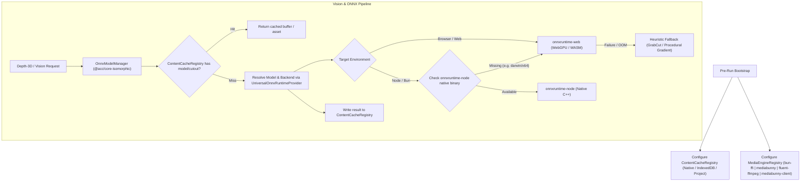

# Master Integration Plan - Iteration 32
# Configurable Target Runtime (MediaEngine, OnnxModelManager & Universal Cross-Platform ONNX Runtime)

## 1. Executive Summary & Design Alignment
Based on the architectural alignment:
1. **Configurable MediaEngine**:
   - The active MediaEngine is determined prior to runtime execution based on settings (`settings.mediaEngine` / `settings.engine`) or CLI flags (`--engine <name>`).
   - If omitted, auto-detect platform defaults:
     - **Web**: Defaults to `MediabunnyClientStrategy` (WebCodecs & Canvas).
     - **Node / Bun**: Defaults to `BunFFIEngineStrategy` (`bun-ffi`).
   - Eliminates all hardcoded `'bun-ffi'` calls in `@acc/effect-engines`, `apps/legacy-story-renderer`, and `packages/core`.
2. **OnnxModelManager in `@acc/core-isomorphic`**:
   - Centralizes ONNX model registry, downloading, and buffer caching using `ContentCacheRegistry`.
   - Node / Bun: Resolves models from disk cache (`NativeFileCacheStrategy` / project cache) or downloads to cache.
   - Web: Resolves models from asset URLs or IndexedDB via `ContentCacheRegistry`.
3. **Universal ONNX Fallback Hierarchy**:
   - Node/Bun: Try native `onnxruntime-node` -> if missing on the host architecture (e.g. `darwin/x64`) or fails to load, gracefully fall back to `onnxruntime-web` (WASM / WebGPU) -> if WASM fails, fall back to procedural heuristics (GrabCut / depth gradient).
   - Web: Uses `onnxruntime-web` (WebGPU / WASM).
4. **Universal ContentCacheRegistry Integration**:
   - The strategy implementation for `ContentCacheRegistry` is decided pre-run:
     - Pre-run bootstraps register the appropriate cache strategy (`NativeFileCacheStrategy`, project folder cache, or `IndexedDbCacheStrategy`).
     - Vision engines and Depth-3D interact exclusively with `ContentCacheRegistry` regardless of runtime environment, maintaining clean isomorphism.

---

## 2. Architecture & Component Interaction

---

## 3. Work Breakdown & Detailed Tasks

### Phase 1: Configurable MediaEngine Pipeline
- **`packages/effect-engines/src/depth3d/index.ts`**:
  - Accept `engine?: string` in `Depth3DSceneOptions`.
  - Resolve strategy via `MediaEngineRegistry.get(engineName)` without hardcoded strings.
- **`apps/legacy-story-renderer/src/cli.ts` & `LegacyDiskStoryRenderer.ts`**:
  - Add `-e, --engine <name>` argument.
  - Automatically detect platform default if no engine specified.
  - Register all available engines (`bun-ffi`, `mediabunny`, `fluent-ffmpeg`) during bootstrap.
- **`packages/core/src/SceneWorker.ts`**:
  - Register all engines inside worker threads and forward `task.data.engine`.

### Phase 2: `OnnxModelManager` in `@acc/core-isomorphic`
- Create `packages/core-isomorphic/src/vision/OnnxModelManager.ts`:
  - Pure isomorphic model registry and storage manager.
  - Integrates with `ContentCacheRegistry` to store model buffers, pre-computed masks, and depth maps.
  - Exposes `getModel(modelId, options)` and `resolveModelBuffer(source)`.
  - On Web: loads model assets from URL/CDN into `ContentCacheRegistry`.
  - On Node/Bun: loads model assets from local storage or downloads into `ContentCacheRegistry`.

### Phase 3: Universal Cross-Platform ONNX Runtime Provider
- Create `packages/effect-engines/src/vision/UniversalOnnxRuntimeProvider.ts`:
  - Host platform & architecture detector.
  - Native binary validator (verifies whether `onnxruntime-node` native binding exists).
  - WebAssembly fallback hook: loads and injects `onnxruntime-web` onto `globalThis[Symbol.for('onnxruntime')]` and `@huggingface/transformers.env.backends.onnx` when native binding is missing.
- Refactor `SubjectSegmentationContext.ts` & `DepthEstimationContext.ts`:
  - Hook into `UniversalOnnxRuntimeProvider` before executing model pipelines.
  - Guarantee zero-crash fallback to `GrabCutFallbackStrategy` and `HeuristicDepthStrategy`.

### Phase 4: Verification, Parity & Monorepo Hardening
- Create `autogenerated-tests/configurable_media_engine_and_onnx.test.ts`:
  - Test engine resolution with explicit flags and automatic platform defaults.
  - Test `OnnxModelManager` cache retrieval and storage via `ContentCacheRegistry`.
  - Test `UniversalOnnxRuntimeProvider` fallback on `darwin/x64` without throwing uncaught native errors.
- Run test suites:
  - `bun test autogenerated-tests/effect_engines_isomorphic.test.ts`
  - `bun test autogenerated-tests/platform_native_parity.test.ts`
  - `bun test autogenerated-tests/video_ir_phase1_phase2.test.ts`
- Commit history record and update `docs/history/README.md`.
