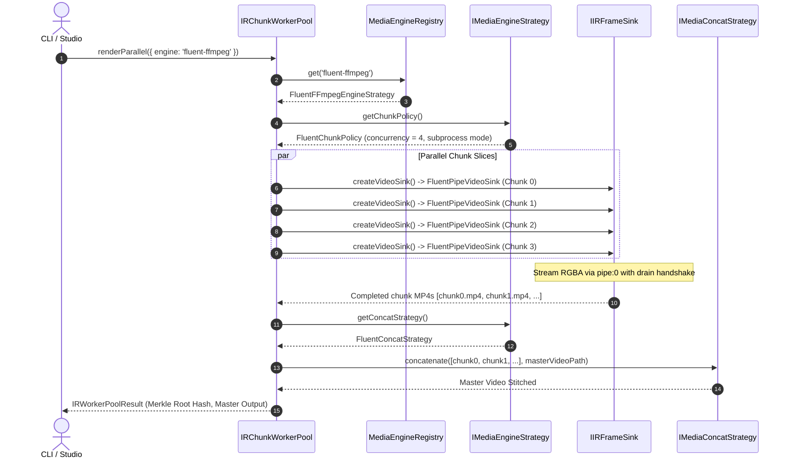

# Master Integration Plan (Iteration 4): Media Backend Strategy Pattern (`bun:ffi` vs `fluent-ffmpeg` vs `mediabunny-server` vs `mediabunny-client`)

## 1. Executive Summary & Strategic Objectives

Following extensive architectural review and alignment sessions, **Iteration 4** establishes an enterprise-grade, decoupled **Strategy Pattern** across the entire media processing stack (`@acc/core`, `@acc/ir`, `@acc/exporters`, `apps/cli`, and `apps/studio`). 

This architecture liberates the Visual Storytelling Generator from a rigid dependency on a single native C FFI runtime, providing an extensible matrix of four specialized backend strategies designed for specific execution environments:

```
                               ┌────────────────────────────────────────────────────────┐
                               │                 MediaEngineRegistry                    │
                               │   Strict & Explicit Prerequisite Validation (Fail-Fast)│
                               │   Lazy-Loaded Engine Drivers, Video-IR-Driven Config   │
                               └───────────┬───────────────────┬────────────────────┬───┘
                                           │                   │                    │
                  ┌────────────────────────┴────────┐          │                    │
                  ▼                                 ▼          ▼                    ▼
       ┌──────────────────────┐         ┌──────────────────────┐  ┌──────────────────────┐  ┌──────────────────────┐
       │     bun:ffi          │         │    fluent-ffmpeg     │  │  mediabunny-server   │  │  mediabunny-client   │
       │ Native Shared C Libs │         │ Bun.spawn CLI Pipe   │  │ Pure TS / Node / Bun │  │ Browser WebCodecs    │
       │ Zero-Copy Frame Ptrs │         │ 100% Filtergraphs    │  │ Box Demux/Remuxing   │  │ Zero-Binary Studio   │
       │ Extreme FPS (Default)│         │ Process Crash Safety │  │ Worker Thread Concat │  │ Offline Client Export│
       └──────────────────────┘         └──────────────────────┘  └──────────────────────┘  └──────────────────────┘
```

### Strategic Phasing Roadmap:
- **Phase 1: High-Performance Server/CLI Dual Engine (`bun:ffi` & `fluent-ffmpeg`)**
  - Scaffold core strategy contracts (`IMediaEngineStrategy`, `IChunkExecutionPolicy`, `MediaEngineRegistry`).
  - Implement `BunFFIEngineStrategy` adapting existing `ffmpeg-ffi/` modules.
  - Implement `FluentFFmpegEngineStrategy` utilizing native `Bun.spawn` with `pipe:0` stdin rawvideo streaming and async `drain` handshake.
  - Refactor `FFmpegCommand.run()` to delegate commands through the active strategy.
  - Adapt `IRChunkWorkerPool` to execute engine-specific chunk concurrency and stitching policies.
  - Update `VideoExporter` and `apps/cli` to support `--engine <type>`.
  - Comprehensive parity test suite validating duration, dimensions, frame counts, and container integrity.

- **Phase 2: Universal TypeScript & Browser WebCodecs Expansion (`mediabunny-server` & `mediabunny-client`)**
  - Implement `MediabunnyServerStrategy` leveraging `@mediabunny/server` for zero-native-binary execution in serverless/container environments.
  - Pure TypeScript atom box demuxing and lossless chunk concatenation (`stts`/`stsc`/`mdat` stitching) without spawning FFmpeg.
  - Implement `MediabunnyClientStrategy` in `apps/studio` using browser-native WebCodecs (`VideoEncoder`/`AudioEncoder`) and client-side in-memory muxing for instant zero-server export.
  - Dynamic Video-IR-driven codec and container configuration (MP4/H.264 vs WebM/VP9).

---

## 2. Comparative Matrix of the Four Media Strategies

| Feature / Dimension | `bun:ffi` | `fluent-ffmpeg` | `mediabunny-server` | `mediabunny-client` |
| :--- | :--- | :--- | :--- | :--- |
| **Execution Environment** | Bun Runtime (Server/Desktop) | Bun / Node.js (CLI / Server) | Bun / Node.js / Docker / Edge | Web Browser (`apps/studio` UI) |
| **Native Dependency** | Shared `.dll`/`.so` (FFmpeg Shared) | System `ffmpeg` binary (`~/.acc`) | **Zero native binaries** (Pure TS) | **Zero native binaries** (WebCodecs) |
| **Transport Mechanism** | Direct C pointer `ptr(buffer)` | `pipe:0` stdin via `Bun.spawn` | Memory buffers / Node streams | Direct WebCodecs `VideoFrame` |
| **Throughput (1080p)** | Ultra-High (150–300+ FPS) | High (80–140 FPS) | Moderate (40–90 FPS) | High (Hardware WebCodecs 60–120 FPS) |
| **Crash Profile** | Native segfault if pointer math fails | Subprocess exit code (isolated) | Standard TS/JS Exception | Browser DOM Exception (isolated) |
| **Complex Filters** | Manual C filtergraph construction | **100% full FFmpeg filtergraphs** | Format conversion & remuxing | Canvas 2D/WebGL shader rendering |
| **Parallel Chunk Model** | Multi-session FFI + C packet concat | Bounded subprocess pool + concat demuxer | Worker threads (`worker_threads`) + box concat | Dedicated Web Worker + memory blob mux |
| **Primary Role** | Default turbo production renderer | Robust CLI fallback & complex filters | Lightweight containers & CI/CD | Client-side preview & browser export |

---

## 3. Core Strategy Interfaces & Architecture

```typescript
// packages/core/src/media-engine/types.ts

export type MediaEngineType = 'bun-ffi' | 'fluent-ffmpeg' | 'mediabunny-server' | 'mediabunny-client';

export interface MediaEngineCapabilities {
  supportsZeroCopyFFI: boolean;
  supportsComplexFilters: boolean;
  supportsRawFrameStream: boolean;
  supportsBrowserRuntime: boolean;
  requiresNativeBinaries: boolean;
}

export interface MediaProbeResult {
  durationSeconds: number;
  width?: number;
  height?: number;
  fps?: number;
  codecVideo?: string;
  codecAudio?: string;
  bitrateKbps?: number;
  hasAudio: boolean;
  hasVideo: boolean;
}

export interface IChunkExecutionPolicy {
  getOptimalConcurrency(totalChunks: number, systemCores: number): number;
  supportsParallelExecution: boolean;
  executionMode: 'in-process' | 'subprocess' | 'worker-thread' | 'web-worker';
}

export interface IMediaProbeStrategy {
  probe(filePath: string): Promise<MediaProbeResult>;
}

export interface IMediaConcatStrategy {
  concatenate(inputPaths: string[], outputPath: string): Promise<void>;
}

export interface IAudioMuxerStrategy {
  muxAudioVideo(videoPath: string, audioPath: string, outputPath: string): Promise<void>;
}

export interface IMediaEngineStrategy {
  readonly id: MediaEngineType;
  readonly name: string;
  readonly capabilities: MediaEngineCapabilities;

  validatePrerequisites(): void; // Strict & Explicit fail-fast
  createVideoSink(options: SinkInitMetadata): IIRFrameSink;
  getProbeStrategy(): IMediaProbeStrategy;
  getConcatStrategy(): IMediaConcatStrategy;
  getAudioMuxerStrategy(): IAudioMuxerStrategy;
  getChunkPolicy(): IChunkExecutionPolicy;
  executeCommand?(args: string[]): Promise<void>;
}
```

---

## 4. Phase 1: High-Performance Server/CLI Dual Engine (`bun:ffi` & `fluent-ffmpeg`)

### 4.1. Detailed Proposed Changes

#### A. `@acc/core`
1. **[NEW] `packages/core/src/media-engine/types.ts`**:
   - Declares the core contracts (`IMediaEngineStrategy`, `IChunkExecutionPolicy`, `MediaProbeResult`, `MediaEngineCapabilities`).
2. **[NEW] `packages/core/src/media-engine/MediaEngineRegistry.ts`**:
   - Manages registered engines with `bun-ffi` as default.
   - Strictly enforces prerequisite checks via `strategy.validatePrerequisites()`.
   - Lazy-loads engine modules using dynamic `import()` to ensure zero cold-start overhead.
3. **[NEW] `packages/core/src/media-engine/strategies/BunFFIEngineStrategy.ts`**:
   - Encapsulates `packages/core/src/ffmpeg-ffi/` (`FFIVideoEncoder`, `FFIConcatMuxer`, `getMediaDurationFFI`, `FFAudioMuxer`).
   - Implements `FFIChunkPolicy`: Max concurrency $\min(\text{cores}, 8)$, in-process FFI sessions, zero-reencode packet copy concat.
4. **[NEW] `packages/core/src/media-engine/strategies/FluentFFmpegEngineStrategy.ts`**:
   - Uses `FFmpegManager.getFFmpegPath()` and `getFFprobePath()` to share downloaded binaries from `~/.acc`.
   - Utilizes native `Bun.spawn` (zero external npm dependencies) for high-speed stdin pipe streaming.
   - Reuses `GPUEncoderResolver` for hardware encoder auto-detection (`h264_nvenc`, `h264_qsv`, `h264_videotoolbox`, `h264_amf`) with graceful fallback to `libx264`.
   - Implements `FluentChunkPolicy`: Max concurrency $\min(\lfloor\text{cores}/2\rfloor, 4)$ using isolated child processes.
   - Concat strategy via FFmpeg `-f concat -safe 0 -i list.txt -c copy`.
5. **[MODIFY] `packages/core/src/FFmpegExecutor.ts`**:
   - Refactor `FFmpegCommand.run()` to delegate to `MediaEngineRegistry.get().executeCommand(this.buildArgs())`.
   - Preserves fluent API ergonomics (`.input()`, `.complexFilter()`, `.output()`) with full execution backing.

#### B. `@acc/ir`
1. **[NEW] `packages/ir/src/renderer/sink/FluentPipeVideoSink.ts`**:
   - Implements `IIRFrameSink`.
   - Spawns: `ffmpeg -y -f rawvideo -pix_fmt rgba -s ${w}x${h} -r ${fps} -i pipe:0 -c:v ${codec} -pix_fmt yuv420p ${tempVideoOut}`.
   - Enforces **Async Drain Handshake**:
     ```typescript
     public async consumeFrame(frameIndex: number, rgbaBuffer: Uint8Array): Promise<void> {
       const ok = this.proc.stdin.write(rgbaBuffer);
       if (!ok) {
         await new Promise((res) => this.proc.stdin.once('drain', res));
       }
       this.framesConsumed++;
     }
     ```
   - Enforces **Two-Pass Stream Copy Mux** in `finalize(audioResult)`: writes PCM to scratch WAV, runs `-c:v copy -c:a aac -shortest` into final output, and removes temp files.
2. **[NEW] `packages/ir/src/renderer/sink/MediaSinkFactory.ts`**:
   - Factory function `createVideoSink(engineType?: MediaEngineType, meta?: SinkInitMetadata): IIRFrameSink`.
3. **[MODIFY] `packages/ir/src/workers/IRChunkWorkerPool.ts`**:
   - Accepts `engine?: MediaEngineType` in `IRWorkerPoolOptions`.
   - Slices timeline, queries `engineStrategy.getChunkPolicy().getOptimalConcurrency()`, instantiates sinks via `createVideoSink(engine)`, and stitches chunks via `engineStrategy.getConcatStrategy().concatenate()`.

#### C. `@acc/exporters` & `apps/cli`
1. **[MODIFY] `packages/exporters/src/video/VideoExporter.ts`**:
   - Accepts `engine?: MediaEngineType` in `VideoExportOptions`.
   - Delegates sink instantiation to `MediaEngineRegistry.get(options.engine).createVideoSink(...)`.
2. **[MODIFY] `apps/cli/src/commands/ir-render.ts`**:
   - Adds `--engine <type>` parameter (options: `bun-ffi`, `fluent-ffmpeg`). Defaults to `bun-ffi`.

#### D. Governance & Rules
1. **[MODIFY] `.agents/rules/01-workspace-specific.md`**:
   - Update rule constraint:
     ```markdown
     - **FFMPEG-MANAGER**: Entrypoints must call `await FFmpegManager.prepare()`. Pure `bun:ffi` (`getBinDir()`) is default for decoding, encoding, audio DSP, concat. `fluent-ffmpeg` and `mediabunny` are permitted STRICTLY behind `MediaEngineStrategy` implementations. NEVER use unmanaged `Bun.spawn*` or `child_process` in general application code.
     ```

---

## 5. Phase 2: Universal TypeScript & Browser WebCodecs Expansion (`mediabunny-server` & `mediabunny-client`)

### 5.1. Detailed Proposed Changes

#### A. `@acc/core` & `@mediabunny/server`
1. **[NEW] `packages/core/src/media-engine/strategies/MediabunnyServerStrategy.ts`**:
   - Strategy for serverless, containerized, and lightweight environments where FFmpeg shared libraries or binaries cannot be installed.
   - Dynamic lazy import of `mediabunny` / `@mediabunny/server`.
   - **Video-IR-Driven Configuration**: Inspects `meta.canvasSize`, `distributionHints.targetFormat`, and codec tags to select MP4 (`avc1` / `mp4a`) or WebM (`vp09` / `opus`).
   - Implements `MediabunnyProbeStrategy`: Pure TypeScript demuxing of MP4/WebM/MKV file headers to extract duration, fps, dimensions, and tracks.
   - Implements `MediabunnyConcatStrategy`: Pure TypeScript container box remuxer. Concatenates consecutive video chunks by merging sample duration tables (`stts`), chunk offsets (`stco`/`co64`), and payload data (`mdat`) without any subprocess or FFI!
   - Implements `MediabunnyChunkPolicy`: Uses Node/Bun `worker_threads` for true multi-threaded CPU parallelization across JavaScript event loops.

#### B. `@acc/ir`
1. **[NEW] `packages/ir/src/renderer/sink/MediabunnyServerSink.ts`**:
   - Implements `IIRFrameSink`.
   - Receives raw RGBA frame buffers, packs them into container chunks using mediabunny's server streaming sink, and writes directly to disk.
   - In `finalize(audioResult)`: Multiplexes interleaved audio samples directly into container audio tracks without invoking an external muxer.

#### C. `apps/studio` & Browser WebCodecs
1. **[NEW] `packages/core/src/media-engine/strategies/MediabunnyClientStrategy.ts`**:
   - Designed strictly for browser client runtimes (Chrome/Edge/Safari).
   - Validates presence of `window.VideoEncoder`, `window.AudioEncoder`, and `window.VideoFrame`.
   - Implements `MediabunnyClientChunkPolicy`: Serial or 2-way parallel chunk rendering to prevent exhausting GPU WebCodecs hardware sessions.
2. **[NEW] `apps/studio/src/lib/renderer/MediabunnyClientSink.ts`**:
   - Browser-side `IIRFrameSink` running inside `apps/studio`.
   - Wraps browser `OffscreenCanvas` and `VideoEncoder({ codec: 'avc1.42001f', width, height, ... })`.
   - Pushes encoded video chunks into mediabunny's in-memory `Mp4Muxer` target.
   - Allows users in `apps/studio` to click "Fast Client Export" and download a fully rendered MP4 video directly from their browser with **zero backend server load**!

---

## 6. Execution Flow & Architecture Diagrams

### 6.1. Parallel Chunk Rendering Flow in `IRChunkWorkerPool`



---

## 7. Comprehensive Verification Plan

### 7.1. Phase 1 Verification

#### Automated Test Suite
1. **Registry & Prerequisite Fail-Fast Tests**:
   ```bash
   bun test autogenerated-tests/media_engine_registry.test.ts
   ```
   - Verifies default engine is `bun-ffi`.
   - Tests explicit switching to `fluent-ffmpeg`.
   - Verifies strict prerequisite validation (fails with descriptive error when binary/shared libs are missing).
   - Verifies lazy-loading does not pull unselected engines into memory.

2. **Dual Sink Rendering Parity Test**:
   ```bash
   bun test autogenerated-tests/media_sink_parity.test.ts
   ```
   - Renders a 30-frame synthetic color-bar animation (1920x1080 @ 30fps) through both `FFIVideoEncoderSink` and `FluentPipeVideoSink`.
   - Enforces **Structural & Metadata Parity**:
     - Exact dimension match: `width === 1920`, `height === 1080`.
     - Exact frame count: `30 frames`.
     - Duration tolerance: $\Delta \le 1/30\text{s}$ ($\le 33.3\text{ms}$).
     - Probe validity: `ffprobe` validates both files with zero stream corruption errors.

3. **Parallel Chunk Pool Parity Test**:
   ```bash
   bun test autogenerated-tests/chunk_worker_pool_parity.test.ts
   ```
   - Renders a 90-frame multi-chunk timeline with `IRChunkWorkerPool` under both engines.
   - Asserts chunk concatenation and final output integrity across both backends.

#### Manual Verification
```bash
# 1. Render via default bun:ffi
bun run apps/cli/src/index.ts ir:render --engine bun-ffi -i test-story.json -o ./output/test-ffi.mp4

# 2. Render via fluent-ffmpeg subprocess
bun run apps/cli/src/index.ts ir:render --engine fluent-ffmpeg -i test-story.json -o ./output/test-fluent.mp4
```

---

### 7.2. Phase 2 Verification

#### Automated Test Suite
1. **Mediabunny Strategies & Sinks Test Suite**:
   ```bash
   bun test autogenerated-tests/mediabunny_strategies.test.ts
   ```
   - Verifies registration and capability contracts for `mediabunny-server` and `mediabunny-client`.
   - Tests pure TypeScript MP4 container metadata probing via `MediabunnyProbeStrategy` without `ffprobe`.
   - Tests lossless elementary-packet chunk concatenation with `MediabunnyConcatStrategy` (zero subprocess, zero re-encode).
   - Tests multi-frame RGBA video and audio encoding with `MediabunnyServerSink`.
   - Tests browser/client in-memory buffer export with `MediabunnyClientSink`.

#### Manual Verification (`apps/studio`)
- Open React Studio in browser:
  ```bash
  bun run --filter=@acc/studio dev
  ```
- Click "Client Export" in Studio: verify browser downloads a playable MP4 rendered purely via client WebCodecs with 0 backend requests.

