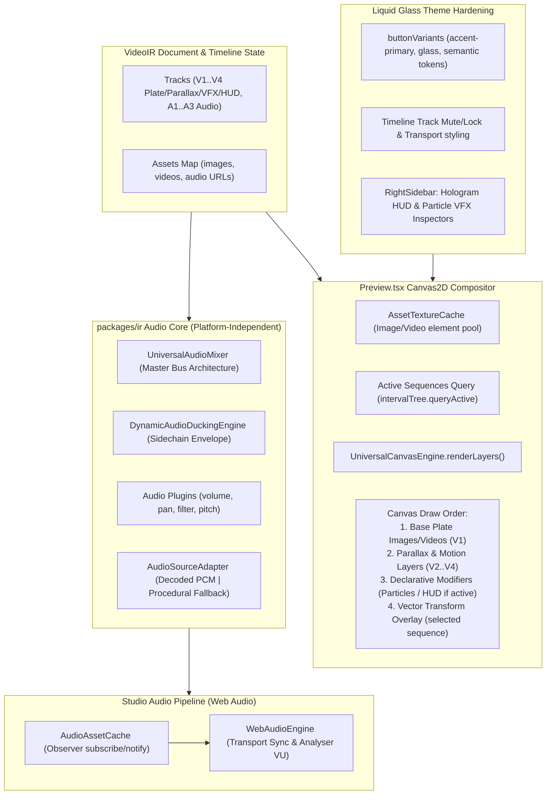

# Iteration 8: Studio Visual/Audio Media Compositor, Declarative VFX & UI/UX Hardening

## Goal Description
The Studio app currently features a modern Liquid Glass layout and timeline manipulation, but suffers from key architectural gaps and visual inconsistencies:
1. **Hardcoded Hologram & Particle VFX**: `Preview.tsx` unconditionally invokes `engine.initHologramHUD(0.35, 40)` and `engine.initParticleSystem(250)` on mount, forcing cyan tech rings and particle swarms into every project regardless of timeline modifiers.
2. **Missing Visual Media Compositing**: `Preview.tsx` only clears the canvas to black and draws particles/vector overlays; active image and video sequence assets are never decoded or drawn (`ctx.drawImage`) onto the Canvas2D context.
3. **Procedural-Only Audio Playback**: `WebAudioEngine` synthesizes generic tones via `UniversalAudioMixer` rather than decoding and mixing real audio assets from asset URLs.
4. **UI/UX Token Inconsistencies**: Several controls (e.g. `button.tsx`, `Timeline.tsx` track mute/lock) contain hardcoded Tailwind classes (`bg-indigo-600`, `hover:bg-slate-200`) instead of semantic Liquid Glass tokens (`--accent-primary`, `--glass-bg`, `--glass-border`).

This initiative turns the Studio into a production-grade media compositor with real visual/audio asset playback, declarative modifier-driven VFX, and unified UI styling.

---

## User Review Required

> [!IMPORTANT]
> **In-Canvas Object Style Isolation**: Per historical design rule 235, in-canvas media placeholders and text cues are video render outputs and must NOT inherit desktop Liquid Glass theme classes. Fallback media cards are rendered with neutral dark video charcoal backgrounds (`#151518`), clean contrast typography, and neutral media icons.

> [!NOTE]
> **Audio Decoding Fallback**: Real audio URLs will be asynchronously decoded into `AudioBuffer`s. If an asset fails to fetch (offline, CORS, 404), `WebAudioEngine` will fall back seamlessly to procedural synthesis so playback never freezes.

---

## Proposed Changes



---

## Phased Implementation Roadmap

### Phase 1: Declarative Particle & HUD Subsystem `[x] Completed (docs/history/246_studio_phase1_declarative_vfx.md)`
- **`packages/effect-engines/src/canvas/UniversalCanvasEngine.ts`**:
  - Add `clearParticles(): void` and `clearHUD(): void`.
  - Add dynamic `setHUDConfig(config: HUDConfig | null)` and `setParticleConfig(config: ParticleConfig | null)`.
- **`apps/studio/src/components/Preview.tsx`**:
  - Remove hardcoded `initHologramHUD(0.35, 40)` and `initParticleSystem(250)` on mount.
  - Dynamically query active sequences for `overlay/canvas_particles` or `overlay/hologram_hud` modifiers in the frame loop.
  - Add FX Ambiance toggle in Viewport Control Bar.

### Phase 2: Real Visual Media Compositor & Preview Architecture Resilience `[x] Completed (docs/history/247_studio_phase2_media_compositor.md, docs/history/248_preview_math_reuse_and_decomposition.md)`
- **`packages/effect-engines/src/canvas/UniversalCanvasEngine.ts`**:
  - Implement `renderLayers(ctx: CanvasRenderingContext2D, layers: VisualLayerItem[]): void`:
    - Strict multi-track layer ordering ($V1 \to V4$).
    - Aspect ratio math: `'cover'` for background plates (fills 16:9 canvas cleanly) and `'contain'` for subjects/overlays.
    - Modifier-driven `blendMode` parameter support (falling back to track `blendMode` or `'source-over'`).
    - GSAP / Pts.js affine transform matrix stacking (`translate`, `rotate`, `scale`, `globalAlpha`) and defensive `ctx.drawImage()`.
- **`apps/studio/src/lib/textures/AssetTextureCache.ts`**:
  - Implement Observer pattern (`subscribe(callback)`, `notify()`) to reactively notify listeners on image/video frame decoding so the preview redraws immediately without waiting for scrub.
  - Implement real image loading and video element seeking (`new Image()`, HTML5 `<video>`).
  - Implement `getVisualAsset(assetId, src, type)` and `renderMissingAssetPlaceholder(ctx, w, h, name, type)` (Rule 235 isolation).
- **`apps/studio/src/components/preview/`**:
  - Decompose monolithic 1,558-line `Preview.tsx` into clean, single-responsibility sub-components:
    - `ViewportControlBar.tsx`: Monitor HUD, zoom presets, pan hand tool, safe guides, checkerboard, ambiance toggle.
    - `ViewportSafeGuides.tsx`: 16:9 Broadcast & 9:16 Social Reel safe overlays.
    - `ContextualActionPill.tsx`: Floating action pill (Duplicate, Center, Lock/Unlock, Reset, Delete).
    - `SubtitlesOverlay.tsx`: In-canvas isolated subtitles & inline text cue editor modal.
- **`apps/studio/src/components/Preview.tsx`**:
  - Lean orchestrator (~280 lines) delegating visual layer drawing to `engine.renderLayers()` and sub-components.
  - Retain exported types and sub-components (`TransformBodyDraggable`, `TransformHandle`, `computeDragTransform`) ensuring 100% zero-regression test compatibility.

### Phase 3: Platform-Independent Audio Core & Multi-Track Mixing `[x] Completed (docs/history/249_studio_phase3_audio_core_and_plugins.md)`
- **Architectural Relocation & Consolidation (`packages/ir/src/renderer/audio/`)**:
  - Relocate `UniversalAudioMixer.ts` to `packages/ir/src/renderer/audio/UniversalAudioMixer.ts` alongside `DecoupledAudioMixer.ts` and `DynamicAudioDuckingEngine.ts`.
  - Re-export `UniversalAudioMixer` from `packages/effect-engines/src/audio/UniversalAudioMixer.ts` ensuring 100% backward compatibility for all existing tests and call sites.
  - Keep `packages/effect-engines` strictly focused on visual/render effects built on top of IR.
- **Audio Source Adapter Pattern (`AudioSourceAdapter`)**:
  - Define `IAudioSourceProvider` interface in `packages/ir`:
    - `DecodedPcmSource`: Samples from real decoded Float32Array PCM channel buffers based on `sequence.sourceTrim` and timeline offsets.
    - `ProceduralSynthesizerSource`: Seamless fallback to deterministic synthesis when audio assets are still loading or unavailable.
- **Pure Buffer-Based Modifier Plugins (`packages/ir/src/plugins/audio/` & `sfx/`)**:
  - Audio plugins operate strictly on pure `Float32Array` PCM channel buffers (zero DOM / Web Audio API dependencies, isomorphic across Node.js/Bun CLI and browser).
  - Register comprehensive audio plugins in `ModifierPluginRegistry`:
    - `audio/volume`: Gain scaling with intro/outro fade curves (linear, cosine, exponential).
    - `audio/pan`: Constant-power stereo panning (-1.0 to 1.0).
    - `audio/filter`: Biquad filter (lowpass, highpass, bandpass) with frequency cutoff and resonance.
    - `audio/pitch`: Resampling / playback rate speed modulation.
    - `sfx/dynamic_ducking`: Sidechain compression utilizing `DynamicAudioDuckingEngine`.
- **Master Bus Architecture in `UniversalAudioMixer`**:
  - **Clip-Level DSP**: Sequential pipeline on channel buffers (`volume/fade` $\to$ `filter` $\to$ `pitch` $\to$ `stereo pan`).
  - **Track-Level Buses**: Dedicated sub-mix buses for Voiceover, Sound Effects (SFX), and Background Music (BGM).
  - **Master Bus**: Summation with `DynamicAudioDuckingEngine` sidechain attenuation of BGM during dialogue activity, followed by a soft-clipping master limiter (`Math.tanh`).
- **Studio Audio Asset Cache (`apps/studio/src/lib/audio/AudioAssetCache.ts`)**:
  - Implement Observer pattern (`subscribe(callback)`, `notify()`) matching `AssetTextureCache`.
  - Asynchronously fetch and decode audio URLs into in-memory `AudioBuffer`s via browser `AudioContext.decodeAudioData()`.
  - Notify subscribers (`WebAudioEngine`, timeline waveform visualizer) upon decode completion to trigger seamless live updates.
- **WebAudioEngine Integration (`apps/studio/src/lib/audio/WebAudioEngine.ts`)**:
  - Thin browser coordinator that syncs timeline transport frames to `UniversalAudioMixer.mixStereo()`.
  - Pipes decoded PCM buffers from `AudioAssetCache` into `UniversalAudioMixer`.
  - Feeds master output into `AnalyserNode` for live peak/RMS VU metering and tactile playhead scrubbing bursts.

### Phase 4: RightSidebar Inspector Panels for HUD & Particles `[x] Completed (docs/history/251_studio_phase4_inspector_hud_particles.md)`
- **Architectural & Schema Alignment**:
  - Strictly align inspector controls with `CanvasParticleOverlayParams` (`packages/ir/src/plugins/overlay/CanvasParticleOverlayPlugin.ts`) and `HUDConfig` (`packages/effect-engines/src/canvas/UniversalCanvasEngine.ts`).
  - Support **Dual Schema for Hologram HUD**:
    1. Dedicated `overlay/hologram_hud`: `{ ringRadiusNorm: number, scanlineDensity: number, color: string, rotationSpeed: number, enabled: boolean }`.
    2. Overlaid `overlay/canvas_particles` with `type: 'sci_fi_hud'`: `{ type: 'sci_fi_hud', intensity: number, speed: number, opacity: number }`.
- **`AVAILABLE_MODIFIERS` Registration in `RightSidebar.tsx`**:
  - Add `overlay/hologram_hud` to `AVAILABLE_MODIFIERS` with icon `Monitor` and defaults `{ enabled: true, ringRadiusNorm: 0.35, scanlineDensity: 40, color: '#00ffff', rotationSpeed: 0.5 }`.
  - Update `overlay/canvas_particles` in `AVAILABLE_MODIFIERS` with defaults `{ enabled: true, type: 'cyber_sparks', intensity: 1.0, speed: 1.0, opacity: 0.8, particleCount: 1500, shaders: { bloom: { threshold: 0.7, intensity: 1.0 }, chromaticAberration: { offsetPx: 2.0 } } }`.
- **Dedicated Hologram HUD Accordion Panel (`value="hologram_hud"`)**:
  - Ring Radius slider: `ringRadiusNorm` (0.10 to 0.80, step 0.05, default 0.35).
  - Scanline Density slider: `scanlineDensity` (10 to 100, step 5, default 40).
  - Rotation Speed slider: `rotationSpeed` (0.1 to 3.0, step 0.1, default 0.5, unit `rad/s`).
  - Color Picker Row: Preset palette (`#00ffff` Cyan Neon, `#ec4899` Magenta Pulse, `#f59e0b` Amber Gold, `#10b981` Emerald Glow, `#8b5cf6` Violet Spark) + native hex picker.
  - Reset to Defaults action button and Enable/Disable switch via `AccordionTrigger` `actions` prop (Rule 229 compliant).
- **Strict Schema-Aligned Particle VFX Accordion Panel (`value="particles"`)**:
  - Particle Type Selector: Dropdown selector featuring predefined particle types (`cyber_sparks`, `embers`, `dust`, `rain`, `snow`, `bokeh`, `matrix_rain`, `digital_glitch`).
  - Core Physics & Emission Sliders:
    - Particle Intensity: `intensity` (0.1 to 2.0, step 0.05, default 1.0).
    - Particle Speed: `speed` (0.1 to 3.0, step 0.1, default 1.0).
    - Overall Opacity: `opacity` (0.0 to 1.0, step 0.05, default 0.8).
    - Particle Count: `particleCount` (50 to 3000, step 50, default 1500).
  - Collapsible Post-Processing Shaders Group:
    - Bloom Glow: Toggle switch + Bloom Threshold slider (`shaders.bloom.threshold`, 0.1 to 1.0) and Intensity slider (`shaders.bloom.intensity`, 0.1 to 3.0). Backward compatible with flat `bloomThreshold`.
    - Chromatic Aberration: Toggle switch + Offset slider (`shaders.chromaticAberration.offsetPx`, 0.0 to 10.0 px). Backward compatible with flat `chromaticAberration`.
  - Preset UX Behavior: Decoupled controls (preserves active slider values on type switch) with a dedicated "Reset to Defaults" button.
- **Reactive Preview Synchronization & State Management**:
  - Real-time binding via `IRStateManager.getInstance().updateModifier(seqId, type, params)` propagating to `Preview.tsx` render loop.
  - Rule 229 Compliance: Pass all interactive elements (`Button`, `Switch`) via `AccordionTrigger` `actions` prop. Zero nested `<button>` violations.


### Phase 5: UI/UX Consistency & Theme Tokens `[x] Completed (docs/history/258_studio_phase5_ui_ux_theme_tokens.md)`
- **`apps/studio/src/components/ui/button.tsx`**:
  - Replaced hardcoded `bg-indigo-600` with `bg-[var(--accent-primary)] text-slate-950 font-semibold shadow-[0_0_12px_var(--accent-glow)]`.
- **`apps/studio/src/components/Timeline.tsx`**:
  - Replaced raw `<button>` track lock/mute elements with styled icon buttons using semantic tokens.
  - Standardized transport buttons, tools, snap toggle, and timecode badges with Liquid Glass styling.
- **`apps/studio/src/components/Titlebar.tsx`**:
  - Standardized IR logo badge, version badge, demo template select, and action buttons with semantic glass tokens.

### Phase 6: Automated Testing & Production Verification `[x] Completed (docs/history/258_studio_phase5_ui_ux_theme_tokens.md)`
- Dedicated test suite `autogenerated-tests/studio_theme_tokens.test.ts` (3/3 passing).
- Full regression verification: `bun test autogenerated-tests/studio` (169/169 passing across 27 files).
- Production bundle verification: `bun run studio:build` (built cleanly in 3.84s).

---

## Verification Plan

### Automated Tests
```bash
# 1. Run full Studio regression suite
bun test autogenerated-tests/studio

# 2. Run new media compositing & UI tests
bun test autogenerated-tests/studio_media_compositor.test.ts

# 3. Verify HTML coverage report generation
bun run coverage:studio

# 4. Verify production bundle build
bun run studio:build
```

### Manual Verification
1. Open Studio in browser:
   - Verify Cyber City Panoramic Plate image displays in Viewport Preview on track V1.
   - Verify Hologram HUD and particles only appear on sequences that have the corresponding modifiers, and can be toggled in Viewport HUD.
   - Adjust Particle Count and HUD Neon Color in RightSidebar and confirm live canvas re-render.
   - Play timeline with audio tracks: confirm voice, SFX, and BGM mix with dynamic ducking.
   - Switch between Dark Obsidian and Light Frosted themes: confirm all buttons and track controls adhere to Liquid Glass styling without rogue indigo or slate backgrounds.
