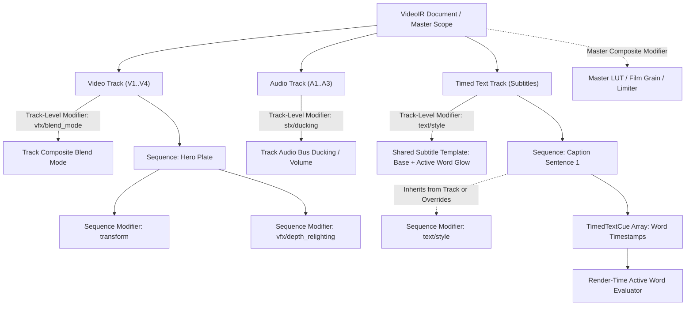

# Master Integration Plan - Iteration 8 Phase 4 Extension (Phase 4 Ext)
# Multi-Tier Context-Aware Inspector & Scoped Modifiers Architecture

## 1. Executive Summary & Problem Context
In Iteration 8 Phase 4, dedicated and schema-aligned inspector panels for Hologram HUD and Particle VFX were successfully integrated into `apps/studio/src/components/RightSidebar.tsx`. However, two fundamental architectural limitations were identified:

1. **Unscoped Inspector Panels & Rigid Mounting**:
   - `RightSidebar.tsx` unconditionally rendered visual panels (such as 2D In-Canvas Transform and GSAP Motion Presets) across all sequence types—even pure audio clips (dialogue voiceovers, sound effects, background music).
   - The "Add Effect" menu displayed a monolithic list of all modifiers without considering the semantic domain or track type of the selected sequence.
2. **The Active-Word Caption Problem**:
   - In modern social/editorial video generation (TikTok, Reels, Shorts), captions feature dynamic active-word highlighting (karaoke glow, word pop-out, bounce animation).
   - An active word is a temporal sub-element of a subtitle cue—it is not an individual sequence. Therefore, applying modifiers strictly at the sequence level creates conceptual ambiguity unless a multi-tier scoping model is explicitly defined.

This extension establishes a unified **Multi-Tier Hierarchical Scoping Model** (`sequence` $\to$ `track` $\to$ `master`) and implements a **Pure Attached-Only, Context-Aware Inspector** in `RightSidebar.tsx`.

---

## 2. Structural Hierarchy & Scoped Modifiers Architecture



### 2.1 The Three Scoping Tiers
1. **Sequence Target Scope (`targetScope: 'sequence'`)**:
   - Stored directly in `sequence.modifiers`.
   - Modifies that specific clip (e.g. In-Canvas Transform, 3D Relighting, Particle VFX, clip-level Audio Fades, sentence-specific text overrides).
2. **Track Target Scope (`targetScope: 'track'`)**:
   - Stored in `track.modifiers` or `track.style`.
   - Acts as a track-wide template or sub-mix bus (e.g. Subtitle Track Default Style with Active-Word Karaoke Glow, Video Track Blend Mode / LUT, Audio Track Bus Ducking / Volume).
   - All sequences on this track inherit these settings unless overridden by a sequence-level modifier.
3. **Master / Global Target Scope (`targetScope: 'master'`)**:
   - Stored in `doc.meta` or executed during master composition passes.
   - Composition-wide effects (Master Resolution, FPS, Color Space, Master Film Grain, Master Bus Limiter).

---

## 3. Resolving the Active-Word Caption Problem

### 3.1 Nature of Active Words
An active word is **not** a sequence; it is a dynamic temporal state evaluated at render time when the playhead satisfies:
$$\text{cue.startOffsetMs} \le \text{localTimeMs} < \text{cue.endOffsetMs}$$

### 3.2 Dual-State Parameters in `text/style` Modifier
Rather than creating fragmented micro-sequences for every word, the `text/style` modifier incorporates both **Base Text Styling** and **Active Word Highlighting**:

```typescript
export interface TextStyleModifierParams {
  // 1. Base Text Style (Applies to all text in the cue)
  fontFamily: string;
  fontSize: number;
  fontWeight: number | string;
  fillColor: string;
  strokeColor?: string;
  strokeWidth?: number;
  letterSpacing?: number;
  shadowColor?: string;
  shadowBlur?: number;

  // 2. Active Word Karaoke Highlight (Temporal Cue Sub-state)
  activeWordHighlight?: {
    enabled: boolean;
    fillColor: string;         // e.g. #00ffff (Cyan Neon) or #f59e0b (Amber)
    scale: number;             // e.g. 1.15 (15% pop-out scale)
    glowColor?: string;        // e.g. #00ffff88
    glowBlur?: number;         // e.g. 8px
    animationPreset?: 'pop' | 'bounce' | 'underline' | 'none';
  };
}
```

### 3.3 Inheritance Rules
- When configured on a **Timed Text Track Header / Style** (`track.style` or `track.modifiers`), all subtitle sentences on that track share this styling uniformly.
- When attached to an individual **Sequence** (`sequence.modifiers`), it overrides the track-level template for that specific sentence or phrase.

---

## 4. Context-Aware Attached-Only Inspector in `RightSidebar.tsx`

### 4.1 Track-Type Scoped Taxonomy
Modifiers are categorized by supported track types:

```typescript
export interface ModifierDefinition {
  type: string;
  name: string;
  icon: React.ComponentType<{ className?: string }>;
  supportedTrackTypes: Array<'video' | 'audio' | 'text'>;
  defaultParams: Record<string, any>;
}
```

#### Modifier Catalog:
1. **Visual Tracks (`video`)**:
   - `transform`: In-Canvas Transform (X, Y, Scale, Rotation, Opacity) & GSAP Motion Presets (pop_in, slide_left, overshoot, bounce, drift).
   - `vfx/depth_relighting`: 3D Depth Relighting (Point light color, 3D position X/Y/Z, diffuse, specular, rim intensity).
   - `camera/3d`: 3D Camera & Lens (FOV, focal distance, bokeh blur radius, 3D eye position).
   - `overlay/canvas_particles`: Particle VFX & Shaders (Type preset, intensity, speed, opacity, particle count, Bloom, Chromatic Aberration).
   - `overlay/hologram_hud`: Hologram HUD (Ring radius, scanline density, rotation speed, color palette).
   - `vfx/color_grading`: Color Grading (Contrast, saturation, exposure, vignette).
2. **Audio Tracks (`audio`)**:
   - `audio/volume`: Volume & Fades (Gain scaling, linear/cosine/exponential fade in/out).
   - `audio/pan`: Constant-Power Stereo Panning (-1.0 to 1.0).
   - `audio/filter`: Biquad Filter (Lowpass, Highpass, Bandpass with cutoff frequency and resonance).
   - `audio/pitch`: Resampling Pitch & Playback Speed Modulation.
   - `sfx/dynamic_ducking`: Dynamic Ducking Sidechain Compressor.
   - `sfx/procedural`: Procedural Audio Synthesizer (whoosh, impact, glitch, riser, laser).
3. **Text / Subtitle Tracks (`text`)**:
   - `text/style`: Typography & Active-Word Karaoke Glow (Base font, colors, stroke, and dual-state active-word pop/glow).
   - `transform`: In-Canvas Transform & Positioning.

### 4.2 Dynamic "Add Effect" Filtering
When the user clicks "+ Add Effect", the dropdown is filtered by:
```typescript
const trackType = (selectedTrack?.type || 'video') as 'video' | 'audio' | 'text';
const relevantAvailableModifiers = ALL_AVAILABLE_MODIFIERS.filter(
  (mod) => mod.supportedTrackTypes.includes(trackType)
);
```

### 4.3 Pure Attached-Only Mounting
- An accordion panel is mounted **only if** its modifier is in `selectedSeq.modifiers`.
- Zero hardcoded default panels.
- If a sequence has no modifiers, a clean, dashed empty state guide appears:
  *"No effects attached. Click '+ Add Effect' to attach modifiers to this sequence."*
- Clicking "Trash / Remove" on a panel dispatches `IRStateManager.removeModifier`, which instantly unmounts that accordion item.

### 4.4 Context-Switching Inspector Header
- **Sequence Selected**:
  - Title: "Sequence Inspector"
  - Sequence Meta Card: ID, Track Name/Type, Base Sequence Configuration (`time: SequenceTime`), Duplicate / Lock / Delete buttons.
  - "+ Add Effect" menu with domain-filtered effects.
  - Pure attached modifier accordion items.
- **No Sequence Selected (or Track Header Selected)**:
  - Title: "Track & Project Settings"
  - Active Track overview with track-level styles and volume/mute status.
  - Master Canvas Resolution, Frame Rate, Color Space, Duration.

### 4.5 Overlay VFX & Generator Sequences (Left Sidebar Library & Timeline)
- **VFX / SFX Duality**:
  - Like Audio SFX (clip-level EQ vs standalone audio clip on `A2`), Video VFX features:
    1. *Clip-Attached VFX*: Modifiers directly on a footage sequence (`seq.modifiers`).
    2. *Standalone Overlay VFX / Generators*: Procedural layers (Particle Swarms, Hologram HUDs, Sci-Fi HUDs, Light Leaks) that exist without a backing media asset (`assetId: undefined`).
- **Schema Purity**: `IRSequence` remains unchanged. An overlay sequence is a standard `IRSequence` with `time` and `modifiers`, leaving `assetId` undefined.
- **Left Sidebar Drop-In**:
  - Users drag Overlay VFX presets from the Left Sidebar (`Library / StagingPresets`) into the Canvas or Timeline.
  - Auto-routes to a dedicated overlay track (`track-overlay-vfx` with `type: 'video'`) layered cleanly above base footage tracks.

### 4.6 Base Sequence Configuration: Interactive `SequenceTime`
In `RightSidebar.tsx`, the sequence header includes an interactive **`SequenceTime`** configuration card:
- **Start Time Mode**:
  - *Absolute*: Direct numeric input for `start` (frame index and calculated timecode `HH:MM:SS:FF`).
  - *Relational*: Toggle to configure `syncWith` or `after` with a target sequence dropdown, plus `offsetFrames` / `overlapFrames`.
- **Duration Mode**:
  - *Absolute*: Direct numeric input for `duration` (frames and seconds).
  - *Relational*: Toggle to configure `matchLengthOf` (target sequence dropdown), `matchAssetDuration` (boolean), and `paddingFrames`.

---

## 5. Verification & Quality Gates
1. **Dedicated Automated Suite:** `autogenerated-tests/studio_context_aware_inspector.test.ts`
   - Taxonomy validation: Verify modifiers match supported track types.
   - Attached-only verification: Adding modifier mounts panel; removing modifier unmounts panel.
   - Dual-state caption styling verification: `text/style` correctly preserves active-word parameters.
   - SequenceTime configuration verification: Absolute and relational start/duration updates mutate state correctly.
   - Overlay VFX sequence verification: Overlay presets instantiate on `track-overlay-vfx` without `assetId`.
   - Rule 229 compliance: Every `AccordionTrigger` passes action controls via `actions` prop.
2. **Full Studio Regression Suite:** `bun test autogenerated-tests/studio` (152+ tests passing).
3. **Production Build:** `bun run studio:build` cleanly bundled.

