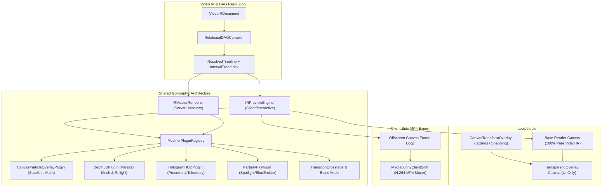

# Iteration 9: Studio Preview Unification with IRMasterRenderer & Decommissioning UniversalCanvasEngine

**Document ID:** `docs/master_integration_plan_iteration9.md`  
**Paired Plan:** [`apps/studio/doc/implementation_plan_21.md`](file:///c:/Users/Admin/workspace/git/acc/apps/studio/doc/implementation_plan_21.md)  
**Status:** `[ ] Planned`  
**Scope:** `apps/studio`, `packages/ir`, `packages/effect-engines`, `autogenerated-tests`  

---

## Goal Description
Eliminate the monolithic, stateful `UniversalCanvasEngine.ts` in favor of the project's official Video IR Plugin Architecture. By elevating `IRPreviewEngine` in `@acc/ir/client` to mirror `IRMasterRenderer`, both the interactive Studio Preview Player and the Headless Exporter will share the exact same modifier plugins (`ModifierPluginRegistry`), deterministic frame mathematics, multi-track layer composition, and GSAP motion timelines.

Furthermore, Studio's `Preview.tsx` will be refactored into a decoupled **2-layer canvas architecture** (base canvas for pure Video IR rendering; overlay canvas for interactive editor transform handles and magnetic snapping guides), and `App.tsx` client-side export will be upgraded from a dummy test pattern to 100% full-fidelity MP4 export via `MediabunnyClientSink`.

---

## Architecture & Data Flow



---

## User Review Required

> [!IMPORTANT]
> **Complete Removal of `UniversalCanvasEngine.ts`:**
> Per design alignment, `UniversalCanvasEngine.ts` and its monolithic internal simulation methods (`renderParticles` Euler accumulator, hardcoded HUD ring loops, etc.) will be removed. All existing unit tests in `/autogenerated-tests/` will be preserved and refactored to test `IRPreviewEngine` and the modular modifier plugins directly.

> [!NOTE]
> **Decoupled Viewport Canvas:**
> The Studio Preview Player will now maintain two stacked canvas elements in the DOM:
> 1. `baseCanvas`: pure Video IR rendering via `IRPreviewEngine.renderFrame(frame, ctx)`.
> 2. `overlayCanvas`: interactive bounding box, scale handles, rotation gizmo, and magnetic snap guides via `CanvasTransformOverlay.render(ctx, w, h)`.
> This guarantees that editor UI gizmos are never baked into video frames or exported files.

---

## Proposed Changes

### Component 1: Video IR Core & Plugins (`packages/ir`)

#### [MODIFY] `packages/ir/src/renderer/preview/IRPreviewEngine.ts`
* Elevate `IRPreviewEngine` from a pure interval-query class into a full interactive renderer mirroring `IRMasterRenderer`:
  * Add `renderFrame(frame: number, ctx: CanvasRenderingContext2D, options?: RenderFrameOptions): PreviewFrameResult`
  * Add multi-track visual layer composition (track sorting V1 $\rightarrow$ V4, `cover` vs `contain`, blendMode mapping).
  * Embed GSAP deterministic timeline evaluator for sequence motion presets (`pop_in`, `slide_left`, `bounce`, `overshoot`, `drift`, intro/steady/outro stages).
  * Dispatch to `ModifierPluginRegistry` for sequence-level and track-level modifiers (`renderClipSpace` and `renderStreamSpace`).
  * Integrate texture lookup via an asset provider (or `AssetTextureCache`).

#### [NEW] `packages/ir/src/plugins/overlay/HologramHUDPlugin.ts`
* Formalize the cybernetic hologram HUD telemetry into a standard `ModifierPlugin<HologramHUDParams>`:
  * Pure deterministic rotation based on $t = \frac{\text{frame}}{\text{fps}}$.
  * Segmented outer tech rings, dashed crosshairs, telemetry targeting ticks.
  * Target scopes: `sequence`, `track`, and `stream`.

#### [NEW] `packages/ir/src/plugins/vfx/PartialVFXPlugin.ts`
* Formalize partial regional VFX into a standard `ModifierPlugin<PartialVFXParams>`:
  * Implements `spotlight`, `regional_blur`, `digital_glitch`, and `point_emitter`.
  * Normalized coordinates $(x, y, w, h)$ mapped deterministically onto the canvas context.

#### [MODIFY] `packages/ir/src/plugins/index.ts` & `packages/ir/src/plugins/clientRegistry.ts`
* Register `HologramHUDPlugin` (`overlay/hologram_hud`) and `PartialVFXPlugin` (`vfx/partial`) in both server and client registries.

---

### Component 2: Effect Engines (`packages/effect-engines`)

#### [DELETE] `packages/effect-engines/src/canvas/UniversalCanvasEngine.ts`
* Completely remove `UniversalCanvasEngine.ts`.

#### [MODIFY] `packages/effect-engines/src/index.ts` & `packages/effect-engines/src/client.ts`
* Remove `UniversalCanvasEngine` exports.
* Retain and export all editor interaction tools: `CanvasTransformOverlay`, `MagneticSnapEngine`, `BoundingBox2D`, `SnappingGuide`, `TransformHandleType`.

---

### Component 3: Apps Studio (`apps/studio`)

#### [MODIFY] `apps/studio/src/components/Preview.tsx`
* Replace `engineRef: useRef<UniversalCanvasEngine>` with `engineRef: useRef<IRPreviewEngine>` and `overlayRef: useRef<CanvasTransformOverlay>`.
* Implement the decoupled 2-layer canvas architecture:
  * Layer 1 (Base Canvas): receives `engine.renderFrame(currentFrame, ctx, { textureCache, popOutIntensity })`.
  * Layer 2 (Overlay Canvas): receives `overlay.render(overlayCtx, width, height)` only when a sequence is selected.
* Remove manual ad-hoc particle and HUD checks (`activeParticleMod`, `activeHudMod`); effects render automatically via `IRPreviewEngine` and the plugin registry.

#### [MODIFY] `apps/studio/src/App.tsx`
* Update `handleStartExport`:
  * Initialize `IRPreviewEngine` for the active `irState.timeline`.
  * In the frame loop $f \in [0, \text{totalFrames}-1]$, render the exact frame via `previewEngine.renderFrame(f, offscreenCtx, { textureCache })`.
  * Feed the real rendered `Uint8Array` directly into `sink.consumeFrame(f, rgba)` in `MediabunnyClientSink`.
  * Eliminates the dummy test pattern and delivers full-fidelity MP4 exports directly in the browser!

---

### Component 4: Autogenerated Tests Migration (`autogenerated-tests`)

#### [MODIFY] Unit & Regression Tests
Update test files importing `UniversalCanvasEngine` to test `IRPreviewEngine` and the modular plugins directly without deleting any test coverage:
* `autogenerated-tests/isomorphic_canvas_engine.test.ts` $\rightarrow$ Test `IRPreviewEngine` layer compositing and frame seeking.
* `autogenerated-tests/studio_phase1_declarative_vfx.test.ts` $\rightarrow$ Test `CanvasParticleOverlayPlugin`, `PartialVFXPlugin`, and `HologramHUDPlugin`.
* `autogenerated-tests/studio_phase2_media_compositor.test.ts` $\rightarrow$ Test `IRPreviewEngine` multi-track compositing (`cover`/`contain`, blend modes, affine transforms).
* `autogenerated-tests/studio_phase4_inspector_hud_particles.test.ts` $\rightarrow$ Test HUD and particle plugins.
* `autogenerated-tests/studio_phase6_motion_timeline.test.ts` $\rightarrow$ Test GSAP deterministic motion evaluator in `IRPreviewEngine`.
* `autogenerated-tests/studio_phase7_master_e2e_hardening.test.ts` $\rightarrow$ Validate full end-to-end preview and export determinism.

---

## Phased Implementation Roadmap

### Phase 1: Elevate IRPreviewEngine & Formalize Missing Modifier Plugins `[x] Completed`
- Implement `renderFrame(frame, ctx, options)` in `packages/ir/src/renderer/preview/IRPreviewEngine.ts`.
- Multi-track visual layer composition with track sorting, aspect-ratio fit modes, and blend modes.
- Implement `packages/ir/src/plugins/overlay/HologramHUDPlugin.ts` and `packages/ir/src/plugins/vfx/PartialVFXPlugin.ts`.
- Register new plugins in server and client registries.

### Phase 2: Decoupled 2-Layer Viewport in Studio Preview `[x] Completed`
- Refactor `apps/studio/src/components/Preview.tsx` to stacked DOM canvas architecture:
  - Base canvas: `IRPreviewEngine.renderFrame()`.
  - Overlay canvas: `CanvasTransformOverlay.render()`.
- Eliminate manual particle/HUD configuration loops from `Preview.tsx`.

### Phase 3: Client-Side Full-Fidelity MP4 Export `[x] Completed`
- Update `handleStartExport` in `apps/studio/src/App.tsx` to run `IRPreviewEngine.renderFrame()` frame-by-frame into `MediabunnyClientSink`.
- Verify full-fidelity client-side MP4 generation without dummy placeholder text.

### Phase 4: Decommission UniversalCanvasEngine & Migrate Test Suite `[x] Completed`
- Delete `packages/effect-engines/src/canvas/UniversalCanvasEngine.ts`.
- Clean exports in `packages/effect-engines/src/index.ts` and `client.ts`.
- Refactor all unit test suites in `autogenerated-tests/` to target `IRPreviewEngine` and modular plugins directly.

---

## Verification Plan

### Automated Tests
Run target test suites using `bun test` in quiet mode:
```powershell
bun test autogenerated-tests/isomorphic_canvas_engine.test.ts
bun test autogenerated-tests/studio_phase1_declarative_vfx.test.ts
bun test autogenerated-tests/studio_phase2_media_compositor.test.ts
bun test autogenerated-tests/studio_phase4_inspector_hud_particles.test.ts
bun test autogenerated-tests/studio_phase6_motion_timeline.test.ts
bun test autogenerated-tests/studio_phase7_master_e2e_hardening.test.ts
```

### Manual Verification
1. **Studio Preview Rendering:**
   * Open Studio (`bun run dev` or vite preview).
   * Scrub the timeline backward and forward; verify particles and HUD render deterministically without drift or lag.
   * Verify transform overlay handles (move, scale, rotate) function cleanly on the transparent overlay layer.
2. **Bit-Identical Client Export:**
   * Click **Export MP4** in Studio.
   * Verify the exported MP4 contains real rendered video content and effects, matching the preview canvas frame-for-frame.
