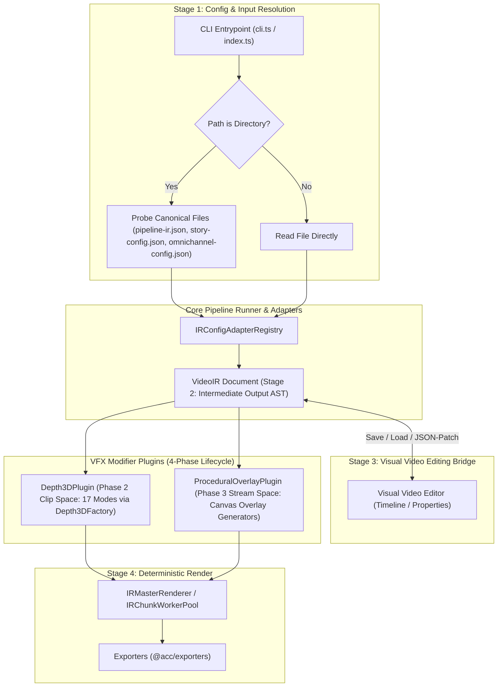

# Master Integration Plan (Iteration 1): VideoIR Intermediate Representation, VFX Modifier Plugin Migration & CLI Pipeline Ingestion

## 1. Executive Summary & Context

Following an exhaustive audit of all documentation (`docs/*.md`, `docs/brainstorming/*.md`, `docs/ir/*.md`, `docs/video-production-techniques/*.md`) and implementation packages (`apps/*`, `packages/*`), this plan establishes the revised, concrete roadmap for Iteration 1 aligned with the current system state:

1. **Clarification of VideoIR Intermediate Representation**:
   - `VideoIR` is an **intermediate output** (compiled AST) representing the Single Source of Truth (SSOT) for deterministic video rendering (Stage 2 in `docs/brainstorming/four-stage-content-generation.md`).
   - Rather than being strictly transient/in-memory, `VideoIR` serves as the serializable, content-addressed intermediate artifact that can be stored and later loaded into **Stage 3: Visual Video Editor** for interactive non-linear timeline editing, JSON-Patch revisions, and iterative preview re-rendering (`Stage 3 <-> Stage 4`).
   - The on-disk configuration contracts adhere to the system's triple-emission model (`pipeline-ir.json`, `omnichannel-config.json`, `story-config.json`). `VideoIRDocument` is compiled via `IRConfigAdapterRegistry`, can be saved as an intermediate artifact for visual editing, and executed deterministically by `IRMasterRenderer`.

2. **Orchestration Scope Adjustment**:
   - External Conductor OSS polling daemon is decoupled/quarantined from the core CLI rendering workflows.
   - We do **not** construct a redundant separate "Native DAG Workflow Engine" abstraction. Instead, pipeline execution is anchored directly on existing core orchestration: `PipelineRunner`, `AutoConfigEngineFacade`, `IRMasterRenderer`, and `IRChunkWorkerPool`.

3. **Complete VFX Migration to VideoIR Modifier Plugins (`docs/ir/9.*`) Aligned with Current Implementation**:
   - **All 17 3D Depth Modes**: Wire `Depth3DPlugin` in `packages/ir/src/plugins/vfx/Depth3DPlugin.ts` to dispatch through `Depth3DFactory` from `@acc/effect-engines` during Phase 2 (Clip Space), passing preflight caches and `Depth3DFrameState` to all 17 registered modes (`frame_breaker`, `parallax_25d`, `volumetric_sandwich`, `depth_map_3d`, `wigglegram`, `isometric_podium`, `cutout_portal`, `gyro_focal_tilt`, `flythrough_carousel`, `diffuse_shadow`, `glassmorphic_fresnel`, `silhouette_rim_light`, `plane_cast_shadow`, `macro_bokeh`, `aerial_mist`, `rack_focus`, `vignette_tunnel`, `perspective_grid`, `extruded_text_3d`, `isometric_billboard`, `tunneling_text`).
   - **Procedural Canvas Overlays**: Align `CanvasParticleOverlayPlugin` / `ProceduralOverlayPlugin` in `packages/ir/src/plugins/overlay/` to provide direct per-frame procedural canvas drawing in Phase 3 (Stream Space) using deterministic frame time (`timeSec = frame / fps`), eliminating subprocess spawning and respecting the zero-alloc frame loop.

4. **CLI Directory Ingestion Aligned with Actual Project Files**:
   - Fix `resolvePipelineInput` in `apps/cli/src/index.ts` to inspect directory targets. Instead of calling `fs.promises.readFile` on a directory (which throws `EISDIR`), check whether the path is a directory and resolve the canonical project files that exist in the codebase:
     - `pipeline-ir.json` (Stage 1 PipelineIR SSOT)
     - `omnichannel-config.json` (Director & fanout configurations)
     - `story-config.json` (Director/storyboard configuration)
     - For Pipeline 4 (`generative-storytelling`), pass the directory path directly as expected by `GenerativeStoryPipeline`.

---

## 2. Architecture & Data Flow

---

## 3. Detailed Component Audit & Plan Alignment

| Component | Current State | Target Alignment | Action |
| :--- | :--- | :--- | :--- |
| **VideoIR AST** | In-memory `VideoIRDocument` compiled via `IRConfigAdapterRegistry`. | Intermediate output artifact that can be serialized/deserialized for visual video editing in Stage 3. | Ensure `VideoIRDocument` can be exported to JSON for visual editing and loaded back for deterministic rendering. |
| **CLI Input Resolution** | `resolvePipelineInput()` in `apps/cli/src/index.ts` calls `readFile` on directory paths, failing with `EISDIR`. | Checks directory existence using `fs.statSync` and detects standard config files (`pipeline-ir.json`, `story-config.json`, `omnichannel-config.json`). | Replace direct `readFile` with folder check that reads the existing canonical configs or passes folder path for P4. |
| **3D Depth VFX Suite** | `packages/effect-engines` implements all 17 modes in `Depth3DFactory`, but `Depth3DPlugin` in `@acc/ir` only explicitly dispatched 5 core modes. | `Depth3DPlugin.renderClipSpace` delegates to `Depth3DFactory.getRenderer(mode)` for all 17 modes with unified `Depth3DFrameState`. | Remove hardcoded mode restrictions in `Depth3DPlugin` and ensure all 17 modes execute smoothly in Phase 2 clip space. |
| **Procedural Overlays** | `CanvasParticleOverlayPlugin` in `@acc/ir` has hardcoded loops for rain, snow, dust, embers. Generators in `@acc/effect-engines` use legacy FFmpeg video pipe. | Expose per-frame canvas draw functions for overlays in `ProceduralOverlayPlugin` in Phase 3 stream space. | Implement clean per-frame render routines matching the zero-alloc frame loop and deterministic timebase `timeSec = frame / fps`. |

---

## 4. Step-by-Step Implementation Roadmap

### Step 1: Align CLI Directory Ingestion with Canonical Configs (`apps/cli/src/index.ts`)
1. In `resolvePipelineInput(pipelineId, options)`:
   - Check if `options.configPath` is a directory via `fs.statSync(options.configPath).isDirectory()`.
   - If directory:
     - For Pipeline 4 (`generative-storytelling`): return the directory path directly (consumed by `GenerativeStoryPipeline.execute(storyDir)`).
     - For Pipelines 1, 2, 3, 5, 6: check for canonical files in order of precedence:
       1. `pipeline-ir.json` (Stage 1 SSOT AST)
       2. `story-config.json` (Director storyboard)
       3. `omnichannel-config.json`
     - If one exists, parse and return its contents.
     - If none exists, return default pipeline mock/template without throwing `EISDIR`.
2. In `apps/cli/src/commands/ir-render.ts`:
   - If `inputPath` is a directory, probe `pipeline-ir.json` -> `story-config.json` -> `omnichannel-config.json`.

### Step 2: Bridge All 17 3D Depth Modes into `Depth3DPlugin` (`packages/ir`)
1. In `packages/ir/src/plugins/vfx/Depth3DPlugin.ts`:
   - Ensure `Depth3DPluginParams.mode` accepts all 17 modes registered in `Depth3DFactory`:
     - `frame_breaker`, `parallax_25d`, `volumetric_sandwich`, `depth_map_3d`, `wigglegram`
     - `isometric_podium`, `cutout_portal`, `gyro_focal_tilt`, `flythrough_carousel`, `isometric_billboard`
     - `diffuse_shadow`, `glassmorphic_fresnel`, `silhouette_rim_light`, `plane_cast_shadow`
     - `macro_bokeh`, `aerial_mist`, `rack_focus`, `vignette_tunnel`, `perspective_grid`, `extruded_text_3d`, `tunneling_text`
   - In `renderClipSpace`:
     - Obtain renderer via `Depth3DFactory.getRenderer(mode)`.
     - Construct compliant `Depth3DFrameState` with cached cutout, depth layers, background canvas, and deterministic progress.
     - Call `renderer.renderFrame(canvasCtx, frameState)`.

### Step 3: Expand Procedural Overlay Plugin (`packages/ir`)
1. In `packages/ir/src/plugins/overlay/CanvasParticleOverlayPlugin.ts` (or unified `ProceduralOverlayPlugin.ts`):
   - Support `renderStreamSpace` with deterministic frame math (`timeSec = frame / fps`).
   - Provide modular per-frame canvas draw handlers for procedural overlays (atmospheric, optics, stylized VHS/glitch, HUD/tech).
   - Maintain the `ZERO-ALLOC-FRAME-LOOP` rule: reuse canvas contexts, avoid heap allocations inside the render loop, and use seeded pseudo-random math for consistent rendering.

### Step 4: VideoIR Intermediate Representation Serialization & Visual Video Editing Support
1. Ensure `VideoIRDocument` has clean helper functions:
   - `serializeVideoIR(doc: VideoIRDocument): string`
   - `deserializeVideoIR(jsonStr: string): VideoIRDocument`
2. Provide support for loading a pre-compiled `video-ir.json` if a user or Stage 3 Visual Editor exports one, allowing round-trip visual editing and deterministic rendering.

### Step 5: Verification & Regressions Testing
1. In `autogenerated-tests/`:
   - Create formal test suite `autogenerated-tests/master-integration-iteration-1.test.ts`.
   - Verify CLI directory resolution across `./samples/01-*` through `./samples/06-*` without `EISDIR`.
   - Verify all 17 3D Depth modes render without error via `Depth3DPlugin.renderClipSpace`.
   - Verify procedural overlays render smoothly via `renderStreamSpace`.
   - Run existing suite (`bun test autogenerated-tests/...`) to ensure zero regressions.
