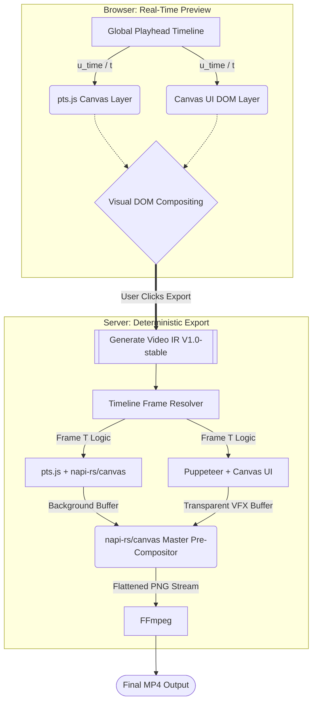

# Architecture Specification: Preview vs. Backend Export

This document outlines the architectural blueprint for a browser-based Non-Linear Editor (NLE) specializing in math-driven geometry and heavily shaded UI visual effects. 

The system relies on a **Hybrid Dual-Pipeline Architecture**:
1. **Frontend Preview:** Prioritizes real-time interactivity and visual feedback, accepting variable frame rates.
2. **Backend Export:** Prioritizes deterministic, perfect-quality rendering, decoupling the render loop from the real-time clock to guarantee a flawless locked-framerate output.

---

## 1. Core Technology Stack

*   **Geometry & Math (CPU):** `pts.js` (calculating points, vectors, and particle waves).
*   **Visual Effects (GPU):** `DavidHDev/canvas-ui` (applying WebGL/WebGPU WGSL shaders over HTML/DOM elements).
*   **Compositor (Backend):** `@napi-rs/canvas` (fast, native 2D canvas for in-memory layer merging).
*   **Renderer Environment (Backend):** `Puppeteer` (headless Chromium for executing DOM/WebGL shaders).
*   **Encoder (Backend):** `FFmpeg` (H.264 video compression via raw `stdin` pipes).
*   **Runtime:** Bun or Node.js.

---

## 2. Phase 1: The Web Editor Preview (Frontend)

**Goal:** Provide an interactive, scrubbable timeline where users can compose scenes, add VFX, and play them back instantly without server-side rendering delays.

### Layer Compositing in the DOM
Instead of forcing all technologies into a single canvas, the frontend utilizes the browser's native z-indexing for real-time compositing:
*   **Layer 0 (Background):** A standard HTML5 `<canvas>` element running `pts.js`. It renders native 2D geometry instantly.
*   **Layer 1 (Foreground):** React/HTML DOM elements wrapped in **Canvas UI** components (e.g., `<Liquid>`, `<Shatter>`). These have transparent backgrounds and sit directly above Layer 0.

### The Global Playhead
The timeline component dictates a single state variable: `currentTime` (or `currentFrame`). 
When the user clicks "Play", a `requestAnimationFrame` loop fires. Instead of relying on internal component clocks, the master loop injects the `currentTime` into:
1.  The `pts.js` animation step (calculating math for *T*).
2.  The Canvas UI shaders (updating the `u_time` uniform to *T*).

**Constraint Management:** Heavy Canvas UI shaders (like glass refraction over the live DOM) may cause the browser to drop below 60fps on lower-end machines. This is acceptable for the preview phase; the backend export will correct this.

---

## 3. Phase 2: The Bridge (Video Intermediate Representation - IR)

**Goal:** Transfer the user's timeline state to the backend accurately, supporting complex NLE features like nested compositions, track masking, and temporal gaps.

Instead of a flat Edit Decision List (EDL), the frontend serializes the sequence into a structured data format called the **Video Intermediate Representation (IR) V1.0-stable**. This format acts as a tree-based hierarchy, heavily inspired by **OpenTimelineIO (OTIO)**.

### IR Structure Example
```json
{
  "kind": "Timeline",
  "version": "IR V1.0-stable",
  "name": "VFX Sequence",
  "fps": 60,
  "resolution": [1920, 1080],
  "tracks": [
    {
      "kind": "Track",
      "name": "V1 - Math Background",
      "children": [
        {
          "kind": "Clip",
          "generator": "pts.js",
          "source_range": { "start": 0, "duration": 150 },
          "parameters": { "style": "particle_wave", "density": 100 }
        }
      ]
    },
    {
      "kind": "Track",
      "name": "V2 - UI Overlay",
      "children": [
        { "kind": "Gap", "duration": 30 },
        {
          "kind": "Clip",
          "generator": "canvas-ui",
          "source_range": { "start": 30, "duration": 60 },
          "content": "<h1>Access Granted</h1>",
          "effects": [
            { "kind": "Shader", "type": "DecryptReveal", "speed": 1.5 }
          ]
        }
      ]
    }
  ]
}
```

---

## 4. Phase 3: The Backend Export (Deterministic Rendering)

**Goal:** Parse the IR and render a frame-perfect, 60FPS video using headless technologies. The backend completely ignores real-time clocks, rendering as fast (or as slow) as the CPU/GPU dictates.

### Step 3.1: The Frame Resolver
The backend does not pass the IR directly to FFmpeg. A custom **Timeline Resolver** script traverses the IR for every single frame (e.g., Frame 1 to 300).
For a given frame $F$, the Resolver calculates local time for each clip and determines exactly which generators are active.

### Step 3.2: Parallel Generation
For a resolved frame requiring both math and VFX, the backend splits the work:
*   **Pipeline A (`pts.js` Native):** A Bun script uses `@napi-rs/canvas` to calculate the `pts.js` math and draw the background to an off-screen buffer. This takes milliseconds.
*   **Pipeline B (Canvas UI Headless):** Puppeteer is booted with `--enable-experimental-web-platform-features`. It loads an isolated, transparent HTML page containing only the active Canvas UI text and shaders. The script injects the specific frame time, mocking the browser's `performance.now()`, and captures a transparent PNG buffer.

### Step 3.3: The Node Pre-Compositor
To avoid building a fragile, deeply nested FFmpeg `-filter_complex` graph, compositing is handled in memory via `@napi-rs/canvas`:
1.  The background buffer (from `pts.js`) is drawn to the master canvas.
2.  The transparent overlay buffer (from Puppeteer) is drawn on top.
3.  The master canvas extracts the final flattened `ImageData`.

### Step 3.4: FFmpeg Encoding
FFmpeg acts strictly as a raw encoder. It receives a continuous pipe of flattened, perfectly composited raw images.

```typescript
// Conceptual Backend Node-Compositing Pipeline
const ffmpeg = spawn('ffmpeg', [
    '-f', 'image2pipe', '-vcodec', 'png', '-r', '60', 
    '-i', '-', '-c:v', 'libx264', 'output.mp4'
]);

for (let currentFrame = 0; currentFrame < totalFrames; currentFrame++) {
    // 1. Ask Resolver what is happening right now based on the IR
    const activeClips = resolver.getClipsAtFrame(videoIR, currentFrame);
    
    // 2. Generate layers
    const bgBuffer = await generatePtsJsFrame(activeClips.pts, currentFrame);
    const fgBuffer = await generateCanvasUIFrame(activeClips.ui, currentFrame);
    
    // 3. Composite in napi-rs/canvas
    masterCtx.drawImage(bgBuffer, 0, 0);
    masterCtx.drawImage(fgBuffer, 0, 0);
    
    // 4. Send flattened frame to FFmpeg
    ffmpeg.stdin.write(masterCanvas.toBuffer('image/png'));
}
```

---

## 5. Architectural Data Flow

