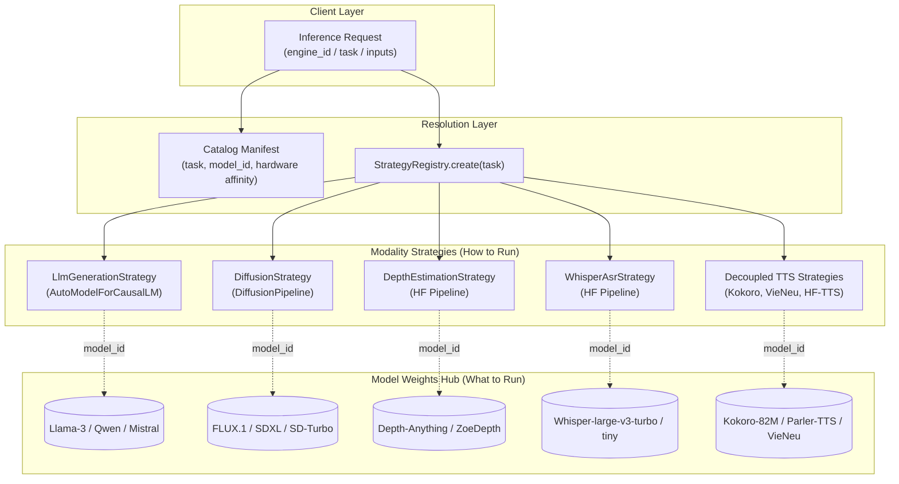
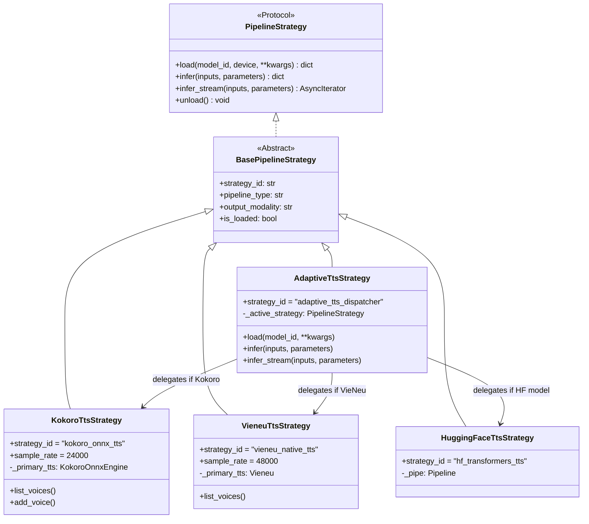

# Model Extensibility & Strategy Architecture Blueprint

## 1. Executive Summary: The Core Architectural Distinction

A central question in designing high-throughput AI orchestration platforms is:  
> *"When supporting new models, do we need to implement a custom Strategy each time?"*

The short answer is **no**. In `ai-control-plane`, the **Strategy Pattern operates at the Modality / Pipeline level**, not at the individual model level:

- **Modality Strategy (The "How to Run")**: Encapsulates runtime mechanics (e.g. Hugging Face `AutoModelForCausalLM`, `diffusers.DiffusionPipeline`, `transformers.pipeline`, ONNX Runtime session, or custom engine).
- **Model Manifest (The "What to Run")**: A declarative schema in [`src/catalog/registry.py`](../apps/ai-control-plane/src/catalog/registry.py) specifying model weights, quantization tiers, VRAM budgets, parameter clamps, and input slots.



---

## 2. The 90 / 10 Model Taxonomy

### Tier 1: Declarative Zero-Code Models (~90% of Models)
Any model conforming to the standard open-source Python ecosystem runs **immediately with zero lines of execution code**.

| Modality / Task | Underlying Strategy | Arbitrary Models Supported Out-of-the-Box |
| :--- | :--- | :--- |
| `text-generation`, `chat-completion` | `LlmGenerationStrategy` | `meta-llama/Llama-3.3-70B`, `Qwen/Qwen2.5-Coder-32B`, `mistralai/Mistral-7B-Instruct-v0.3`, `deepseek-ai/DeepSeek-R1-Distill-Qwen-1.5B`, `google/gemma-2-9b` |
| `text-to-image`, `image-to-image` | `DiffusionStrategy` | `stabilityai/sd-turbo`, `stabilityai/stable-diffusion-xl-base-1.0`, `black-forest-labs/FLUX.1-schnell`, `stabilityai/stable-diffusion-3.5-large` |
| `automatic-speech-recognition` | `WhisperAsrStrategy` | `openai/whisper-large-v3-turbo`, `openai/whisper-tiny`, `distil-whisper/distil-large-v3` |
| `depth-estimation` | `DepthEstimationStrategy` | `depth-anything/Depth-Anything-V2-Small-hf`, `Intel/dpt-large`, `Intel/zoedepth-nyu-kitti` |
| `feature-extraction`, `embeddings` | `EmbeddingsStrategy` | `BAAI/bge-m3`, `sentence-transformers/all-MiniLM-L6-v2`, `Alibaba-NLP/gte-Qwen2-7B-instruct` |
| `object-detection`, `zero-shot` | `DetectionStrategy` | `google/owlvit-base-patch32`, `google/owlv2-base-patch16-ensemble` |
| `image-segmentation` | `SegmentationStrategy` | `briaai/RMBG-1.4`, `briaai/RMBG-2.0`, `facebook/sam-vit-base` |

#### How to Add a Tier 1 Model (Example: Llama-3-8B-Instruct)
Add a declarative entry in `catalog_registry.py`:
```python
EngineManifest(
    engine_id="meta-llama-3-8b-instruct",
    model_id="meta-llama/Meta-Llama-3-8B-Instruct",
    pipeline_type="text-generation",
    hardware_affinity=HardwareAffinity.CUDA_REQUIRED,
    vram_budget_mb=8192,
    parameters_schema=[
        ParameterSchemaField(name="temperature", type="float", default=0.7, min_val=0.0, max_val=2.0),
        ParameterSchemaField(name="max_tokens", type="int", default=1024, min_val=1, max_val=4096),
    ],
    input_slots=[
        InputSlotDescriptor(slot_id="prompt", role="prompt", data_type="text", required=True)
    ]
)
```
**No Python strategy classes, no custom loaders, no manual CUDA memory wiring required.**

---

### Tier 2: Bespoke Runtime Models (~10% of Models)
A custom `PipelineStrategy` subclass is required **only** when a model:
1. **Breaks standard library conventions**:
   - Uses exotic non-HF weights (e.g. Kokoro ONNX graph + espeak phonemizer).
   - Requires custom compiled C++ binaries or third-party proprietary wheels (e.g. `vieneu`).
   - Requires complex audio phonemizers, custom Vocoders, or multi-stage neural cascades.
2. **Targets an external inference engine**:
   - vLLM / SGLang PagedAttention server.
   - `llama.cpp` GGUF binary server over shared memory or sockets.
   - TensorRT-LLM optimized engine plans.

---

## 3. Root Cause Analysis: The TTS Architectural Debt

### Why Did TTS Look Like Everything Was Hardcoded?
Unlike LLMs and Image Diffusion—where Hugging Face `transformers` and `diffusers` established universal standard protocols—**Neural Text-to-Speech remains heavily fragmented**:
- Every audio lab invents its own tokenization, phonemizer, acoustic feature extractor, and vocoder.
- In `ai-control-plane`, two specialized TTS engines were integrated:
  1. `Kokoro-82M`: An ultra-fast, lightweight 82M parameter English/Japanese/Chinese TTS running as a raw ONNX Runtime execution graph.
  2. `VieNeu`: A Vietnamese neural voice synthesis engine using a specialized custom library (`import vieneu`).

### The Antipattern in `src/engines/strategies/tts.py`
In the initial implementation, both engines were stuffed into a single class named `KokoroTtsStrategy`:
```python
# ANTIPATTERN in original tts.py:
@StrategyRegistry.register("text-to-speech", "tts")
class KokoroTtsStrategy(BasePipelineStrategy):
    def load(self, model_id, ...):
        is_kokoro = "kokoro" in engine_id.lower() or "kokoro" in model_id.lower()
        if is_kokoro:
            # Kokoro ONNX Engine instantiation
        else:
            # Vieneu Engine instantiation
```

This violated several enterprise engineering principles:
1. **Violation of Single Responsibility Principle (SRP)**: One strategy class was managing two unrelated runtimes (ONNX Runtime vs VieNeu vocoder).
2. **Violation of Open/Closed Principle (OCP)**: Adding a third TTS engine (such as Hugging Face `parler-tts`) would require adding yet another `elif` branch inside `KokoroTtsStrategy`.
3. **Misleading Nomenclature**: Calling the strategy `KokoroTtsStrategy` while handling VieNeu and general TTS tasks caused architectural confusion.

---

## 4. Target Decoupled TTS Architecture

To eliminate this debt, we refactor `tts.py` into a clean, decoupled design:



### Strategy Catalog & Responsibilities

1. **`KokoroTtsStrategy` (`tts_kokoro.py`)**:
   - Dedicated exclusively to Kokoro ONNX Runtime.
   - Enforces strict local weight validation (`kokoro-v1_0.onnx`).
   - Manages Kokoro voice vectors (`af_bella`, `am_adam`, `bf_emma`, etc.) and 24kHz PCM WAV output.
   - Registered under `"kokoro-tts"`, `"kokoro"`.

2. **`VieneuTtsStrategy` (`tts_vieneu.py`)**:
   - Dedicated exclusively to the VieNeu Vietnamese neural acoustic model.
   - Provides graceful fallback to synthetic sine wave test tone if the optional `vieneu` C-extension is not installed.
   - Manages Vietnamese speaker profiles (`Hải Đăng`, `Thảo Chi`, etc.) and 48kHz audio.
   - Registered under `"vieneu-tts"`, `"vieneu"`.

3. **`HuggingFaceTtsStrategy` (`tts_hf.py`)**:
   - Standard declarative Hugging Face speech synthesis via `pipeline("text-to-speech", model=model_id)`.
   - Allows loading any standard open-source TTS checkpoint (`parler-tts/parler-tts-mini-v1`, `facebook/mms-tts-eng`, `microsoft/speecht5_tts`).
   - Registered under `"hf-tts"`, `"huggingface-tts"`.

4. **`AdaptiveTtsStrategy` (`tts.py`)**:
   - The Composite Dispatcher registered under standard aliases: `"text-to-speech"`, `"tts"`.
   - On `.load()`, inspects `engine_id` and `model_id`.
   - Dynamically delegates to `KokoroTtsStrategy`, `VieneuTtsStrategy`, or `HuggingFaceTtsStrategy`.
   - Preserves 100% backward compatibility for all existing routes, `backends.py`, `gpu_worker.py`, and unit tests.

---

## 5. Verification Matrix

| Area | Contract Under Test | Success Criteria |
| :--- | :--- | :--- |
| **Independence** | Can `KokoroTtsStrategy` be instantiated and loaded without touching `Vieneu`? | Passes with zero `vieneu` dependencies. |
| **Isolation** | Can `VieneuTtsStrategy` fail/fallback without corrupting Kokoro ONNX state? | Isolated exception handling; graceful test tone fallback. |
| **HF Support** | Can `HuggingFaceTtsStrategy` synthesize speech using standard `transformers.pipeline`? | Returns valid PCM WAV bytes with correct duration and sample rate. |
| **Backward Compatibility** | Does `StrategyRegistry.create("text-to-speech")` continue to work flawlessly? | All existing 36 tests in the suite pass with zero regressions. |
