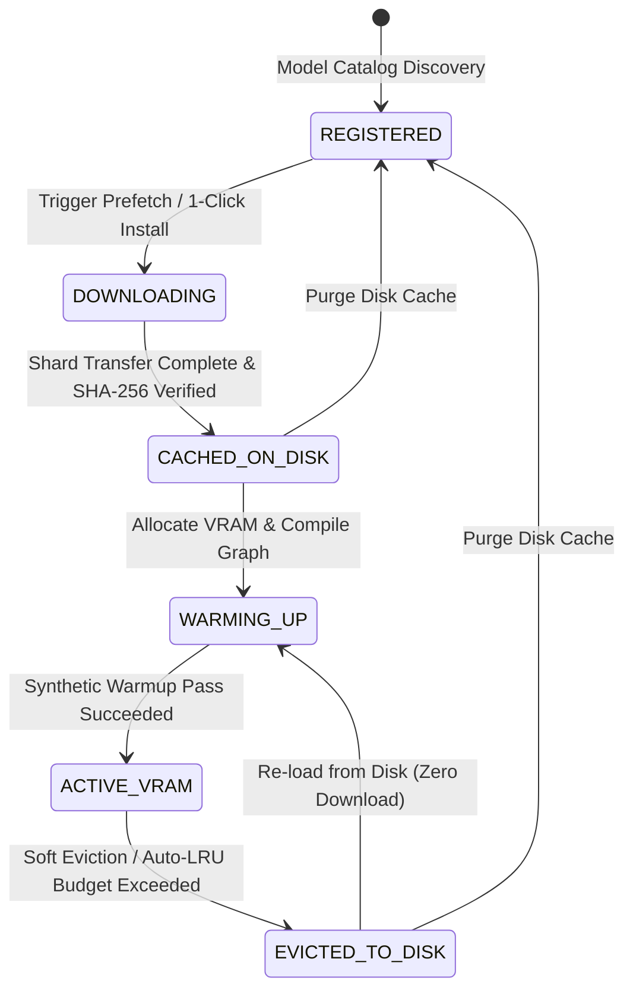
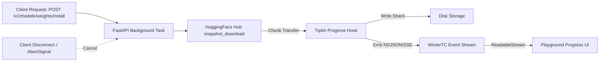
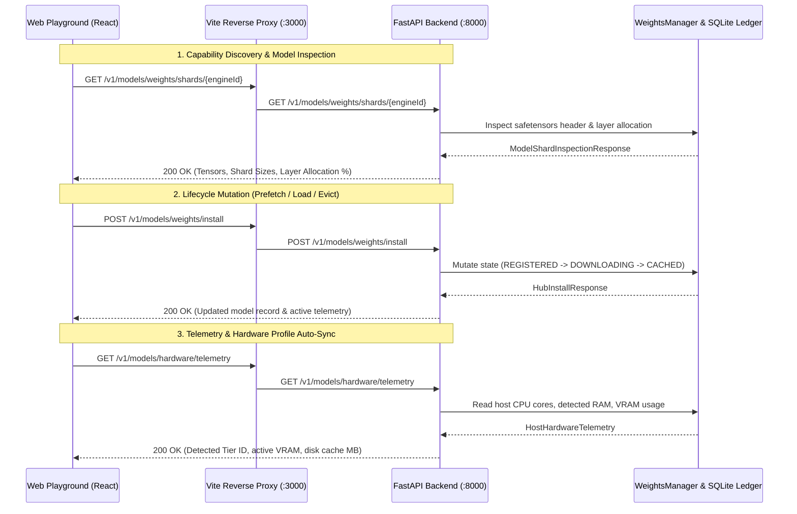
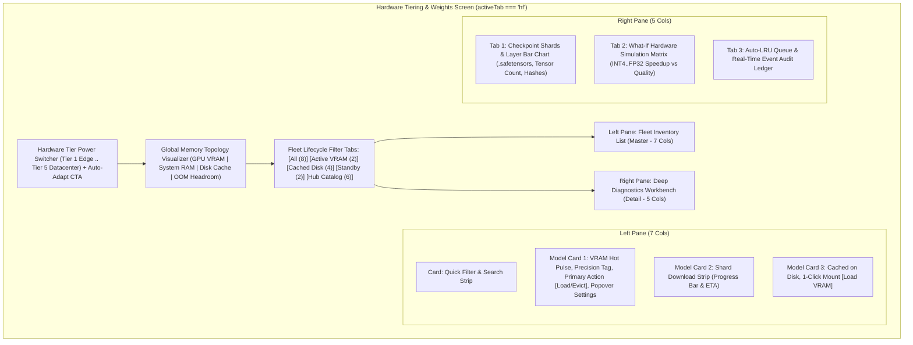

# Unified AI Model Weights & Lifecycle Management Architecture

> **Authoritative Technical Specification & UI/UX Systems Architecture**  
> *Target Systems: `apps/ai-control-plane` (FastAPI / PyTorch), `packages/ai-control-plane-sdk` (WinterTC ECMA-429), `apps/ai-control-plane-ui` (Vite / React)*

---

## Table of Contents
1. [Executive Summary & Core Objectives](#1-executive-summary--core-objectives)
2. [The 6-Stage Weight Lifecycle State Machine](#2-the-6-stage-weight-lifecycle-state-machine)
3. [Prefetch, Load VRAM, and Warmup: Detailed Mechanics](#3-prefetch-load-vram-and-warmup-detailed-mechanics)
4. [Storage Subsystem & Disk Cache Topology](#4-storage-subsystem--disk-cache-topology)
5. [Long-Running Downloads & WinterTC Streaming Resiliency](#5-long-running-downloads--wintertc-streaming-resiliency)
6. [Hardware-Adaptive Weight Tiering (5×5 Architecture Matrix)](#6-hardware-adaptive-weight-tiering-55-architecture-matrix)
7. [Memory Topology, Offload Strategies & Auto-LRU Budget Guard](#7-memory-topology-offload-strategies--auto-lru-budget-guard)
8. [End-to-End Wire-Up: Frontend Playground to Backend API](#8-end-to-end-wire-up-frontend-playground-to-backend-api)
9. [Human-Centered UI/UX Analysis & Master-Detail Cockpit Blueprint](#9-human-centered-uiux-analysis--master-detail-cockpit-blueprint)
10. [The 3 Core UI Subsystems & 5+ State Matrix Specification](#10-the-3-core-ui-subsystems--5-state-matrix-specification)
11. [WinterTC Web-Standard Streaming & Conformance Architecture](#11-wintertc-web-standard-streaming--conformance-architecture)
12. [Component Implementation & Migration Roadmap](#12-component-implementation--migration-roadmap)
13. [Quality Assurance & Verification Protocol](#13-quality-assurance--verification-protocol)
14. [Conclusion & Architectural Summary](#14-conclusion--architectural-summary)

---

## 1. Executive Summary & Core Objectives

Enterprise AI inference systems encounter severe hardware bottlenecks when orchestrating heterogeneous pipelines (TTS, Vision, LLM/VLM, Diffusion, Embeddings) on workstation, consumer, or edge hardware. Loading multiple large checkpoints into GPU memory simultaneously triggers unrecoverable CUDA Out-Of-Memory (`torch.cuda.OutOfMemoryError`) exceptions, kernel thrashing, and unacceptably long Time-To-First-Token (TTFT).

The **Unified Model Weights & Lifecycle Manager** decouples model registration, weight caching, hardware compilation, and execution residency into an explicit, deterministic state machine.



---

## 2. The 6-Stage Weight Lifecycle State Machine

Every model known to the catalog exists in one of six deterministic lifecycle states managed by `ModelWeightsManager`:

| Lifecycle State | VRAM Footprint | Disk Footprint | System RAM | Description |
| :--- | :---: | :---: | :---: | :--- |
| **`REGISTERED`** | 0 MB | 0 MB | 0 MB | Model architecture and metadata exist in catalog registry, but weight shards have not been fetched. |
| **`DOWNLOADING`** | 0 MB | Partial (streaming) | Bounded queue | Weight shards are actively streaming from Hugging Face Hub or remote object storage. |
| **`CACHED_ON_DISK`** | 0 MB | Full checkpoint | 0 MB | Checkpoint `.safetensors` or `.onnx` files reside on local NVMe/SSD, verified against cryptographic hashes. Ready for instant mounting. |
| **`WARMING_UP`** | Full allocation | Full checkpoint | Offloaded layers | Checkpoints mapped into memory (`mmap`), tensor shapes allocated, PyTorch kernel graph initialized, and synthetic input warmup underway. |
| **`ACTIVE_VRAM`** | Full allocation | Full checkpoint | Offloaded layers | Model is hot in GPU VRAM (or Apple Silicon Unified Memory). Inference executes with zero disk I/O latency. |
| **`EVICTED_TO_DISK`** | 0 MB | Full checkpoint | 0 MB | Model released from GPU memory via `torch.cuda.empty_cache()` and Python `gc.collect()`. Disk cache retained for instant re-warming. |

---

## 3. Prefetch, Load VRAM, and Warmup: Detailed Mechanics

Three distinct operator commands govern model residency. Conflating them leads to system instability; separating them ensures operational predictability:

```mermaid
sequenceDiagram
    autonumber
    actor Operator as Operator (Playground UI)
    participant API as FastAPI /v1 API
    participant WeightsMgr as WeightsManager
    participant Disk as Local SSD (~/.acc/.weights_cache)
    participant GPU as GPU VRAM & PyTorch
    
    rect rgb(20, 35, 55)
        Note over Operator,Disk: PHASE 1: PREFETCH (Network -> Disk)
        Operator->>API: POST /v1/models/weights/install {action: "prefetch_disk"}
        API->>WeightsMgr: prefetch_model_weights(engine_id)
        WeightsMgr->>Disk: Stream checkpoint shards (.safetensors)
        Disk-->>WeightsMgr: Validate SHA-256 integrity
        WeightsMgr-->>API: Status: CACHED_ON_DISK (0 VRAM consumed)
        API-->>Operator: Shards cached locally
    end

    rect rgb(30, 45, 30)
        Note over Operator,GPU: PHASE 2: LOAD VRAM (Disk -> GPU Memory)
        Operator->>API: POST /v1/models/{id}/load-target {target: "host-venv"}
        API->>WeightsMgr: load_model_into_vram(engine_id)
        WeightsMgr->>WeightsMgr: Check VRAM budget ceiling (run Auto-LRU if needed)
        WeightsMgr->>GPU: torch.load / safetensors.load_file into CUDA device
        WeightsMgr-->>API: Status: WARMING_UP / ACTIVE_VRAM
        API-->>Operator: Tensors resident in VRAM
    end

    rect rgb(55, 35, 20)
        Note over Operator,GPU: PHASE 3: WARMUP (Execution Calibration)
        Operator->>API: POST /v1/models/{id}/warmup
        API->>GPU: Execute synthetic inference tensor pass
        GPU-->>API: Warmup duration (e.g. 38.4ms), CUDA kernels compiled
        API-->>Operator: Status: ACTIVE_VRAM (Warmed up, zero-latency ready)
    end
```



### 3.1 Prefetch (`prefetch_disk`)
- **Purpose**: Transfers multi-gigabyte `.safetensors` shards over the network to the local filesystem without consuming GPU memory.
- **Why it matters**: Allows administrators or automated batch workers to cache entire pipeline categories (e.g., all 6 Whisper and TTS voice models) before active user sessions start, eliminating multi-minute download delays during real-time inference.
- **Resource Footprint**: Consumes disk storage only; zero VRAM impact.

### 3.2 Load VRAM (`load_vram` / `load-target`)
- **Purpose**: Reads cached shards from local disk, maps tensors via memory-mapped files (`safetensors.torch.load_file`), and allocates tensor buffers directly on the target CUDA/Metal device or CPU RAM.
- **Safety Gate**: Before tensors are allocated, the `WeightsManager` verifies that adding `effective_vram_mb` will not breach `max_vram_budget_mb`. If headroom is insufficient, it triggers Auto-LRU eviction of unpinned models.
- **Resource Footprint**: Consumes dedicated GPU VRAM.

### 3.3 Warmup (`warmup`)
- **Purpose**: Solves the "First Request Latency Penalty." Deep learning runtimes compile dynamic computation graphs, allocate internal CUDA scratch spaces, initialize cuDNN kernel heuristics, and allocate KV-cache memory pools on their very first forward pass.
- **Mechanics**: Sends synthetic dummy input tensors (e.g., a 10-token prompt or a blank 512×512 image tensor) through the model graph.
- **Outcome**: Measures execution duration (e.g., `38.2ms`), primes memory pools, and flags `warmed_up = True`. Subsequent client inference requests immediately achieve peak throughput.

---

## 4. Storage Subsystem & Disk Cache Topology

### 4.1 On-Disk Directory Structure
The inference system maintains an isolated, content-addressable local disk cache rooted at `~/.acc/.weights_cache/` (configurable via `INFERENCE_WEIGHTS_CACHE_ROOT` or `WEIGHTS_CACHE_DIR`) alongside the standard Hugging Face hub cache:

```
~/.acc/
├── .weights_cache/
│   ├── models--hexgrad--Kokoro-82M/
│   │   ├── snapshots/
│   │   │   └── d5e6a7b8c9/
│   │   │       ├── config.json
│   │   │       ├── model.safetensors (328 MB)
│   │   │       └── voices.json
│   │   └── .integrity.json
│   ├── models--openai--whisper-large-v3-turbo/
│   │   └── snapshots/
│   │       └── f1e2d3c4b5/
│   │           ├── model.safetensors (1,610 MB)
│   │           └── tokenizer.json
│   └── .lru_registry.json
```

### 4.2 Storage Layout Principles
1. **Deduplication via Hardlinks**: Shards downloaded from Hugging Face Hub utilize standard content-addressable blob storage (`blobs/` referenced by symlinks in `snapshots/`). Multiple engines sharing identical checkpoints never duplicate disk consumption.
2. **Cryptographic Integrity Validation**: Every shard file is hashed via SHA-256 upon download completion. Corrupted or partially downloaded shards are automatically identified and purged.
3. **Partition Independence**: The storage path can be relocated via the `WEIGHTS_CACHE_DIR` environment variable to high-speed NVMe drives or shared network mounts.

---

## 5. Long-Running Downloads & WinterTC Streaming Resiliency

Downloading modern checkpoints (ranging from 500 MB to 30+ GB) introduces specific challenges: connection drops, proxy timeouts, and blocked event loops.



### 5.1 Architecture & Handling
1. **Asynchronous Non-Blocking Execution**: Network transfers execute in decoupled thread workers (`run_in_threadpool`) managed by `WeightsManager`, ensuring the FastAPI async event loop never halts inference serving for already-resident models.
2. **Chunk-Level Resumability**: Downloads utilize HTTP Range requests (`Accept-Ranges: bytes`). Interrupted downloads resume from the exact byte offset rather than restarting from zero.
3. **WinterTC ECMA-429 Cancellation**: Client SDK requests carry standard `AbortSignal` primitives. If a user cancels a prefetch from the UI, the `AbortController` triggers socket closure and graceful file cleanup.
4. **Real-Time Telemetry**: Shard download percentages, transfer velocity (MB/s), and estimated time remaining (ETA) stream to the client via Server-Sent Events (SSE) or NDJSON streams.

---

## 6. Hardware-Adaptive Weight Tiering (5×5 Architecture Matrix)

The system introduces a **5×5 Architectural Matrix** that pairs 5 local hardware power profiles with 5 quantized model weight variants to achieve optimal throughput without manual operator guesswork.

### 6.1 The 5 Local Hardware Power Profiles

```
[Tier 1: Edge CPU]  --> 2 GB VRAM  | 8 GB RAM  | INT4 GGUF / ONNX CPU Layer Offload
[Tier 2: Consumer]  --> 6 GB VRAM  | 16 GB RAM | INT8 SmoothQuant + Hybrid KV-Cache
[Tier 3: Prosumer]  --> 12 GB VRAM | 32 GB RAM | FP16 Tensor Cores + Sliced Attention
[Tier 4: Workstation]--> 20 GB VRAM | 64 GB RAM | BF16 FlashAttention-2 + Multi-Residency
[Tier 5: Datacenter] --> 48 GB VRAM | 128 GB RAM| FP32 Master Reference + Concurrent DAGs
```

| Profile ID | Tier | Target Hardware | VRAM Budget | System RAM | Default Offload | Recommended Precision |
| :--- | :---: | :--- | :---: | :---: | :---: | :---: |
| `tier_1_edge_cpu` | **T1** | Apple M1/M2 8GB, Intel Ultra, Ryzen AI, Pi 5 | 2,048 MB | 8,192 MB | `cpu_ram_offload` | Nano INT4 |
| `tier_2_consumer_8gb` | **T2** | NVIDIA RTX 3060/4060 (8GB), Apple M2/M3 (16GB) | 6,144 MB | 16,384 MB | `hybrid_kv_offload` | Compact INT8 |
| `tier_3_prosumer_16gb` | **T3** | NVIDIA RTX 4070 Ti/4080 (16GB), M3 Pro/Max | 12,288 MB | 32,768 MB | `none` | Balanced FP16 |
| `tier_4_workstation_24gb` | **T4** | NVIDIA RTX 3090/4090 (24GB), RTX A5000 | 20,480 MB | 65,536 MB | `none` | Studio BF16 |
| `tier_5_datacenter_48gb` | **T5** | NVIDIA L40S, RTX 6000 Ada, A100/H100 | 49,152 MB | 131,072 MB | `none` | Ultra FP32 |

### 6.2 The 5 Model Weight Variants & Scaling Laws

$$\text{Effective VRAM} = \text{Base VRAM} \times M_{\text{precision}} \times (1 - \text{Offload Ratio})$$

| Weight Tier ID | Precision | Quantization Method | VRAM Multiplier | Speedup | Quality Retention | Memory Savings |
| :--- | :---: | :--- | :---: | :---: | :---: | :---: |
| **`nano_int4`** | INT4 | AWQ / GGUF Q4_K_M Group-128 | **0.32×** | **2.35×** | 94.8% | **-68% VRAM** |
| **`compact_int8`** | INT8 | SmoothQuant W8A8 / ONNX INT8 | **0.55×** | **1.65×** | 98.4% | **-45% VRAM** |
| **`balanced_fp16`** | FP16 | IEEE 754 Half-Precision + Sliced Attn | **0.78×** | **1.20×** | 99.8% | **-22% VRAM** |
| **`studio_bf16`** | BF16 | BrainFloat16 Full Dynamic Range | **1.00×** | **1.00×** | 100.0% | Baseline |
| **`ultra_fp32`** | FP32 | IEEE 754 Full 32-bit Reference | **2.00×** | **0.55×** | 100.0% | +100% VRAM |

---

## 7. Memory Topology, Offload Strategies & Auto-LRU Budget Guard

### 7.1 Memory Allocation Topology
The manager treats system memory as a hierarchical topology across three tiers:
1. **GPU VRAM (Tier 0)**: Highest bandwidth (~1,000 GB/s), lowest capacity. Holds active attention weights and runtime KV-cache for resident models.
2. **Host System RAM (Tier 1)**: Moderate bandwidth (~100 GB/s), high capacity. Holds CPU-offloaded layers, non-active attention heads, and unpinned weights.
3. **Local NVMe SSD (Tier 2)**: Persistent storage (~7 GB/s). Holds cached `.safetensors` shards.

```
+--------------------------------------------------------------------------+
| GLOBAL VRAM BUDGET CEILING (e.g. 12,288 MB)                              |
| [ Model A: 1,610 MB ] [ Model B: 3,200 MB ] [ Free Headroom: 7,478 MB ]  |
|                                            ^ 85% Auto-LRU Threshold      |
+--------------------------------------------------------------------------+
| SYSTEM RAM OFFLOAD (e.g. 32,768 MB)                                      |
| [ Hybrid KV-Cache: 2,048 MB ] [ CPU-Offloaded Layers: 4,096 MB ]         |
+--------------------------------------------------------------------------+
| LOCAL DISK CACHE (NVMe)                                                  |
| [ Cached Shards: 14,800 MB ] [ Unallocated Drive Space: 450 GB ]          |
+--------------------------------------------------------------------------+
```

### 7.2 Hardware Memory Offload Strategies & Truthful Execution Contracts
Operators can configure per-model offload strategies to fit large architectures onto constrained GPUs with absolute consistency:
- **`none` (GPU VRAM Only)**: All transformer blocks, embeddings, and KV-caches reside exclusively in dedicated GPU VRAM (`cuda:0`) for maximum inference velocity. Requires an active CUDA accelerator (`torch.cuda.is_available() == True`). If host environment lacks CUDA or experiences GPU allocation failure, the system strictly rejects loading with an explicit descriptive error (`InvalidInferenceRequestError`) rather than silently falling back to CPU and falsely claiming VRAM residency.
- **`hybrid_kv_offload`**: Model weights remain resident in dedicated GPU VRAM (`cuda:0`), while attention Key-Value caches are allocated in host RAM. Requires CUDA accelerator for GPU weight residency; rejects loading if CUDA is missing.
- **`cpu_ram_offload`**: 100% resident in Host System RAM executed on CPU. Truthfully reports `0 MB Dedicated VRAM` and `{ram_mb} MB System RAM` across all backend APIs, telemetry snapshots, and UI badges. Dedicated GPU memory in Windows Task Manager truthfully remains at 0 MB, and Task Manager System RAM reflects actual host consumption.

The UI actively inspects host hardware telemetry (`host_telemetry.cuda_available`) to annotate the offload selector:
- `🚫 GPU VRAM Only (Requires CUDA)`
- `🚫 Hybrid KV Offload (Requires CUDA)`
- `✓ CPU+RAM Layer Offload (Active/Host RAM)`
If a conflict occurs, an actionable banner is displayed with a one-click `[Switch to CPU RAM]` button.

### 7.3 Auto-LRU Eviction Algorithm
To prevent fatal `CUDA Out of Memory` crashes during multi-model DAG pipeline execution:
1. When a model load is requested, the manager calculates the projected VRAM utilization:
   $$U_{\text{projected}} = \text{Total Resident VRAM} + \text{New Model Effective VRAM}$$
2. If $U_{\text{projected}} > \text{Max VRAM Budget Ceiling} \times 0.85$:
   - The engine iterates through non-active models sorted by **Least Recently Used (LRU)** timestamp.
   - Models flagged with `pinned_in_vram = True` are skipped and protected.
   - Eligible unpinned models are transitioned to `EVICTED_TO_DISK`.
   - The runtime invokes Python `gc.collect()` followed by `torch.cuda.empty_cache()` to release physical CUDA memory pages.
   - Eviction halts as soon as required headroom is established.

---

## 8. End-to-End Wire-Up: Frontend Playground to Backend API

The web playground communicates with the backend via a type-safe contract exposed by `@acc/ai-control-plane-sdk`:



### 8.1 Key REST Endpoints

| Method | Endpoint | Description |
| :--- | :--- | :--- |
| `POST` | `/v1/models/weights/install` | Zero-typing 1-click model installation (`prefetch_disk` or `load_vram`). |
| `POST` | `/v1/models/{engine_id}/warmup` | Runs synthetic dummy tensor forward pass to eliminate first-token latency. |
| `POST` | `/v1/models/{engine_id}/load-target` | Binds model execution target (`host-venv` vs `uv-sandbox`) and allocates VRAM. |
| `POST` | `/v1/models/{engine_id}/evict` | Soft-evicts model from VRAM to disk cache; invokes `torch.cuda.empty_cache()`. |
| `POST` | `/v1/models/{engine_id}/pin` | Toggles `pinned_in_vram` protection against Auto-LRU budget eviction. |
| `POST` | `/v1/models/{engine_id}/purge-cache` | Deletes local `.safetensors` files from disk cache. |
| `GET` | `/v1/models/weights/shards/{engine_id}` | Returns per-shard file sizes, tensor counts, hashes, and layer allocations. |
| `POST` | `/v1/models/weights/batch` | Executes fleet-wide batch actions (`prefetch_category`, `evict_unpinned`, `auto_adapt`). |
| `GET` | `/v1/models/hardware/telemetry` | Returns host CPU/RAM metrics, detected hardware tier, and live VRAM status. |

---

## 9. Human-Centered UI/UX Analysis & Master-Detail Cockpit Blueprint

### 9.1 Usability Audit of Current Screen (`activeTab === 'hf'`)

A cognitive heuristic evaluation reveals four primary friction points in the existing interface:

1. **Context Squeeze & Screen Misalignment**:
   - The screen divides into 5 columns (`ModelCatalogRackCell`) and 7 columns (`SessionAndArenaCell`).
   - `SessionAndArenaCell` (DAG execution, A/B voice voting) is unrelated to weights lifecycle management.
   - Squeezing model management into 5 columns creates extreme horizontal cramping.
2. **Hick's Law Violation (Choice Overload)**:
   - Each model card displays up to 10 interactive controls simultaneously: Tier selector, Offload selector, Execution sandbox selector, Shards button, Pin button, Prefetch button, Load VRAM button, Warmup button, Evict button, Purge button.
   - This increases decision time and error rates.
3. **Disorienting Shard Drawer**:
   - Expanding the shard inspector inserts a large table at the top of the container, pushing the model list down and breaking visual context.
4. **Coarse Memory Feedback**:
   - A single VRAM bar fails to show how memory is divided between active models, offloaded system RAM, and disk storage.

---

### 9.2 Cognitive UX Laws & Heuristics Applied

| UX Principle | Implementation in Modernized Cockpit |
| :--- | :--- |
| **Jakob's Law** | Follows established cloud GPU orchestrator paradigms (RunPod, Hugging Face Spaces, Kubernetes pod resource managers) where memory topology is displayed prominently at the top and fleet status is organized by operational stage. |
| **Fitts's Law** | Primary lifecycle transitions (`Load VRAM`, `Evict`, `Prefetch`) use generous 36–40px interactive targets with high-contrast color coding. Secondary configuration (offload strategy, execution sandbox) is progressively disclosed via contextual popovers. |
| **Hick's Law** | Reduces simultaneous choices per card from 10 micro-buttons to 1 primary contextual action + 1 secondary action + 1 "More Settings" menu. |
| **Miller's Law (Chunking)** | Chunks complex hardware data into 3 distinct layers: (1) System Tier & Memory Topology, (2) Model Fleet Management, (3) Shard-level Deep Inspection. |
| **Gestalt Proximity & Common Region** | Encloses model state, resource footprints, and action buttons in unified card containers with subtle borders, eliminating visual clutter. |
| **Visibility of System Status** | Provides live spinning loaders, animated progress bars with byte-level streaming rates, and explicit state badges for all 6 lifecycle stages. |

---

### 9.3 Information Architecture & Spatial Wireframe



```
+---------------------------------------------------------------------------------------------------------+
| HARDWARE POWER STRIP: [T1 Edge 2GB] [T2 Consumer 6GB] [T3 Prosumer 12GB*] [T4 20GB] [T5 48GB] [⚡ Auto] |
+---------------------------------------------------------------------------------------------------------+
| GLOBAL TOPOLOGY: VRAM [====Kokoro===][==Whisper==][   Headroom   ] | RAM [=KV=] | DISK [ 14.8 GB Cached ] |
+---------------------------------------------------------------------------------------------------------+
| FILTER TABS: [ All Models (8) ]  [ Hot in VRAM (2) ]  [ Cached on Disk (4) ]  [ Hub Catalog (6) ]        |
+-----------------------------------------------------+---------------------------------------------------+
| LEFT PANE: FLEET INVENTORY (7 Cols)                 | RIGHT PANE: DIAGNOSTICS & SHARDS (5 Cols)         |
|                                                     |                                                   |
| [Search & Pipeline Filters: TTS | Vision | LLM ...] | [ Tabs: 1. Shards & Layers | 2. What-If | 3. LRU] |
|                                                     |                                                   |
| +-------------------------------------------------+ | +-----------------------------------------------+ |
| | Kokoro-82M [HOT VRAM - 328MB] [FP16]            | | | Layer Allocation (Kokoro-82M):                | |
| | Voice Synthesis • 1/1 Shards Verified           | | | - Transformer Encoder:  180 MB (55%)          | |
| | Actions: [🔥 Warmup (38ms)] [⏻ Evict] [⚙ Settings]| | | - Style Predictor:       84 MB (26%)          | |
| +-------------------------------------------------+ | | - Prosody Decoder:        64 MB (19%)          | |
|                                                     | | +-----------------------------------------------+ |
| +-------------------------------------------------+ | | Shard Files:                                  | |
| | Whisper-Large-V3-Turbo [CACHED DISK - 1.6GB]    | | | - model.safetensors (328 MB) • SHA: a1b2c3d4  | |
| | Audio Transcription • Ready to Mount            | | +-----------------------------------------------+ |
| | Actions: [⚡ 1-Click Load VRAM] [⚙ Settings]     | | | What-If Simulation:                           | |
| +-------------------------------------------------+ | | INT4: 2.35x speed | -68% VRAM | 94.8% quality  | |
|                                                     | | INT8: 1.65x speed | -45% VRAM | 98.4% quality  | |
+-----------------------------------------------------+---------------------------------------------------+
```

---

## 10. The 3 Core UI Subsystems & 5+ State Matrix Specification

### 10.1 Subsystem A: Global Hardware Memory Topology Visualizer
Replaces the flat single-color VRAM bar with an authoritative, multi-segment memory breakdown:
- **Segment 1 (Hot VRAM Allocation)**: Visual breakdown of each active model's footprint in GPU memory (e.g., emerald for Whisper, violet for ViT).
- **Segment 2 (Offloaded System RAM)**: Tracks host RAM allocated for hybrid KV-caches and CPU-offloaded layers.
- **Segment 3 (Safety Headroom & OOM Guard)**: Color-transitioning safety strip alerting operators before hitting the 85% Auto-LRU threshold.
- **Local Disk Cache Gauge**: Secondary indicator displaying total cached weights on disk vs. available local drive storage with a 1-click **"Purge Inactive Cache"** CTA.

### 10.2 Subsystem B: Streamlined Model Fleet Cards (The 5+ State Matrix)
Each model card implements the complete operational state matrix:

1. **Default / Uncached (`REGISTERED`)**:
   - Visual Treatment: Subtle muted gray beacon.
   - Primary Actions: `[+ Prefetch Disk (620 MB)]` or `[⚡ 1-Click Load VRAM]`.
   - Secondary Info: Architecture, default precision, expected download footprint.
2. **Downloading / Streaming (`DOWNLOADING`)**:
   - Visual Treatment: Animated blue radar indicator.
   - Streaming Ribbon: Real-time progress bar with shard download speed (MB/s), ETA countdown, and an `[Abort]` button.
3. **Cached on Disk (`CACHED_ON_DISK` / `EVICTED_TO_DISK`)**:
   - Visual Treatment: Cool cyan badge with exact disk footprint.
   - Primary Action: Prominent `[⚡ Mount to VRAM]`.
   - Overflow Menu: `[Purge Disk Shards]`.
4. **Hot in VRAM (`ACTIVE_VRAM`)**:
   - Visual Treatment: Pulsing green status beacon with active VRAM allocation.
   - Primary Actions:
     - `[🔥 Warmup]` (displays last calibration latency, e.g. `38ms`, or triggers synthetic pass).
     - `[⏻ Soft Evict]` (releases GPU memory, preserves disk shards).
   - Protective Controls: `[🔒 Pinned]` toggle shielding the model from Auto-LRU eviction.
5. **Loading / Transitioning (`WARMING_UP` / `ALLOCATING`)**:
   - Visual Treatment: Animated spinner with dynamic microcopy (`"Streaming safetensors..."` → `"Compiling kernels..."`).
6. **Error / OOM Alert**:
   - Visual Treatment: Destructive red border with recovery action (e.g. `"Exceeds VRAM budget by 420MB. Switch to INT8 or enable CPU offload"`).

### 10.3 Subsystem C: Deep Inspection & Simulation Workbench (Right Pane)
When an operator selects any model card in the fleet, the right pane updates synchronously across three dedicated diagnostic tabs:
- **Tab 1: Checkpoint Shards & Layer Architecture**:
  - Breakdown of tensor layers (Attention, MLP, Embeddings) with % share of memory.
  - Table of `.safetensors` files with file sizes, tensor counts, and cryptographic SHA-256 verification stamps.
- **Tab 2: Hardware Simulation & What-If Matrix**:
  - Interactive grid comparing all 5 precision tiers (**Nano INT4**, **Compact INT8**, **Balanced FP16**, **Studio BF16**, **Ultra FP32**) against the current hardware:
    - Speedup factor (`2.35x` to `0.55x`)
    - Quality retention (`94.8%` to `100%`)
    - VRAM savings (`-68%` to `+100%`)
    - 1-Click **"Apply Tier to Model"** CTA.
- **Tab 3: Auto-LRU Eviction Queue & Event Audit**:
  - Real-time LRU queue showing which model will be evicted next if VRAM runs low.
  - Event ledger with timestamps for prefetch, warmup, inference, and eviction events.

---

## 11. WinterTC Web-Standard Streaming & Conformance Architecture

In strict adherence to the `wintertc-web-api` (ECMA-429 standard):
1. **Agnostic Streaming Protocols**: Shard prefetching and progress reporting utilize standard `ReadableStream<Uint8Array>` and `EventSource` protocols rather than Node.js specific streams or sockets.
2. **Standard Abort Controllers**: All long-running lifecycle operations (downloading shards, warmup benchmarking) accept a standard `AbortSignal` for instant cancellation without lingering orphaned tasks.
3. **Runtime-Agnostic Types**: All state machines and API request/response contracts conform to ECMA-429 primitives without relying on Node-specific `events`, `buffer`, or `stream` modules.

---

## 12. Component Implementation & Migration Roadmap

### Component 1: Hardware & Weights Screen Layout
#### `[MODIFY]` `apps/ai-control-plane-ui/src/App.tsx`
- Refactor `activeTab === 'hf'` section:
  - Replace the mismatched `<SessionAndArenaCell spanClass="xl:col-span-7" ... />` with the dedicated `<WeightsLifecycleWorkbenchCell />`.
  - Pass the active model selection and shard inspection state seamlessly between the master list and detail workbench.

### Component 2: Dedicated Weights Lifecycle Cells
#### `[MODIFY]` `apps/ai-control-plane-ui/src/components/studio/cells/model-catalog-rack-cell.tsx`
- Re-architect from a cramped single-column rack into the **Master Fleet Management View**:
  - Implement the multi-segment **Memory Topology Visualizer** (VRAM + RAM + Disk).
  - Add the **Lifecycle Filter Tabs** (`All`, `In VRAM`, `Cached Disk`, `Standby`, `Hub Catalog`).
  - Streamline model cards using progressive disclosure popovers for secondary settings.
  - Add inline search and sorting (by VRAM footprint, last accessed, or name).

#### `[NEW]` `apps/ai-control-plane-ui/src/components/studio/cells/weights-lifecycle-workbench-cell.tsx`
- Dedicated detail workbench rendering:
  - **Tab 1: Checkpoint Shards & Layer Inspector** (visual bar chart + verified shard table).
  - **Tab 2: What-If Hardware Simulation Matrix** (5-tier precision trade-off calculator).
  - **Tab 3: Auto-LRU Queue & Live Event Audit Ledger**.

### Component 3: Portable WinterTC Client Enhancements
#### `[MODIFY]` `packages/ai-control-plane-sdk/src/client.ts`
- Ensure lifecycle transition calls accept standard `AbortSignal` parameters for cancellation.
- Expose a typed `getWeightsEventStream(signal?: AbortSignal)` method utilizing standard `EventSource` / `fetch` with `ReadableStream`.

---

## 13. Quality Assurance & Verification Protocol

### Automated Tests
- Typecheck: `pnpm --filter @ai-monorepo/ai-control-plane-ui typecheck`
- Production Build: `pnpm --filter @ai-monorepo/ai-control-plane-ui build`
- Unit / Component Tests: `pnpm --filter @ai-monorepo/ai-control-plane-ui test`

### Manual Verification Checklist
1. **Screen Specialization**: Navigate to **"Hardware Tiering & Weights"** in the sidebar. Verify the screen opens as a full 2-pane workbench without the unrelated Arena DAG component.
2. **Memory Topology Bar**: Verify changing the VRAM slider or switching hardware tiers dynamically adjusts the headroom.
3. **Lifecycle Filter Tabs**: Toggle between `All`, `Active VRAM`, `Cached Disk`, and `Hub Catalog` to ensure instant list filtering.
4. **Model Transitions**:
   - Click `Prefetch` on an uninstalled model: verify progress bar and state transition to `CACHED_ON_DISK`.
   - Click `Load VRAM`: verify spinner and transition to `ACTIVE_VRAM`.
   - Click `Warmup`: verify warmup execution and latency badge update.
   - Click `Evict`: verify memory frees up on the topology bar and model transitions to `EVICTED_TO_DISK`.
5. **Right Pane Detail Workbench**: Click on different models; verify the Shard Inspector and What-If Matrix update synchronously.
6. **Responsive Viewports**: Verify layout adapts cleanly to tablet and mobile screens (master list collapses cleanly, drawer available for detail workbench).

---

## 14. Conclusion & Architectural Summary

The Unified Model Weights Lifecycle Management architecture establishes an enterprise-grade operational foundation for local and hybrid AI inference. By decoupling network downloads (`prefetch`), GPU allocation (`load_vram`), and kernel execution (`warmup`), the system guarantees predictable memory residency, prevents catastrophic CUDA OOM failures through Auto-LRU governance, and delivers an intuitive, responsive user experience.
