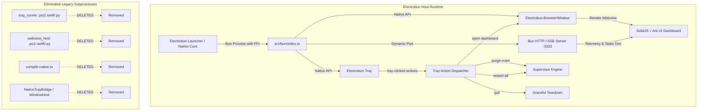

# Implementation Plan 03 - Pure Electrobun Migration & Multi-Platform Script Elimination

## Problem Statement
The ACC Control Plane in `apps/ai-supervisor` currently uses an ad-hoc subprocess bridging system to control desktop windows and tray icons:
- `NativeTrayBridge.ts` invoking platform scripts (`tray_runner.ps1`, `tray_runner_mac.swift`, `tray_runner_linux.py`).
- `WindowHost.ts` invoking webview scripts (`webview_host_win.ps1`, `webview_host_mac.swift`, `webview_host_linux.py`) with browser fallbacks.
- `scripts/compile-native.ts` compiling Swift universal binaries for macOS.
- Bypassing the native Electrobun runtime by invoking raw `bun run src/bun/index.ts`, which causes Electrobun FFI / bridge libraries (`ElectrobunCore.dll` / `libNativeWrapper`) to be missing.

The user mandate is to eliminate all multi-platform tray bridge scripts and native webview hosts, replacing them entirely with **pure Electrobun**.

---

## Architecture & Migration Design

---

## Proposed Changes

### 1. `apps/ai-supervisor/src/bun/index.ts`
- Replace imports of `NativeTrayBridge` and `WindowHost` with `BrowserWindow` and `Tray` from `"electrobun/bun"`.
- Implement `openDashboardWindow()` with singleton window reuse (`show()` / `activate()`), lifecycle recreation on close, and default size 1200x820.
- Implement `Tray` instantiation via `new Tray({ title: "ACC Control Plane", image: getTrayIcon(...) })`.
- Wire `tray.setMenu()` with standard control options:
  - `Open Dashboard`
  - `Purge All VRAM`
  - `Restart Services`
  - `Check for Updates...`
  - `Quit`
- Wire `tray.on("tray-clicked")` event dispatcher.
- Wire `supervisorEngine.onStatusChange` to update `tray.setImage(...)` and `tray.setTitle(...)`.
- Update graceful `shutdown()` to remove tray and close active window cleanly.

### 2. Remove Legacy Subprocess Artifacts & Bridges
- Remove:
  - `apps/ai-supervisor/src/bun/NativeTrayBridge.ts`
  - `apps/ai-supervisor/src/bun/WindowHost.ts`
  - `apps/ai-supervisor/src/bun/platform/` directory (IProcessRunner, strategies/tray, strategies/window)
  - `apps/ai-supervisor/src/assets/tray_runner.ps1`
  - `apps/ai-supervisor/src/assets/tray_runner_mac.swift`
  - `apps/ai-supervisor/src/assets/tray_runner_linux.py`
  - `apps/ai-supervisor/src/assets/webview_host_win.ps1`
  - `apps/ai-supervisor/src/assets/webview_host_mac.swift`
  - `apps/ai-supervisor/src/assets/webview_host_linux.py`
  - `apps/ai-supervisor/src/assets/bin/` (and compiled swift binaries)
  - `apps/ai-supervisor/scripts/compile-native.ts`

### 3. Update Build & Dev Tooling
- Update `apps/ai-supervisor/package.json`:
  - Remove `compile:native`.
  - Wire `dev` to `scripts/dev-runner.ts` (which spawns `electrobun dev` and `build-ui.ts --watch`).
  - Wire `dev:app` to `electrobun dev`.
  - Wire `build` to `bun run build:ui && electrobun build`.
  - Wire `start` to `electrobun dev`.
- Update `apps/ai-supervisor/scripts/dev-runner.ts`:
  - Replace `spawn(["bun", "--watch", "run", "src/bun/index.ts"])` with `spawn(["bun", "run", "electrobun", "dev"])`.
- Update `apps/ai-supervisor/tsconfig.json`:
  - Path mappings for `electrobun` and `electrobun/bun` to `.hutch/devkit/api/sdks/main/index.ts`.

---

## Verification Plan
1. Typecheck: `bun x tsc --noEmit --project apps/ai-supervisor/tsconfig.json`
2. Electrobun Config Validation: `pnpm --filter @acc/ai-supervisor exec electrobun config`
3. SolidJS UI Build: `bun run apps/ai-supervisor/scripts/build-ui.ts`
4. Dev Runner Smoke Test: Verify Electrobun launcher boots and mounts native tray & window.
