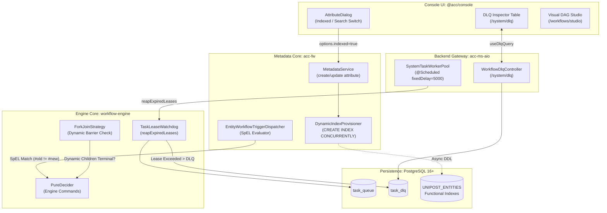

# Implementation Plan 49: Full-Stack Backend & Console UI Wiring for Metadata & Workflow Orchestration Hardening

## Goal Description
Deliver an end-to-end, production-grade hardening and enhancement across both **`@acc/backend`** (`workflow-engine`, `acc-ms-aio`, `acc-fw`) and **`@acc/console`** (React 19 / Vite 8 UI app):
1. **Workflow Engine & System Fleet**:
   - **Backend**: Implement the missing `TaskLeaseWatchdog` in `workflow-engine`, wire its scheduled reaper into `SystemTaskWorkerPool` in `acc-ms-aio`, and guarantee that tasks exceeding max lease attempts are quarantined to `task_dlq`.
   - **Frontend UI**: Wire the Dead-Letter Queue UI (`apps/console/src/features/dlq`) to display lease-reaped zombie tasks with dedicated filter chips (`Reason: LEASE_EXPIRED`) and allow one-click retry / discard with live React Query invalidation.
   - **Dynamic Fork Convergence**: Update `ForkJoinStrategy` in the backend so `joinOn` nodes waiting on `DYNAMIC_FORK` branches dynamically verify that all spawned subtasks are completed before unblocking.
2. **Metadata Platform**:
   - **Backend**: Extend `DynamicIndexProvisioner` in `acc-fw` to asynchronously provision PostgreSQL expression indexes on `UNIPOST_ENTITIES ((data->>'system_name'))` when `options.indexed = true`.
   - **Frontend UI**: Update `AttributeDialog` (`apps/console/src/features/metadata/components/schema-builder/attribute-dialog.tsx`) to add an **"Index & Search Optimization"** switch ("Accelerate Filters with PostgreSQL Functional Index"). When toggled on, it persists `options.indexed = true` to trigger automatic background DDL provisioning.
   - **SpEL Entity Trigger Engine**: Add Spring Expression Language (`SpelExpressionParser`) evaluation in `EntityWorkflowTriggerDispatcher` to match field-level deltas (`#old` vs `#new`), preventing notification and workflow trigger stampedes.

---

## User Review Required

> [!IMPORTANT]
> **Full-Stack Schema & DTO Contract**:
> - `CreateAttributeRequest` and `UpdateAttributeRequest` already support `options: Map<String, Object>`. No database migration or DDL table change is required for `UNIPOST_ATTRIBUTE_DEFINITIONS`.
> - Toggling "Accelerate Filters" in the Console UI stores `{ "indexed": true }` in `options`, which `DynamicIndexProvisioner` detects and executes asynchronously outside the main transaction using PostgreSQL `CREATE INDEX CONCURRENTLY IF NOT EXISTS`.
>
> **Task Lease Expiry DLQ Classification**:
> - Reaped tasks are stamped with `error_message = "TASK_LEASE_EXPIRED: Worker heartbeat lost after N attempts"`.
> - The Console DLQ table will display a high-visibility badge `Lease Expired` with elapsed duration, enabling operators to identify slow or crashed workers at a glance.

---

## Architecture Topology



---

## Proposed Changes

```
┌────────────────────────────────────────────────────────────────────────────────────────┐
│                                   COMPONENT BREAKDOWN                                  │
├────────────────────────────────────────────────────────────────────────────────────────┤
│ 1. workflow-engine:                                                                    │
│    - [NEW] com.acc.workflow.application.TaskLeaseWatchdog                             │
│    - [MODIFY] com.acc.workflow.application.WorkflowEngineService                       │
│    - [MODIFY] com.acc.workflow.core.decider.strategy.ForkJoinStrategy                 │
│                                                                                        │
│ 2. acc-ms-aio:                                                                         │
│    - [MODIFY] com.acc.aio.worker.SystemTaskWorkerPool                                  │
│                                                                                        │
│ 3. acc-fw:                                                                             │
│    - [MODIFY] com.acc.service.DynamicIndexProvisioner                                  │
│    - [MODIFY] com.acc.service.MetadataService                                          │
│    - [MODIFY] com.acc.service.workflow.EntityWorkflowTriggerDispatcher                 │
│                                                                                        │
│ 4. apps/console:                                                                       │
│    - [MODIFY] src/features/metadata/components/schema-builder/attribute-dialog.tsx     │
│    - [MODIFY] src/features/dlq/components/dlq-columns.tsx                              │
└────────────────────────────────────────────────────────────────────────────────────────┘
```

---

### Component 1: Workflow Engine Core (`apps/backend/workflow-engine`)

#### [NEW] `com/acc/workflow/application/TaskLeaseWatchdog.java`
- Implement `reapExpiredLeases(long nowEpochMs)`:
  - Iterates over `persistencePort.findExpiredLeaseTasks(nowEpochMs)`.
  - If `task.attempt() >= maxAttempts`:
    - Creates `TaskDlqRecord` with `errorMessage = "TASK_LEASE_EXPIRED: Worker heartbeat lost after " + task.attempt() + " attempts"`.
    - Persists via `persistencePort.quarantineTaskToDlq(record)`.
    - Updates execution status to `TaskStatus.TIMED_OUT`.
  - Else:
    - Increments attempt and clears `lease_owner` via `persistencePort.requeueTask(task.taskId(), task.attempt() + 1, nowEpochMs)`.

#### [MODIFY] `com/acc/workflow/application/WorkflowEngineService.java`
- Integrate `TaskLeaseWatchdog`.
- Implement `public List<TaskSnapshot> reapExpiredLeases(long nowEpochMs)`:
  - Calls `watchdog.reapExpiredLeases(nowEpochMs)`.
  - For each quarantined task, triggers `decide(task.workflowId(), nowEpochMs)` to unblock or fail the parent workflow snapshot.

#### [MODIFY] `com/acc/workflow/core/decider/strategy/ForkJoinStrategy.java`
- In `ForkJoinStrategy.evaluate()`:
  - When inspecting prerequisite tasks in `joinOn`, check if the prerequisite task definition is a `DYNAMIC_FORK` or contains dynamic subtasks.
  - If dynamic sub-tasks exist (`outputData.get("dynamicRefs")`), verify that all dynamic subtask references in `snapshot.tasksByRef()` have reached `COMPLETED`.
  - If any dynamic subtask failed, fail-fast the join node; if still in-progress, return `NodeEvaluationResult.inProgress()`.

---

### Component 2: Backend System Worker Fleet (`apps/backend/acc-ms-aio`)

#### [MODIFY] `com/acc/aio/worker/SystemTaskWorkerPool.java`
- Add scheduled reaper hook:
```java
@Scheduled(fixedDelay = 5000)
public void scheduleLeaseWatchdog() {
    try {
        engineService.reapExpiredLeases(System.currentTimeMillis());
    } catch (Exception e) {
        log.warn("Error running task lease watchdog: {}", e.getMessage());
    }
}
```

---

### Component 3: Metadata Engine & Indexing (`apps/backend/acc-fw`)

#### [MODIFY] `com/acc/service/DynamicIndexProvisioner.java`
- Add method `public void provisionAttributeIndexAsync(Long entityTypeId, String systemName, String dataType)`:
  - Sanitizes `systemName` with regex `[^a-zA-Z0-9_]`.
  - Generates DDL:
    - `NUMERIC`: `CREATE INDEX CONCURRENTLY IF NOT EXISTS idx_ent_data_${entityTypeId}_${cleanName} ON UNIPOST_ENTITIES (((attributes->>'${systemName}')::numeric)) WHERE (entity_type_id = ${entityTypeId} AND "deletedDate" IS NULL);`
    - `DATE`: `CREATE INDEX CONCURRENTLY IF NOT EXISTS ... ON UNIPOST_ENTITIES (((attributes->>'${systemName}')::timestamp)) ...`
    - Other: `CREATE INDEX CONCURRENTLY IF NOT EXISTS ... ON UNIPOST_ENTITIES ((attributes->>'${systemName}')) ...`
  - Submits DDL to `indexExecutor` virtual thread pool.

#### [MODIFY] `com/acc/service/MetadataService.java`
- In `createAttributeDefinition` and `updateAttributeDefinition`:
  - Inspect `request.options()`:
  - If `Boolean.TRUE.equals(request.options().get("indexed")) || Boolean.TRUE.equals(request.options().get("searchable"))`:
    - Dispatch `dynamicIndexProvisioner.provisionAttributeIndexAsync(entityTypeId, saved.getSystemName(), saved.getDataType())`.

#### [MODIFY] `com/acc/service/workflow/EntityWorkflowTriggerDispatcher.java`
- Integrate Spring's `SpelExpressionParser`:
  - When entity mutation events occur, evaluate optional trigger expression against `#old`, `#new`, and `#action`.
  - Only broadcast and trigger workflow evaluations when the condition evaluates to true or if no condition is defined.

---

### Component 4: Console UI App (`apps/console`)

#### [MODIFY] `src/features/metadata/components/schema-builder/attribute-dialog.tsx`
- Add UI state: `const [isIndexed, setIsIndexed] = useState<boolean>(false);`
- In `useEffect`: initialize `setIsIndexed(Boolean(editingAttribute?.options?.indexed));`
- In `handleSave`: include `if (isIndexed) options.indexed = true;`
- In the **Validation & Options** tab:
  - Add a Liquid Glass switch card:
    - Label: **"PostgreSQL Functional Index"**
    - Description: *"Accelerates queries and faceted search on this attribute with an automated PostgreSQL JSONB expression index."*
    - Component: `<Switch checked={isIndexed} onCheckedChange={setIsIndexed} />`

#### [MODIFY] `src/features/dlq/components/dlq-columns.tsx`
- In the error / reason column:
  - Detect `row.original.errorMessage?.includes('TASK_LEASE_EXPIRED')`.
  - Render a specialized `Badge` with variant warning/destructive:
    - Badge: `⚡ Lease Expired` (Amber/Orange accent).
    - Tooltip displaying the retry attempt count and last heartbeat epoch.

---

## Verification Plan

### Automated Tests
1. **Workflow Engine Tests (`apps/backend/workflow-engine`)**:
   - `TaskLeaseWatchdogTest`: Verify tasks with expired leases get re-enqueued with attempt incremented, or quarantined to `task_dlq` when exceeding max attempts.
   - `ForkJoinDynamicBarrierTest`: Verify `ForkJoinStrategy` blocks until all dynamic child tasks finish.
2. **Metadata Platform Tests (`apps/backend/acc-fw`)**:
   - `DynamicIndexProvisionerTest`: Test DDL generation for attribute-level expression indexes across numeric, date, and string types.
   - `EntityWorkflowTriggerDispatcherTest`: Verify SpEL evaluation against field deltas.
3. **Console UI Tests (`apps/console`)**:
   - `schema-builder.test.tsx`: Verify saving an attribute with `indexed = true` correctly passes the option payload.
   - `dlq-feature.test.tsx`: Verify DLQ table renders `Lease Expired` badges and allows replay action.

### Exact CLI Verification Commands:
```bash
# 1. Console UI Vitest Suite
pnpm --filter @acc/console test -- schema-builder.test.tsx dlq-feature.test.tsx

# 2. Console TypeScript Check
pnpm --filter @acc/console exec tsc --noEmit
```
