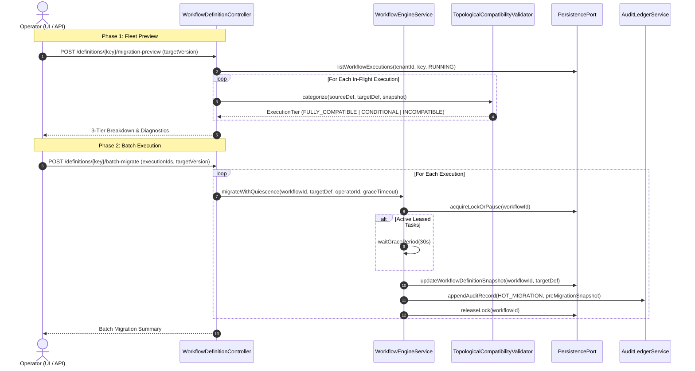

# Implementation Plan 108 - Phase 39.1: Hot Migration Hardening, Quiescence Locking & Fleet Categorization Engine

## Goal Description
Build upon Phase 39 by hardening in-flight hot migration with:
1. **Strict Execution Quiescence & Leased Task Graceful Draining**: Automatically acquire execution locks to pause new task dispatching during hot migration, wait for actively `RUNNING` (leased) tasks to finish within a configurable grace period, and strictly reject migration on terminal executions (`COMPLETED`, `FAILED`, `TERMINATED`, `COMPENSATED_FAILED`).
2. **Deterministic 3-Tier Heuristic Categorization**:
   - `FULLY_COMPATIBLE`: All completed/running nodes match target topology and parameters; newly added nodes exist strictly in downstream frontier.
   - `CONDITIONAL_REQUIRES_MANUAL_REVIEW`: Downstream branch topology shifts, optional parameters missing defaults, or active node attribute modifications.
   - `INCOMPATIBLE_BLOCK`: Completed or running node removed/renamed, circular dependencies introduced, or terminal/compensating state.
3. **Two-Phase Fleet/Batch Migration API**:
   - `POST /api/v1/workflow/definitions/{key}/migration-preview`: Evaluates all in-flight executions of a definition key, categorizes them into the 3 tiers, and returns a detailed preview.
   - `POST /api/v1/workflow/definitions/{key}/batch-migrate`: Executes hot migration for selected or all `FULLY_COMPATIBLE` instances under individual quiescence locks with audit logging.
4. **Point-in-Time Snapshot Capture & Rollback Lineage**:
   - Snapshot execution state into `workflow_audit_log` prior to mutating, enabling forward-only rollback by restoring the pre-migration snapshot or re-migrating.
5. **Console UI Fleet Migration & Operator Inspection Drawer**:
   - Add a "Fleet Hot Migration" operator action in the Workflow catalog / definitions view.
   - Bento metric cards showing tier breakdown (`Fully Compatible`, `Requires Review`, `Incompatible`).
   - Slide-over review drawer inspecting topological diffs and warnings for conditional instances.
6. **Unified Sandbox Platform Parity**:
   - Extend `workflow-versioning-sandbox-handler.ts` with batch preview and batch migrate mock handlers.

---

## User Review Required
> [!IMPORTANT]
> **Strict Terminal Execution Rejection**: Completed and terminal executions cannot be hot-migrated. Attempting to migrate them will immediately return HTTP 409 / error status `ILLEGAL_STATE_MIGRATION_REJECTED`.
>
> **Wait-for-Completion Grace Period**: When hot-migrating an execution that currently has tasks in `IN_PROGRESS` (leased to workers), the engine will poll/wait for up to 30 seconds for the tasks to finish. If the lease expires or the task finishes, migration proceeds. If the grace period expires while a task remains actively leased, migration is safely aborted with an informative timeout error, leaving the active execution unmodified.

---

## Architecture & Workflows

---

## Proposed Changes

### 1. Backend Core & Validator (`apps/backend/workflow-engine`)

#### [MODIFY] `TopologicalCompatibilityValidator.java`
- Introduce `MigrationTier` enum: `FULLY_COMPATIBLE`, `CONDITIONAL_REQUIRES_MANUAL_REVIEW`, `INCOMPATIBLE_BLOCK`.
- Add `categorizeExecution(WorkflowDefinition sourceDef, WorkflowDefinition targetDef, WorkflowSnapshot snapshot)`:
  - Checks terminal status -> `INCOMPATIBLE_BLOCK`.
  - Checks if completed or running tasks were removed/renamed -> `INCOMPATIBLE_BLOCK`.
  - Checks if active tasks or immediate frontier edges changed -> `CONDITIONAL_REQUIRES_MANUAL_REVIEW`.
  - Checks if new tasks require parameters without defaults -> `CONDITIONAL_REQUIRES_MANUAL_REVIEW`.
  - Otherwise -> `FULLY_COMPATIBLE`.
- Enhance `MigrationValidationReport` to include `tier: MigrationTier` and `warnings: List<String>`.

#### [MODIFY] `PersistencePort.java`, `InMemoryPersistenceAdapter.java`, `PostgresJdbcPersistenceAdapter.java`, `SqliteJdbcPersistenceAdapter.java`
- Add `List<WorkflowSnapshot> listWorkflowExecutions(String tenantId, String workflowKey, WorkflowStatus status)` to retrieve active executions for a workflow definition.

#### [MODIFY] `WorkflowEngineService.java`
- Add `migrateExecutionWithQuiescence(String workflowId, WorkflowDefinition targetDef, String operatorId, long graceTimeoutMs, long nowEpochMs)`:
  - Checks execution status: if terminal, throws `IllegalStateException("Execution is in terminal state: " + current.status())`.
  - Checks running tasks: if any tasks are in `IN_PROGRESS`, enters wait loop (up to `graceTimeoutMs`, e.g. 30s) waiting for them to reach a completed state.
  - Validates compatibility via `TopologicalCompatibilityValidator`.
  - Captures full pre-migration snapshot in the `HOT_MIGRATION` audit log payload (`preMigrationSnapshot`).
  - Updates workflow definition snapshot in database.

---

### 2. REST Layer (`apps/backend/acc-ms-aio`)

#### [MODIFY] `WorkflowDefinitionController.java`
- Add `POST /api/v1/workflow/definitions/{key}/migration-preview`:
  - Request body: `{ "targetVersion": 2 }`
  - Fetches all `RUNNING` executions for `{key}` and runs categorization.
  - Returns `{ summary: { fullyCompatible: N, requiresReview: N, incompatible: N }, items: [...] }`.
- Add `POST /api/v1/workflow/definitions/{key}/batch-migrate`:
  - Request body: `{ "targetVersion": 2, "executionIds": ["wf_1", "wf_2"], "autoMigrateCompatibleOnly": true }`
  - Iterates through target executions, applies quiescence hot migration, and returns success/failure counts.

---

### 3. Unified Sandbox Platform (`packages/sandbox`)

#### [MODIFY] `workflow-versioning-sandbox-handler.ts`
- Implement handlers for:
  - `POST /workflow/definitions/:key/migration-preview`
  - `POST /workflow/definitions/:key/batch-migrate`
- Seed realistic in-flight executions with varying progress to demonstrate all 3 tiers (`FULLY_COMPATIBLE`, `CONDITIONAL_REQUIRES_MANUAL_REVIEW`, `INCOMPATIBLE_BLOCK`).

---

### 4. Console UI (`apps/console`)

#### [MODIFY] `workflow-api.ts`
- Add types: `MigrationTier`, `FleetMigrationPreview`, `FleetBatchMigrateResult`.
- Add React Query hooks: `useFleetMigrationPreview(key, targetVersion)` and `useFleetBatchMigrate()`.

#### [NEW] `apps/console/src/features/workflows/components/fleet-migration-modal.tsx`
- Liquid Glass modal launched from Workflow Catalog:
  - Target version selector.
  - Bento metric summary bar showing counts for `Fully Compatible` (emerald), `Requires Review` (amber), and `Incompatible` (rose).
  - Filterable table of executions with status pills and warning tooltips.
  - Review drawer inspecting task graph diff and parameters for any conditional execution.
  - "Migrate Fully Compatible (N)" and "Migrate Selected" primary actions.

#### [MODIFY] `apps/console/src/features/workflows/components/workflow-catalog-columns.tsx`
- Add "Fleet Hot Migration" action item to the workflow catalog table dropdown menu.

---

## Verification Plan

### Automated Tests
1. **Engine Unit Tests**:
   - `TopologicalCompatibilityValidatorTest.java`: Test the 3 tiers (fully compatible, conditional review, incompatible blocked).
   - `WorkflowEngineServiceQuiescenceTest.java`: Test quiescence wait and terminal execution rejection.
2. **Sandbox Vitest**:
   - Test `migration-preview` and `batch-migrate` sandbox handlers.
3. **Console Vitest & Typecheck**:
   - Unit test `fleet-migration-modal.test.tsx`.
   - Run `pnpm --filter @acc/console exec tsc --noEmit`.

### Manual Verification
1. Open Workflow Catalog in Console.
2. Click "Fleet Hot Migration" from the actions menu of a workflow definition.
3. Verify the 3-tier metrics and execution list render correctly.
4. Trigger batch migration and verify execution snapshots and audit logs update seamlessly.
