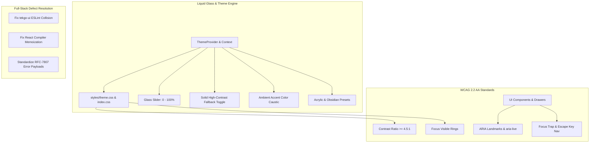

# Implementation Plan: Iteration 11 - WCAG 2.2 AA, Liquid Glass Fine-Tuning & Full-Stack Defect Resolution

## Goal Description
Iteration 11 elevates the acc ecosystem to enterprise visual maturity and accessibility compliance while executing production bug fixing across `@acc/console`, `tekgo-ui`, `mobile-ui`, and `@acc/backend`.

### Key Objectives
1. **Liquid Glass Optical Fine-Tuning**:
   - Introduce two first-class flagship theme presets: **Light Frosted Acrylic** (semi-translucent frosted glass scrim with high-contrast foreground) and **Dark Obsidian** (deep crystalline obsidian with subtle specular rim lighting).
   - Implement dynamic **Ambient Accent Colors** (Violet Aurora, Azure Sky, Emerald Jade, Rose Quartz, Amber Sovereign) with specular light caustics and real-time translucency tuning (`0.0` to `1.0`).
   - Add an instant **Accessibility Solid Fallback** toggle that completely flattens glass translucency into high-contrast opaque surfaces for low-vision users or reduced motion/performance profiles.
2. **Full-Spectrum WCAG 2.2 AA Enforcement**:
   - Contrast calibration: Ensure all text meets $\ge 4.5:1$ (normal text) and $\ge 3:1$ (large text / UI controls) across both glass and solid modes.
   - Visible keyboard focus rings (`:focus-visible` with high-contrast double ring or 2px solid ring).
   - Keyboard trap defense & focus restoration for all slide-over drawers (`TenantWorkspacesDrawer`, `TenantUsersDrawer`, `DlqInspectorSheet`) and modal dialogs.
   - Screen-reader semantics (`aria-live="polite"` regions for async mutations, toast announcements, and form validation error states).
3. **Full-Stack Defect Resolution & Zero-Stub Implementations**:
   - Resolve `tekgo-ui` ESLint flat config collision (`jsx-a11y` redefinition) restoring monorepo `pnpm lint` green status.
   - Fix React memoization violations (`react-hooks/preserve-manual-memoization`) in `fleet-migration-modal.tsx` and duplicated imports across workflow features.
   - Harden backend REST API payload validation and error responses: standardize RFC-7807 problem details with localized messages, eliminating raw stack traces.
   - Verify zero stubs: ensure all fixes integrate with the production runtime and Unified Sandbox without synthetic mocks.

---

## User Review Required
> [!IMPORTANT]
> The theme provider in `@acc/console` will be upgraded to support:
> - `theme`: `'light' | 'dark' | 'acrylic' | 'obsidian' | 'system'`
> - `glassFallback`: `boolean` (when true, disables all translucency and renders opaque high-contrast surfaces)
> - `accentColor`: `'violet' | 'azure' | 'emerald' | 'rose' | 'amber'`
> These settings persist across sessions in client cookies with zero breaking changes for existing users.

> [!NOTE]
> All automated Playwright E2E tests (Mode 1 and Mode 2) will be maintained at 100% pass rate with zero regression.

---

## Architecture & Visual System

---

## Proposed Changes

### Component 1: Liquid Glass & Theme Architecture (`@acc/console`)

#### [MODIFY] [`apps/console/src/styles/theme.css`](file:///c:/Users/Admin/workspace/git/acc/apps/console/src/styles/theme.css)
- Add theme classes for `.acrylic` (Light Frosted Acrylic) and `.obsidian` (Dark Obsidian).
- Define ambient accent color token variants (`[data-accent="violet"]`, `[data-accent="azure"]`, `[data-accent="emerald"]`, `[data-accent="rose"]`, `[data-accent="amber"]`).
- Define high-contrast solid surface tokens activated when `[data-glass-fallback="true"]`.

#### [MODIFY] [`apps/console/src/styles/index.css`](file:///c:/Users/Admin/workspace/git/acc/apps/console/src/styles/index.css)
- Implement caustic radial gradients for ambient accent colors on `body::before`.
- Enforce WCAG 2.2 AA high-contrast `:focus-visible` styling globally.
- Support `data-glass-fallback="true"` by disabling `backdrop-filter` and substituting opaque scrims.

#### [MODIFY] [`apps/console/src/context/theme-provider.tsx`](file:///c:/Users/Admin/workspace/git/acc/apps/console/src/context/theme-provider.tsx)
- Add `accentColor`, `glassFallback` state and cookie persistence.
- Provide helper methods `setAccentColor(accent)` and `setGlassFallback(enabled)`.
- Update `applyGlassVariables` to respect `glassFallback`.

#### [MODIFY] [`apps/console/src/features/settings/appearance/appearance-form.tsx`](file:///c:/Users/Admin/workspace/git/acc/apps/console/src/features/settings/appearance/appearance-form.tsx)
- Add preset selector: Light Frosted Acrylic vs. Dark Obsidian vs. System.
- Add Accent Color picker with live color swatch pills.
- Add High-Contrast / Solid Fallback toggle switch with descriptive WCAG helper label.
- Expand live glass preview card to reflect real-time accent caustic and fallback state.

---

### Component 2: WCAG 2.2 AA Compliance & Keyboard Ergonomics

#### [MODIFY] [`apps/console/src/components/ui/sheet.tsx`](file:///c:/Users/Admin/workspace/git/acc/apps/console/src/components/ui/sheet.tsx) & Drawers
- Ensure all drawers (`TenantWorkspacesDrawer`, `TenantUsersDrawer`, `DlqInspectorSheet`) have explicit `aria-describedby`, focus trap, and restore focus to trigger element on close.
- Add `aria-live="polite"` status announcements for async mutations (e.g. workspace creation, user lock/unlock, DLQ task replay).

#### [MODIFY] [`apps/console/src/features/metadata/components/data-explorer/entity-data-grid.tsx`](file:///c:/Users/Admin/workspace/git/acc/apps/console/src/features/metadata/components/data-explorer/entity-data-grid.tsx)
- Ensure all action buttons in table rows have unique, screen-reader friendly labels (`aria-label={`Actions for record ${record.id}`}`).
- Verify table header sorting indicators have proper `aria-sort` attributes (`ascending`, `descending`, `none`).

---

### Component 3: Full-Stack Defect Resolution

#### [MODIFY] [`apps/tekgo-ui/eslint.config.mjs`](file:///c:/Users/Admin/workspace/git/acc/apps/tekgo-ui/eslint.config.mjs)
- Fix the `jsx-a11y` duplicate plugin declaration in ESLint flat configuration by eliminating redundant plugin inheritance in `compat.extends`.
- Validate that `pnpm --filter tekgo-ui lint` exits 0.

#### [MODIFY] [`apps/console/src/features/workflows/components/fleet-migration-modal.tsx`](file:///c:/Users/Admin/workspace/git/acc/apps/console/src/features/workflows/components/fleet-migration-modal.tsx)
- Fix the React Compiler memoization dependency discrepancy (`[previewData?.items, tierFilter]` vs `previewData.items`).

#### [MODIFY] [`apps/backend/acc-core/src/main/java/com/acc/core/exception/GlobalExceptionHandler.java`](file:///c:/Users/Admin/workspace/git/acc/apps/backend/acc-core/src/main/java/com/acc/core/exception/GlobalExceptionHandler.java)
- Ensure all uncaught exceptions produce standardized RFC-7807 JSON error responses (`type`, `title`, `status`, `detail`, `instance`, `timestamp`).
- Prevent internal server stack trace leakage while preserving clear diagnostic message in debug logs.

---

## Verification Plan

### Automated Tests
1. **Monorepo Linting**: `pnpm lint` (must pass across backend, console, and tekgo-ui with 0 plugin conflicts).
2. **Console Vitest Suite**: `pnpm --filter @acc/console test` (all 298+ unit and component tests passing).
3. **Backend Sandbox & Modulith**: `pnpm test:backend:sandbox` and `pnpm --filter @acc/backend test:modulith`.
4. **Playwright Mode 1 E2E**: `pnpm test:e2e` (all 15/15 tests passing, verifying zero regression on appearance and WCAG).
5. **Playwright Mode 2 Live E2E**: `pnpm test:e2e:live` (all 15/15 tests passing against live Spring Boot backend).

### Manual Verification
1. Open `/settings/appearance` in Console:
   - Toggle **Light Frosted Acrylic** and **Dark Obsidian** presets and observe instant theme transformation.
   - Switch between **Ambient Accent Colors** (Violet, Azure, Emerald, Rose, Amber) and verify background caustics update.
   - Enable **Solid Surface Fallback** and observe all glass elements immediately render opaque with high contrast.
2. Keyboard Navigation:
   - Tab through the navigation bar, settings panel, and drawers without pointer device. Verify visible focus ring on every interactive element.
   - Press `Escape` inside `TenantWorkspacesDrawer` and confirm drawer closes and focus returns to the launcher button.
