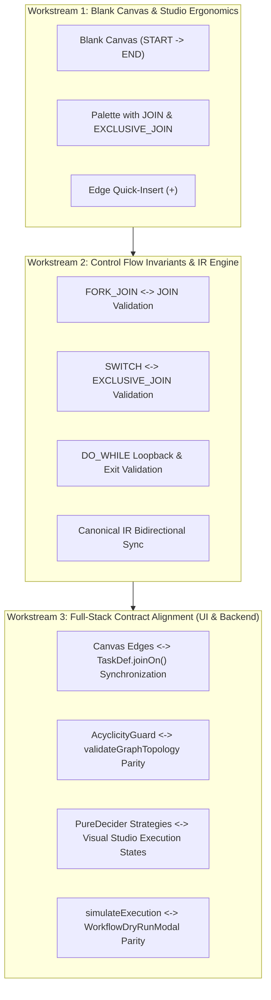

# Implementation Plan 138: Pure Blank Workflow Canvas & Full Control Flow Node Architecture

Enforce that newly created blank workflows initialize with strictly a `START` node and an `END` node connected by a direct edge (no other nodes in between), and align the complete suite of Control Flow nodes (`FORK_JOIN` + `JOIN`, `SWITCH` + `EXCLUSIVE_JOIN`, `TERMINATE` -> `END`, and `DO_WHILE` loopback + exit branch) across the Visual DAG Studio and the backend Workflow Engine following Netflix/Orkes Conductor OSS best practices.

---

## 1. User Review Required

> [!IMPORTANT]
> **Strict Control Flow Structural Invariants**:
> 1. **Blank Workflow Canvas**: Any new or reset workflow starts with exactly 2 nodes: `node-start` (`workflow_start`, in-degree 0) and `node-end` (`workflow_end`, out-degree 0) connected by edge `e_start_to_end`. Sample pre-populated mock graphs will be reserved strictly for demonstration / template loading.
> 2. **Strict Fork-Join Pair**: Every `FORK_JOIN` must be paired with and converge into a matching `JOIN` node before reaching subsequent tasks or the `END` node. The `JOIN` node is added as a first-class palette item.
> 3. **Switch & Exclusive Join**: Branches diverging from a `SWITCH` node converge into an `EXCLUSIVE_JOIN` node (which proceeds when the single active evaluated branch finishes) or directly into `END`.
> 4. **Terminate Routed to End**: On the visual canvas, `TERMINATE` tasks connect downstream to the `END` node (so the canvas has strictly 1 out-degree 0 sink), but at engine runtime, reaching `TERMINATE` triggers an immediate short-circuit termination.
> 5. **Do-While Loopback & Exit**: `DO_WHILE` features a loopback edge for iterations, plus a mandatory exit branch connecting downstream toward `END`. Loopback edges are tagged (`isLoopbackEdge: true`) to bypass Kahn cycle checks while verifying downstream reachability.

---

## 2. Architecture & Workstream Overview



---

## 3. Detailed Workstreams

### Workstream 1: Blank Canvas & Studio Ergonomics (`apps/console`)

#### [`visual-dag-studio.tsx`](file:///apps/console/src/features/metadata/components/studio/visual-dag-studio.tsx)
- Define default blank workflow constants:
  ```typescript
  const BLANK_WORKFLOW_NODES: Node<DagNodeData>[] = [
    {
      id: 'node-start',
      type: 'dagNode',
      position: { x: 100, y: 200 },
      data: {
        taskReferenceName: 'workflow_start',
        taskType: 'NOOP',
        label: 'Workflow Start',
        executionState: 'COMPLETED',
        isPermanent: true,
        isStartNode: true,
        inputParameters: {},
      },
    },
    {
      id: 'node-end',
      type: 'dagNode',
      position: { x: 500, y: 200 },
      data: {
        taskReferenceName: 'workflow_end',
        taskType: 'TERMINATE',
        label: 'Workflow End',
        executionState: 'PENDING',
        isPermanent: true,
        isEndNode: true,
        inputParameters: {},
      },
    },
  ];
  const BLANK_WORKFLOW_EDGES: Edge[] = [
    {
      id: 'e_start_to_end',
      type: 'dagEdge',
      source: 'node-start',
      target: 'node-end',
      animated: true,
    },
  ];
  ```
- Initialize canvas state with `BLANK_WORKFLOW_NODES` and `BLANK_WORKFLOW_EDGES` for new workflows or when no existing definition is loaded.
- Implement `handleSplitEdge(edgeId, newNodeType)`:
  - Takes an existing edge between Node A and Node B.
  - Inserts Node C at the midpoint `(xA + xB) / 2, (yA + yB) / 2`.
  - Replaces the original edge with two edges: `A -> C` and `C -> B`.
- Update `handleClearSelected` to prevent deleting `isPermanent` nodes (START and END).

#### [`dag-palette.tsx`](file:///apps/console/src/features/metadata/components/studio/dag-palette.tsx)
- Add missing `JOIN` and `EXCLUSIVE_JOIN` items to the `Control Flow` category in `PALETTE_ITEMS`:
  - `JOIN`: "Parallel Join Barrier" (`GitMerge` icon, indigo), waits for all fork branches in `joinOn`.
  - `EXCLUSIVE_JOIN`: "Exclusive Switch Merge" (`GitMerge` icon, rose/amber), merges the single active switch branch.
- Calibrate `TERMINATE` item description: "Fail-fast abort node (routes to END on canvas)".

#### [`dag-condition-edge.tsx`](file:///apps/console/src/features/metadata/components/studio/dag-condition-edge.tsx)
- Add a Quick-Insert `+` button in the center of condition edges (especially useful on the initial `e_start_to_end` edge) allowing users to click `+` and choose a node to split and insert between source and target with automatic edge rewiring.

---

### Workstream 2: Control Flow Invariants & IR Converter (`apps/console`)

#### [`workflow-ir-converter.ts`](file:///apps/console/src/features/metadata/components/studio/workflow-ir-converter.ts)
- Extend `validateGraphTopology`:
  1. **Strict Fork-Join Pair Check**:
     - For every `FORK_JOIN` node, find all outgoing branch paths and verify they converge into a matching `JOIN` node.
     - If a `FORK_JOIN` branch terminates or bypasses the `JOIN`, emit validation error: `FORK_JOIN "${ref}" must converge into a JOIN node before reaching downstream tasks or END.`
  2. **Switch Merge Check**:
     - Verify all decision cases from a `SWITCH` node converge into an `EXCLUSIVE_JOIN` or the `END` node.
  3. **DO_WHILE Exit Branch Check**:
     - Verify that every `DO_WHILE` node has an exit edge (`!isLoopbackEdge`) reachable to `END`.
     - Tag loopback edges and exclude them from Kahn cycle detection.
  4. **Single-Start and Single-End Invariant**:
     - Maintain strict 1 entry (START) and 1 exit (END) validation.

---

### Workstream 3: Full-Stack Contract Alignment (UI & Backend)

#### 1. Canvas Edges <-> `TaskDefinition.joinOn` Synchronization
- **Canvas to IR Export**:
  - In `exportToWorkflowIR`: For any `JOIN` or `EXCLUSIVE_JOIN` node, automatically compute its incoming edge source task references and assign them to `task.joinOn: string[]`.
  - For `FORK_JOIN`, compute each outgoing branch path and assign to `task.forkTasks: string[][]`.
- **IR to Canvas Import**:
  - In `importFromWorkflowIR`: If a task has `joinOn: [t1, t2]`, guarantee incoming edges `t1 -> joinNode` and `t2 -> joinNode` are created.

#### 2. Synchronized Topology Validators (`AcyclicityGuard` <-> `workflow-ir-converter`)
- **Backend `AcyclicityGuard.java`**:
  - Verify `tasks` list has strictly 1 start node (in-degree 0) and 1 end node (out-degree 0).
  - Verify that for every `TaskType.FORK_JOIN` task, there is a subsequent `TaskType.JOIN` task whose `joinOn` covers all fork branches.
  - Verify that `TaskType.TERMINATE` task has a downstream dependency or is properly positioned before the terminal sink.
- **Error Codes & Problem Details**:
  - Align validation error types between frontend and backend: `NO_START_NODE`, `MULTIPLE_START_NODES`, `NO_END_NODE`, `MULTIPLE_END_NODES`, `CYCLE`, `UNPAIRED_FORK_JOIN`, `DISCONNECTED_GRAPH`.

#### 3. PureDecider Execution & Visual Studio Telemetry Alignment
- Backend `PureDecider`:
  - `ForkJoinStrategy`: Schedules all branches in parallel; blocks at `JOIN` until all `joinOn` tasks are `COMPLETED`.
  - `ExclusiveJoinStrategy`: Evaluates `joinOn` prerequisites and completes as soon as whichever single active branch completes.
  - `TerminateNodeStrategy`: When evaluated, immediately issues `TransitionWorkflow(FAILED / COMPLETED)` short-circuiting downstream execution.
  - `DoWhileStrategy`: Loops over body tasks while `loopCondition` evaluates to true; once false, progression continues downstream.
- Frontend Telemetry & Telemetry Inspector:
  - Visual DAG Studio nodes update states (`IN_PROGRESS`, `COMPLETED`, `FAILED`, `SKIPPED`) matching the exact backend events emitted via SSE.

#### 4. Simulation & Dry-Run Parity
- Backend `WorkflowEngineService.simulateExecution`:
  - Evaluates Control Flow nodes step-by-step: `workflow_start` passes inputs -> `FORK_JOIN` simulates parallel branches -> `JOIN` aggregates outputs -> `SWITCH` evaluates expression to select branch -> `EXCLUSIVE_JOIN` receives active branch -> `workflow_end` produces final output.
- Frontend `WorkflowDryRunModal`:
  - Calls `/api/v1/workflows/definitions/simulate` and displays the simulated execution path and task telemetry with traversed-path illumination.

---

## 4. Verification Plan

### Automated Tests
1. **Frontend Vitest Suites**:
   - `dag-palette.test.tsx`: Verify `JOIN` and `EXCLUSIVE_JOIN` are present in Control Flow category.
   - `workflow-ir-converter.test.ts`: Verify:
     - Blank canvas (START -> END) passes validation cleanly with 0 errors.
     - Unpaired `FORK_JOIN` without `JOIN` fails validation.
     - Paired `FORK_JOIN` -> branches -> `JOIN` -> `END` passes validation.
     - `SWITCH` -> cases -> `EXCLUSIVE_JOIN` -> `END` passes validation.
     - `DO_WHILE` with loopback + exit branch passes validation.
     - Bidirectional `joinOn` synchronization in export and import.
   - Run: `pnpm --filter @unipost/console test -- src/features/metadata/components/studio/`
2. **TypeScript Compilation**:
   - Run: `pnpm --filter @unipost/console exec tsc --noEmit`
3. **Backend Maven Unit Tests**:
   - `AcyclicityGuardTest.java`: Verify strict single start/end, fork-join pair validation, and cycle detection.
   - `PureDeciderTest.java`: Verify `ForkJoinStrategy`, `ExclusiveJoinStrategy`, `TerminateNodeStrategy`, and `DoWhileStrategy`.
   - Run: `cmd.exe /c "mvnw.cmd test -pl workflow-engine -Dtest=AcyclicityGuardTest,PureDeciderTest -q"`

### Manual Verification
- Open Visual DAG Studio in new workflow mode: canvas should show ONLY `START` and `END` connected with 1 edge.
- Click `+` on edge or drag `FORK_JOIN` and `JOIN` to build parallel branches.
- Verify property inspector binds `joinOn` and switch cases seamlessly.
- Run dry-run simulation to verify step-by-step execution.
