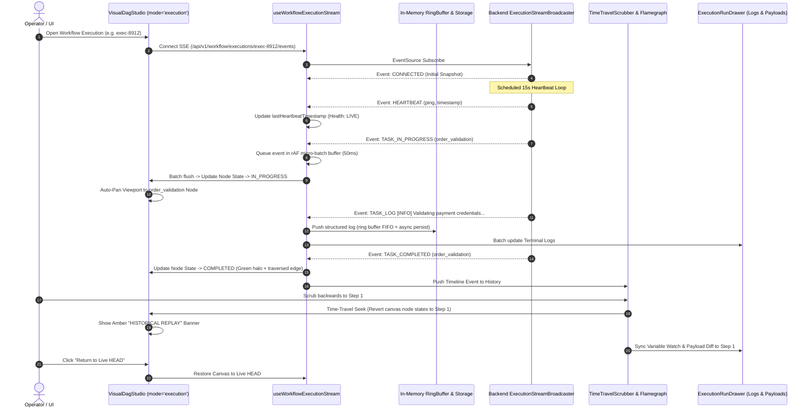

# Implementation Plan: Workflow Execution & Live Streaming Experience (Iteration 19)

## 1. Goal Description
The objective of this iteration is to elevate the **Workflow Execution & Live Streaming Experience** across `@acc/console` and `@acc/backend` to enterprise production-grade standards.

When users inspect workflow instances (from `/workflow-executions` or inside `VisualDagStudio` in `mode="execution"`):
1. **Full-Stack Real-Time SSE Telemetry Channel**:
   - **Frontend**: Elevate `useWorkflowExecutionStream` with automatic reconnection, exponential backoff, heartbeat tracking, graceful degradation, and live execution metrics.
   - **Backend**: Enhance `ExecutionStreamBroadcaster` with Java 21 Loom virtual threads (`Executors.newVirtualThreadPerTaskExecutor()`) to decouple worker endpoints from slow SSE clients, add periodic 15s `HEARTBEAT` pings, and emit `TASK_LOG` events when task workers append stdout/stderr logs.
2. **Dynamic Canvas Edge Flow, Node Pulse & Auto-Pan**: Synchronize live SSE execution transitions directly with SVG edge particle flow, dynamic edge glow (`#10b981`), dead-branch dimming, task node state rings (In-Progress glowing ring, Waiting for Approval, Timed Out, Failed), and automatic smooth canvas auto-pan tracking the active `IN_PROGRESS` frontier.
3. **Unified Execution Telemetry Console (Log & Payload Stream)**: Integrate an interactive live terminal log feed inside a docked `ExecutionRunDrawer` at the bottom of the studio with level filters (`ALL`, `INFO`, `WARN`, `ERROR`), search, auto-scroll freeze on hover, and instantaneous JSON payload inspection for the active node.
4. **Synchronized Time-Travel Scrubber & Concurrency Flamegraph**: Link the timeline scrubber seamlessly with the React Flow canvas and the variable watch drawer, allowing operators to scrub backwards to any step $t_k$, roll back node states and variables to that exact historical moment with an amber historical replay banner, and step forward/backward with instant visual feedback.
5. **Unified Sandbox Simulation Engine for Live Streaming**: Register mock SSE stream handlers and interactive step controllers in `apps/console/src/core/sandbox/handlers/` and `SandboxDock`, providing a realistic multi-branch order pipeline simulation with step-by-step controls and failure triggers.

---

## 2. Aligned Decisions from Design Review (`/grill-me`)

| Design Decision | User Selection & Architectural Agreement |
| :--- | :--- |
| **Telemetry Layout** | **Split-View / Docked Drawer**: Dock `ExecutionRunDrawer` at the bottom of the studio with tabbed telemetry (Terminal Logs, Payload Diff, Variables) so the operator views both live DAG canvas and logs concurrently without covering the canvas. |
| **Viewport Tracking** | **Automatic Canvas Auto-Pan / Tracking**: Smoothly center/pan the canvas viewport to follow the currently active `IN_PROGRESS` node as execution advances across long DAGs, with an accessible toggle to pause auto-tracking if the operator manually pans. |
| **Time-Travel Scrubbing** | **Full Graph Historical State Rollback**: Scrubbing back to step $t_k$ reverts node states (`IN_PROGRESS` -> `PENDING`, `COMPLETED` -> `PENDING`), edge traversed highlights, and variables to the exact snapshot at step $k$, accompanied by an amber `"HISTORICAL REPLAY (Step k of N) - Read Only"` banner and a 1-click `"Return to Live HEAD"` button. |
| **SSE Reconnect Resilience** | **Dynamic Reconnect Banner with Exponential Backoff + Seamless Polling Fallback**: Display an amber non-intrusive status pill in the toolbar (`"Reconnecting in 2s (Attempt 1/5)..."`) while polling snapshots in the background every 2s, automatically recovering to full SSE when the stream reconnects. |
| **Unified Sandbox Simulation** | **Realistic Multi-Branch Scenario with Interactive Playback Controls**: Multi-branch order pipeline (validation -> parallel fraud check & inventory reserve -> dynamic approval condition -> payment -> fulfillment) with Play, Pause, Step-by-Step, and Inject Failure / Timed-Out buttons in `SandboxDock`. |
| **Backend SSE Broadcaster** | **Java 21 Virtual Threads (Loom) + Heartbeat**: Non-blocking asynchronous broadcast via virtual thread executor (`Executors.newVirtualThreadPerTaskExecutor()`), periodic 15-second background `HEARTBEAT` event to prevent TCP/proxy timeouts, and support for streaming task logs (`TASK_LOG`). |
| **Connection State Model (WS-2)** | **Connection Lifecycle Enum with Diagnostics**: State machine (`IDLE` -> `CONNECTING` -> `LIVE` -> `RECONNECTING` -> `POLLING_FALLBACK` -> `DISCONNECTED`), tracking `retryAttempt` (1..5), `nextRetryDelayMs`, and `lastHeartbeatTimestamp`. |
| **Log Ingestion & Storage (WS-2)** | **Structured In-Memory Ring Buffer + Async IndexedDB Spooling**: Ingest structured `TASK_LOG` events into an in-memory ring buffer (up to 1,000 items) with asynchronous non-blocking session writes to IndexedDB/sessionStorage, preventing memory bloat and preserving full execution history. |
| **Event Batching & Performance (WS-2)** | **requestAnimationFrame (rAF) Micro-Batching (~50ms window)**: Ingest incoming SSE bursts into a pending event queue and flush to React state via `requestAnimationFrame` micro-batches to guarantee 60fps canvas animation and zero main-thread lockup. |

---

## 3. Architecture & Data Flow



---

## 4. Proposed Changes

### Workstream 1: Backend Loom Virtual Threads & SSE Broadcaster [COMPLETED]
- **File**: `apps/backend/acc-ms-aio/src/main/java/com/acc/aio/controller/workflow/ExecutionStreamBroadcaster.java`
  - Upgraded with Java 21 Loom virtual threads executor, scheduled 15s heartbeat pings, and task log broadcast method.
- **File**: `apps/backend/acc-ms-aio/src/main/java/com/acc/aio/controller/workflow/TaskWorkerController.java`
  - Added `POST /api/v1/workflow/tasks/{id}/log` endpoint for task stdout/stderr log chunk streaming.

### Workstream 2: Frontend Real-Time SSE Telemetry & State Synchronization
- **File**: `apps/console/src/features/workflows/hooks/use-workflow-execution-stream.ts`
  - Enhance `useWorkflowExecutionStream` with:
    - Connection health state machine (`IDLE` | `CONNECTING` | `LIVE` | `RECONNECTING` | `POLLING_FALLBACK` | `DISCONNECTED`).
    - Exponential backoff retry logic (1s, 2s, 4s, 8s, 16s) up to 5 attempts before falling back to HTTP polling.
    - Heartbeat monitor (`HEARTBEAT`) updating `lastHeartbeatTimestamp` and detecting stalled connections.
    - Handling for `TASK_LOG`, `TASK_STEP_PROGRESS`, `WORKFLOW_PAUSED`, `WORKFLOW_RESUMED`, `VARIABLE_MUTATED`.
    - In-memory ring buffer (up to 1,000 items) with `requestAnimationFrame` micro-batching to eliminate React re-render thrashing.
    - Asynchronous IndexedDB/sessionStorage spooling for full execution history.

### Workstream 3: Canvas Edge Flow, Node Visuals & Auto-Pan
- **File**: `apps/console/src/features/workflows/components/studio/canvas/dag-condition-edge.tsx`
  - Add SVG flow particle animations for active edges where `sourceNode.status === 'COMPLETED'` and `targetNode.status === 'IN_PROGRESS'`.
  - Add gradient pulse effects for traversed branches vs dotted low-opacity style for unselected switch cases.
- **File**: `apps/console/src/features/workflows/components/studio/canvas/dag-node.tsx`
  - Enhance execution badge visual hierarchy with live progress rings, timer counters (`durationMs`), and retry badges.
  - Implement active execution hover tooltip displaying task I/O summary and error stack snippets without opening the full inspector.
- **File**: `apps/console/src/features/workflows/components/studio/visual-dag-studio.tsx`
  - Implement auto-pan camera animation to center on active `IN_PROGRESS` node when auto-track is enabled.
  - Add auto-track camera toggle button in the toolbar.

### Workstream 4: Unified Execution Telemetry Drawer & Live Terminal
- **File**: `apps/console/src/features/workflows/components/execution/execution-run-drawer.tsx`
  - Enhance docked bottom drawer with:
    - Status pill cluster (Status, Elapsed Time, Total Tasks, Failed Tasks, Active Lease Owner).
    - Terminal log viewer with syntax-highlighted JSON lines, search filter, level selector (`ALL`, `INFO`, `WARN`, `ERROR`), and an auto-scroll lock toggle ("Follow live").
    - Payload inspector tab with live JSON tree and instant copy-to-clipboard.
    - Live variable watch viewer showing mutated runtime variables across steps.

### Workstream 5: Time-Travel Scrubber & Flamegraph Synchronization
- **File**: `apps/console/src/features/workflows/components/studio/hooks/use-dag-execution-sync.ts`
  - Full graph historical state rollback: revert canvas node execution states, active edge styles, and execution drawer variable watches.
  - Amber "HISTORICAL REPLAY" banner and 1-click "Return to Live HEAD" button.
- **File**: `apps/console/src/features/workflows/components/studio/timeline/workflow-execution-flamegraph.tsx`
  - Refine task bar tooltips with real start time, end time, concurrency slot, and execution worker thread id.

### Workstream 6: Unified Sandbox Platform Live Simulation Handlers
- **File**: `apps/console/src/core/sandbox/handlers/workflows-sandbox-handler.ts` (NEW)
  - Create a realistic multi-branch order pipeline SSE mock simulation engine:
    - Order Validation -> Parallel Fraud Check & Inventory Reserve -> Dynamic Approval Condition -> Payment Capture -> Fulfillment.
    - Emits real `MessageEvent` objects simulating streaming server events.
    - Exposes interactive controls in `SandboxDock`: Play, Pause, Step-by-Step, and Inject Failure / Timed-Out triggers.
  - Register in `apps/console/src/core/sandbox/index.ts`.

---

## 5. Verification Plan

### Automated Tests
1. **Backend Unit & Sliced Rest Controller Tests**:
   ```bash
   node ./apps/backend/mvnw.cjs test -pl acc-ms-aio -Dtest=WorkflowEngineRestApiTest,WorkflowIteration13ControllersTest
   ```
   Verified green (3/3 passed).
2. **Console Workflows & Execution Unit/Component Tests**:
   ```bash
   pnpm --filter @acc/console test -- src/features/workflows/ src/features/workflow-executions/
   ```
   Verify 100% pass across all unit and component suites.
3. **TypeScript Compilation Check**:
   ```bash
   pnpm --filter @acc/console exec tsc --noEmit
   ```
   Zero type errors across `@acc/console`.

### Manual Verification
1. Open `/workflow-executions` and open `WorkflowExecutionDetailDrawer`.
2. Inspect the live SSE connection pill and observe smooth transitions.
3. Watch the auto-pan camera smoothly glide to the active task as it executes.
4. Scrub backwards in time on the scrubber and verify the full graph rolls back to the past step with the amber replay banner.
5. In development mode with `Unified Sandbox`, open `SandboxDock` and trigger step execution or failure injection.
