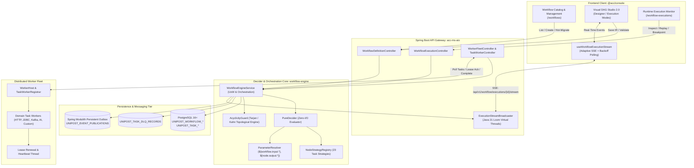

# Implementation Plan: Workflow Orchestration Engine Architecture (Single Source of Truth)

**Goal Description**: Brainstorm and author a comprehensive, authoritative **Workflow Orchestration Engine Architecture** document as the permanent Single Source of Truth (SSOT) across the Acc monorepo. This aligns backend (`apps/backend/workflow-engine`, `acc-ms-aio`), frontend (`apps/console`), worker fleets, real-time SSE streaming, and the Unified Sandbox platform.

---

## User Review Required

> [!IMPORTANT]
> **Key Architectural Anchors to Ratify:**
> 1. **Master Architecture Placement**: We will persist the master reference document to [`docs/workflow_orchestration_engine_architecture.md`](file:///c:/Users/Admin/workspace/git/acc/docs/workflow_orchestration_engine_architecture.md) and mirror the app-specific plan to `apps/console/doc/implementation_plan_150.md` per repo rules.
> 2. **Contract Boundaries**:
>    - **Pure Decider Core**: Zero I/O, deterministic `(Definition, Snapshot, Epoch) -> DecisionResult`.
>    - **Worker Fleet Lease Protocol**: `SELECT ... FOR UPDATE SKIP LOCKED` with 30s heartbeat renewal and exponential backoff retry.
>    - **Visual DAG Studio 2.0**: Dual operational modes (Designer vs. Execution) with 23 node categories, live SSE streaming, and time-travel scrubbing.
> 3. **Prioritization of Next Steps**: After establishing the SSOT, prioritize the roadmap between:
>    - **Phase A**: Advanced Worker Fleet Connectors (Kafka Publish, MCP Tool, Dynamic Fork).
>    - **Phase B**: Studio Canvas Ergonomics (ElkJS / Dagre automatic layout, multi-selection grouping).
>    - **Phase C**: End-to-end DLQ Interactive Parameter Edit & Partial Replay.

---

## Architecture Overview (System Blueprint)



---

## Strategy & Node Capabilities (23 Task Types)

| Category | Node Type (`TaskType`) | Decider Semantics & Payload |
| :--- | :--- | :--- |
| **Control Flow** | `SIMPLE` | External task queued for leased worker polling. |
| | `SWITCH` | Conditional routing evaluating branch expressions. |
| | `FORK_JOIN` | Parallel split executing multiple branches concurrently. |
| | `JOIN` | Barrier sync: waits for all incoming branches to complete. |
| | `EXCLUSIVE_JOIN` | Converges `SWITCH` branches when one branch completes. |
| | `DYNAMIC_FORK` | Dynamically evaluates input list and spawns parallel tasks. |
| | `WAIT` | Suspends execution until timestamp or external callback. |
| | `DO_WHILE` | Loop construct re-scheduling child nodes until condition is false. |
| | `TERMINATE` | Immediately marks workflow as terminal `COMPLETED` or `FAILED`. |
| | `SUB_WORKFLOW` | Triggers child workflow and yields until completion. |
| | `START_WORKFLOW` | Pure conventional boundary node for workflow inputs. |
| **Data & Transform** | `JSON_JQ_TRANSFORM` | In-memory JSON manipulation without network roundtrip. |
| | `INLINE` | Evaluates Groovy/MVEL/JavaScript expression in sandbox. |
| | `SET_VARIABLE` | Sets ephemeral variables in `workflow.variables.*`. |
| **System I/O** | `HTTP` | Declarative REST request with backoff retry and status checks. |
| | `JDBC` | Executes parameterized SQL query/mutation. |
| | `KAFKA_PUBLISH` | Publishes idempotent structured message to Kafka topic. |
| | `EVENT` | Suspends node until correlation event arrives. |
| | `NOOP` | Passthrough connector node for graph alignment. |
| **Human Governance** | `HUMAN` | Halts execution and notifies `ApprovalsInbox`. |
| **AI & Emerging** | `LLM_CHAT_COMPLETE` | Streams prompt to LLM provider with token telemetry. |
| | `CALL_MCP_TOOL` | Standard Model Context Protocol dynamic tool call. |
| | `DYNAMIC` | Dynamic runtime task type discovered via worker lease. |

---

## Proposed Changes

### Master Documentation & SSOT
#### [NEW] `docs/workflow_orchestration_engine_architecture.md`
- Master authoritative architectural document detailing:
  1. Executive Summary & Core Invariants (Zero-I/O Decider, Topological Acyclicity, Zero-Stub Sandbox).
  2. Full-Stack Polyglot Component Map (Decider, Gateway, Worker Fleet, Studio, Streaming).
  3. 23-Node Strategy Specification and IR schema contract (`WorkflowIR`).
  4. Worker Lease Lifecycle, Heartbeat Protocol, and Error Classification.
  5. UI/UX Design System, Dual-Mode Studio, and Liquid Glass Optical Tokens.
  6. Operational Resilience: DLQ Interactive Replay and Fleet Hot Migration.

#### [NEW] `apps/console/doc/implementation_plan_150.md`
- Mirrors the plan into target app directory per App-Specific Artifact Tracking rule.

#### [MODIFY] `apps/console/ROUTE.md` & `apps/console/DESIGN.md`
- Synchronize route definitions with the updated `/workflows` and `/workflow-executions` telemetry KPI strips.

---

## Verification Plan

### Automated Tests
1. Verify console type safety:
   ```powershell
   pnpm --filter @acc/console exec tsc --noEmit
   ```
2. Verify all workflow tests in console:
   ```powershell
   pnpm --filter @acc/console test -- run src/features/workflows src/features/workflow-executions
   ```
3. Verify backend compile:
   ```powershell
   cd apps/backend && ./mvnw test-compile -q
   ```

### Manual Verification
1. Review [`docs/workflow_orchestration_engine_architecture.md`](file:///c:/Users/Admin/workspace/git/acc/docs/workflow_orchestration_engine_architecture.md) for clarity, structural completeness, and accuracy against existing implementations.
2. Confirm that all 23 task types, decider invariants, worker lifecycle protocols, and frontend studio components are represented accurately.
