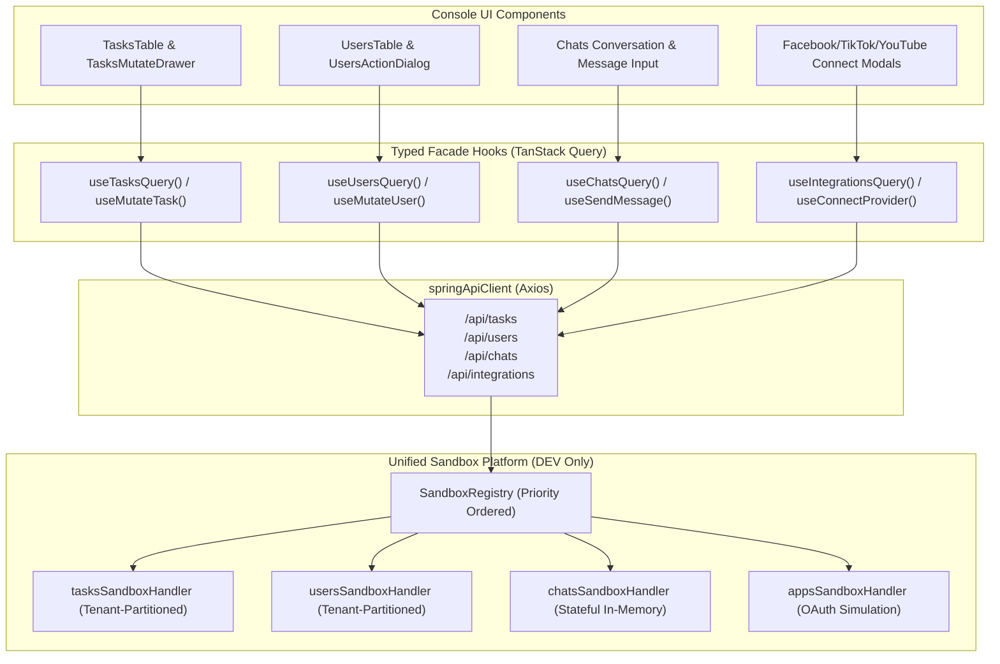

# Implementation Plan 78: Phase A & Phase B — Purge Rogue Mocks, Wire End-to-End Flows & Unify Sandbox Platform

## 1. Goal Description
To bring `@unipost/console` into full compliance with **Rule 00 (`ZERO-STUB-PROHIBITION` & `NO-ORPHANED-CODE`)** and **Rule 02 (`UNIFIED SANDBOX PLATFORM INTEGRATION MANDATE`)**:
1. **Eliminate rogue in-component mocks** across `features/tasks`, `features/users`, `features/chats`, and `features/apps`.
2. **Wire all UI views and mutation dialogs/drawers to real network APIs** (`/api/tasks`, `/api/users`, `/api/chats`, `/api/integrations`) through `springApiClient` / TanStack Query hooks.
3. **Connect orphaned sandbox handlers** (`tasksSandboxHandler`, `usersSandboxHandler`) into active runtime flows, supporting dynamic tenant partitioning (`activeTenantId`).
4. **Standardize third-party simulations** (Facebook, TikTok, YouTube) and conversation threads into the central `sandboxRegistry` with full stateful reset capabilities.
5. **Ensure transparent fall-through**: in production or when connected to a live backend, all calls route cleanly to real backend endpoints without mock interference.

---

## 2. User Review Required

> [!IMPORTANT]
> **Key Architecture Decisions:**
> 1. **TanStack Query Query/Mutation Hooks Pattern**: We will create custom hooks (`useTasks`, `useUsers`, `useChats`, `useAppsIntegrations`) that mirror the Facade pattern used in `features/metadata` and `features/system`.
> 2. **Multi-Tenant State Isolation**: In sandbox mode, `tasksSandboxRepo` and `usersSandboxRepo` will partition records by `tenantId` (derived from the active tenant in `useSandboxStore` / `TenantContextHolder`). When switching between `tenant-acme` and `tenant-us-east-1`, users will see their respective tenant's tasks and team members.
> 3. **Social App Credentials & State**: Currently, OAuth simulations in Facebook, TikTok, and YouTube stores use local storage and hardcoded in-file generator functions. These will be unified into `apps-sandbox-handler.ts` matching `/api/integrations/:provider/*`.

---

## 3. Proposed Changes

### Phase A: Wire Core Views to Network APIs & Clean Up Rogue Mocks

---

### Component 1: Tasks Feature (`apps/console/src/features/tasks`)

#### [NEW] `apps/console/src/features/tasks/api/use-tasks.ts`
- Implement custom TanStack Query hooks:
  - `useTasksQuery()`: Calls `GET /api/tasks` with tenant context headers (`X-Tenant-Id`, `X-Workspace-Id`).
  - `useCreateTaskMutation()`: Calls `POST /api/tasks`.
  - `useUpdateTaskMutation()`: Calls `PATCH /api/tasks/:id`.
  - `useDeleteTaskMutation()`: Calls `DELETE /api/tasks/:id`.
  - `useBulkDeleteTasksMutation()`: Calls `POST /api/tasks/bulk-delete` or multiple DELETEs.

#### [MODIFY] `apps/console/src/features/tasks/index.tsx`
- Remove static import `import { tasks } from './data/tasks'`.
- Call `const { data: tasks = [], isLoading } = useTasksQuery()`.
- Pass live query data into `<TasksTable data={tasks} />`.

#### [MODIFY] `apps/console/src/features/tasks/components/tasks-mutate-drawer.tsx`
- Replace `showSubmittedData(data)` with `createMutation.mutateAsync(data)` (when creating) or `updateMutation.mutateAsync({ id: currentRow.id, ...data })` (when updating).
- Trigger success toasts and invalidate queries via TanStack `queryClient`.

#### [MODIFY] `apps/console/src/features/tasks/components/tasks-dialogs.tsx` & `tasks-multi-delete-dialog.tsx`
- Replace `showSubmittedData` with `deleteMutation.mutateAsync(currentRow.id)`.

---

### Component 2: Users Feature (`apps/console/src/features/users`)

#### [NEW] `apps/console/src/features/users/api/use-users.ts`
- Implement TanStack Query hooks:
  - `useUsersQuery()`: Calls `GET /api/users`.
  - `useCreateUserMutation()`: Calls `POST /api/users`.
  - `useUpdateUserMutation()`: Calls `PATCH /api/users/:id`.
  - `useDeleteUserMutation()`: Calls `DELETE /api/users/:id`.

#### [MODIFY] `apps/console/src/features/users/index.tsx`
- Remove static import `import { users } from './data/users'`.
- Call `useUsersQuery()` and supply dynamic results into `<UsersTable data={users} ... />`.

#### [MODIFY] `apps/console/src/features/users/components/users-action-dialog.tsx`
- Replace `showSubmittedData(values)` with real API mutations (`createUserMutation` or `updateUserMutation`).

#### [MODIFY] `apps/console/src/features/users/components/users-delete-dialog.tsx` & `users-invite-dialog.tsx`
- Wire real deletion and invitation dispatch to `/api/users/:id` and `/api/users/invite`.

---

### Component 3: Third-Party Apps & Chats Integration

#### [NEW] `apps/console/src/core/sandbox/handlers/apps-sandbox-handler.ts`
- Move demo simulations (`simulateDemoFacebookLogin`, `simulateDemoTikTokAuthCode`, `simulateDemoTokenExchange`) out of feature services into a clean, centralized `appsSandboxHandler`.
- Match `/api/integrations/*` with mock token exchanges, page listings, and channel stats.

#### [NEW] `apps/console/src/core/sandbox/handlers/chats-sandbox-handler.ts`
- Stateful in-memory chat repository implementing `getAll()`, `getConversation(id)`, `sendMessage(convoId, message)`.
- Match `/api/chats` and `/api/chats/:id/messages`.

#### [MODIFY] `apps/console/src/features/chats/index.tsx`
- Wire chat list and message submission form to `/api/chats` endpoints via `springApiClient` / `useQuery`.

---

### Phase B: Unified Sandbox Platform Alignment & Governance

#### [MODIFY] `apps/console/src/core/sandbox/handlers/tasks-sandbox-handler.ts`
- Add multi-tenant partitioning support:
  - Partition internal storage map: `Map<string, Task[]>` keyed by `tenantId`.
  - Retrieve active tenant via `useSandboxStore.getState().activeTenantId`.
  - Default to `tenant-acme` baseline seeds on init.
  - Implement `reset()` to re-initialize all tenant partitions.

#### [MODIFY] `apps/console/src/core/sandbox/handlers/users-sandbox-handler.ts`
- Add multi-tenant partitioning support:
  - Partition users map by `tenantId`.
  - Connect to `useSandboxStore.getState().activeTenantId`.
  - Support user deletion, role patching, and invitation per tenant.

#### [MODIFY] `apps/console/src/core/sandbox/ui/sandbox-dock.tsx` & `sandbox-manager.ts`
- Wire `chatsSandboxRepo.reset()` and `appsSandboxRepo.reset()` into `handleResetAllData()`.
- Ensure all 7 sandbox domain repositories reset simultaneously on single click.

---

## 4. Verification Plan

### Automated Tests
1. **Console Vitest Suites**:
   - `pnpm --filter @unipost/console test`
   - Run dedicated sandbox integration test: `pnpm --filter @unipost/console test src/core/sandbox/__tests__/users-tasks-sandbox.test.ts`
   - Add new test suite `apps/console/src/features/tasks/__tests__/tasks-flow.test.tsx` verifying create/update/delete live query updates.
2. **Type Checking & Production Build**:
   - `pnpm --filter @unipost/console exec tsc --noEmit`
   - `pnpm --filter @unipost/console build`

### Manual Verification
1. Open http://localhost:5173/tasks:
   - Verify tasks table loads from `/api/tasks`.
   - Create a task via drawer -> Verify it immediately appears in table.
   - Delete task -> Verify it disappears.
2. Open http://localhost:5173/users:
   - Create user -> Verify user is created.
   - Edit user role -> Verify updated in table.
3. Switch Tenant in ProfileSwitcher (e.g. from `Acme Corp` to `US East Operations`):
   - Verify tasks and users are isolated to that specific tenant.
4. Click **Reset All Data** in Sandbox Dock:
   - Verify tasks and users return to clean seed state without manual page refresh.
