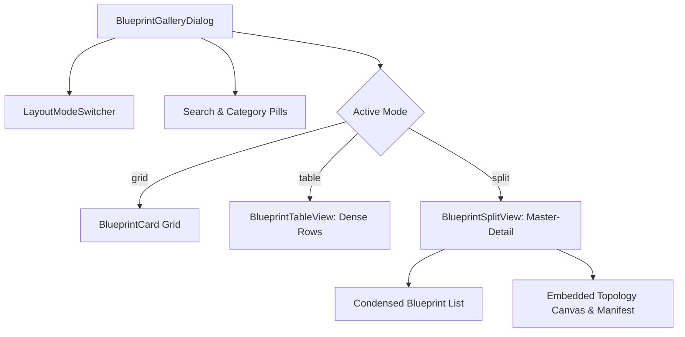

# Technical Design & Implementation Plan: Unified Dynamic Layout Switching Engine for Management Views & High-Dimensional Entity Grids

> **Document Status**: Refined Enterprise-Grade Architecture Specification  
> **Applies to**: `@unipost/console` (React 19 / Vite 8 / TanStack Suite)  
> **Aesthetic System**: Liquid Glass Enterprise (`DESIGN.md`)  
> **Accessibility Standard**: WAI-ARIA & WCAG 2.2 Level AA  

---

## 1. Executive Summary & Problem Scope

Enterprise resource management systems present a fundamental tension between **discovery ergonomics** and **high-density data execution**:

1. **Consumer Discovery vs. Enterprise Density**:
   - Card grids excel on public landing pages or onboarding discovery (e.g., initial blueprint browsing).
   - In operational management contexts, cards consume excessive vertical space, limit comparative side-by-side scanning, and introduce modal fatigue.
2. **The "80-Column Enterprise Grid Dilemma" (High-Dimensional Entities)**:
   - Modern enterprise metadata models (e.g. Healthcare EHR, Multi-Carrier Logistics, Financial Ledgers) easily contain 30–100+ dynamic attributes.
   - Naive horizontal tables suffer from:
     - **Horizontal scroll disassociation**: Users scroll 2,500px to the right and lose track of *which entity record* they are inspecting.
     - **DOM bloat & layout thrashing**: 100 columns $\times$ 50 rows = 5,000 active interactive DOM nodes, inducing scroll stutter and input lag.
     - **Cognitive friction**: Essential operational signals (e.g., FSM status, payment gate, assigned owner) are submerged under tertiary audit logs and raw payloads.

### Proposed Architecture
To solve this systematically without fragmented one-off fixes, we establish a **two-tier architecture**:
1. **Tier 1 — Reusable Layout Switcher Engine**: A lightweight, accessible, zero-dependency segmented control that manages layout modes (`grid`, `table`, `split`) with local storage persistence and responsive degradation.
2. **Tier 2 — High-Dimensional Grid Management Architecture**: A systematic framework for dense entity grids featuring **dual-anchor horizon pinning**, **persona column lenses**, **collapsible super-headers**, and a **keyboard-accessible peek inspector drawer**.

---

## 2. Tier 1: Reusable Dynamic Layout Switcher Engine

### 2.1 The Three Core Management Layout Modes

```
+---------------------------------------------------------------------------------------------------------------+
| 🔍 Search...   [Filter Pills: All | Media | Ops]    [Layout:  ⊞ Grid  |  ☰ Table (Dense)  |  ◫ Split Inspector ] |
+---------------------------------------------------------------------------------------------------------------+
```

| Mode ID | Visual Layout | Optimal Use Case | Density Metric | Keyboard Traversal |
| :--- | :--- | :--- | :--- | :--- |
| **`grid`** | Responsive Glass Cards (`grid-cols-1 md:grid-cols-2`) | Discovery, template onboarding, visual differentiation | Low-Medium (~4 cards in viewport) | `Tab` / `Shift+Tab` across cards |
| **`table`** | Dense Single-Line Rows with Sortable Headers | High-volume scanning, comparative auditing | High (~15–20 rows in viewport) | `↑`/`↓` row cursor, `Enter` to preview |
| **`split`** | 35% Fixed Left Master Rail + 65% Live Detail Canvas | In-context deep inspection, graph preview, zero-modal flow | Maximum contextual productivity | `↑`/`↓` selects active rail item |

### 2.2 Layout Switcher Component Specification (`LayoutModeSwitcher`)
- **Location**: `apps/console/src/components/layout-switcher/layout-mode-switcher.tsx`
- **ARIA Semantics**:
  - Container: `role="radiogroup"` with `aria-label="View layout options"`.
  - Buttons: `role="radio"`, `aria-checked={currentMode === mode}`, `tabIndex={currentMode === mode ? 0 : -1}` with standard roving `ArrowLeft`/`ArrowRight` tab stop.
- **Visual Design**:
  - Micro Liquid Glass pill: `backdrop-blur-md bg-white/40 dark:bg-slate-900/40 border border-white/25 dark:border-white/10 p-0.5 rounded-lg`.
  - Active indicator: Specular sheen with subtle elevation `bg-white dark:bg-slate-800 text-foreground shadow-xs`.
- **State Persistence**:
  - Uses key-namespaced `localStorage` (`console:layout-mode:<viewId>`) with a typed hook `useLayoutMode(viewId, defaultMode)`.
  - Gracefully falls back to `defaultMode` in SSR or private browsing modes without throwing exceptions.

---

## 3. Tier 2: UI/UX Architecture for High-Dimensional Entity Grids (Massive Fields/Columns)

### 3.1 Architectural Principles for 30–100+ Column Grids

```
+--------------------------------------------------------------------------------------------------------------------+
| 🔍 Search Records...  [Lens: ▾ Operational ]  [Columns (8/72) ▾]  [Auto-Fit]  [ ⊞ Grid | ☰ Table | ◫ Split ]       |
+--------------------------------------------------------------------------------------------------------------------+
| FROZEN LEFT ANCHOR     | VIRTUALIZED MIDDLE ATTRIBUTES VIEWPORT               | FROZEN RIGHT ANCHOR                |
| [ ] #ID  | Name/Title  | Status  | Priority | Amount | Carrier | Stage | ... | [ FSM Transitions ▾ ] [ Actions ··· ]|
| [✓] #101 | Shipment X  | EN_ROUTE| CRITICAL | $4,200 | DHL Exp | IN_HUB| ... | [ Transition: DELIVER ] [ Edit ]   |
+--------------------------------------------------------------------------------------------------------------------+
```

#### Principle 1: Dual-Anchor Horizon Pinning
- **Left Sticky Anchor (Frozen Identity Zone)**:
  - Pins the primary selection checkbox (`width: 44px`), primary key (`id`, `width: 70px`), and primary descriptor (`name`/`title`, `width: 200px`).
  - Styled with a directional specular scrim and elevation shadow:
    `sticky left-0 z-20 backdrop-blur-xl bg-white/80 dark:bg-slate-900/80 shadow-[4px_0_12px_-2px_rgba(0,0,0,0.08)]`.
  - **Invariant**: As users scroll through 80 columns horizontally, the identity of each record remains crystal clear.
- **Right Sticky Anchor (Frozen Action Hub)**:
  - Pins record FSM workflow transitions and quick-action menu dropdowns (`sticky right-0 z-20 backdrop-blur-xl border-l border-white/20`).
  - Ensures operational execution (e.g. approve, reject, transition state) is reachable without having to scroll back.

#### Principle 2: Semantic Column Grouping & Collapsible Fieldset Headers
- Dynamic metadata attributes are grouped by semantic domain:
  1. `🏷️ Core Identification`: Name, Code, External Reference, Tenant.
  2. `📊 Operational & State`: FSM State, Priority, Assignee, Step.
  3. `💰 Commercial & Financial`: Unit Price, Tax, Subtotal, Currency.
  4. `🕒 Audit & Provenance`: Schema Version, Created By, Updated At.
- **Collapsible Group Headers**:
  - Clicking a group header collapses all member columns into a single compact pill column:
    e.g., `Audit (4 fields) ▸` (taking only 80px).
  - Users can expand/collapse groups with 1 click to tailor their working screen.

#### Principle 3: Persona-Driven Column Lenses ("View Presets")
- Provide curated view lenses for rapid operational context switching:
  - **Operator Lens**: Pinned Identity + Operational State + FSM Actions (8 visible columns).
  - **Financial Lens**: Pinned Identity + Commercial / Billing fields + Payment Gate (10 visible columns).
  - **Schema Engineer Lens**: Pinned Identity + Schema Version + Drift Flag + Raw JSONB (6 visible columns).
  - **All Fields (Deep Audit)**: Full 80+ columns with column virtualization.
- Custom lenses can be created, named, and saved to the user's workspace profile.

#### Principle 4: Instant Peek Inspector Drawer (Master-Detail on Demand)
- For records with 50+ attributes, horizontal scrolling is often secondary to focused vertical inspection:
  - **Interaction**: Pressing `Spacebar` or clicking anywhere on a table row opens the **Liquid Glass Peek Inspector Drawer** from the right edge (`width: 480px`).
  - **Layout**:
    - Sticky Header: Entity ID, Title, FSM State badge, and Primary Action button.
    - Scrollable Body: Vertical accordion sections grouping all 80+ fields cleanly.
    - Inline editing: Double-click or click to modify field values directly in the drawer.
    - Keyboard Navigation: Pressing `↑` or `↓` while the drawer is open seamlessly inspects the previous/next record in the grid without closing the drawer!

---

## 4. Phase 1 Implementation: Blueprint Catalog Layout Switcher

### 4.1 Target Components & Architecture



### 4.2 Detailed Component Specifications

#### [NEW] `apps/console/src/components/layout-switcher/layout-mode-switcher.tsx`
- Generic segmented control accepting generic types `T extends string`.
- Built-in tooltips and WCAG AA aria attributes.
- Smooth transitions adhering to Liquid Glass design tokens.

#### [NEW] `apps/console/src/features/metadata/components/blueprint-gallery/blueprint-table-view.tsx`
- Renders `BlueprintSummaryDto[]` in an ultra-clean, high-density table.
- Columns:
  1. `Icon & Name`: Icon badge + Bold name + Category pill (`30% width`).
  2. `Description`: Muted helper text with single-line truncate and full tooltip (`35% width`).
  3. `Models & Edges`: Monospace counts in secondary glass badges (`15% width`).
  4. `Quick Actions`: Right-aligned `Preview` and `Use Blueprint` buttons (`20% width`).
- Hover row state: Liquid Glass specular highlight (`hover:bg-white/40 dark:hover:bg-white/5 transition-colors`).

#### [NEW] `apps/console/src/features/metadata/components/blueprint-gallery/blueprint-split-view.tsx`
- Master-Detail layout within the dialog viewport:
  - **Left Rail (35%)**: Scrollable compact list with active item ring (`ring-2 ring-primary bg-primary/5`), search count, and category chips.
  - **Right Detail Canvas (65%)**:
    - Embedded `BlueprintGraphCanvas` rendering real-time SVG topological relationships.
    - Entity model badges and field counts.
    - Direct action bar with `Provision Workspace with Blueprint` button.
  - Eliminates the nested modal popups, providing instant sub-100ms inspection.

#### [MODIFY] `apps/console/src/features/metadata/components/blueprint-gallery/blueprint-gallery-dialog.tsx`
- Integrate `useLayoutMode('blueprint-catalog', 'grid')`.
- Insert `LayoutModeSwitcher` in the header toolbar.
- Render dynamic view branch (`grid` vs `table` vs `split`).

---

## 5. Implementation Roadmap & Milestones

| Milestone | Deliverables | Target Scope |
| :--- | :--- | :--- |
| **Milestone 1** | Reusable `LayoutModeSwitcher` component with ARIA radiogroup, keyboard roving tabindex, and Liquid Glass tokens | `apps/console/src/components/layout-switcher/` |
| **Milestone 2** | `BlueprintTableView` (dense single-line row layout with sortable columns and specular hover effects) | `apps/console/src/features/metadata/components/blueprint-gallery/` |
| **Milestone 3** | `BlueprintSplitView` (embedded master-detail layout with live topological graph preview and model cards) | `apps/console/src/features/metadata/components/blueprint-gallery/` |
| **Milestone 4** | Integration & state persistence in `BlueprintGalleryDialog`, unit testing suite update, and verification | `blueprint-gallery-dialog.tsx`, `blueprint-gallery.test.tsx` |
| **Milestone 5 (Future Roadmap)** | Entity Data Grid High-Dimensional Upgrade (dual-anchor pinning, persona column lenses, and peek drawer) | `apps/console/src/features/metadata/components/data-explorer/` |

---

## 6. Verification & Quality Gates

### 6.1 Automated Testing Plan
- Execute: `pnpm --filter @unipost/console test src/features/metadata`
- Unit test assertions:
  1. `LayoutModeSwitcher`: Renders options, toggles active mode on click, fires `onChange`.
  2. `BlueprintTableView`: Correctly renders all blueprints with proper column mapping, triggers `onPreview` and `onSelect`.
  3. `BlueprintSplitView`: Renders master rail, updates selected blueprint on rail click, renders graph canvas with correct models.
  4. `BlueprintGalleryDialog`: Preserves layout mode selection across renders and correctly toggles view modes.

### 6.2 Manual Verification Steps
1. Navigate to `@unipost/console` -> Metadata Studio.
2. Click **Templates** to open the Domain Blueprint Catalog.
3. Switch to **Table Mode**: Verify dense single-line rows with clear model/edge counts and right-aligned action buttons.
4. Switch to **Split Mode**: Click different blueprints in the left rail; verify the right detail pane immediately updates the live graph canvas and models list without lag.
5. Switch back to **Grid Mode**: Verify cards render cleanly.
6. Reload the browser and verify the chosen layout mode is restored from `localStorage`.
