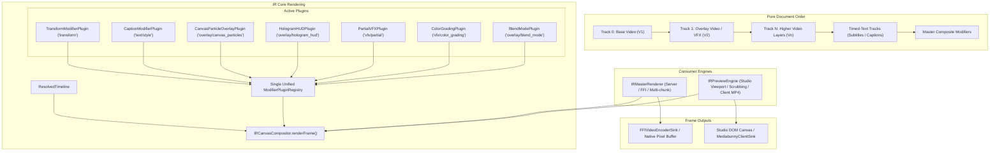

# Implementation Plan: Unify IRPreviewEngine & IRMasterRenderer for 100% Web/Server Visual Parity

**Document ID:** `apps/studio/doc/implementation_plan_22.md`  
**Master Plan:** [`docs/master_integration_plan_iteration10.md`](file:///c:/Users/Admin/workspace/git/acc/docs/master_integration_plan_iteration10.md)  
**Status:** `[ ] Planned`  
**Scope:** `packages/ir`, `packages/effect-engines`, `apps/studio`, `autogenerated-tests`

---

## Goal Description
Unify and consolidate **`IRPreviewEngine`** (client/web interactive renderer) and **`IRMasterRenderer`** (server/headless rasterizer) by extracting a canonical **`IRCanvasCompositor`**, formalizing **`TransformModifierPlugin`** and **`CaptionModifierPlugin`**, and ensuring identical byte-for-byte visual output across web browser preview, client MP4 export, and server FFI video encoding.

---

## Decisions Aligned via Interview (/grill-me)

1. **Asset Retrieval Strategy:** Option 1/A — Direct Synchronous Composite Core with pre-fetched textures and decoders, preserving pure 60fps synchronous scrubbing on the web.
2. **Default Viewport Clear Color:** Option 1/A — Standardized `#000000` (Pure Black) in both environments.
3. **Default Asset Fit Mode:** Option 1/A — `cover` as universal default when omitted (explicit `contain` supported).
4. **Motion Transform Hierarchy:** Option 1/A — Formal `TransformModifierPlugin` (`transform`) that executes in clip-space (`renderClipSpace`) with `translate -> rotate -> scale -> draw from center origin [-w/2, -h/2]`. Sequence transforms are isolated via `ctx.save()` and `ctx.restore()` so a sequence never alters the global canvas matrix.
5. **Timed-Text Captions & Safe Zones:** Option 1/A — Formal `CaptionModifierPlugin` (`text/style`) evaluating `BoundedAcousticCaptionStrategy` and `drawCanvasCaptionsFromSnapshot` with `SafeZoneManager` platform support.
6. **Track Stacking & Overlay Order (Hybrid Pragmatic Approach):**
   - **Order Rule:** Pure document order (`doc.tracks` array index). Track 0 is bottom base layer; subsequent visual tracks overlay on top.
   - **Painter's Algorithm by Default:** Renders bottom-to-top unconditionally to guarantee 100% mathematical correctness for opacity keyframes, blend modes (`screen`, `multiply`, `overlay`), rotations, transparent WebM/PNG overlays, and 3D cutouts.
   - **Explicit Culling via Mute/Disabled Flags:** If a track or sequence is explicitly muted/disabled (`track.muted === true` or `track.style?.visible === false` or `sequence.enabled === false`), `IRCanvasCompositor` completely skips it to save rasterization cycles.
   - **Type Hierarchy:** All `video` tracks render first $\rightarrow$ all `timed_text` tracks render on top $\rightarrow$ master composite plugins apply across the entire frame.
   - **Blend Mode Scoping:** Sequence `blendMode` applies to the canvas blit and restores to `source-over` in `finally`, leaving subsequent tracks cleanly compositable.
7. **Unified Plugin Registry:** Option 1/A — Single isomorphic registry `registerCoreModifierPlugins()`, eliminating `clientRegistry.ts`. Tag legacy Node/native filesystem imports in `Camera3DPlugin` and `Depth3DPlugin` with `// TODO(isomorphic-migration)`.

---

## Architecture & Data Flow



---

## Proposed Changes

### Component 1: Plugins (`packages/ir/src/plugins/`)
- [NEW] `packages/ir/src/plugins/transform/TransformModifierPlugin.ts`
- [NEW] `packages/ir/src/plugins/text/CaptionModifierPlugin.ts`
- [MODIFY] `packages/ir/src/plugins/vfx/Camera3DPlugin.ts` & `Depth3DPlugin.ts`
- [MODIFY] `packages/ir/src/plugins/index.ts`
- [DELETE] `packages/ir/src/plugins/clientRegistry.ts`

### Component 2: Shared Compositor (`packages/ir/src/renderer/shared/`)
- [NEW] `packages/ir/src/renderer/shared/IRCanvasCompositor.ts`

### Component 3: Engine Integrations (`packages/ir/src/renderer/`)
- [MODIFY] `packages/ir/src/renderer/IRMasterRenderer.ts`
- [MODIFY] `packages/ir/src/renderer/preview/IRPreviewEngine.ts`

### Component 4: Autogenerated Parity Tests (`autogenerated-tests/`)
- [NEW] `autogenerated-tests/ir_renderer_web_server_parity.test.ts`

---

## Phased Implementation Roadmap

### Phase 1: Formalize Transform & Caption Modifier Plugins `[x] Completed`
- Implement `TransformModifierPlugin.ts` (`type = 'transform'`).
- Implement `CaptionModifierPlugin.ts` (`type = 'text/style'`).
- Register both in `packages/ir/src/plugins/index.ts`.
- Guard `Camera3DPlugin.ts` and `Depth3DPlugin.ts` with `// TODO(isomorphic-migration)` and defensive runtime checks.
- Consolidate client registry and exports in `packages/ir/src/plugins/clientRegistry.ts` and `packages/ir/src/client.ts`.

### Phase 2: Create Canonical `IRCanvasCompositor` with Document-Order Multi-Track Priority `[x] Completed`
- Implement `packages/ir/src/renderer/shared/IRCanvasCompositor.ts`.
- Multi-track layer compositing with pure document ordering, aspect-ratio fit modes (`cover`/`contain`), scoped blend modes, clip-space plugins, stream-space plugins, timed-text subtitles strictly above video, and master compositing.

### Phase 3: Unify `IRMasterRenderer` & `IRPreviewEngine` `[ ] Planned`
- Delegate canvas rendering in `IRMasterRenderer.ts` to `IRCanvasCompositor.renderFrame()`.
- Delegate canvas rendering in `IRPreviewEngine.ts` to `IRCanvasCompositor.renderFrame()`.
- Standardize `#000000` clear color across both engines.

### Phase 4: Automated Parity Testing & Hardening `[ ] Planned`
- Create `autogenerated-tests/ir_renderer_web_server_parity.test.ts`.
- Run full regression suites (`video_ir_phase4_engine`, `studio_phase7_master_e2e_hardening`, `studio_client_export_phase3`).
- Run production build (`bun run studio:build`).

---

## Verification Plan

### Automated Tests
Run target parity and studio test suites:
```powershell
bun test autogenerated-tests/ir_renderer_web_server_parity.test.ts
bun test autogenerated-tests/video_ir_phase4_engine.test.ts
bun test autogenerated-tests/studio_phase7_master_e2e_hardening.test.ts
bun test autogenerated-tests/studio_client_export_phase3.test.ts
```

### Production Build
Ensure client and studio packages compile cleanly:
```powershell
bun run studio:build
```
